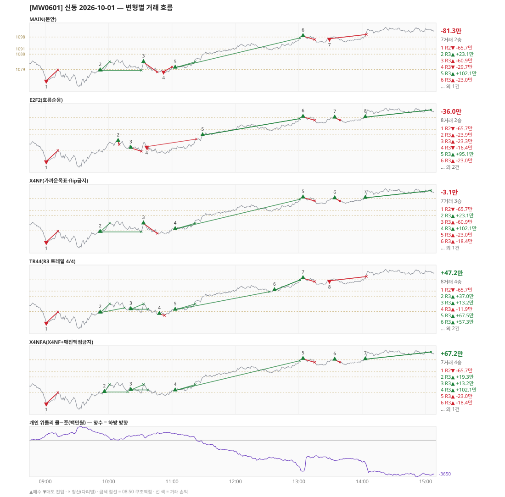

# [MW0601] 신동 일일 리포트 — 2026-10-01

> **MW0601 리포트** · 생성 2026-10-01 15:40 · 규격 `SD-2026-09-29-v2` · 상품 `wk_thu` (최근접 만기 목위클리 (만기 2026-10-01))
> 가상거래다 — 주문 없음(절대원칙 §6). 손익은 미니선물 2계약 · CYBOS 요율 · 1틱 슬리피지 기준.

## 0. 한눈에

| 시장 | R1 장전 | R2 개장확정 | R1 적중(09:00→15:05) |
|---|---|---|---|
| 1074.88 → 1102.58 (+27.70) · 고 1104.12 · 저 1068.16 · 폭 36.0pt | 콜−풋 +343 → **하방** | CONFIRMED 09:01 | ❌ 불적중 |

| 변형 | 거래 | 승 | R2 | R3 | **순손익** | 최악 거래 | MAIN 대비 | 기록 |
|---|---|---|---|---|---|---|---|---|
| MAIN(본안) | 7 | 2 | -65.7만 | -15.6만 | **-81.3만** | -65.7만 | — | 라이브 |
| E2F2(흐름순응) | 8 | 2 | -65.7만 | +29.7만 | **-36.0만** | -65.7만 | +45.3만 | 라이브 |
| X4NF(가까운목표·flip금지) | 7 | 3 | -65.7만 | +62.6만 | **-3.1만** | -65.7만 | +78.2만 | 라이브 |
| TR44(R3 트레일 4/4) | 8 | 4 | -65.7만 | +112.9만 | **+47.2만** | -65.7만 | +128.5만 | 라이브 |
| X4NFA(X4NF+깨진맥점금지) | 7 | 4 | -65.7만 | +132.9만 | **+67.2만** | -65.7만 | +148.5만 | 라이브 |

**오늘의 한 줄** — MAIN -81.3만(7거래 2승), 최선은 X4NFA(X4NF+깨진맥점금지) +67.2만(MAIN 대비 +148.5만).

## 1. 차트

## 2. 거래 흐름 — MAIN

| # | 규칙 | 방향 | 진입 | 맥점 | 손절 | 1차 · 최종 | 청산(다리별) | MFE | 손익 | 누적 |
|---|---|---|---|---|---|---|---|---|---|---|
| 1 | R2 | 매도 | 09:01 1072.46 (탐지 09:02) | - | 1078.78 | 1063.70 · 1063.70 | 손절 09:12 1078.78 · 손절 09:12 1078.78 | 1.0 | **-65.7만** | -65.7만 |
| 2 | R3 | 매수 | 09:52 1078.40 (탐지 09:53) | 1079.0 | 1077.00 | 1083.50 · 1097.50 | 1차 10:01 1083.50 · 본전 10:31 1078.40 | 6.8 | **+23.1만** | -42.6만 |
| 3 | R3 | 매수 | 10:33 1083.34 (탐지 10:34) | 1079.0 | 1077.50 | 1085.24 · 1097.50 | 손절 10:46 1077.50 · 손절 10:46 1077.50 | 1.0 | **-60.9만** | -103.5만 |
| 4 | R3 | 매도 | 10:52 1077.78 (탐지 10:53) | 1079.0 | 1080.50 | 1063.70 · 1059.51 | 손절 11:00 1080.50 · 손절 11:00 1080.50 | 1.1 | **-29.7만** | -133.3만 |
| 5 | R3 | 매수 | 11:03 1080.06 (탐지 11:04) | 1079.0 | 1077.50 | 1083.50 · 1097.50 | 1차 11:22 1083.50 · 최종 13:01 1097.50 | 17.9 | **+102.1만** | -31.2만 |
| 6 | R3 | 매수 | 13:04 1098.54 (탐지 13:05) | 1098.0 | 1096.50 | - · - | 손절 13:15 1096.50 · 손절 13:15 1096.50 | 0.8 | **-23.0만** | -54.1만 |
| 7 | R3 | 매도 | 13:29 1097.04 (탐지 13:30) | 1098.0 | 1099.50 | 1079.50 · 1059.51 | 손절 14:04 1099.50 · 손절 14:04 1099.50 | 2.0 | **-27.2만** | -81.3만 |

## 3. 섀도 흐름 — MAIN 과 무엇이 달랐나

### E2F2(흐름순응) — -36.0만 (MAIN 대비 +45.3만)

- 09:52 R3 매수: MAIN 진입 1078.40 → **F2 차단(당일 흐름 역방향)** (MAIN 손익 +23.1만 제외)
- 10:33 R3 매수: MAIN 진입 1083.34 → **F2 차단(당일 흐름 역방향)** (MAIN 손익 -60.9만 제외)
- 10:52 R3 매도: MAIN 진입 1077.78 → **앞 거래 보유 중/시점 이동** (MAIN 손익 -29.7만 제외)
- 11:03 R3 매수: MAIN 진입 1080.06 → **F2 차단(당일 흐름 역방향)** (MAIN 손익 +102.1만 제외)
- 13:29 R3 매도: MAIN 진입 1097.04 → **F2 차단(당일 흐름 역방향)** (MAIN 손익 -27.2만 제외)
- 10:09 R3 매수: **섀도만 진입** 1084.40 (앞 거래가 없어 신호가 살아남) → -23.9만
- 10:21 R3 매수: **섀도만 진입** 1080.38 (앞 거래가 없어 신호가 살아남) → -23.3만
- 10:36 R3 매도: **섀도만 진입** 1081.10 (앞 거래가 없어 신호가 살아남) → -16.4만
- 11:29 R3 매수: **섀도만 진입** 1087.76 (앞 거래가 없어 신호가 살아남) → +95.1만
- 13:34 R3 매수: **섀도만 진입** 1098.08 (앞 거래가 없어 신호가 살아남) → -18.4만
- 14:03 R3 매수: **섀도만 진입** 1098.36 (앞 거래가 없어 신호가 살아남) → +39.6만

| # | 규칙 | 방향 | 진입 | 맥점 | 손절 | 1차 · 최종 | 청산(다리별) | MFE | 손익 | 누적 |
|---|---|---|---|---|---|---|---|---|---|---|
| 1 | R2 | 매도 | 09:01 1072.46 (탐지 09:02) | - | 1078.78 | 1063.70 · 1063.70 | 손절 09:12 1078.78 · 손절 09:12 1078.78 | 1.0 | **-65.7만** | -65.7만 |
| 2 | R3 | 매수 | 10:09 1084.40 (탐지 10:10) | 1084.0 | 1082.26 | 1097.50 · 1097.50 | 손절 10:10 1082.26 · 손절 10:10 1082.26 | 0.1 | **-23.9만** | -89.6만 |
| 3 | R3 | 매수 | 10:21 1080.38 (탐지 10:22) | 1084.0 | 1078.30 | 1083.50 · 1097.50 | 손절 10:31 1078.30 · 손절 10:31 1078.30 | 1.3 | **-23.3만** | -113.0만 |
| 4 | R3 | 매도 | 10:36 1081.10 (탐지 10:37) | 1084.0 | 1085.50 | 1079.50 · 1059.51 | 1차 10:37 1079.50 · 손절 11:23 1085.50 | 4.4 | **-16.4만** | -129.4만 |
| 5 | R3 | 매수 | 11:29 1087.76 (탐지 11:30) | 1084.0 | 1082.50 | 1097.50 · 1097.50 | 1차 13:01 1097.50 · 최종 13:01 1097.50 | 10.2 | **+95.1만** | -34.3만 |
| 6 | R3 | 매수 | 13:04 1098.54 (탐지 13:05) | 1098.0 | 1096.50 | - · - | 손절 13:15 1096.50 · 손절 13:15 1096.50 | 0.8 | **-23.0만** | -57.3만 |
| 7 | R3 | 매수 | 13:34 1098.08 (탐지 13:35) | 1098.0 | 1096.50 | 1099.62 · 1099.62 | 손절 13:39 1096.50 · 손절 13:39 1096.50 | 0.0 | **-18.4만** | -75.6만 |
| 8 | R3 | 매수 | 14:03 1098.36 (탐지 14:04) | 1098.0 | 1096.50 | - · - | 시간 15:05 1102.58 · 시간 15:05 1102.58 | 5.8 | **+39.6만** | -36.0만 |

### X4NF(가까운목표·flip금지) — -3.1만 (MAIN 대비 +78.2만)

- 10:52 R3 매도: MAIN 진입 1077.78 → **flip 금지(같은 맥점 1079.0 반대 방향)** (MAIN 손익 -29.7만 제외)
- 13:29 R3 매도: MAIN 진입 1097.04 → **flip 금지(같은 맥점 1098.0 반대 방향)** (MAIN 손익 -27.2만 제외)
- 13:34 R3 매수: **섀도만 진입** 1098.08 (앞 거래가 없어 신호가 살아남) → -18.4만
- 14:03 R3 매수: **섀도만 진입** 1098.36 (앞 거래가 없어 신호가 살아남) → +39.6만

| # | 규칙 | 방향 | 진입 | 맥점 | 손절 | 1차 · 최종 | 청산(다리별) | MFE | 손익 | 누적 |
|---|---|---|---|---|---|---|---|---|---|---|
| 1 | R2 | 매도 | 09:01 1072.46 (탐지 09:02) | - | 1078.78 | 1063.70 · 1063.70 | 손절 09:12 1078.78 · 손절 09:12 1078.78 | 1.0 | **-65.7만** | -65.7만 |
| 2 | R3 | 매수 | 09:52 1078.40 (탐지 09:53) | 1079.0 | 1077.00 | 1083.50 · 1097.50 | 1차 10:01 1083.50 · 본전 10:31 1078.40 | 6.8 | **+23.1만** | -42.6만 |
| 3 | R3 | 매수 | 10:33 1083.34 (탐지 10:34) | 1079.0 | 1077.50 | 1085.24 · 1097.50 | 손절 10:46 1077.50 · 손절 10:46 1077.50 | 1.0 | **-60.9만** | -103.5만 |
| 4 | R3 | 매수 | 11:03 1080.06 (탐지 11:04) | 1079.0 | 1077.50 | 1083.50 · 1097.50 | 1차 11:22 1083.50 · 최종 13:01 1097.50 | 17.9 | **+102.1만** | -1.5만 |
| 5 | R3 | 매수 | 13:04 1098.54 (탐지 13:05) | 1098.0 | 1096.50 | - · - | 손절 13:15 1096.50 · 손절 13:15 1096.50 | 0.8 | **-23.0만** | -24.4만 |
| 6 | R3 | 매수 | 13:34 1098.08 (탐지 13:35) | 1098.0 | 1096.50 | 1099.62 · 1099.62 | 손절 13:39 1096.50 · 손절 13:39 1096.50 | 0.0 | **-18.4만** | -42.8만 |
| 7 | R3 | 매수 | 14:03 1098.36 (탐지 14:04) | 1098.0 | 1096.50 | - · - | 시간 15:05 1102.58 · 시간 15:05 1102.58 | 5.8 | **+39.6만** | -3.1만 |

### TR44(R3 트레일 4/4) — +47.2만 (MAIN 대비 +128.5만)

- 09:52 R3 매수: 청산 차이 — MAIN 1차/본전 → 1차/트레일 (+23.1만 → +37.0만, 차 +13.9만)
- 10:33 R3 매수: MAIN 진입 1083.34 → **앞 거래 보유 중/시점 이동** (MAIN 손익 -60.9만 제외)
- 10:52 R3 매도: MAIN 진입 1077.78 → **앞 거래 보유 중/시점 이동** (MAIN 손익 -29.7만 제외)
- 11:03 R3 매수: 청산 차이 — MAIN 1차/최종 → 1차/트레일 (+102.1만 → +67.5만, 차 -34.6만)
- 10:21 R3 매수: **섀도만 진입** 1080.38 (앞 거래가 없어 신호가 살아남) → +13.2만
- 10:48 R3 매수: **섀도만 진입** 1077.64 (앞 거래가 없어 신호가 살아남) → -11.9만
- 12:37 R3 매수: **섀도만 진입** 1091.54 (앞 거래가 없어 신호가 살아남) → +57.3만

| # | 규칙 | 방향 | 진입 | 맥점 | 손절 | 1차 · 최종 | 청산(다리별) | MFE | 손익 | 누적 |
|---|---|---|---|---|---|---|---|---|---|---|
| 1 | R2 | 매도 | 09:01 1072.46 (탐지 09:02) | - | 1078.78 | 1063.70 · 1063.70 | 손절 09:12 1078.78 · 손절 09:12 1078.78 | 1.0 | **-65.7만** | -65.7만 |
| 2 | R3 | 매수 | 09:52 1078.40 (탐지 09:53) | 1079.0 | 1077.00 | 1083.50 · 1097.50 | 1차 10:01 1083.50 · 트레일 10:15 1081.18 | 6.8 | **+37.0만** | -28.7만 |
| 3 | R3 | 매수 | 10:21 1080.38 (탐지 10:22) | 1079.0 | 1077.50 | 1083.50 · 1097.50 | 1차 10:33 1083.50 · 본전 10:37 1080.38 | 3.9 | **+13.2만** | -15.6만 |
| 4 | R3 | 매수 | 10:48 1077.64 (탐지 10:49) | 1079.0 | 1076.70 | 1083.50 · 1097.50 | 손절 10:53 1076.70 · 손절 10:53 1076.70 | 1.5 | **-11.9만** | -27.5만 |
| 5 | R3 | 매수 | 11:03 1080.06 (탐지 11:04) | 1079.0 | 1077.50 | 1083.50 · 1097.50 | 1차 11:22 1083.50 · 트레일 12:32 1090.60 | 14.5 | **+67.5만** | +40.0만 |
| 6 | R3 | 매수 | 12:37 1091.54 (탐지 12:38) | 1091.0 | 1089.50 | 1097.50 · 1097.50 | 1차 13:01 1097.50 · 최종 13:01 1097.50 | 6.4 | **+57.3만** | +97.3만 |
| 7 | R3 | 매수 | 13:04 1098.54 (탐지 13:05) | 1098.0 | 1096.50 | - · - | 손절 13:15 1096.50 · 손절 13:15 1096.50 | 0.8 | **-23.0만** | +74.3만 |
| 8 | R3 | 매도 | 13:29 1097.04 (탐지 13:30) | 1098.0 | 1099.50 | 1079.50 · 1059.51 | 손절 14:04 1099.50 · 손절 14:04 1099.50 | 2.0 | **-27.2만** | +47.2만 |

### X4NFA(X4NF+깨진맥점금지) — +67.2만 (MAIN 대비 +148.5만)

- 09:52 R3 매수: MAIN 진입 1078.40 → **깨진 맥점 차단(진입 1078.40 · 맥점 1079.0)** (MAIN 손익 +23.1만 제외)
- 10:33 R3 매수: MAIN 진입 1083.34 → **앞 거래 보유 중/시점 이동** (MAIN 손익 -60.9만 제외)
- 10:52 R3 매도: MAIN 진입 1077.78 → **flip 금지(같은 맥점 1079.0 반대 방향)** (MAIN 손익 -29.7만 제외)
- 13:29 R3 매도: MAIN 진입 1097.04 → **flip 금지(같은 맥점 1098.0 반대 방향)** (MAIN 손익 -27.2만 제외)
- 09:56 R3 매수: **섀도만 진입** 1079.16 (앞 거래가 없어 신호가 살아남) → +19.3만
- 10:21 R3 매수: **섀도만 진입** 1080.38 (앞 거래가 없어 신호가 살아남) → +13.2만
- 13:34 R3 매수: **섀도만 진입** 1098.08 (앞 거래가 없어 신호가 살아남) → -18.4만
- 14:03 R3 매수: **섀도만 진입** 1098.36 (앞 거래가 없어 신호가 살아남) → +39.6만

| # | 규칙 | 방향 | 진입 | 맥점 | 손절 | 1차 · 최종 | 청산(다리별) | MFE | 손익 | 누적 |
|---|---|---|---|---|---|---|---|---|---|---|
| 1 | R2 | 매도 | 09:01 1072.46 (탐지 09:02) | - | 1078.78 | 1063.70 · 1063.70 | 손절 09:12 1078.78 · 손절 09:12 1078.78 | 1.0 | **-65.7만** | -65.7만 |
| 2 | R3 | 매수 | 09:56 1079.16 (탐지 09:57) | 1079.0 | 1077.18 | 1083.50 · 1097.50 | 1차 10:01 1083.50 · 본전 10:18 1079.16 | 6.0 | **+19.3만** | -46.4만 |
| 3 | R3 | 매수 | 10:21 1080.38 (탐지 10:22) | 1079.0 | 1077.50 | 1083.50 · 1097.50 | 1차 10:33 1083.50 · 본전 10:37 1080.38 | 3.9 | **+13.2만** | -33.3만 |
| 4 | R3 | 매수 | 11:03 1080.06 (탐지 11:04) | 1079.0 | 1077.50 | 1083.50 · 1097.50 | 1차 11:22 1083.50 · 최종 13:01 1097.50 | 17.9 | **+102.1만** | +68.8만 |
| 5 | R3 | 매수 | 13:04 1098.54 (탐지 13:05) | 1098.0 | 1096.50 | - · - | 손절 13:15 1096.50 · 손절 13:15 1096.50 | 0.8 | **-23.0만** | +45.9만 |
| 6 | R3 | 매수 | 13:34 1098.08 (탐지 13:35) | 1098.0 | 1096.50 | 1099.62 · 1099.62 | 손절 13:39 1096.50 · 손절 13:39 1096.50 | 0.0 | **-18.4만** | +27.5만 |
| 7 | R3 | 매수 | 14:03 1098.36 (탐지 14:04) | 1098.0 | 1096.50 | - · - | 시간 15:05 1102.58 · 시간 15:05 1102.58 | 5.8 | **+39.6만** | +67.2만 |

## 4. 누적 채점 (라이브 기록 · 판정 창)

| 변형 | 채점 시작 | 거래일 | 거래 | 승률 | 순손익 | 최악일 | R3 (건 · 승률 · 순) | 판정 |
|---|---|---|---|---|---|---|---|---|
| MAIN(본안) | 2026-09-30 | 2 | 13 | 31% | **-141.4만** | -81.3만 | 11 · 36% · -6.1만 | R3 중단 판정 2/10일 |
| E2F2(흐름순응) | 2026-09-30 | 2 | 12 | 33% | **-2.4만** | -36.0만 | 10 · 40% · +132.9만 | MAIN 비교 2/10일 |
| X4NF(가까운목표·flip금지) | 2026-09-30 | 2 | 13 | 38% | **-63.2만** | -60.1만 | 11 · 45% · +72.1만 | MAIN 비교 2/10일 |
| TR44(R3 트레일 4/4) | 2026-09-30 | 2 | 14 | 50% | **+28.6만** | -18.6만 | 12 · 58% · +163.9만 | MAIN 비교 2/10일 |
| X4NFA(X4NF+깨진맥점금지) | 2026-09-30 | 2 | 11 | 55% | **+25.8만** | -41.4만 | 9 · 67% · +161.0만 | MAIN 비교 2/10일 |

> 판정 전 집계다 — 인용·규격 변경 근거로 쓰지 말 것. R3 중단 기준: 순손익 < 0 **그리고** 승률 < 35%.

## 5. 러너 섀도 — 미륵이 × 신동 (CREON 요율)

| 미륵이 진입 | 방향 | 조건 | 러너 | 실제 | 러너 적용 | 차이 | 필터 B |
|---|---|---|---|---|---|---|---|
| 10:49 1077.62 ×2 | 매도 | 충족 | BE 10:50 | +0.8만 | +1.0만 | **+0.2만** | 제외 |
| 11:12 1081.02 ×2 | 매수 | 불충족 | 신동 방향 반대 | -2.9만 | -2.9만 | **+0.0만** | 통과 |
| 11:25 1085.24 ×2 | 매수 | 불충족 | 신동 방향 반대 | +1.7만 | +1.7만 | **+0.0만** | 통과 |
| 13:04 1098.32 ×1 | 매수 | 불충족 | 신동 방향 반대 | +2.0만 | +2.0만 | **+0.0만** | 제외 |

- 합: 실제 +1.6만 → 러너 +1.8만 (차 +0.2만)

## 6. 개선 방향 (자동 관찰 — 판정 아님)

- **진입 품질** — MAIN 손실 5건 중 5건은 유리한 쪽으로 4pt 도 못 갔다(MFE 1.0, 1.0, 1.1, 0.8, 2.0). 청산을 바꿔서는 못 막는 손실이다 → 진입 필터(E2F2·X4NF·X4NFA) 쪽 관찰 대상.
- **맥점 반복** — 1079.0 에서 R3 4회(매수→매수→매도→매수) · 합 +34.5만. 박스권에서 같은 맥점을 양쪽으로 번갈아 잡았다.
- **맥점 반복** — 1098.0 에서 R3 2회(매수→매도) · 합 -50.1만. 박스권에서 같은 맥점을 양쪽으로 번갈아 잡았다.
- **깨진 맥점 진입 1건** — 흐름 반전을 기다리는 사이 가격이 맥점을 다시 넘어간 뒤 들어갔다(09:52 매수 1078.40/맥점 1079.0 +23.1만) · 합 +23.1만 → X4NFA 가 막는 진입이다.
- **목표 없는 진입 1건** — 가격이 08:50 맥점 범위 밖이라 손절·15:05 로만 끝날 수 있었다(13:04 -23.0만).
- **탐지 지연** — 라이브 진입 7건, 규칙가 대비 실현가능가 차 +0(음수 = 늦게 알아채 손해).
- **오늘 최선은 X4NFA(X4NF+깨진맥점금지)** (+67.2만, MAIN 대비 +148.5만). 하루 결과다 — 판정은 사전등록 창(10거래일)으로만.
- ⚠ 규격 변경은 사전등록 §6(새 버전 · 재채점)으로만. 이 절은 관찰이다.

---
재생성: `python scripts/shindong_daily_report.py 2026-10-01`
