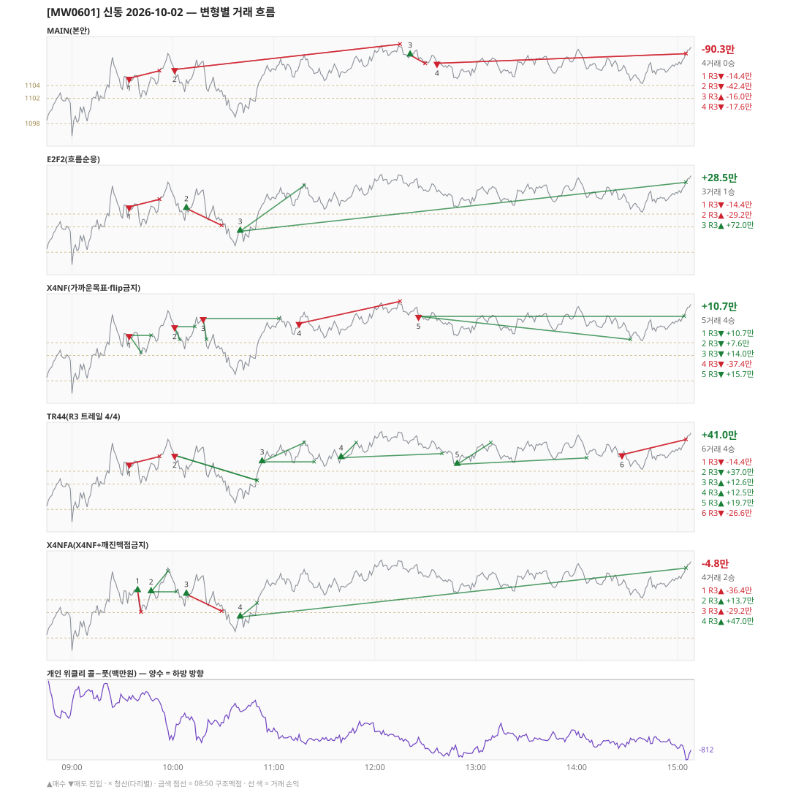

# [MW0601] 신동 일일 리포트 — 2026-10-02

> **MW0601 리포트** · 생성 2026-10-02 15:40 · 규격 `SD-2026-09-29-v2` · 상품 `wk_mon` (최근접 만기 월위클리 (만기 2026-10-06))
> 가상거래다 — 주문 없음(절대원칙 §6). 손익은 미니선물 2계약 · CYBOS 요율 · 1틱 슬리피지 기준.

## 0. 한눈에

| 시장 | R1 장전 | R2 개장확정 | R1 적중(09:00→15:05) |
|---|---|---|---|
| 1096.02 → 1109.00 (+12.98) · 고 1110.78 · 저 1095.38 · 폭 15.4pt | 콜−풋 -410 → **상방** | NONE | ✅ 적중 |

| 변형 | 거래 | 승 | R2 | R3 | **순손익** | 최악 거래 | MAIN 대비 | 기록 |
|---|---|---|---|---|---|---|---|---|
| MAIN(본안) | 4 | 0 | +0.0만 | -90.3만 | **-90.3만** | -42.4만 | — | 라이브 |
| E2F2(흐름순응) | 3 | 1 | +0.0만 | +28.5만 | **+28.5만** | -29.2만 | +118.8만 | 라이브 |
| X4NF(가까운목표·flip금지) | 5 | 4 | +0.0만 | +10.7만 | **+10.7만** | -37.4만 | +101.0만 | 라이브 |
| TR44(R3 트레일 4/4) | 6 | 4 | +0.0만 | +41.0만 | **+41.0만** | -26.6만 | +131.3만 | 라이브 |
| X4NFA(X4NF+깨진맥점금지) | 4 | 2 | +0.0만 | -4.8만 | **-4.8만** | -36.4만 | +85.5만 | 라이브 |

**오늘의 한 줄** — MAIN -90.3만(4거래 0승), 최선은 TR44(R3 트레일 4/4) +41.0만(MAIN 대비 +131.3만).

## 1. 차트

## 2. 거래 흐름 — MAIN

| # | 규칙 | 방향 | 진입 | 맥점 | 손절 | 1차 · 최종 | 청산(다리별) | MFE | 손익 | 누적 |
|---|---|---|---|---|---|---|---|---|---|---|
| 1 | R3 | 매도 | 09:34 1105.14 (탐지 09:35) | 1104.0 | 1106.32 | 1095.50 · 1087.50 | 손절 09:52 1106.32 · 손절 09:52 1106.32 | 3.1 | **-14.4만** | -14.4만 |
| 2 | R3 | 매도 | 10:01 1106.52 (탐지 10:02) | 1109.0 | 1110.50 | 1095.50 · 1087.50 | 손절 12:15 1110.50 · 손절 12:15 1110.50 | 8.0 | **-42.4만** | -56.7만 |
| 3 | R3 | 매수 | 12:21 1108.80 (탐지 12:22) | 1109.0 | 1107.46 | 1113.57 · 1115.50 | 손절 12:30 1107.46 · 손절 12:30 1107.46 | 0.9 | **-16.0만** | -72.7만 |
| 4 | R3 | 매도 | 12:37 1107.50 (탐지 12:38) | 1109.0 | 1110.50 | 1095.50 · 1087.50 | 시간 15:05 1109.00 · 시간 15:05 1109.00 | 3.6 | **-17.6만** | -90.3만 |

## 3. 섀도 흐름 — MAIN 과 무엇이 달랐나

### E2F2(흐름순응) — +28.5만 (MAIN 대비 +118.8만)

- 10:01 R3 매도: MAIN 진입 1106.52 → **F2 차단(당일 흐름 역방향)** (MAIN 손익 -42.4만 제외)
- 12:21 R3 매수: MAIN 진입 1108.80 → **앞 거래 보유 중/시점 이동** (MAIN 손익 -16.0만 제외)
- 12:37 R3 매도: MAIN 진입 1107.50 → **F2 차단(당일 흐름 역방향)** (MAIN 손익 -17.6만 제외)
- 10:08 R3 매수: **섀도만 진입** 1104.88 (앞 거래가 없어 신호가 살아남) → -29.2만
- 10:40 R3 매수: **섀도만 진입** 1101.30 (앞 거래가 없어 신호가 살아남) → +72.0만

| # | 규칙 | 방향 | 진입 | 맥점 | 손절 | 1차 · 최종 | 청산(다리별) | MFE | 손익 | 누적 |
|---|---|---|---|---|---|---|---|---|---|---|
| 1 | R3 | 매도 | 09:34 1105.14 (탐지 09:35) | 1104.0 | 1106.32 | 1095.50 · 1087.50 | 손절 09:52 1106.32 · 손절 09:52 1106.32 | 3.1 | **-14.4만** | -14.4만 |
| 2 | R3 | 매수 | 10:08 1104.88 (탐지 10:09) | 1104.0 | 1102.22 | 1108.50 · 1115.50 | 손절 10:29 1102.22 · 손절 10:29 1102.22 | 3.4 | **-29.2만** | -43.5만 |
| 3 | R3 | 매수 | 10:40 1101.30 (탐지 10:41) | 1102.0 | 1098.06 | 1108.50 · 1115.50 | 1차 11:18 1108.50 · 시간 15:05 1109.00 | 9.5 | **+72.0만** | +28.5만 |

### X4NF(가까운목표·flip금지) — +10.7만 (MAIN 대비 +101.0만)

- 09:34 R3 매도: 청산 차이 — MAIN 손절/손절 → 1차/본전 (-14.4만 → +10.7만, 차 +25.1만)
- 10:01 R3 매도: 청산 차이 — MAIN 손절/손절 → 1차/본전 (-42.4만 → +7.6만, 차 +50.0만)
- 12:21 R3 매수: MAIN 진입 1108.80 → **flip 금지(같은 맥점 1109.0 반대 방향)** (MAIN 손익 -16.0만 제외)
- 12:37 R3 매도: MAIN 진입 1107.50 → **flip 금지(같은 맥점 1109.0 반대 방향)** (MAIN 손익 -17.6만 제외)
- 10:18 R3 매도: **섀도만 진입** 1107.80 (앞 거래가 없어 신호가 살아남) → +14.0만
- 11:15 R3 매도: **섀도만 진입** 1107.02 (앞 거래가 없어 신호가 살아남) → -37.4만
- 12:26 R3 매도: **섀도만 진입** 1108.14 (앞 거래가 없어 신호가 살아남) → +15.7만

| # | 규칙 | 방향 | 진입 | 맥점 | 손절 | 1차 · 최종 | 청산(다리별) | MFE | 손익 | 누적 |
|---|---|---|---|---|---|---|---|---|---|---|
| 1 | R3 | 매도 | 09:34 1105.14 (탐지 09:35) | 1104.0 | 1106.32 | 1102.50 · 1087.50 | 1차 09:41 1102.50 · 본전 09:47 1105.14 | 3.1 | **+10.7만** | +10.7만 |
| 2 | R3 | 매도 | 10:01 1106.52 (탐지 10:02) | 1109.0 | 1110.50 | 1104.50 · 1087.50 | 1차 10:04 1104.50 · 본전 10:13 1106.52 | 3.8 | **+7.6만** | +18.4만 |
| 3 | R3 | 매도 | 10:18 1107.80 (탐지 10:19) | 1109.0 | 1110.50 | 1104.50 · 1087.50 | 1차 10:20 1104.50 · 본전 11:03 1107.80 | 9.2 | **+14.0만** | +32.4만 |
| 4 | R3 | 매도 | 11:15 1107.02 (탐지 11:16) | 1109.0 | 1110.50 | 1104.50 · 1087.50 | 손절 12:15 1110.50 · 손절 12:15 1110.50 | 2.3 | **-37.4만** | -5.0만 |
| 5 | R3 | 매도 | 12:26 1108.14 (탐지 12:27) | 1109.0 | 1110.58 | 1104.50 · 1087.50 | 1차 14:32 1104.50 · 본전 15:04 1108.14 | 4.2 | **+15.7만** | +10.7만 |

### TR44(R3 트레일 4/4) — +41.0만 (MAIN 대비 +131.3만)

- 10:01 R3 매도: 청산 차이 — MAIN 손절/손절 → 트레일/트레일 (-42.4만 → +37.0만, 차 +79.4만)
- 12:21 R3 매수: MAIN 진입 1108.80 → **앞 거래 보유 중/시점 이동** (MAIN 손익 -16.0만 제외)
- 12:37 R3 매도: MAIN 진입 1107.50 → **앞 거래 보유 중/시점 이동** (MAIN 손익 -17.6만 제외)
- 10:53 R3 매수: **섀도만 진입** 1105.48 (앞 거래가 없어 신호가 살아남) → +12.6만
- 11:40 R3 매수: **섀도만 진입** 1106.14 (앞 거래가 없어 신호가 살아남) → +12.5만
- 12:49 R3 매수: **섀도만 진입** 1105.08 (앞 거래가 없어 신호가 살아남) → +19.7만
- 14:27 R3 매도: **섀도만 진입** 1106.60 (앞 거래가 없어 신호가 살아남) → -26.6만

| # | 규칙 | 방향 | 진입 | 맥점 | 손절 | 1차 · 최종 | 청산(다리별) | MFE | 손익 | 누적 |
|---|---|---|---|---|---|---|---|---|---|---|
| 1 | R3 | 매도 | 09:34 1105.14 (탐지 09:35) | 1104.0 | 1106.32 | 1095.50 · 1087.50 | 손절 09:52 1106.32 · 손절 09:52 1106.32 | 3.1 | **-14.4만** | -14.4만 |
| 2 | R3 | 매도 | 10:01 1106.52 (탐지 10:02) | 1109.0 | 1110.50 | 1095.50 · 1087.50 | 트레일 10:50 1102.56 · 트레일 10:50 1102.56 | 8.0 | **+37.0만** | +22.7만 |
| 3 | R3 | 매수 | 10:53 1105.48 (탐지 10:54) | 1104.0 | 1102.50 | 1108.50 · 1115.50 | 1차 11:18 1108.50 · 본전 11:24 1105.48 | 3.7 | **+12.6만** | +35.3만 |
| 4 | R3 | 매수 | 11:40 1106.14 (탐지 11:41) | 1104.0 | 1102.50 | 1108.50 · 1115.50 | 1차 11:49 1108.50 · 트레일 12:40 1106.78 | 4.6 | **+12.5만** | +47.8만 |
| 5 | R3 | 매수 | 12:49 1105.08 (탐지 12:50) | 1104.0 | 1102.50 | 1108.50 · 1115.50 | 1차 13:09 1108.50 · 트레일 14:06 1106.10 | 5.0 | **+19.7만** | +67.6만 |
| 6 | R3 | 매도 | 14:27 1106.60 (탐지 14:28) | 1109.0 | 1110.50 | 1095.50 · 1087.50 | 시간 15:05 1109.00 · 시간 15:05 1109.00 | 2.7 | **-26.6만** | +41.0만 |

### X4NFA(X4NF+깨진맥점금지) — -4.8만 (MAIN 대비 +85.5만)

- 09:34 R3 매도: MAIN 진입 1105.14 → **깨진 맥점 차단(진입 1105.14 · 맥점 1104.0)** (MAIN 손익 -14.4만 제외)
- 10:01 R3 매도: MAIN 진입 1106.52 → **앞 거래 보유 중/시점 이동** (MAIN 손익 -42.4만 제외)
- 12:21 R3 매수: MAIN 진입 1108.80 → **flip 금지(같은 맥점 1109.0 반대 방향)** (MAIN 손익 -16.0만 제외)
- 12:37 R3 매도: MAIN 진입 1107.50 → **flip 금지(같은 맥점 1109.0 반대 방향)** (MAIN 손익 -17.6만 제외)
- 09:39 R3 매수: **섀도만 진입** 1105.44 (앞 거래가 없어 신호가 살아남) → -36.4만
- 09:47 R3 매수: **섀도만 진입** 1105.26 (앞 거래가 없어 신호가 살아남) → +13.7만
- 10:08 R3 매수: **섀도만 진입** 1104.88 (앞 거래가 없어 신호가 살아남) → -29.2만
- 10:40 R3 매수: **섀도만 진입** 1101.30 (앞 거래가 없어 신호가 살아남) → +47.0만

| # | 규칙 | 방향 | 진입 | 맥점 | 손절 | 1차 · 최종 | 청산(다리별) | MFE | 손익 | 누적 |
|---|---|---|---|---|---|---|---|---|---|---|
| 1 | R3 | 매수 | 09:39 1105.44 (탐지 09:40) | 1104.0 | 1102.06 | 1108.50 · 1115.50 | 손절 09:41 1102.06 · 손절 09:41 1102.06 | 0.5 | **-36.4만** | -36.4만 |
| 2 | R3 | 매수 | 09:47 1105.26 (탐지 09:48) | 1102.0 | 1100.50 | 1108.50 · 1115.50 | 1차 09:57 1108.50 · 본전 10:02 1105.26 | 4.1 | **+13.7만** | -22.6만 |
| 3 | R3 | 매수 | 10:08 1104.88 (탐지 10:09) | 1104.0 | 1102.22 | 1108.50 · 1115.50 | 손절 10:29 1102.22 · 손절 10:29 1102.22 | 3.4 | **-29.2만** | -51.8만 |
| 4 | R3 | 매수 | 10:40 1101.30 (탐지 10:41) | 1098.0 | 1096.50 | 1103.50 · 1115.50 | 1차 10:50 1103.50 · 시간 15:05 1109.00 | 9.5 | **+47.0만** | -4.8만 |

## 4. 누적 채점 (라이브 기록 · 판정 창)

| 변형 | 채점 시작 | 거래일 | 거래 | 승률 | 순손익 | 최악일 | R3 (건 · 승률 · 순) | 판정 |
|---|---|---|---|---|---|---|---|---|
| MAIN(본안) | 2026-09-30 | 3 | 17 | 24% | **-231.7만** | -90.3만 | 15 · 27% · -96.4만 | R3 중단 판정 3/10일 |
| E2F2(흐름순응) | 2026-09-30 | 3 | 15 | 33% | **+26.1만** | -36.0만 | 13 · 38% · +161.4만 | MAIN 비교 3/10일 |
| X4NF(가까운목표·flip금지) | 2026-09-30 | 3 | 18 | 50% | **-52.5만** | -60.1만 | 16 · 56% · +82.8만 | MAIN 비교 3/10일 |
| TR44(R3 트레일 4/4) | 2026-09-30 | 3 | 20 | 55% | **+69.6만** | -18.6만 | 18 · 61% · +204.8만 | MAIN 비교 3/10일 |
| X4NFA(X4NF+깨진맥점금지) | 2026-09-30 | 3 | 15 | 53% | **+21.0만** | -41.4만 | 13 · 62% · +156.3만 | MAIN 비교 3/10일 |

> 판정 전 집계다 — 인용·규격 변경 근거로 쓰지 말 것. R3 중단 기준: 순손익 < 0 **그리고** 승률 < 35%.

## 5. 러너 섀도 — 미륵이 × 신동 (CREON 요율)

- 오늘 기록 없음 — 미륵이 시스템 진입이 없었거나 장후 기록 전이다

## 6. 개선 방향 (자동 관찰 — 판정 아님)

- **진입 품질** — MAIN 손실 4건 중 3건은 유리한 쪽으로 4pt 도 못 갔다(MFE 3.1, 0.9, 3.6). 청산을 바꿔서는 못 막는 손실이다 → 진입 필터(E2F2·X4NF·X4NFA) 쪽 관찰 대상.
- **청산** — MAIN 손실 1건은 4pt 이상 유리하게 갔다가 손절됐다(MFE 8.0) → 트레일(TR44) 쪽 관찰 대상.
- **맥점 반복** — 1109.0 에서 R3 3회(매도→매수→매도) · 합 -75.9만. 박스권에서 같은 맥점을 양쪽으로 번갈아 잡았다.
- **깨진 맥점 진입 2건** — 흐름 반전을 기다리는 사이 가격이 맥점을 다시 넘어간 뒤 들어갔다(09:34 매도 1105.14/맥점 1104.0 -14.4만, 12:21 매수 1108.80/맥점 1109.0 -16.0만) · 합 -30.3만 → X4NFA 가 막는 진입이다.
- **탐지 지연** — 라이브 진입 4건, 규칙가 대비 실현가능가 차 +0(음수 = 늦게 알아채 손해).
- **오늘 최선은 TR44(R3 트레일 4/4)** (+41.0만, MAIN 대비 +131.3만). 하루 결과다 — 판정은 사전등록 창(10거래일)으로만.
- ⚠ 규격 변경은 사전등록 §6(새 버전 · 재채점)으로만. 이 절은 관찰이다.

---
재생성: `python scripts/shindong_daily_report.py 2026-10-02`
