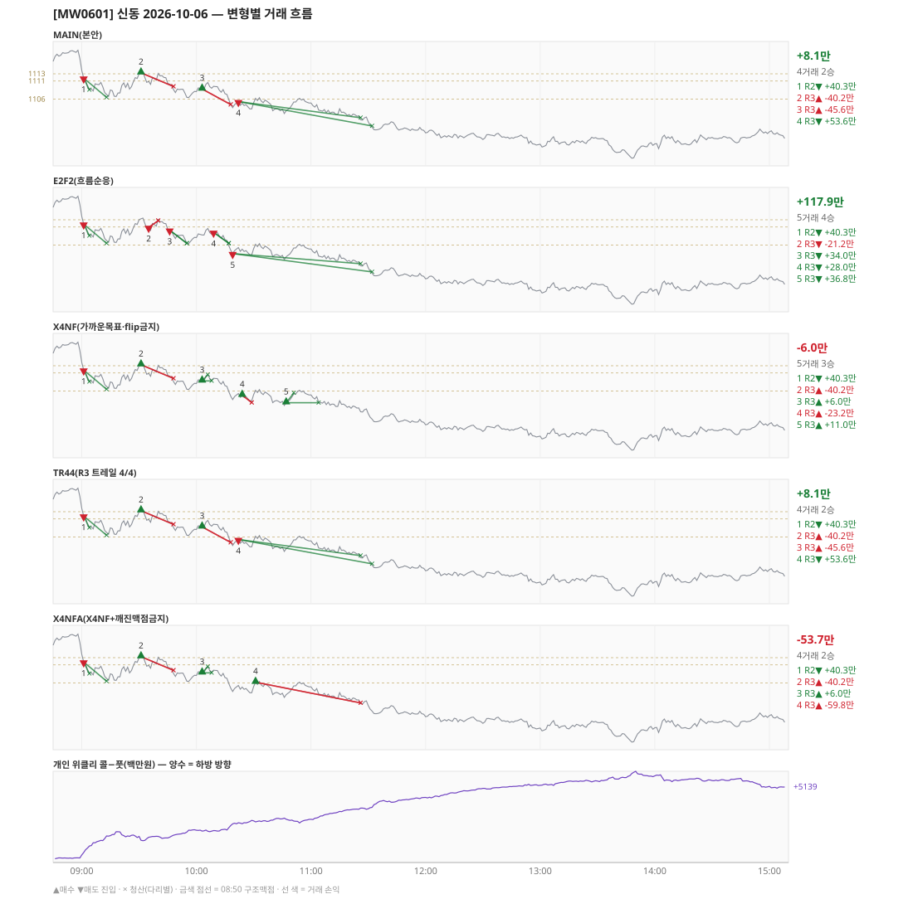

# [MW0601] 신동 일일 리포트 — 2026-10-06

> **MW0601 리포트** · 생성 2026-10-06 15:40 · 규격 `SD-2026-09-29-v2` · 상품 `wk_mon` (최근접 만기 월위클리 (만기 2026-10-06))
> 가상거래다 — 주문 없음(절대원칙 §6). 손익은 미니선물 2계약 · CYBOS 요율 · 1틱 슬리피지 기준.

## 0. 한눈에

| 시장 | R1 장전 | R2 개장확정 | R1 적중(09:00→15:05) |
|---|---|---|---|
| 1113.94 → 1096.28 (-17.66) · 고 1117.44 · 저 1089.44 · 폭 28.0pt | 콜−풋 +312 → **하방** | CONFIRMED 09:01 | ✅ 적중 |

| 변형 | 거래 | 승 | R2 | R3 | **순손익** | 최악 거래 | MAIN 대비 | 기록 |
|---|---|---|---|---|---|---|---|---|
| MAIN(본안) | 4 | 2 | +40.3만 | -32.1만 | **+8.1만** | -45.6만 | — | 라이브 |
| E2F2(흐름순응) | 5 | 4 | +40.3만 | +77.7만 | **+117.9만** | -21.2만 | +109.8만 | 라이브 |
| X4NF(가까운목표·flip금지) | 5 | 3 | +40.3만 | -46.3만 | **-6.0만** | -40.2만 | -14.1만 | 라이브 |
| TR44(R3 트레일 4/4) | 4 | 2 | +40.3만 | -32.1만 | **+8.1만** | -45.6만 | +0.0만 | 라이브 |
| X4NFA(X4NF+깨진맥점금지) | 4 | 2 | +40.3만 | -93.9만 | **-53.7만** | -59.8만 | -61.8만 | 라이브 |

**오늘의 한 줄** — MAIN +8.1만(4거래 2승), 최선은 E2F2(흐름순응) +117.9만(MAIN 대비 +109.8만).

## 1. 차트

## 2. 거래 흐름 — MAIN

| # | 규칙 | 방향 | 진입 | 맥점 | 손절 | 1차 · 최종 | 청산(다리별) | MFE | 손익 | 누적 |
|---|---|---|---|---|---|---|---|---|---|---|
| 1 | R2 | 매도 | 09:01 1111.80 (탐지 09:02) | - | 1118.44 | 1108.57 · 1106.50 | 1차 09:04 1108.57 · 최종 09:13 1106.50 | 5.4 | **+40.3만** | +40.3만 |
| 2 | R3 | 매수 | 09:31 1113.26 (탐지 09:32) | 1111.0 | 1109.50 | 1119.50 · 1126.50 | 손절 09:48 1109.50 · 손절 09:48 1109.50 | 0.7 | **-40.2만** | +0.1만 |
| 3 | R3 | 매수 | 10:03 1108.80 (탐지 10:04) | 1106.0 | 1104.50 | 1119.50 · 1126.50 | 손절 10:18 1104.50 · 손절 10:18 1104.50 | 2.2 | **-45.6만** | -45.5만 |
| 4 | R3 | 매도 | 10:22 1105.34 (탐지 10:23) | 1106.0 | 1107.50 | 1100.88 · 1098.61 | 1차 11:26 1100.88 · 최종 11:32 1098.61 | 7.2 | **+53.6만** | +8.1만 |

## 3. 섀도 흐름 — MAIN 과 무엇이 달랐나

### E2F2(흐름순응) — +117.9만 (MAIN 대비 +109.8만)

- 09:31 R3 매수: MAIN 진입 1113.26 → **F2 차단(당일 흐름 역방향)** (MAIN 손익 -40.2만 제외)
- 10:03 R3 매수: MAIN 진입 1108.80 → **F2 차단(당일 흐름 역방향)** (MAIN 손익 -45.6만 제외)
- 10:22 R3 매도: MAIN 진입 1105.34 → **앞 거래 보유 중/시점 이동** (MAIN 손익 +53.6만 제외)
- 09:35 R3 매도: **섀도만 진입** 1110.88 (앞 거래가 없어 신호가 살아남) → -21.2만
- 09:46 R3 매도: **섀도만 진입** 1110.14 (앞 거래가 없어 신호가 살아남) → +34.0만
- 10:09 R3 매도: **섀도만 진입** 1109.54 (앞 거래가 없어 신호가 살아남) → +28.0만
- 10:19 R3 매도: **섀도만 진입** 1103.66 (앞 거래가 없어 신호가 살아남) → +36.8만

| # | 규칙 | 방향 | 진입 | 맥점 | 손절 | 1차 · 최종 | 청산(다리별) | MFE | 손익 | 누적 |
|---|---|---|---|---|---|---|---|---|---|---|
| 1 | R2 | 매도 | 09:01 1111.80 (탐지 09:02) | - | 1118.44 | 1108.57 · 1106.50 | 1차 09:04 1108.57 · 최종 09:13 1106.50 | 5.4 | **+40.3만** | +40.3만 |
| 2 | R3 | 매도 | 09:35 1110.88 (탐지 09:36) | 1111.0 | 1112.74 | 1106.50 · 1106.50 | 손절 09:40 1112.74 · 손절 09:40 1112.74 | 0.9 | **-21.2만** | +19.1만 |
| 3 | R3 | 매도 | 09:46 1110.14 (탐지 09:47) | 1113.0 | 1114.50 | 1106.50 · 1106.50 | 1차 09:55 1106.50 · 최종 09:55 1106.50 | 3.6 | **+34.0만** | +53.1만 |
| 4 | R3 | 매도 | 10:09 1109.54 (탐지 10:10) | 1111.0 | 1112.50 | 1106.50 · 1106.50 | 1차 10:17 1106.50 · 최종 10:17 1106.50 | 3.9 | **+28.0만** | +81.1만 |
| 5 | R3 | 매도 | 10:19 1103.66 (탐지 10:20) | 1106.0 | 1107.50 | 1100.88 · 1098.61 | 1차 11:26 1100.88 · 최종 11:32 1098.61 | 5.5 | **+36.8만** | +117.9만 |

### X4NF(가까운목표·flip금지) — -6.0만 (MAIN 대비 -14.1만)

- 10:03 R3 매수: 청산 차이 — MAIN 손절/손절 → 1차/본전 (-45.6만 → +6.0만, 차 +51.6만)
- 10:22 R3 매도: MAIN 진입 1105.34 → **flip 금지(같은 맥점 1106.0 반대 방향)** (MAIN 손익 +53.6만 제외)
- 10:24 R3 매수: **섀도만 진입** 1104.88 (앞 거래가 없어 신호가 살아남) → -23.2만
- 10:47 R3 매수: **섀도만 진입** 1102.80 (앞 거래가 없어 신호가 살아남) → +11.0만

| # | 규칙 | 방향 | 진입 | 맥점 | 손절 | 1차 · 최종 | 청산(다리별) | MFE | 손익 | 누적 |
|---|---|---|---|---|---|---|---|---|---|---|
| 1 | R2 | 매도 | 09:01 1111.80 (탐지 09:02) | - | 1118.44 | 1108.57 · 1106.50 | 1차 09:04 1108.57 · 최종 09:13 1106.50 | 5.4 | **+40.3만** | +40.3만 |
| 2 | R3 | 매수 | 09:31 1113.26 (탐지 09:32) | 1111.0 | 1109.50 | 1115.50 · 1126.50 | 손절 09:48 1109.50 · 손절 09:48 1109.50 | 0.7 | **-40.2만** | +0.1만 |
| 3 | R3 | 매수 | 10:03 1108.80 (탐지 10:04) | 1106.0 | 1104.50 | 1110.50 · 1126.50 | 1차 10:06 1110.50 · 본전 10:08 1108.80 | 2.2 | **+6.0만** | +6.1만 |
| 4 | R3 | 매수 | 10:24 1104.88 (탐지 10:25) | 1106.0 | 1102.82 | 1110.50 · 1126.50 | 손절 10:29 1102.82 · 손절 10:29 1102.82 | 0.3 | **-23.2만** | -17.1만 |
| 5 | R3 | 매수 | 10:47 1102.80 (탐지 10:48) | 1102.0 | 1100.50 | 1105.50 · 1126.50 | 1차 10:51 1105.50 · 본전 11:04 1102.80 | 4.1 | **+11.0만** | -6.0만 |

### TR44(R3 트레일 4/4) — +8.1만 (MAIN 대비 +0.0만)

- MAIN 과 같다

| # | 규칙 | 방향 | 진입 | 맥점 | 손절 | 1차 · 최종 | 청산(다리별) | MFE | 손익 | 누적 |
|---|---|---|---|---|---|---|---|---|---|---|
| 1 | R2 | 매도 | 09:01 1111.80 (탐지 09:02) | - | 1118.44 | 1108.57 · 1106.50 | 1차 09:04 1108.57 · 최종 09:13 1106.50 | 5.4 | **+40.3만** | +40.3만 |
| 2 | R3 | 매수 | 09:31 1113.26 (탐지 09:32) | 1111.0 | 1109.50 | 1119.50 · 1126.50 | 손절 09:48 1109.50 · 손절 09:48 1109.50 | 0.7 | **-40.2만** | +0.1만 |
| 3 | R3 | 매수 | 10:03 1108.80 (탐지 10:04) | 1106.0 | 1104.50 | 1119.50 · 1126.50 | 손절 10:18 1104.50 · 손절 10:18 1104.50 | 2.2 | **-45.6만** | -45.5만 |
| 4 | R3 | 매도 | 10:22 1105.34 (탐지 10:23) | 1106.0 | 1107.50 | 1100.88 · 1098.61 | 1차 11:26 1100.88 · 최종 11:32 1098.61 | 7.2 | **+53.6만** | +8.1만 |

### X4NFA(X4NF+깨진맥점금지) — -53.7만 (MAIN 대비 -61.8만)

- 10:03 R3 매수: 청산 차이 — MAIN 손절/손절 → 1차/본전 (-45.6만 → +6.0만, 차 +51.6만)
- 10:22 R3 매도: MAIN 진입 1105.34 → **flip 금지(같은 맥점 1106.0 반대 방향)** (MAIN 손익 +53.6만 제외)
- 10:31 R3 매수: **섀도만 진입** 1106.22 (앞 거래가 없어 신호가 살아남) → -59.8만

| # | 규칙 | 방향 | 진입 | 맥점 | 손절 | 1차 · 최종 | 청산(다리별) | MFE | 손익 | 누적 |
|---|---|---|---|---|---|---|---|---|---|---|
| 1 | R2 | 매도 | 09:01 1111.80 (탐지 09:02) | - | 1118.44 | 1108.57 · 1106.50 | 1차 09:04 1108.57 · 최종 09:13 1106.50 | 5.4 | **+40.3만** | +40.3만 |
| 2 | R3 | 매수 | 09:31 1113.26 (탐지 09:32) | 1111.0 | 1109.50 | 1115.50 · 1126.50 | 손절 09:48 1109.50 · 손절 09:48 1109.50 | 0.7 | **-40.2만** | +0.1만 |
| 3 | R3 | 매수 | 10:03 1108.80 (탐지 10:04) | 1106.0 | 1104.50 | 1110.50 · 1126.50 | 1차 10:06 1110.50 · 본전 10:08 1108.80 | 2.2 | **+6.0만** | +6.1만 |
| 4 | R3 | 매수 | 10:31 1106.22 (탐지 10:32) | 1102.0 | 1100.50 | 1110.50 · 1126.50 | 손절 11:26 1100.50 · 손절 11:26 1100.50 | 0.6 | **-59.8만** | -53.7만 |

## 4. 누적 채점 (라이브 기록 · 판정 창)

| 변형 | 채점 시작 | 거래일 | 거래 | 승률 | 순손익 | 최악일 | R3 (건 · 승률 · 순) | 판정 |
|---|---|---|---|---|---|---|---|---|
| MAIN(본안) | 2026-09-30 | 4 | 21 | 29% | **-223.5만** | -90.3만 | 18 · 28% · -128.5만 | R3 중단 판정 4/10일 |
| E2F2(흐름순응) | 2026-09-30 | 4 | 20 | 45% | **+144.1만** | -36.0만 | 17 · 47% · +239.1만 | MAIN 비교 4/10일 |
| X4NF(가까운목표·flip금지) | 2026-09-30 | 4 | 23 | 52% | **-58.5만** | -60.1만 | 20 · 55% · +36.5만 | MAIN 비교 4/10일 |
| TR44(R3 트레일 4/4) | 2026-09-30 | 4 | 24 | 54% | **+77.7만** | -18.6만 | 21 · 57% · +172.7만 | MAIN 비교 4/10일 |
| X4NFA(X4NF+깨진맥점금지) | 2026-09-30 | 4 | 19 | 53% | **-32.7만** | -53.7만 | 16 · 56% · +62.3만 | MAIN 비교 4/10일 |

> 판정 전 집계다 — 인용·규격 변경 근거로 쓰지 말 것. R3 중단 기준: 순손익 < 0 **그리고** 승률 < 35%.

## 5. 러너 섀도 — 미륵이 × 신동 (CREON 요율)

- 오늘 기록 없음 — 미륵이 시스템 진입이 없었거나 장후 기록 전이다

## 6. 개선 방향 (자동 관찰 — 판정 아님)

- **진입 품질** — MAIN 손실 2건 중 2건은 유리한 쪽으로 4pt 도 못 갔다(MFE 0.7, 2.2). 청산을 바꿔서는 못 막는 손실이다 → 진입 필터(E2F2·X4NF·X4NFA) 쪽 관찰 대상.
- **맥점 반복** — 1106.0 에서 R3 2회(매수→매도) · 합 +8.0만. 박스권에서 같은 맥점을 양쪽으로 번갈아 잡았다.
- **탐지 지연** — 라이브 진입 4건, 규칙가 대비 실현가능가 차 +0(음수 = 늦게 알아채 손해).
- **오늘 최선은 E2F2(흐름순응)** (+117.9만, MAIN 대비 +109.8만). 하루 결과다 — 판정은 사전등록 창(10거래일)으로만.
- ⚠ 규격 변경은 사전등록 §6(새 버전 · 재채점)으로만. 이 절은 관찰이다.

---
재생성: `python scripts/shindong_daily_report.py 2026-10-06`
