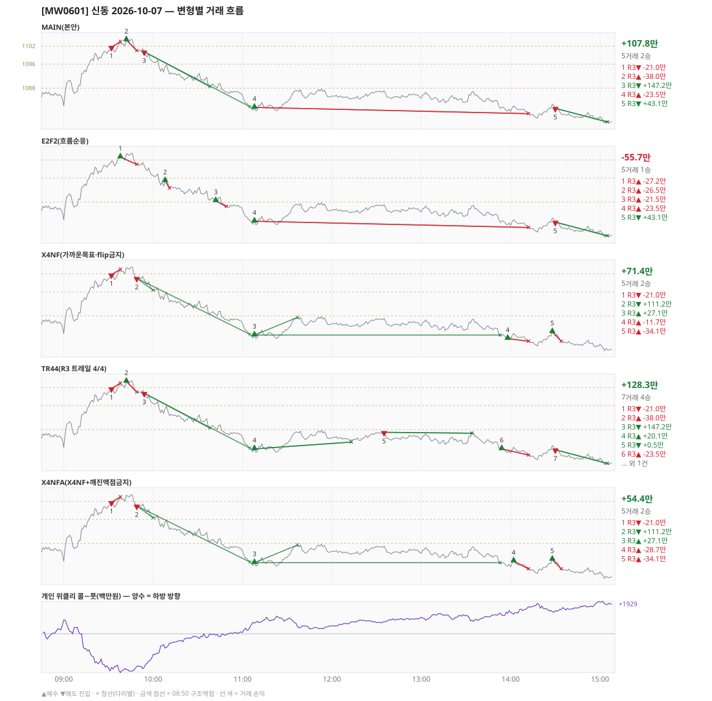

# [MW0601] 신동 일일 리포트 — 2026-10-07

> **MW0601 리포트** · 생성 2026-10-07 15:40 · 규격 `SD-2026-09-29-v2` · 상품 `mon` (먼스리 만기주 — 목위클리 대신 먼스리 (만기 2026-10-08))
> 가상거래다 — 주문 없음(절대원칙 §6). 손익은 미니선물 2계약 · CYBOS 요율 · 1틱 슬리피지 기준.

## 0. 한눈에

| 시장 | R1 장전 | R2 개장확정 | R1 적중(09:00→15:05) |
|---|---|---|---|
| 1082.00 → 1076.72 (-5.28) · 고 1104.86 · 저 1076.02 · 폭 28.8pt | 콜−풋 +540 → **하방** | NONE | ✅ 적중 |

| 변형 | 거래 | 승 | R2 | R3 | **순손익** | 최악 거래 | MAIN 대비 | 기록 |
|---|---|---|---|---|---|---|---|---|
| MAIN(본안) | 5 | 2 | +0.0만 | +107.8만 | **+107.8만** | -38.0만 | — | 라이브 |
| E2F2(흐름순응) | 5 | 1 | +0.0만 | -55.7만 | **-55.7만** | -27.2만 | -163.5만 | 라이브 |
| X4NF(가까운목표·flip금지) | 5 | 2 | +0.0만 | +71.4만 | **+71.4만** | -34.1만 | -36.4만 | 라이브 |
| TR44(R3 트레일 4/4) | 7 | 4 | +0.0만 | +128.3만 | **+128.3만** | -38.0만 | +20.5만 | 라이브 |
| X4NFA(X4NF+깨진맥점금지) | 5 | 2 | +0.0만 | +54.4만 | **+54.4만** | -34.1만 | -53.4만 | 라이브 |

**오늘의 한 줄** — MAIN +107.8만(5거래 2승), 최선은 TR44(R3 트레일 4/4) +128.3만(MAIN 대비 +20.5만).

## 1. 차트

## 2. 거래 흐름 — MAIN

| # | 규칙 | 방향 | 진입 | 맥점 | 손절 | 1차 · 최종 | 청산(다리별) | MFE | 손익 | 누적 |
|---|---|---|---|---|---|---|---|---|---|---|
| 1 | R3 | 매도 | 09:32 1101.66 (탐지 09:33) | 1102.0 | 1103.50 | 1088.50 · 1081.80 | 손절 09:38 1103.50 · 손절 09:38 1103.50 | 2.5 | **-21.0만** | -21.0만 |
| 2 | R3 | 매수 | 09:42 1104.04 (탐지 09:43) | 1102.0 | 1100.50 | 1108.61 · - | 손절 09:49 1100.50 · 손절 09:49 1100.50 | 0.8 | **-38.0만** | -58.9만 |
| 3 | R3 | 매도 | 09:54 1100.10 (탐지 09:55) | 1102.0 | 1103.50 | 1088.50 · 1081.80 | 1차 10:38 1088.50 · 최종 11:05 1081.80 | 19.2 | **+147.2만** | +88.2만 |
| 4 | R3 | 매수 | 11:08 1081.60 (탐지 11:09) | 1081.0 | 1079.50 | 1101.50 · 1101.50 | 손절 14:12 1079.50 · 손절 14:12 1079.50 | 6.3 | **-23.5만** | +64.7만 |
| 5 | R3 | 매도 | 14:30 1081.28 (탐지 14:31) | 1081.0 | 1083.30 | 1064.58 · 1064.58 | 시간 15:05 1076.72 · 시간 15:05 1076.72 | 5.3 | **+43.1만** | +107.8만 |

## 3. 섀도 흐름 — MAIN 과 무엇이 달랐나

### E2F2(흐름순응) — -55.7만 (MAIN 대비 -163.5만)

- 09:32 R3 매도: MAIN 진입 1101.66 → **F2 차단(당일 흐름 역방향)** (MAIN 손익 -21.0만 제외)
- 09:42 R3 매수: MAIN 진입 1104.04 → **앞 거래 보유 중/시점 이동** (MAIN 손익 -38.0만 제외)
- 09:54 R3 매도: MAIN 진입 1100.10 → **F2 차단(당일 흐름 역방향)** (MAIN 손익 +147.2만 제외)
- 09:38 R3 매수: **섀도만 진입** 1102.96 (앞 거래가 없어 신호가 살아남) → -27.2만
- 10:08 R3 매수: **섀도만 진입** 1095.04 (앞 거래가 없어 신호가 살아남) → -26.5만
- 10:42 R3 매수: **섀도만 진입** 1088.40 (앞 거래가 없어 신호가 살아남) → -21.5만

| # | 규칙 | 방향 | 진입 | 맥점 | 손절 | 1차 · 최종 | 청산(다리별) | MFE | 손익 | 누적 |
|---|---|---|---|---|---|---|---|---|---|---|
| 1 | R3 | 매수 | 09:38 1102.96 (탐지 09:39) | 1102.0 | 1100.50 | 1108.61 · - | 손절 09:49 1100.50 · 손절 09:49 1100.50 | 1.9 | **-27.2만** | -27.2만 |
| 2 | R3 | 매수 | 10:08 1095.04 (탐지 10:09) | 1096.0 | 1092.64 | 1101.50 · 1101.50 | 손절 10:11 1092.64 · 손절 10:11 1092.64 | 0.9 | **-26.5만** | -53.7만 |
| 3 | R3 | 매수 | 10:42 1088.40 (탐지 10:43) | 1088.0 | 1086.50 | 1101.50 · 1101.50 | 손절 10:49 1086.50 · 손절 10:49 1086.50 | 1.8 | **-21.5만** | -75.2만 |
| 4 | R3 | 매수 | 11:08 1081.60 (탐지 11:09) | 1081.0 | 1079.50 | 1101.50 · 1101.50 | 손절 14:12 1079.50 · 손절 14:12 1079.50 | 6.3 | **-23.5만** | -98.8만 |
| 5 | R3 | 매도 | 14:30 1081.28 (탐지 14:31) | 1081.0 | 1083.30 | 1064.58 · 1064.58 | 시간 15:05 1076.72 · 시간 15:05 1076.72 | 5.3 | **+43.1만** | -55.7만 |

### X4NF(가까운목표·flip금지) — +71.4만 (MAIN 대비 -36.4만)

- 09:42 R3 매수: MAIN 진입 1104.04 → **flip 금지(같은 맥점 1102.0 반대 방향)** (MAIN 손익 -38.0만 제외)
- 09:54 R3 매도: MAIN 진입 1100.10 → **flip 금지(같은 맥점 1102.0 반대 방향)** (MAIN 손익 +147.2만 제외)
- 11:08 R3 매수: 청산 차이 — MAIN 손절/손절 → 1차/본전 (-23.5만 → +27.1만, 차 +50.6만)
- 14:30 R3 매도: MAIN 진입 1081.28 → **flip 금지(같은 맥점 1081.0 반대 방향)** (MAIN 손익 +43.1만 제외)
- 09:49 R3 매도: **섀도만 진입** 1100.50 (앞 거래가 없어 신호가 살아남) → +111.2만
- 13:58 R3 매수: **섀도만 진입** 1080.42 (앞 거래가 없어 신호가 살아남) → -11.7만
- 14:28 R3 매수: **섀도만 진입** 1082.66 (앞 거래가 없어 신호가 살아남) → -34.1만

| # | 규칙 | 방향 | 진입 | 맥점 | 손절 | 1차 · 최종 | 청산(다리별) | MFE | 손익 | 누적 |
|---|---|---|---|---|---|---|---|---|---|---|
| 1 | R3 | 매도 | 09:32 1101.66 (탐지 09:33) | 1102.0 | 1103.50 | 1096.50 · 1081.80 | 손절 09:38 1103.50 · 손절 09:38 1103.50 | 2.5 | **-21.0만** | -21.0만 |
| 2 | R3 | 매도 | 09:49 1100.50 (탐지 09:50) | 1102.0 | 1103.50 | 1096.50 · 1081.80 | 1차 10:00 1096.50 · 최종 11:05 1081.80 | 19.6 | **+111.2만** | +90.2만 |
| 3 | R3 | 매수 | 11:08 1081.60 (탐지 11:09) | 1081.0 | 1079.50 | 1087.50 · 1101.50 | 1차 11:37 1087.50 · 본전 13:53 1081.60 | 6.3 | **+27.1만** | +117.3만 |
| 4 | R3 | 매수 | 13:58 1080.42 (탐지 13:59) | 1081.0 | 1079.50 | 1087.50 · 1101.50 | 손절 14:12 1079.50 · 손절 14:12 1079.50 | 2.4 | **-11.7만** | +105.5만 |
| 5 | R3 | 매수 | 14:28 1082.66 (탐지 14:29) | 1081.0 | 1079.50 | 1087.50 · 1101.50 | 손절 14:34 1079.50 · 손절 14:34 1079.50 | 0.1 | **-34.1만** | +71.4만 |

### TR44(R3 트레일 4/4) — +128.3만 (MAIN 대비 +20.5만)

- 11:08 R3 매수: 청산 차이 — MAIN 손절/손절 → 트레일/트레일 (-23.5만 → +20.1만, 차 +43.6만)
- 12:35 R3 매도: **섀도만 진입** 1087.10 (앞 거래가 없어 신호가 살아남) → +0.5만
- 13:54 R3 매수: **섀도만 진입** 1081.60 (앞 거래가 없어 신호가 살아남) → -23.5만

| # | 규칙 | 방향 | 진입 | 맥점 | 손절 | 1차 · 최종 | 청산(다리별) | MFE | 손익 | 누적 |
|---|---|---|---|---|---|---|---|---|---|---|
| 1 | R3 | 매도 | 09:32 1101.66 (탐지 09:33) | 1102.0 | 1103.50 | 1088.50 · 1081.80 | 손절 09:38 1103.50 · 손절 09:38 1103.50 | 2.5 | **-21.0만** | -21.0만 |
| 2 | R3 | 매수 | 09:42 1104.04 (탐지 09:43) | 1102.0 | 1100.50 | 1108.61 · - | 손절 09:49 1100.50 · 손절 09:49 1100.50 | 0.8 | **-38.0만** | -58.9만 |
| 3 | R3 | 매도 | 09:54 1100.10 (탐지 09:55) | 1102.0 | 1103.50 | 1088.50 · 1081.80 | 1차 10:38 1088.50 · 최종 11:05 1081.80 | 19.2 | **+147.2만** | +88.2만 |
| 4 | R3 | 매수 | 11:08 1081.60 (탐지 11:09) | 1081.0 | 1079.50 | 1101.50 · 1101.50 | 트레일 12:13 1083.86 · 트레일 12:13 1083.86 | 6.3 | **+20.1만** | +108.3만 |
| 5 | R3 | 매도 | 12:35 1087.10 (탐지 12:36) | 1088.0 | 1089.50 | 1081.80 · 1064.58 | 트레일 13:34 1086.80 · 트레일 13:34 1086.80 | 4.3 | **+0.5만** | +108.8만 |
| 6 | R3 | 매수 | 13:54 1081.60 (탐지 13:55) | 1081.0 | 1079.50 | 1101.50 · 1101.50 | 손절 14:12 1079.50 · 손절 14:12 1079.50 | 1.2 | **-23.5만** | +85.3만 |
| 7 | R3 | 매도 | 14:30 1081.28 (탐지 14:31) | 1081.0 | 1083.30 | 1064.58 · 1064.58 | 시간 15:05 1076.72 · 시간 15:05 1076.72 | 5.3 | **+43.1만** | +128.3만 |

### X4NFA(X4NF+깨진맥점금지) — +54.4만 (MAIN 대비 -53.4만)

- 09:42 R3 매수: MAIN 진입 1104.04 → **flip 금지(같은 맥점 1102.0 반대 방향)** (MAIN 손익 -38.0만 제외)
- 09:54 R3 매도: MAIN 진입 1100.10 → **flip 금지(같은 맥점 1102.0 반대 방향)** (MAIN 손익 +147.2만 제외)
- 11:08 R3 매수: 청산 차이 — MAIN 손절/손절 → 1차/본전 (-23.5만 → +27.1만, 차 +50.6만)
- 14:30 R3 매도: MAIN 진입 1081.28 → **flip 금지(같은 맥점 1081.0 반대 방향)** (MAIN 손익 +43.1만 제외)
- 09:49 R3 매도: **섀도만 진입** 1100.50 (앞 거래가 없어 신호가 살아남) → +111.2만
- 14:02 R3 매수: **섀도만 진입** 1082.12 (앞 거래가 없어 신호가 살아남) → -28.7만
- 14:28 R3 매수: **섀도만 진입** 1082.66 (앞 거래가 없어 신호가 살아남) → -34.1만

| # | 규칙 | 방향 | 진입 | 맥점 | 손절 | 1차 · 최종 | 청산(다리별) | MFE | 손익 | 누적 |
|---|---|---|---|---|---|---|---|---|---|---|
| 1 | R3 | 매도 | 09:32 1101.66 (탐지 09:33) | 1102.0 | 1103.50 | 1096.50 · 1081.80 | 손절 09:38 1103.50 · 손절 09:38 1103.50 | 2.5 | **-21.0만** | -21.0만 |
| 2 | R3 | 매도 | 09:49 1100.50 (탐지 09:50) | 1102.0 | 1103.50 | 1096.50 · 1081.80 | 1차 10:00 1096.50 · 최종 11:05 1081.80 | 19.6 | **+111.2만** | +90.2만 |
| 3 | R3 | 매수 | 11:08 1081.60 (탐지 11:09) | 1081.0 | 1079.50 | 1087.50 · 1101.50 | 1차 11:37 1087.50 · 본전 13:53 1081.60 | 6.3 | **+27.1만** | +117.3만 |
| 4 | R3 | 매수 | 14:02 1082.12 (탐지 14:03) | 1081.0 | 1079.50 | 1087.50 · 1101.50 | 손절 14:12 1079.50 · 손절 14:12 1079.50 | 0.7 | **-28.7만** | +88.5만 |
| 5 | R3 | 매수 | 14:28 1082.66 (탐지 14:29) | 1081.0 | 1079.50 | 1087.50 · 1101.50 | 손절 14:34 1079.50 · 손절 14:34 1079.50 | 0.1 | **-34.1만** | +54.4만 |

## 4. 누적 채점 (라이브 기록 · 판정 창)

| 변형 | 채점 시작 | 거래일 | 거래 | 승률 | 순손익 | 최악일 | R3 (건 · 승률 · 순) | 판정 |
|---|---|---|---|---|---|---|---|---|
| MAIN(본안) | 2026-09-30 | 5 | 26 | 31% | **-115.8만** | -90.3만 | 23 · 30% · -20.7만 | R3 중단 판정 5/10일 |
| E2F2(흐름순응) | 2026-09-30 | 5 | 25 | 40% | **+88.4만** | -55.7만 | 22 · 41% · +183.4만 | MAIN 비교 5/10일 |
| X4NF(가까운목표·flip금지) | 2026-09-30 | 5 | 28 | 50% | **+12.9만** | -60.1만 | 25 · 52% · +107.9만 | MAIN 비교 5/10일 |
| TR44(R3 트레일 4/4) | 2026-09-30 | 5 | 31 | 55% | **+206.0만** | -18.6만 | 28 · 57% · +301.0만 | MAIN 비교 5/10일 |
| X4NFA(X4NF+깨진맥점금지) | 2026-09-30 | 5 | 24 | 50% | **+21.8만** | -53.7만 | 21 · 52% · +116.8만 | MAIN 비교 5/10일 |

> 판정 전 집계다 — 인용·규격 변경 근거로 쓰지 말 것. R3 중단 기준: 순손익 < 0 **그리고** 승률 < 35%.

## 5. 러너 섀도 — 미륵이 × 신동 (CREON 요율)

| 미륵이 진입 | 방향 | 조건 | 러너 | 실제 | 러너 적용 | 차이 | 필터 B |
|---|---|---|---|---|---|---|---|
| 10:20 1091.41 ×2 | 매도 | 충족 | BE 10:21 | +3.5만 | +3.1만 | **-0.4만** | 통과 |
| 10:26 1091.83 ×2 | 매도 | 충족 | BE 10:29 | +0.9만 | +1.1만 | **+0.3만** | 통과 |
| 10:48 1087.57 ×2 | 매도 | 충족 | BE 10:57 | +2.5만 | +1.4만 | **-1.1만** | 통과 |
| 11:08 1080.71 ×2 | 매도 | 충족 | TP1 미도달 | -11.5만 | -11.5만 | **+0.0만** | 제외 |
| 11:19 1082.26 ×1 | 매도 | 충족 | TP1 미도달 | +0.9만 | +0.9만 | **+0.0만** | 제외 |

- 합: 실제 -3.8만 → 러너 -4.9만 (차 -1.2만)

## 6. 개선 방향 (자동 관찰 — 판정 아님)

- **진입 품질** — MAIN 손실 3건 중 2건은 유리한 쪽으로 4pt 도 못 갔다(MFE 2.5, 0.8). 청산을 바꿔서는 못 막는 손실이다 → 진입 필터(E2F2·X4NF·X4NFA) 쪽 관찰 대상.
- **청산** — MAIN 손실 1건은 4pt 이상 유리하게 갔다가 손절됐다(MFE 6.3) → 트레일(TR44) 쪽 관찰 대상.
- **맥점 반복** — 1102.0 에서 R3 3회(매도→매수→매도) · 합 +88.2만. 박스권에서 같은 맥점을 양쪽으로 번갈아 잡았다.
- **맥점 반복** — 1081.0 에서 R3 2회(매수→매도) · 합 +19.6만. 박스권에서 같은 맥점을 양쪽으로 번갈아 잡았다.
- **깨진 맥점 진입 1건** — 흐름 반전을 기다리는 사이 가격이 맥점을 다시 넘어간 뒤 들어갔다(14:30 매도 1081.28/맥점 1081.0 +43.1만) · 합 +43.1만 → X4NFA 가 막는 진입이다.
- **탐지 지연** — 라이브 진입 5건, 규칙가 대비 실현가능가 차 +0(음수 = 늦게 알아채 손해).
- **오늘 최선은 TR44(R3 트레일 4/4)** (+128.3만, MAIN 대비 +20.5만). 하루 결과다 — 판정은 사전등록 창(10거래일)으로만.
- ⚠ 규격 변경은 사전등록 §6(새 버전 · 재채점)으로만. 이 절은 관찰이다.

---
재생성: `python scripts/shindong_daily_report.py 2026-10-07`
