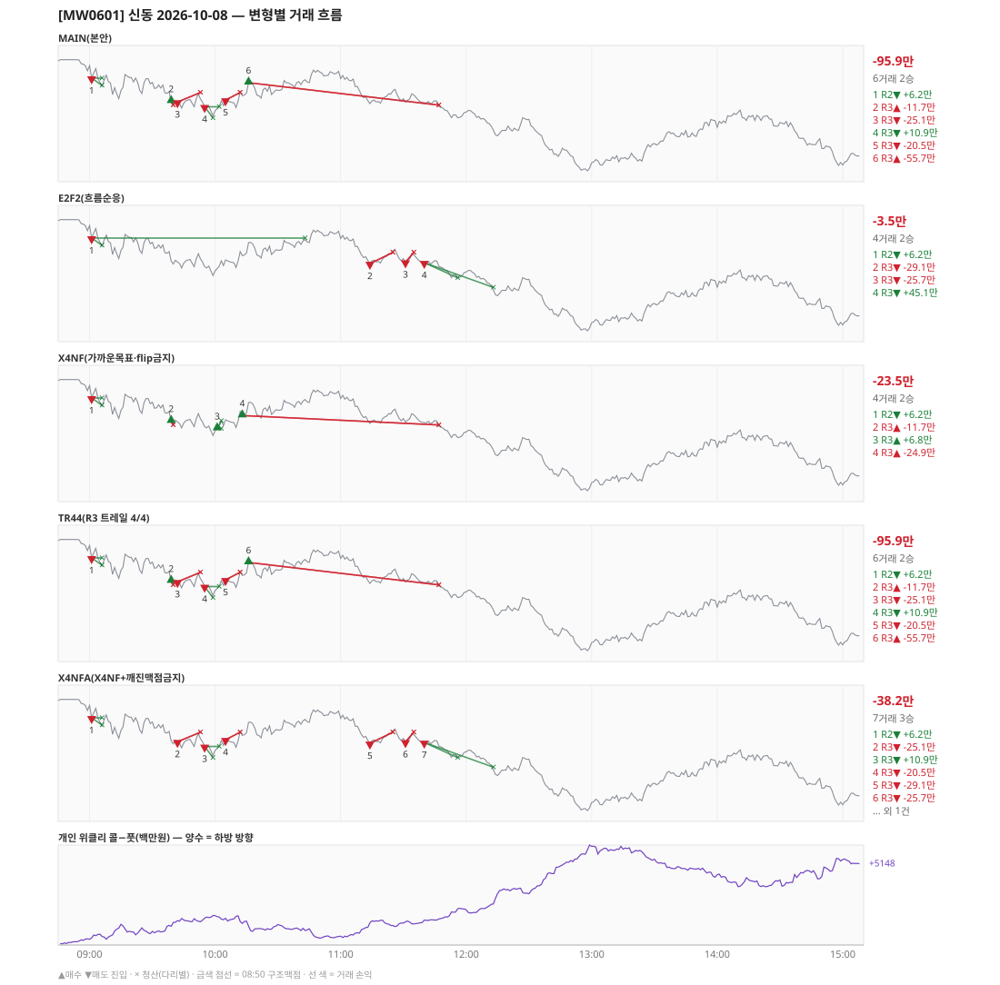

# [MW0601] 신동 일일 리포트 — 2026-10-08

> **MW0601 리포트** · 생성 2026-10-08 15:43 · 규격 `SD-2026-09-29-v2` · 상품 `mon` (먼스리 만기주 — 목위클리 대신 먼스리 (만기 2026-10-08))
> 가상거래다 — 주문 없음(절대원칙 §6). 손익은 미니선물 2계약 · CYBOS 요율 · 1틱 슬리피지 기준.

## 0. 한눈에

| 시장 | R1 장전 | R2 개장확정 | R1 적중(09:00→15:05) |
|---|---|---|---|
| 1073.86 → 1053.02 (-20.84) · 고 1075.70 · 저 1048.04 · 폭 27.7pt | 콜−풋 +392 → **하방** | CONFIRMED 09:01 | ✅ 적중 |

| 변형 | 거래 | 승 | R2 | R3 | **순손익** | 최악 거래 | MAIN 대비 | 기록 |
|---|---|---|---|---|---|---|---|---|
| MAIN(본안) | 6 | 2 | +6.2만 | -102.1만 | **-95.9만** | -55.7만 | — | 라이브 |
| E2F2(흐름순응) | 4 | 2 | +6.2만 | -9.7만 | **-3.5만** | -29.1만 | +92.4만 | 라이브 |
| X4NF(가까운목표·flip금지) | 4 | 2 | +6.2만 | -29.8만 | **-23.5만** | -24.9만 | +72.3만 | 라이브 |
| TR44(R3 트레일 4/4) | 6 | 2 | +6.2만 | -102.1만 | **-95.9만** | -55.7만 | +0.0만 | 라이브 |
| X4NFA(X4NF+깨진맥점금지) | 7 | 3 | +6.2만 | -44.4만 | **-38.2만** | -29.1만 | +57.7만 | 라이브 |

**오늘의 한 줄** — MAIN -95.9만(6거래 2승), 최선은 E2F2(흐름순응) -3.5만(MAIN 대비 +92.4만).

## 1. 차트

## 2. 거래 흐름 — MAIN

| # | 규칙 | 방향 | 진입 | 맥점 | 손절 | 1차 · 최종 | 청산(다리별) | MFE | 손익 | 누적 |
|---|---|---|---|---|---|---|---|---|---|---|
| 1 | R2 | 매도 | 09:01 1070.90 (탐지 09:02) | - | 1076.70 | 1069.17 · 1059.20 | 1차 09:06 1069.17 · 본전 09:06 1070.90 | 2.2 | **+6.2만** | +6.2만 |
| 2 | R3 | 매수 | 09:39 1065.42 (탐지 09:40) | 1066.0 | 1064.50 | 1075.50 · 1094.50 | 손절 09:40 1064.50 · 손절 09:40 1064.50 | 0.5 | **-11.7만** | -5.5만 |
| 3 | R3 | 매도 | 09:42 1065.24 (탐지 09:43) | 1066.0 | 1067.50 | 1061.45 · 1059.20 | 손절 09:53 1067.50 · 손절 09:53 1067.50 | 2.0 | **-25.1만** | -30.5만 |
| 4 | R3 | 매도 | 09:55 1064.10 (탐지 09:56) | 1066.0 | 1067.50 | 1061.45 · 1059.20 | 1차 09:59 1061.45 · 본전 10:02 1064.10 | 2.7 | **+10.9만** | -19.7만 |
| 5 | R3 | 매도 | 10:05 1065.70 (탐지 10:06) | 1066.0 | 1067.50 | 1061.45 · 1059.20 | 손절 10:12 1067.50 · 손절 10:12 1067.50 | 2.2 | **-20.5만** | -40.2만 |
| 6 | R3 | 매수 | 10:16 1069.82 (탐지 10:17) | 1066.0 | 1064.50 | 1075.50 · 1094.50 | 손절 11:47 1064.50 · 손절 11:47 1064.50 | 3.5 | **-55.7만** | -95.9만 |

## 3. 섀도 흐름 — MAIN 과 무엇이 달랐나

### E2F2(흐름순응) — -3.5만 (MAIN 대비 +92.4만)

- 09:39 R3 매수: MAIN 진입 1065.42 → **F2 차단(당일 흐름 역방향)** (MAIN 손익 -11.7만 제외)
- 09:42 R3 매도: MAIN 진입 1065.24 → **앞 거래 보유 중/시점 이동** (MAIN 손익 -25.1만 제외)
- 09:55 R3 매도: MAIN 진입 1064.10 → **앞 거래 보유 중/시점 이동** (MAIN 손익 +10.9만 제외)
- 10:05 R3 매도: MAIN 진입 1065.70 → **앞 거래 보유 중/시점 이동** (MAIN 손익 -20.5만 제외)
- 10:16 R3 매수: MAIN 진입 1069.82 → **F2 차단(당일 흐름 역방향)** (MAIN 손익 -55.7만 제외)
- 11:14 R3 매도: **섀도만 진입** 1064.84 (앞 거래가 없어 신호가 살아남) → -29.1만
- 11:31 R3 매도: **섀도만 진입** 1065.18 (앞 거래가 없어 신호가 살아남) → -25.7만
- 11:40 R3 매도: **섀도만 진입** 1065.06 (앞 거래가 없어 신호가 살아남) → +45.1만

| # | 규칙 | 방향 | 진입 | 맥점 | 손절 | 1차 · 최종 | 청산(다리별) | MFE | 손익 | 누적 |
|---|---|---|---|---|---|---|---|---|---|---|
| 1 | R2 | 매도 | 09:01 1070.90 (탐지 09:02) | - | 1076.70 | 1069.17 · 1059.20 | 1차 09:06 1069.17 · 본전 10:43 1070.90 | 9.5 | **+6.2만** | +6.2만 |
| 2 | R3 | 매도 | 11:14 1064.84 (탐지 11:15) | 1066.0 | 1067.50 | 1061.45 · 1059.20 | 손절 11:25 1067.50 · 손절 11:25 1067.50 | 0.3 | **-29.1만** | -22.9만 |
| 3 | R3 | 매도 | 11:31 1065.18 (탐지 11:32) | 1066.0 | 1067.50 | 1061.45 · 1059.20 | 손절 11:35 1067.50 · 손절 11:35 1067.50 | 0.3 | **-25.7만** | -48.6만 |
| 4 | R3 | 매도 | 11:40 1065.06 (탐지 11:41) | 1066.0 | 1067.50 | 1061.45 · 1059.20 | 1차 11:56 1061.45 · 최종 12:13 1059.20 | 6.5 | **+45.1만** | -3.5만 |

### X4NF(가까운목표·flip금지) — -23.5만 (MAIN 대비 +72.3만)

- 09:42 R3 매도: MAIN 진입 1065.24 → **flip 금지(같은 맥점 1066.0 반대 방향)** (MAIN 손익 -25.1만 제외)
- 09:55 R3 매도: MAIN 진입 1064.10 → **앞 거래 보유 중/시점 이동** (MAIN 손익 +10.9만 제외)
- 10:05 R3 매도: MAIN 진입 1065.70 → **앞 거래 보유 중/시점 이동** (MAIN 손익 -20.5만 제외)
- 10:16 R3 매수: MAIN 진입 1069.82 → **flip 금지(같은 맥점 1066.0 반대 방향)** (MAIN 손익 -55.7만 제외)
- 10:01 R3 매수: **섀도만 진입** 1063.66 (앞 거래가 없어 신호가 살아남) → +6.8만
- 10:13 R3 매수: **섀도만 진입** 1066.74 (앞 거래가 없어 신호가 살아남) → -24.9만

| # | 규칙 | 방향 | 진입 | 맥점 | 손절 | 1차 · 최종 | 청산(다리별) | MFE | 손익 | 누적 |
|---|---|---|---|---|---|---|---|---|---|---|
| 1 | R2 | 매도 | 09:01 1070.90 (탐지 09:02) | - | 1076.70 | 1069.17 · 1059.20 | 1차 09:06 1069.17 · 본전 09:06 1070.90 | 2.2 | **+6.2만** | +6.2만 |
| 2 | R3 | 매수 | 09:39 1065.42 (탐지 09:40) | 1066.0 | 1064.50 | 1075.50 · 1094.50 | 손절 09:40 1064.50 · 손절 09:40 1064.50 | 0.5 | **-11.7만** | -5.5만 |
| 3 | R3 | 매수 | 10:01 1063.66 (탐지 10:02) | 1066.0 | 1060.90 | 1065.50 · 1094.50 | 1차 10:03 1065.50 · 본전 10:03 1063.66 | 2.0 | **+6.8만** | +1.4만 |
| 4 | R3 | 매수 | 10:13 1066.74 (탐지 10:14) | 1066.0 | 1064.50 | 1075.50 · 1094.50 | 손절 11:47 1064.50 · 손절 11:47 1064.50 | 6.6 | **-24.9만** | -23.5만 |

### TR44(R3 트레일 4/4) — -95.9만 (MAIN 대비 +0.0만)

- MAIN 과 같다

| # | 규칙 | 방향 | 진입 | 맥점 | 손절 | 1차 · 최종 | 청산(다리별) | MFE | 손익 | 누적 |
|---|---|---|---|---|---|---|---|---|---|---|
| 1 | R2 | 매도 | 09:01 1070.90 (탐지 09:02) | - | 1076.70 | 1069.17 · 1059.20 | 1차 09:06 1069.17 · 본전 09:06 1070.90 | 2.2 | **+6.2만** | +6.2만 |
| 2 | R3 | 매수 | 09:39 1065.42 (탐지 09:40) | 1066.0 | 1064.50 | 1075.50 · 1094.50 | 손절 09:40 1064.50 · 손절 09:40 1064.50 | 0.5 | **-11.7만** | -5.5만 |
| 3 | R3 | 매도 | 09:42 1065.24 (탐지 09:43) | 1066.0 | 1067.50 | 1061.45 · 1059.20 | 손절 09:53 1067.50 · 손절 09:53 1067.50 | 2.0 | **-25.1만** | -30.5만 |
| 4 | R3 | 매도 | 09:55 1064.10 (탐지 09:56) | 1066.0 | 1067.50 | 1061.45 · 1059.20 | 1차 09:59 1061.45 · 본전 10:02 1064.10 | 2.7 | **+10.9만** | -19.7만 |
| 5 | R3 | 매도 | 10:05 1065.70 (탐지 10:06) | 1066.0 | 1067.50 | 1061.45 · 1059.20 | 손절 10:12 1067.50 · 손절 10:12 1067.50 | 2.2 | **-20.5만** | -40.2만 |
| 6 | R3 | 매수 | 10:16 1069.82 (탐지 10:17) | 1066.0 | 1064.50 | 1075.50 · 1094.50 | 손절 11:47 1064.50 · 손절 11:47 1064.50 | 3.5 | **-55.7만** | -95.9만 |

### X4NFA(X4NF+깨진맥점금지) — -38.2만 (MAIN 대비 +57.7만)

- 09:39 R3 매수: MAIN 진입 1065.42 → **깨진 맥점 차단(진입 1065.42 · 맥점 1066.0)** (MAIN 손익 -11.7만 제외)
- 10:16 R3 매수: MAIN 진입 1069.82 → **flip 금지(같은 맥점 1066.0 반대 방향)** (MAIN 손익 -55.7만 제외)
- 11:14 R3 매도: **섀도만 진입** 1064.84 (앞 거래가 없어 신호가 살아남) → -29.1만
- 11:31 R3 매도: **섀도만 진입** 1065.18 (앞 거래가 없어 신호가 살아남) → -25.7만
- 11:40 R3 매도: **섀도만 진입** 1065.06 (앞 거래가 없어 신호가 살아남) → +45.1만

| # | 규칙 | 방향 | 진입 | 맥점 | 손절 | 1차 · 최종 | 청산(다리별) | MFE | 손익 | 누적 |
|---|---|---|---|---|---|---|---|---|---|---|
| 1 | R2 | 매도 | 09:01 1070.90 (탐지 09:02) | - | 1076.70 | 1069.17 · 1059.20 | 1차 09:06 1069.17 · 본전 09:06 1070.90 | 2.2 | **+6.2만** | +6.2만 |
| 2 | R3 | 매도 | 09:42 1065.24 (탐지 09:43) | 1066.0 | 1067.50 | 1061.45 · 1059.20 | 손절 09:53 1067.50 · 손절 09:53 1067.50 | 2.0 | **-25.1만** | -18.9만 |
| 3 | R3 | 매도 | 09:55 1064.10 (탐지 09:56) | 1066.0 | 1067.50 | 1061.45 · 1059.20 | 1차 09:59 1061.45 · 본전 10:02 1064.10 | 2.7 | **+10.9만** | -8.0만 |
| 4 | R3 | 매도 | 10:05 1065.70 (탐지 10:06) | 1066.0 | 1067.50 | 1061.45 · 1059.20 | 손절 10:12 1067.50 · 손절 10:12 1067.50 | 2.2 | **-20.5만** | -28.5만 |
| 5 | R3 | 매도 | 11:14 1064.84 (탐지 11:15) | 1066.0 | 1067.50 | 1061.45 · 1059.20 | 손절 11:25 1067.50 · 손절 11:25 1067.50 | 0.3 | **-29.1만** | -57.6만 |
| 6 | R3 | 매도 | 11:31 1065.18 (탐지 11:32) | 1066.0 | 1067.50 | 1061.45 · 1059.20 | 손절 11:35 1067.50 · 손절 11:35 1067.50 | 0.3 | **-25.7만** | -83.3만 |
| 7 | R3 | 매도 | 11:40 1065.06 (탐지 11:41) | 1066.0 | 1067.50 | 1061.45 · 1059.20 | 1차 11:56 1061.45 · 최종 12:13 1059.20 | 6.5 | **+45.1만** | -38.2만 |

## 4. 누적 채점 (라이브 기록 · 판정 창)

| 변형 | 채점 시작 | 거래일 | 거래 | 승률 | 순손익 | 최악일 | R3 (건 · 승률 · 순) | 판정 |
|---|---|---|---|---|---|---|---|---|
| MAIN(본안) | 2026-09-30 | 6 | 32 | 31% | **-211.6만** | -95.9만 | 28 · 29% · -122.8만 | R3 중단 판정 6/10일 |
| E2F2(흐름순응) | 2026-09-30 | 6 | 29 | 41% | **+84.9만** | -55.7만 | 25 · 40% · +173.7만 | MAIN 비교 6/10일 |
| X4NF(가까운목표·flip금지) | 2026-09-30 | 6 | 32 | 50% | **-10.6만** | -60.1만 | 28 · 50% · +78.2만 | MAIN 비교 6/10일 |
| TR44(R3 트레일 4/4) | 2026-09-30 | 6 | 37 | 51% | **+110.2만** | -95.9만 | 33 · 52% · +198.9만 | MAIN 비교 6/10일 |
| X4NFA(X4NF+깨진맥점금지) | 2026-09-30 | 6 | 31 | 48% | **-16.4만** | -53.7만 | 27 · 48% · +72.3만 | MAIN 비교 6/10일 |

> 판정 전 집계다 — 인용·규격 변경 근거로 쓰지 말 것. R3 중단 기준: 순손익 < 0 **그리고** 승률 < 35%.

## 5. 러너 섀도 — 미륵이 × 신동 (CREON 요율)

| 미륵이 진입 | 방향 | 조건 | 러너 | 실제 | 러너 적용 | 차이 | 필터 B |
|---|---|---|---|---|---|---|---|
| 10:54 1071.44 ×2 | 매수 | 불충족 | 신동 방향 반대 | -3.5만 | -3.5만 | **+0.0만** | 통과 |
| 13:02 1051.00 ×2 | 매도 | 충족 | BE 13:03 | +2.4만 | +3.1만 | **+0.7만** | 제외 |
| 13:32 1055.08 ×1 | 매도 | 충족 | TP1 미도달 | -11.2만 | -11.2만 | **+0.0만** | 제외 |
| 13:41 1056.98 ×1 | 매도 | 충족 | TP1 미도달 | -9.9만 | -9.9만 | **+0.0만** | 제외 |
| 13:59 1060.88 ×1 | 매도 | 충족 | TP1 미도달 | +1.5만 | +1.5만 | **+0.0만** | 제외 |
| 14:03 1060.32 ×1 | 매도 | 충족 | TP1 미도달 | +2.6만 | +2.6만 | **+0.0만** | 제외 |
| 14:09 1062.00 ×1 | 매도 | 충족 | TP1 미도달 | +1.1만 | +1.1만 | **+0.0만** | 제외 |

- 합: 실제 -17.0만 → 러너 -16.3만 (차 +0.7만)

## 6. 개선 방향 (자동 관찰 — 판정 아님)

- **진입 품질** — MAIN 손실 4건 중 4건은 유리한 쪽으로 4pt 도 못 갔다(MFE 0.5, 2.0, 2.2, 3.5). 청산을 바꿔서는 못 막는 손실이다 → 진입 필터(E2F2·X4NF·X4NFA) 쪽 관찰 대상.
- **맥점 반복** — 1066.0 에서 R3 5회(매수→매도→매도→매도→매수) · 합 -102.1만. 박스권에서 같은 맥점을 양쪽으로 번갈아 잡았다.
- **깨진 맥점 진입 1건** — 흐름 반전을 기다리는 사이 가격이 맥점을 다시 넘어간 뒤 들어갔다(09:39 매수 1065.42/맥점 1066.0 -11.7만) · 합 -11.7만 → X4NFA 가 막는 진입이다.
- **탐지 지연** — 라이브 진입 6건, 규칙가 대비 실현가능가 차 +0(음수 = 늦게 알아채 손해).
- **오늘 최선은 E2F2(흐름순응)** (-3.5만, MAIN 대비 +92.4만). 하루 결과다 — 판정은 사전등록 창(10거래일)으로만.
- ⚠ 규격 변경은 사전등록 §6(새 버전 · 재채점)으로만. 이 절은 관찰이다.

---
재생성: `python scripts/shindong_daily_report.py 2026-10-08`
