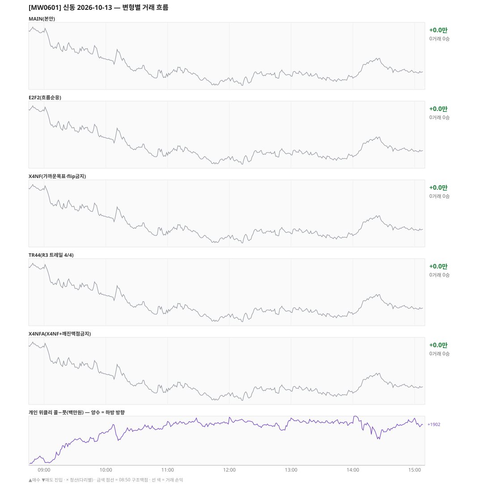

# [MW0601] 신동 일일 리포트 — 2026-10-13

> **MW0601 리포트** · 생성 2026-10-13 15:40 · 규격 `SD-2026-09-29-v2` · 상품 `wk_thu` (최근접 만기 목위클리 (만기 2026-10-15))
> 가상거래다 — 주문 없음(절대원칙 §6). 손익은 미니선물 2계약 · CYBOS 요율 · 1틱 슬리피지 기준.

## 0. 한눈에

| 시장 | R1 장전 | R2 개장확정 | R1 적중(09:00→15:05) |
|---|---|---|---|
| 973.54 → 940.34 (-33.20) · 고 978.78 · 저 928.02 · 폭 50.8pt | 콜−풋 +338 → **하방** | NONE | ✅ 적중 |

| 변형 | 거래 | 승 | R2 | R3 | **순손익** | 최악 거래 | MAIN 대비 | 기록 |
|---|---|---|---|---|---|---|---|---|
| MAIN(본안) | 0 | 0 | +0.0만 | +0.0만 | **+0.0만** | +0.0만 | — | 라이브 |
| E2F2(흐름순응) | 0 | 0 | +0.0만 | +0.0만 | **+0.0만** | +0.0만 | +0.0만 | 라이브 |
| X4NF(가까운목표·flip금지) | 0 | 0 | +0.0만 | +0.0만 | **+0.0만** | +0.0만 | +0.0만 | 라이브 |
| TR44(R3 트레일 4/4) | 0 | 0 | +0.0만 | +0.0만 | **+0.0만** | +0.0만 | +0.0만 | 라이브 |
| X4NFA(X4NF+깨진맥점금지) | 0 | 0 | +0.0만 | +0.0만 | **+0.0만** | +0.0만 | +0.0만 | 라이브 |

**오늘의 한 줄** — MAIN +0.0만(0거래 0승).

## 1. 차트

## 2. 거래 흐름 — MAIN

| # | 규칙 | 방향 | 진입 | 맥점 | 손절 | 1차 · 최종 | 청산(다리별) | MFE | 손익 | 누적 |
|---|---|---|---|---|---|---|---|---|---|---|
| - | 거래 없음 | | | | | | | | | |

## 3. 섀도 흐름 — MAIN 과 무엇이 달랐나

### E2F2(흐름순응) — +0.0만 (MAIN 대비 +0.0만)

- MAIN 과 같다

| # | 규칙 | 방향 | 진입 | 맥점 | 손절 | 1차 · 최종 | 청산(다리별) | MFE | 손익 | 누적 |
|---|---|---|---|---|---|---|---|---|---|---|
| - | 거래 없음 | | | | | | | | | |

### X4NF(가까운목표·flip금지) — +0.0만 (MAIN 대비 +0.0만)

- MAIN 과 같다

| # | 규칙 | 방향 | 진입 | 맥점 | 손절 | 1차 · 최종 | 청산(다리별) | MFE | 손익 | 누적 |
|---|---|---|---|---|---|---|---|---|---|---|
| - | 거래 없음 | | | | | | | | | |

### TR44(R3 트레일 4/4) — +0.0만 (MAIN 대비 +0.0만)

- MAIN 과 같다

| # | 규칙 | 방향 | 진입 | 맥점 | 손절 | 1차 · 최종 | 청산(다리별) | MFE | 손익 | 누적 |
|---|---|---|---|---|---|---|---|---|---|---|
| - | 거래 없음 | | | | | | | | | |

### X4NFA(X4NF+깨진맥점금지) — +0.0만 (MAIN 대비 +0.0만)

- MAIN 과 같다

| # | 규칙 | 방향 | 진입 | 맥점 | 손절 | 1차 · 최종 | 청산(다리별) | MFE | 손익 | 누적 |
|---|---|---|---|---|---|---|---|---|---|---|
| - | 거래 없음 | | | | | | | | | |

## 4. 누적 채점 (라이브 기록 · 판정 창)

| 변형 | 채점 시작 | 거래일 | 거래 | 승률 | 순손익 | 최악일 | R3 (건 · 승률 · 순) | 판정 |
|---|---|---|---|---|---|---|---|---|
| MAIN(본안) | 2026-09-30 | 8 | 34 | 35% | **-59.2만** | -95.9만 | 30 · 33% · +29.5만 | R3 중단 판정 8/10일 |
| E2F2(흐름순응) | 2026-09-30 | 8 | 31 | 45% | **+237.3만** | -55.7만 | 27 · 44% · +326.1만 | MAIN 비교 8/10일 |
| X4NF(가까운목표·flip금지) | 2026-09-30 | 8 | 34 | 53% | **+141.8만** | -60.1만 | 30 · 53% · +230.5만 | MAIN 비교 8/10일 |
| TR44(R3 트레일 4/4) | 2026-09-30 | 8 | 39 | 54% | **+188.9만** | -95.9만 | 35 · 54% · +277.7만 | MAIN 비교 8/10일 |
| X4NFA(X4NF+깨진맥점금지) | 2026-09-30 | 8 | 33 | 52% | **+135.9만** | -53.7만 | 29 · 52% · +224.7만 | MAIN 비교 8/10일 |

> 판정 전 집계다 — 인용·규격 변경 근거로 쓰지 말 것. R3 중단 기준: 순손익 < 0 **그리고** 승률 < 35%.

## 5. 러너 섀도 — 미륵이 × 신동 (CREON 요율)

- 오늘 기록 없음 — 미륵이 시스템 진입이 없었거나 장후 기록 전이다

## 6. 개선 방향 (자동 관찰 — 판정 아님)

- **오늘은 MAIN 이 최선** (+0.0만).
- ⚠ 규격 변경은 사전등록 §6(새 버전 · 재채점)으로만. 이 절은 관찰이다.

---
재생성: `python scripts/shindong_daily_report.py 2026-10-13`
