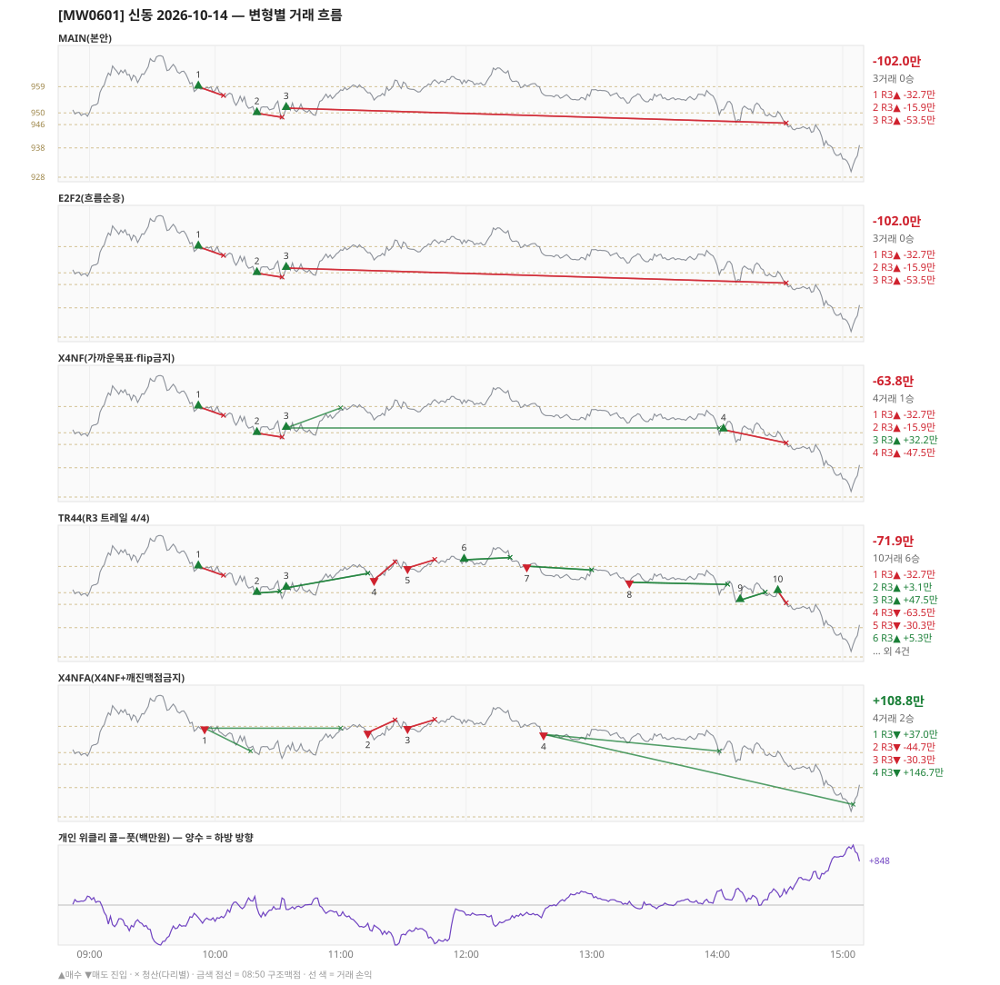

# [MW0601] 신동 일일 리포트 — 2026-10-14

> **MW0601 리포트** · 생성 2026-10-14 15:40 · 규격 `SD-2026-09-29-v2` · 상품 `wk_thu` (최근접 만기 목위클리 (만기 2026-10-15))
> 가상거래다 — 주문 없음(절대원칙 §6). 손익은 미니선물 2계약 · CYBOS 요율 · 1틱 슬리피지 기준.

## 0. 한눈에

| 시장 | R1 장전 | R2 개장확정 | R1 적중(09:00→15:05) |
|---|---|---|---|
| 950.20 → 932.24 (-17.96) · 고 970.58 · 저 928.94 · 폭 41.6pt | 콜−풋 +173 → **하방** | NONE | ✅ 적중 |

| 변형 | 거래 | 승 | R2 | R3 | **순손익** | 최악 거래 | MAIN 대비 | 기록 |
|---|---|---|---|---|---|---|---|---|
| MAIN(본안) | 3 | 0 | +0.0만 | -102.0만 | **-102.0만** | -53.5만 | — | 라이브 |
| E2F2(흐름순응) | 3 | 0 | +0.0만 | -102.0만 | **-102.0만** | -53.5만 | +0.0만 | 라이브 |
| X4NF(가까운목표·flip금지) | 4 | 1 | +0.0만 | -63.8만 | **-63.8만** | -47.5만 | +38.2만 | 라이브 |
| TR44(R3 트레일 4/4) | 10 | 6 | +0.0만 | -71.9만 | **-71.9만** | -63.5만 | +30.1만 | 라이브 |
| X4NFA(X4NF+깨진맥점금지) | 4 | 2 | +0.0만 | +108.8만 | **+108.8만** | -44.7만 | +210.8만 | 라이브 |

**오늘의 한 줄** — MAIN -102.0만(3거래 0승), 최선은 X4NFA(X4NF+깨진맥점금지) +108.8만(MAIN 대비 +210.8만).

## 1. 차트

## 2. 거래 흐름 — MAIN

| # | 규칙 | 방향 | 진입 | 맥점 | 손절 | 1차 · 최종 | 청산(다리별) | MFE | 손익 | 누적 |
|---|---|---|---|---|---|---|---|---|---|---|
| 1 | R3 | 매수 | 09:52 958.92 (탐지 09:53) | 959.0 | 955.88 | 977.09 · 978.50 | 손절 10:04 955.88 · 손절 10:04 955.88 | 0.6 | **-32.7만** | -32.7만 |
| 2 | R3 | 매수 | 10:20 949.86 (탐지 10:21) | 950.0 | 948.50 | 977.09 · 978.50 | 손절 10:32 948.50 · 손절 10:32 948.50 | 4.5 | **-15.9만** | -48.5만 |
| 3 | R3 | 매수 | 10:34 951.62 (탐지 10:35) | 948.0 | 946.50 | 977.09 · 978.50 | 손절 14:33 946.50 · 손절 14:33 946.50 | 14.4 | **-53.5만** | -102.0만 |

## 3. 섀도 흐름 — MAIN 과 무엇이 달랐나

### E2F2(흐름순응) — -102.0만 (MAIN 대비 +0.0만)

- MAIN 과 같다

| # | 규칙 | 방향 | 진입 | 맥점 | 손절 | 1차 · 최종 | 청산(다리별) | MFE | 손익 | 누적 |
|---|---|---|---|---|---|---|---|---|---|---|
| 1 | R3 | 매수 | 09:52 958.92 (탐지 09:53) | 959.0 | 955.88 | 977.09 · 978.50 | 손절 10:04 955.88 · 손절 10:04 955.88 | 0.6 | **-32.7만** | -32.7만 |
| 2 | R3 | 매수 | 10:20 949.86 (탐지 10:21) | 950.0 | 948.50 | 977.09 · 978.50 | 손절 10:32 948.50 · 손절 10:32 948.50 | 4.5 | **-15.9만** | -48.5만 |
| 3 | R3 | 매수 | 10:34 951.62 (탐지 10:35) | 948.0 | 946.50 | 977.09 · 978.50 | 손절 14:33 946.50 · 손절 14:33 946.50 | 14.4 | **-53.5만** | -102.0만 |

### X4NF(가까운목표·flip금지) — -63.8만 (MAIN 대비 +38.2만)

- 10:34 R3 매수: 청산 차이 — MAIN 손절/손절 → 1차/본전 (-53.5만 → +32.2만, 차 +85.7만)
- 14:03 R3 매수: **섀도만 진입** 951.02 (앞 거래가 없어 신호가 살아남) → -47.5만

| # | 규칙 | 방향 | 진입 | 맥점 | 손절 | 1차 · 최종 | 청산(다리별) | MFE | 손익 | 누적 |
|---|---|---|---|---|---|---|---|---|---|---|
| 1 | R3 | 매수 | 09:52 958.92 (탐지 09:53) | 959.0 | 955.88 | 977.09 · 978.50 | 손절 10:04 955.88 · 손절 10:04 955.88 | 0.6 | **-32.7만** | -32.7만 |
| 2 | R3 | 매수 | 10:20 949.86 (탐지 10:21) | 950.0 | 948.50 | 958.50 · 978.50 | 손절 10:32 948.50 · 손절 10:32 948.50 | 4.5 | **-15.9만** | -48.5만 |
| 3 | R3 | 매수 | 10:34 951.62 (탐지 10:35) | 948.0 | 946.50 | 958.50 · 978.50 | 1차 11:00 958.50 · 본전 14:01 951.62 | 14.4 | **+32.2만** | -16.3만 |
| 4 | R3 | 매수 | 14:03 951.02 (탐지 14:04) | 948.0 | 946.50 | 958.50 · 978.50 | 손절 14:33 946.50 · 손절 14:33 946.50 | 3.2 | **-47.5만** | -63.8만 |

### TR44(R3 트레일 4/4) — -71.9만 (MAIN 대비 +30.1만)

- 10:20 R3 매수: 청산 차이 — MAIN 손절/손절 → 트레일/트레일 (-15.9만 → +3.1만, 차 +19.0만)
- 10:34 R3 매수: 청산 차이 — MAIN 손절/손절 → 트레일/트레일 (-53.5만 → +47.5만, 차 +101.0만)
- 11:16 R3 매도: **섀도만 진입** 954.38 (앞 거래가 없어 신호가 살아남) → -63.5만
- 11:32 R3 매도: **섀도만 진입** 958.48 (앞 거래가 없어 신호가 살아남) → -30.3만
- 11:59 R3 매수: **섀도만 진입** 961.24 (앞 거래가 없어 신호가 살아남) → +5.3만
- 12:29 R3 매도: **섀도만 진입** 959.06 (앞 거래가 없어 신호가 살아남) → +10.7만
- 13:18 R3 매도: **섀도만 진입** 953.54 (앞 거래가 없어 신호가 살아남) → +5.1만
- 14:11 R3 매수: **섀도만 진입** 947.42 (앞 거래가 없어 신호가 살아남) → +24.7만
- 14:29 R3 매수: **섀도만 진입** 950.48 (앞 거래가 없어 신호가 살아남) → -42.1만

| # | 규칙 | 방향 | 진입 | 맥점 | 손절 | 1차 · 최종 | 청산(다리별) | MFE | 손익 | 누적 |
|---|---|---|---|---|---|---|---|---|---|---|
| 1 | R3 | 매수 | 09:52 958.92 (탐지 09:53) | 959.0 | 955.88 | 977.09 · 978.50 | 손절 10:04 955.88 · 손절 10:04 955.88 | 0.6 | **-32.7만** | -32.7만 |
| 2 | R3 | 매수 | 10:20 949.86 (탐지 10:21) | 950.0 | 948.50 | 977.09 · 978.50 | 트레일 10:31 950.40 · 트레일 10:31 950.40 | 4.5 | **+3.1만** | -29.5만 |
| 3 | R3 | 매수 | 10:34 951.62 (탐지 10:35) | 948.0 | 946.50 | 977.09 · 978.50 | 트레일 11:13 956.60 · 트레일 11:13 956.60 | 9.0 | **+47.5만** | +18.0만 |
| 4 | R3 | 매도 | 11:16 954.38 (탐지 11:17) | 959.0 | 960.50 | 948.50 · 928.50 | 손절 11:26 960.50 · 손절 11:26 960.50 | -0.0 | **-63.5만** | -45.5만 |
| 5 | R3 | 매도 | 11:32 958.48 (탐지 11:33) | 959.0 | 961.28 | 948.50 · 928.50 | 손절 11:45 961.28 · 손절 11:45 961.28 | 1.9 | **-30.3만** | -75.8만 |
| 6 | R3 | 매수 | 11:59 961.24 (탐지 12:00) | 959.0 | 957.50 | 977.09 · 978.50 | 트레일 12:21 962.00 · 트레일 12:21 962.00 | 4.8 | **+5.3만** | -70.5만 |
| 7 | R3 | 매도 | 12:29 959.06 (탐지 12:30) | 959.0 | 960.86 | 948.50 · 928.50 | 트레일 13:00 957.76 · 트레일 13:00 957.76 | 5.3 | **+10.7만** | -59.7만 |
| 8 | R3 | 매도 | 13:18 953.54 (탐지 13:19) | 959.0 | 960.50 | 948.50 · 928.50 | 트레일 14:05 952.80 · 트레일 14:05 952.80 | 4.7 | **+5.1만** | -54.6만 |
| 9 | R3 | 매수 | 14:11 947.42 (탐지 14:12) | 946.0 | 944.50 | 977.09 · 978.50 | 트레일 14:23 950.12 · 트레일 14:23 950.12 | 6.7 | **+24.7만** | -29.9만 |
| 10 | R3 | 매수 | 14:29 950.48 (탐지 14:30) | 948.0 | 946.50 | 977.09 · 978.50 | 손절 14:33 946.50 · 손절 14:33 946.50 | 0.3 | **-42.1만** | -71.9만 |

### X4NFA(X4NF+깨진맥점금지) — +108.8만 (MAIN 대비 +210.8만)

- 09:52 R3 매수: MAIN 진입 958.92 → **깨진 맥점 차단(진입 958.92 · 맥점 959.0)** (MAIN 손익 -32.7만 제외)
- 10:20 R3 매수: MAIN 진입 949.86 → **깨진 맥점 차단(진입 949.86 · 맥점 950.0)** (MAIN 손익 -15.9만 제외)
- 10:34 R3 매수: MAIN 진입 951.62 → **앞 거래 보유 중/시점 이동** (MAIN 손익 -53.5만 제외)
- 09:55 R3 매도: **섀도만 진입** 958.34 (앞 거래가 없어 신호가 살아남) → +37.0만
- 11:13 R3 매도: **섀도만 진입** 956.86 (앞 거래가 없어 신호가 살아남) → -44.7만
- 11:32 R3 매도: **섀도만 진입** 958.48 (앞 거래가 없어 신호가 살아남) → -30.3만
- 12:37 R3 매도: **섀도만 진입** 956.26 (앞 거래가 없어 신호가 살아남) → +146.7만

| # | 규칙 | 방향 | 진입 | 맥점 | 손절 | 1차 · 최종 | 청산(다리별) | MFE | 손익 | 누적 |
|---|---|---|---|---|---|---|---|---|---|---|
| 1 | R3 | 매도 | 09:55 958.34 (탐지 09:56) | 959.0 | 960.86 | 950.50 · 928.50 | 1차 10:17 950.50 · 본전 11:00 958.34 | 10.8 | **+37.0만** | +37.0만 |
| 2 | R3 | 매도 | 11:13 956.86 (탐지 11:14) | 959.0 | 961.10 | 950.50 · 928.50 | 손절 11:26 961.10 · 손절 11:26 961.10 | 2.5 | **-44.7만** | -7.7만 |
| 3 | R3 | 매도 | 11:32 958.48 (탐지 11:33) | 959.0 | 961.28 | 950.50 · 928.50 | 손절 11:45 961.28 · 손절 11:45 961.28 | 1.9 | **-30.3만** | -37.9만 |
| 4 | R3 | 매도 | 12:37 956.26 (탐지 12:38) | 959.0 | 960.50 | 950.50 · 928.50 | 1차 14:01 950.50 · 시간 15:05 932.24 | 27.3 | **+146.7만** | +108.8만 |

## 4. 누적 채점 (라이브 기록 · 판정 창)

| 변형 | 채점 시작 | 거래일 | 거래 | 승률 | 순손익 | 최악일 | R3 (건 · 승률 · 순) | 판정 |
|---|---|---|---|---|---|---|---|---|
| MAIN(본안) | 2026-09-30 | 9 | 37 | 32% | **-161.2만** | -102.0만 | 33 · 30% · -72.5만 | R3 중단 판정 9/10일 |
| E2F2(흐름순응) | 2026-09-30 | 9 | 34 | 41% | **+135.3만** | -102.0만 | 30 · 40% · +224.1만 | MAIN 비교 9/10일 |
| X4NF(가까운목표·flip금지) | 2026-09-30 | 9 | 38 | 50% | **+78.0만** | -63.8만 | 34 · 50% · +166.8만 | MAIN 비교 9/10일 |
| TR44(R3 트레일 4/4) | 2026-09-30 | 9 | 49 | 55% | **+117.0만** | -95.9만 | 45 · 56% · +205.8만 | MAIN 비교 9/10일 |
| X4NFA(X4NF+깨진맥점금지) | 2026-09-30 | 9 | 37 | 51% | **+244.7만** | -53.7만 | 33 · 52% · +333.5만 | MAIN 비교 9/10일 |

> 판정 전 집계다 — 인용·규격 변경 근거로 쓰지 말 것. R3 중단 기준: 순손익 < 0 **그리고** 승률 < 35%.

## 5. 러너 섀도 — 미륵이 × 신동 (CREON 요율)

- 오늘 기록 없음 — 미륵이 시스템 진입이 없었거나 장후 기록 전이다

## 6. 개선 방향 (자동 관찰 — 판정 아님)

- **진입 품질** — MAIN 손실 3건 중 1건은 유리한 쪽으로 4pt 도 못 갔다(MFE 0.6). 청산을 바꿔서는 못 막는 손실이다 → 진입 필터(E2F2·X4NF·X4NFA) 쪽 관찰 대상.
- **청산** — MAIN 손실 2건은 4pt 이상 유리하게 갔다가 손절됐다(MFE 4.5, 14.4) → 트레일(TR44) 쪽 관찰 대상.
- **깨진 맥점 진입 2건** — 흐름 반전을 기다리는 사이 가격이 맥점을 다시 넘어간 뒤 들어갔다(09:52 매수 958.92/맥점 959.0 -32.7만, 10:20 매수 949.86/맥점 950.0 -15.9만) · 합 -48.5만 → X4NFA 가 막는 진입이다.
- **탐지 지연** — 라이브 진입 3건, 규칙가 대비 실현가능가 차 +0(음수 = 늦게 알아채 손해).
- **오늘 최선은 X4NFA(X4NF+깨진맥점금지)** (+108.8만, MAIN 대비 +210.8만). 하루 결과다 — 판정은 사전등록 창(10거래일)으로만.
- ⚠ 규격 변경은 사전등록 §6(새 버전 · 재채점)으로만. 이 절은 관찰이다.

---
재생성: `python scripts/shindong_daily_report.py 2026-10-14`
