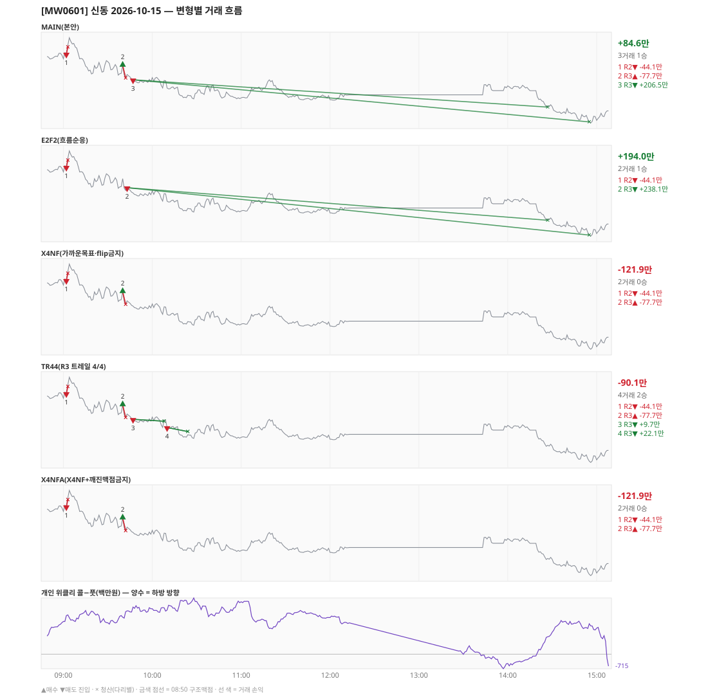

# [MW0601] 신동 일일 리포트 — 2026-10-15

> **MW0601 리포트** · 생성 2026-10-15 15:40 · 규격 `SD-2026-09-29-v2` · 상품 `wk_thu` (최근접 만기 목위클리 (만기 2026-10-15))
> 가상거래다 — 주문 없음(절대원칙 §6). 손익은 미니선물 2계약 · CYBOS 요율 · 1틱 슬리피지 기준.

## 0. 한눈에

| 시장 | R1 장전 | R2 개장확정 | R1 적중(09:00→15:05) |
|---|---|---|---|
| 885.06 → 850.40 (-34.66) · 고 897.92 · 저 846.28 · 폭 51.6pt | 콜−풋 +1884 → **하방** | CONFIRMED 09:02 | ✅ 적중 |

| 변형 | 거래 | 승 | R2 | R3 | **순손익** | 최악 거래 | MAIN 대비 | 기록 |
|---|---|---|---|---|---|---|---|---|
| MAIN(본안) | 3 | 1 | -44.1만 | +128.8만 | **+84.6만** | -77.7만 | — | 라이브 |
| E2F2(흐름순응) | 2 | 1 | -44.1만 | +238.1만 | **+194.0만** | -44.1만 | +109.3만 | 라이브 |
| X4NF(가까운목표·flip금지) | 2 | 0 | -44.1만 | -77.7만 | **-121.9만** | -77.7만 | -206.5만 | 라이브 |
| TR44(R3 트레일 4/4) | 4 | 2 | -44.1만 | -45.9만 | **-90.1만** | -77.7만 | -174.7만 | 라이브 |
| X4NFA(X4NF+깨진맥점금지) | 2 | 0 | -44.1만 | -77.7만 | **-121.9만** | -77.7만 | -206.5만 | 라이브 |

**오늘의 한 줄** — MAIN +84.6만(3거래 1승), 최선은 E2F2(흐름순응) +194.0만(MAIN 대비 +109.3만).

## 1. 차트

## 2. 거래 흐름 — MAIN

| # | 규칙 | 방향 | 진입 | 맥점 | 손절 | 1차 · 최종 | 청산(다리별) | MFE | 손익 | 누적 |
|---|---|---|---|---|---|---|---|---|---|---|
| 1 | R2 | 매도 | 09:02 887.92 (탐지 09:03) | - | 892.12 | 873.93 · 847.20 | 손절 09:03 892.12 · 손절 09:03 892.12 | 1.0 | **-44.1만** | -44.1만 |
| 2 | R3 | 매수 | 09:40 881.06 (탐지 09:41) | 875.0 | 873.50 | 897.50 · 950.50 | 손절 09:42 873.50 · 손절 09:42 873.50 | 0.0 | **-77.7만** | -121.9만 |
| 3 | R3 | 매도 | 09:47 872.46 (탐지 09:48) | 875.0 | 876.50 | 856.04 · 847.20 | 1차 14:27 856.04 · 최종 14:55 847.20 | 25.5 | **+206.5만** | +84.6만 |

## 3. 섀도 흐름 — MAIN 과 무엇이 달랐나

### E2F2(흐름순응) — +194.0만 (MAIN 대비 +109.3만)

- 09:40 R3 매수: MAIN 진입 881.06 → **F2 차단(당일 흐름 역방향)** (MAIN 손익 -77.7만 제외)
- 09:47 R3 매도: MAIN 진입 872.46 → **앞 거래 보유 중/시점 이동** (MAIN 손익 +206.5만 제외)
- 09:43 R3 매도: **섀도만 진입** 875.62 (앞 거래가 없어 신호가 살아남) → +238.1만

| # | 규칙 | 방향 | 진입 | 맥점 | 손절 | 1차 · 최종 | 청산(다리별) | MFE | 손익 | 누적 |
|---|---|---|---|---|---|---|---|---|---|---|
| 1 | R2 | 매도 | 09:02 887.92 (탐지 09:03) | - | 892.12 | 873.93 · 847.20 | 손절 09:03 892.12 · 손절 09:03 892.12 | 1.0 | **-44.1만** | -44.1만 |
| 2 | R3 | 매도 | 09:43 875.62 (탐지 09:44) | 875.0 | 876.50 | 856.04 · 847.20 | 1차 14:27 856.04 · 최종 14:55 847.20 | 28.7 | **+238.1만** | +194.0만 |

### X4NF(가까운목표·flip금지) — -121.9만 (MAIN 대비 -206.5만)

- 09:47 R3 매도: MAIN 진입 872.46 → **flip 금지(같은 맥점 875.0 반대 방향)** (MAIN 손익 +206.5만 제외)

| # | 규칙 | 방향 | 진입 | 맥점 | 손절 | 1차 · 최종 | 청산(다리별) | MFE | 손익 | 누적 |
|---|---|---|---|---|---|---|---|---|---|---|
| 1 | R2 | 매도 | 09:02 887.92 (탐지 09:03) | - | 892.12 | 873.93 · 847.20 | 손절 09:03 892.12 · 손절 09:03 892.12 | 1.0 | **-44.1만** | -44.1만 |
| 2 | R3 | 매수 | 09:40 881.06 (탐지 09:41) | 875.0 | 873.50 | 897.50 · 950.50 | 손절 09:42 873.50 · 손절 09:42 873.50 | 0.0 | **-77.7만** | -121.9만 |

### TR44(R3 트레일 4/4) — -90.1만 (MAIN 대비 -174.7만)

- 09:47 R3 매도: 청산 차이 — MAIN 1차/최종 → 트레일/트레일 (+206.5만 → +9.7만, 차 -196.8만)
- 10:10 R3 매도: **섀도만 진입** 867.52 (앞 거래가 없어 신호가 살아남) → +22.1만

| # | 규칙 | 방향 | 진입 | 맥점 | 손절 | 1차 · 최종 | 청산(다리별) | MFE | 손익 | 누적 |
|---|---|---|---|---|---|---|---|---|---|---|
| 1 | R2 | 매도 | 09:02 887.92 (탐지 09:03) | - | 892.12 | 873.93 · 847.20 | 손절 09:03 892.12 · 손절 09:03 892.12 | 1.0 | **-44.1만** | -44.1만 |
| 2 | R3 | 매수 | 09:40 881.06 (탐지 09:41) | 875.0 | 873.50 | 897.50 · 950.50 | 손절 09:42 873.50 · 손절 09:42 873.50 | 0.0 | **-77.7만** | -121.9만 |
| 3 | R3 | 매도 | 09:47 872.46 (탐지 09:48) | 875.0 | 876.50 | 856.04 · 847.20 | 트레일 10:08 871.28 · 트레일 10:08 871.28 | 5.2 | **+9.7만** | -112.2만 |
| 4 | R3 | 매도 | 10:10 867.52 (탐지 10:11) | 875.0 | 876.50 | 856.04 · 847.20 | 트레일 10:24 865.10 · 트레일 10:24 865.10 | 6.4 | **+22.1만** | -90.1만 |

### X4NFA(X4NF+깨진맥점금지) — -121.9만 (MAIN 대비 -206.5만)

- 09:47 R3 매도: MAIN 진입 872.46 → **flip 금지(같은 맥점 875.0 반대 방향)** (MAIN 손익 +206.5만 제외)

| # | 규칙 | 방향 | 진입 | 맥점 | 손절 | 1차 · 최종 | 청산(다리별) | MFE | 손익 | 누적 |
|---|---|---|---|---|---|---|---|---|---|---|
| 1 | R2 | 매도 | 09:02 887.92 (탐지 09:03) | - | 892.12 | 873.93 · 847.20 | 손절 09:03 892.12 · 손절 09:03 892.12 | 1.0 | **-44.1만** | -44.1만 |
| 2 | R3 | 매수 | 09:40 881.06 (탐지 09:41) | 875.0 | 873.50 | 897.50 · 950.50 | 손절 09:42 873.50 · 손절 09:42 873.50 | 0.0 | **-77.7만** | -121.9만 |

## 4. 누적 채점 (라이브 기록 · 판정 창)

| 변형 | 채점 시작 | 거래일 | 거래 | 승률 | 순손익 | 최악일 | R3 (건 · 승률 · 순) | 판정 |
|---|---|---|---|---|---|---|---|---|
| MAIN(본안) | 2026-09-30 | 10 | 40 | 32% | **-76.6만** | -102.0만 | 35 · 31% · +56.3만 | R3 중단 판정 10/10일 |
| E2F2(흐름순응) | 2026-09-30 | 10 | 36 | 42% | **+329.2만** | -102.0만 | 31 · 42% · +462.2만 | MAIN 비교 10/10일 |
| X4NF(가까운목표·flip금지) | 2026-09-30 | 10 | 40 | 48% | **-43.9만** | -121.9만 | 35 · 49% · +89.0만 | MAIN 비교 10/10일 |
| TR44(R3 트레일 4/4) | 2026-09-30 | 10 | 53 | 55% | **+26.9만** | -95.9만 | 48 · 56% · +159.8만 | MAIN 비교 10/10일 |
| X4NFA(X4NF+깨진맥점금지) | 2026-09-30 | 10 | 39 | 49% | **+122.9만** | -121.9만 | 34 · 50% · +255.8만 | MAIN 비교 10/10일 |

> 판정 전 집계다 — 인용·규격 변경 근거로 쓰지 말 것. R3 중단 기준: 순손익 < 0 **그리고** 승률 < 35%.

## 5. 러너 섀도 — 미륵이 × 신동 (CREON 요율)

- 오늘 기록 없음 — 미륵이 시스템 진입이 없었거나 장후 기록 전이다

## 6. 개선 방향 (자동 관찰 — 판정 아님)

- **진입 품질** — MAIN 손실 2건 중 2건은 유리한 쪽으로 4pt 도 못 갔다(MFE 1.0, 0.0). 청산을 바꿔서는 못 막는 손실이다 → 진입 필터(E2F2·X4NF·X4NFA) 쪽 관찰 대상.
- **맥점 반복** — 875.0 에서 R3 2회(매수→매도) · 합 +128.8만. 박스권에서 같은 맥점을 양쪽으로 번갈아 잡았다.
- **탐지 지연** — 라이브 진입 3건, 규칙가 대비 실현가능가 차 +0(음수 = 늦게 알아채 손해).
- **오늘 최선은 E2F2(흐름순응)** (+194.0만, MAIN 대비 +109.3만). 하루 결과다 — 판정은 사전등록 창(10거래일)으로만.
- ⚠ 규격 변경은 사전등록 §6(새 버전 · 재채점)으로만. 이 절은 관찰이다.

---
재생성: `python scripts/shindong_daily_report.py 2026-10-15`
