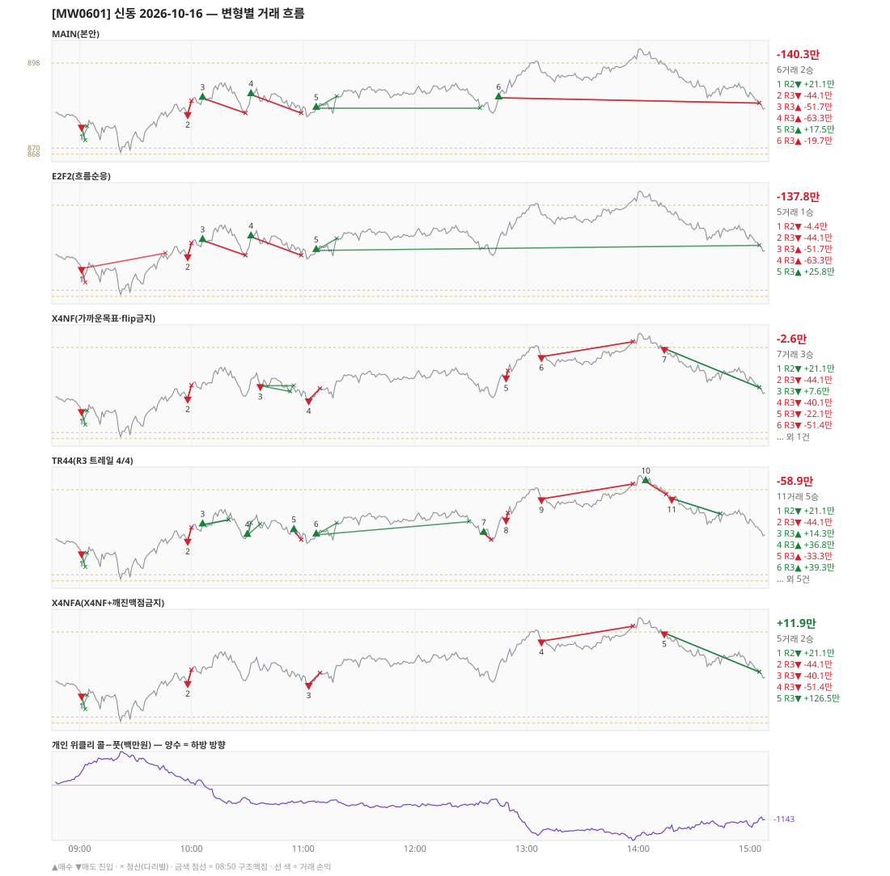

# [MW0601] 신동 일일 리포트 — 2026-10-16

> **MW0601 리포트** · 생성 2026-10-16 15:40 · 규격 `SD-2026-09-29-v2` · 상품 `wk_mon` (최근접 만기 월위클리 (만기 2026-10-19))
> 가상거래다 — 주문 없음(절대원칙 §6). 손익은 미니선물 2계약 · CYBOS 요율 · 1틱 슬리피지 기준.

## 0. 한눈에

| 시장 | R1 장전 | R2 개장확정 | R1 적중(09:00→15:05) |
|---|---|---|---|
| 878.56 → 884.80 (+6.24) · 고 903.32 · 저 867.68 · 폭 35.6pt | 콜−풋 +298 → **하방** | CONFIRMED 09:01 | ❌ 불적중 |

| 변형 | 거래 | 승 | R2 | R3 | **순손익** | 최악 거래 | MAIN 대비 | 기록 |
|---|---|---|---|---|---|---|---|---|
| MAIN(본안) | 6 | 2 | +21.1만 | -161.4만 | **-140.3만** | -63.3만 | — | 라이브 |
| E2F2(흐름순응) | 5 | 1 | -4.4만 | -133.4만 | **-137.8만** | -63.3만 | +2.5만 | 라이브 |
| X4NF(가까운목표·flip금지) | 7 | 3 | +21.1만 | -23.8만 | **-2.6만** | -51.4만 | +137.6만 | 라이브 |
| TR44(R3 트레일 4/4) | 11 | 5 | +21.1만 | -80.0만 | **-58.9만** | -51.4만 | +81.4만 | 라이브 |
| X4NFA(X4NF+깨진맥점금지) | 5 | 2 | +21.1만 | -9.2만 | **+11.9만** | -51.4만 | +152.2만 | 라이브 |

**오늘의 한 줄** — MAIN -140.3만(6거래 2승), 최선은 X4NFA(X4NF+깨진맥점금지) +11.9만(MAIN 대비 +152.2만).

## 1. 차트

## 2. 거래 흐름 — MAIN

| # | 규칙 | 방향 | 진입 | 맥점 | 손절 | 1차 · 최종 | 청산(다리별) | MFE | 손익 | 누적 |
|---|---|---|---|---|---|---|---|---|---|---|
| 1 | R2 | 매도 | 09:01 877.16 (탐지 09:02) | - | 882.26 | 872.53 · 862.50 | 1차 09:03 872.53 · 본전 09:04 877.16 | 5.0 | **+21.1만** | +21.1만 |
| 2 | R3 | 매도 | 09:58 881.30 (탐지 09:59) | 883.0 | 885.50 | 868.50 · 862.50 | 손절 10:00 885.50 · 손절 10:00 885.50 | -0.1 | **-44.1만** | -23.0만 |
| 3 | R3 | 매수 | 10:06 886.46 (탐지 10:07) | 883.0 | 881.50 | 937.50 · 937.50 | 손절 10:29 881.50 · 손절 10:29 881.50 | 5.6 | **-51.7만** | -74.8만 |
| 4 | R3 | 매수 | 10:32 887.62 (탐지 10:33) | 883.0 | 881.50 | 937.50 · 937.50 | 손절 10:59 881.50 · 손절 10:59 881.50 | 3.1 | **-63.3만** | -138.1만 |
| 5 | R3 | 매수 | 11:07 883.14 (탐지 11:08) | 883.0 | 879.66 | 887.05 · 937.50 | 1차 11:18 887.05 · 본전 12:35 883.14 | 8.4 | **+17.5만** | -120.6만 |
| 6 | R3 | 매수 | 12:45 886.56 (탐지 12:46) | 883.0 | 879.92 | 937.50 · 937.50 | 시간 15:05 884.80 · 시간 15:05 884.80 | 16.8 | **-19.7만** | -140.3만 |

## 3. 섀도 흐름 — MAIN 과 무엇이 달랐나

### E2F2(흐름순응) — -137.8만 (MAIN 대비 +2.5만)

- 09:01 R2 매도: 청산 차이 — MAIN 1차/본전 → 1차/손절 (+21.1만 → -4.4만, 차 -25.5만)
- 11:07 R3 매수: 청산 차이 — MAIN 1차/본전 → 1차/시간 (+17.5만 → +25.8만, 차 +8.3만)
- 12:45 R3 매수: MAIN 진입 886.56 → **앞 거래 보유 중/시점 이동** (MAIN 손익 -19.7만 제외)

| # | 규칙 | 방향 | 진입 | 맥점 | 손절 | 1차 · 최종 | 청산(다리별) | MFE | 손익 | 누적 |
|---|---|---|---|---|---|---|---|---|---|---|
| 1 | R2 | 매도 | 09:01 877.16 (탐지 09:02) | - | 882.26 | 872.53 · 862.50 | 1차 09:03 872.53 · 손절 09:46 882.26 | 9.5 | **-4.4만** | -4.4만 |
| 2 | R3 | 매도 | 09:58 881.30 (탐지 09:59) | 883.0 | 885.50 | 868.50 · 862.50 | 손절 10:00 885.50 · 손절 10:00 885.50 | -0.1 | **-44.1만** | -48.5만 |
| 3 | R3 | 매수 | 10:06 886.46 (탐지 10:07) | 883.0 | 881.50 | 937.50 · 937.50 | 손절 10:29 881.50 · 손절 10:29 881.50 | 5.6 | **-51.7만** | -100.3만 |
| 4 | R3 | 매수 | 10:32 887.62 (탐지 10:33) | 883.0 | 881.50 | 937.50 · 937.50 | 손절 10:59 881.50 · 손절 10:59 881.50 | 3.1 | **-63.3만** | -163.6만 |
| 5 | R3 | 매수 | 11:07 883.14 (탐지 11:08) | 883.0 | 879.66 | 887.05 · 937.50 | 1차 11:18 887.05 · 시간 15:05 884.80 | 20.2 | **+25.8만** | -137.8만 |

### X4NF(가까운목표·flip금지) — -2.6만 (MAIN 대비 +137.6만)

- 10:06 R3 매수: MAIN 진입 886.46 → **flip 금지(같은 맥점 883.0 반대 방향)** (MAIN 손익 -51.7만 제외)
- 10:32 R3 매수: MAIN 진입 887.62 → **앞 거래 보유 중/시점 이동** (MAIN 손익 -63.3만 제외)
- 11:07 R3 매수: MAIN 진입 883.14 → **앞 거래 보유 중/시점 이동** (MAIN 손익 +17.5만 제외)
- 12:45 R3 매수: MAIN 진입 886.56 → **앞 거래 보유 중/시점 이동** (MAIN 손익 -19.7만 제외)
- 10:37 R3 매도: **섀도만 진입** 885.42 (앞 거래가 없어 신호가 살아남) → +7.6만
- 11:03 R3 매도: **섀도만 진입** 880.70 (앞 거래가 없어 신호가 살아남) → -40.1만
- 12:49 R3 매도: **섀도만 진입** 888.28 (앞 거래가 없어 신호가 살아남) → -22.1만
- 13:08 R3 매도: **섀도만 진입** 894.98 (앞 거래가 없어 신호가 살아남) → -51.4만
- 14:14 R3 매도: **섀도만 진입** 897.66 (앞 거래가 없어 신호가 살아남) → +126.5만

| # | 규칙 | 방향 | 진입 | 맥점 | 손절 | 1차 · 최종 | 청산(다리별) | MFE | 손익 | 누적 |
|---|---|---|---|---|---|---|---|---|---|---|
| 1 | R2 | 매도 | 09:01 877.16 (탐지 09:02) | - | 882.26 | 872.53 · 862.50 | 1차 09:03 872.53 · 본전 09:04 877.16 | 5.0 | **+21.1만** | +21.1만 |
| 2 | R3 | 매도 | 09:58 881.30 (탐지 09:59) | 883.0 | 885.50 | 870.50 · 862.50 | 손절 10:00 885.50 · 손절 10:00 885.50 | -0.1 | **-44.1만** | -23.0만 |
| 3 | R3 | 매도 | 10:37 885.42 (탐지 10:38) | 883.0 | 891.22 | 883.50 · 862.50 | 1차 10:53 883.50 · 본전 10:55 885.42 | 2.7 | **+7.6만** | -15.5만 |
| 4 | R3 | 매도 | 11:03 880.70 (탐지 11:04) | 883.0 | 884.50 | 870.50 · 862.50 | 손절 11:09 884.50 · 손절 11:09 884.50 | 0.2 | **-40.1만** | -55.6만 |
| 5 | R3 | 매도 | 12:49 888.28 (탐지 12:50) | 883.0 | 890.28 | 883.50 · 862.50 | 손절 12:50 890.28 · 손절 12:50 890.28 | 0.0 | **-22.1만** | -77.7만 |
| 6 | R3 | 매도 | 13:08 894.98 (탐지 13:09) | 898.0 | 899.90 | 883.50 · 862.50 | 손절 13:57 899.90 · 손절 13:57 899.90 | 3.5 | **-51.4만** | -129.1만 |
| 7 | R3 | 매도 | 14:14 897.66 (탐지 14:15) | 898.0 | 899.82 | 883.50 · 862.50 | 시간 15:05 884.80 · 시간 15:05 884.80 | 13.9 | **+126.5만** | -2.6만 |

### TR44(R3 트레일 4/4) — -58.9만 (MAIN 대비 +81.4만)

- 10:06 R3 매수: 청산 차이 — MAIN 손절/손절 → 트레일/트레일 (-51.7만 → +14.3만, 차 +66.0만)
- 10:32 R3 매수: MAIN 진입 887.62 → **앞 거래 보유 중/시점 이동** (MAIN 손익 -63.3만 제외)
- 11:07 R3 매수: 청산 차이 — MAIN 1차/본전 → 1차/트레일 (+17.5만 → +39.3만, 차 +21.8만)
- 12:45 R3 매수: MAIN 진입 886.56 → **앞 거래 보유 중/시점 이동** (MAIN 손익 -19.7만 제외)
- 10:30 R3 매수: **섀도만 진입** 883.00 (앞 거래가 없어 신호가 살아남) → +36.8만
- 10:55 R3 매수: **섀도만 진입** 884.62 (앞 거래가 없어 신호가 살아남) → -33.3만
- 12:37 R3 매수: **섀도만 진입** 883.66 (앞 거래가 없어 신호가 살아남) → -23.7만
- 12:49 R3 매도: **섀도만 진입** 888.28 (앞 거래가 없어 신호가 살아남) → -22.1만
- 13:08 R3 매도: **섀도만 진입** 894.98 (앞 거래가 없어 신호가 살아남) → -51.4만
- 14:04 R3 매수: **섀도만 진입** 900.70 (앞 거래가 없어 신호가 살아남) → -44.2만
- 14:18 R3 매도: **섀도만 진입** 895.12 (앞 거래가 없어 신호가 살아남) → +48.4만

| # | 규칙 | 방향 | 진입 | 맥점 | 손절 | 1차 · 최종 | 청산(다리별) | MFE | 손익 | 누적 |
|---|---|---|---|---|---|---|---|---|---|---|
| 1 | R2 | 매도 | 09:01 877.16 (탐지 09:02) | - | 882.26 | 872.53 · 862.50 | 1차 09:03 872.53 · 본전 09:04 877.16 | 5.0 | **+21.1만** | +21.1만 |
| 2 | R3 | 매도 | 09:58 881.30 (탐지 09:59) | 883.0 | 885.50 | 868.50 · 862.50 | 손절 10:00 885.50 · 손절 10:00 885.50 | -0.1 | **-44.1만** | -23.0만 |
| 3 | R3 | 매수 | 10:06 886.46 (탐지 10:07) | 883.0 | 881.50 | 937.50 · 937.50 | 트레일 10:20 888.10 · 트레일 10:20 888.10 | 5.6 | **+14.3만** | -8.8만 |
| 4 | R3 | 매수 | 10:30 883.00 (탐지 10:31) | 883.0 | 880.80 | 887.05 · 937.50 | 1차 10:32 887.05 · 트레일 10:37 886.72 | 7.7 | **+36.8만** | +28.1만 |
| 5 | R3 | 매수 | 10:55 884.62 (탐지 10:56) | 883.0 | 881.50 | 887.05 · 937.50 | 손절 10:59 881.50 · 손절 10:59 881.50 | 0.4 | **-33.3만** | -5.3만 |
| 6 | R3 | 매수 | 11:07 883.14 (탐지 11:08) | 883.0 | 879.66 | 887.05 · 937.50 | 1차 11:18 887.05 · 트레일 12:29 887.50 | 8.4 | **+39.3만** | +34.1만 |
| 7 | R3 | 매수 | 12:37 883.66 (탐지 12:38) | 883.0 | 881.50 | 887.05 · 937.50 | 손절 12:41 881.50 · 손절 12:41 881.50 | 1.6 | **-23.7만** | +10.3만 |
| 8 | R3 | 매도 | 12:49 888.28 (탐지 12:50) | 883.0 | 890.28 | 868.50 · 862.50 | 손절 12:50 890.28 · 손절 12:50 890.28 | 0.0 | **-22.1만** | -11.8만 |
| 9 | R3 | 매도 | 13:08 894.98 (탐지 13:09) | 898.0 | 899.90 | 868.50 · 862.50 | 손절 13:57 899.90 · 손절 13:57 899.90 | 3.5 | **-51.4만** | -63.2만 |
| 10 | R3 | 매수 | 14:04 900.70 (탐지 14:05) | 898.0 | 896.50 | 937.50 · 937.50 | 손절 14:15 896.50 · 손절 14:15 896.50 | 1.2 | **-44.2만** | -107.3만 |
| 11 | R3 | 매도 | 14:18 895.12 (탐지 14:19) | 898.0 | 899.50 | 868.50 · 862.50 | 트레일 14:44 890.06 · 트레일 14:44 890.06 | 9.1 | **+48.4만** | -58.9만 |

### X4NFA(X4NF+깨진맥점금지) — +11.9만 (MAIN 대비 +152.2만)

- 10:06 R3 매수: MAIN 진입 886.46 → **flip 금지(같은 맥점 883.0 반대 방향)** (MAIN 손익 -51.7만 제외)
- 10:32 R3 매수: MAIN 진입 887.62 → **앞 거래 보유 중/시점 이동** (MAIN 손익 -63.3만 제외)
- 11:07 R3 매수: MAIN 진입 883.14 → **앞 거래 보유 중/시점 이동** (MAIN 손익 +17.5만 제외)
- 12:45 R3 매수: MAIN 진입 886.56 → **앞 거래 보유 중/시점 이동** (MAIN 손익 -19.7만 제외)
- 11:03 R3 매도: **섀도만 진입** 880.70 (앞 거래가 없어 신호가 살아남) → -40.1만
- 13:08 R3 매도: **섀도만 진입** 894.98 (앞 거래가 없어 신호가 살아남) → -51.4만
- 14:14 R3 매도: **섀도만 진입** 897.66 (앞 거래가 없어 신호가 살아남) → +126.5만

| # | 규칙 | 방향 | 진입 | 맥점 | 손절 | 1차 · 최종 | 청산(다리별) | MFE | 손익 | 누적 |
|---|---|---|---|---|---|---|---|---|---|---|
| 1 | R2 | 매도 | 09:01 877.16 (탐지 09:02) | - | 882.26 | 872.53 · 862.50 | 1차 09:03 872.53 · 본전 09:04 877.16 | 5.0 | **+21.1만** | +21.1만 |
| 2 | R3 | 매도 | 09:58 881.30 (탐지 09:59) | 883.0 | 885.50 | 870.50 · 862.50 | 손절 10:00 885.50 · 손절 10:00 885.50 | -0.1 | **-44.1만** | -23.0만 |
| 3 | R3 | 매도 | 11:03 880.70 (탐지 11:04) | 883.0 | 884.50 | 870.50 · 862.50 | 손절 11:09 884.50 · 손절 11:09 884.50 | 0.2 | **-40.1만** | -63.2만 |
| 4 | R3 | 매도 | 13:08 894.98 (탐지 13:09) | 898.0 | 899.90 | 883.50 · 862.50 | 손절 13:57 899.90 · 손절 13:57 899.90 | 3.5 | **-51.4만** | -114.5만 |
| 5 | R3 | 매도 | 14:14 897.66 (탐지 14:15) | 898.0 | 899.82 | 883.50 · 862.50 | 시간 15:05 884.80 · 시간 15:05 884.80 | 13.9 | **+126.5만** | +11.9만 |

## 4. 누적 채점 (라이브 기록 · 판정 창)

| 변형 | 채점 시작 | 거래일 | 거래 | 승률 | 순손익 | 최악일 | R3 (건 · 승률 · 순) | 판정 |
|---|---|---|---|---|---|---|---|---|
| MAIN(본안) | 2026-09-30 | 11 | 46 | 33% | **-216.9만** | -140.3만 | 40 · 30% · -105.1만 | R3 중단 판정 11/10일 |
| E2F2(흐름순응) | 2026-09-30 | 11 | 41 | 39% | **+191.5만** | -137.8만 | 35 · 40% · +328.8만 | MAIN 비교 11/10일 |
| X4NF(가까운목표·flip금지) | 2026-09-30 | 11 | 47 | 47% | **-46.5만** | -121.9만 | 41 · 46% · +65.3만 | MAIN 비교 11/10일 |
| TR44(R3 트레일 4/4) | 2026-09-30 | 11 | 64 | 53% | **-32.0만** | -95.9만 | 58 · 53% · +79.9만 | MAIN 비교 11/10일 |
| X4NFA(X4NF+깨진맥점금지) | 2026-09-30 | 11 | 44 | 48% | **+134.8만** | -121.9만 | 38 · 47% · +246.6만 | MAIN 비교 11/10일 |

> 판정 전 집계다 — 인용·규격 변경 근거로 쓰지 말 것. R3 중단 기준: 순손익 < 0 **그리고** 승률 < 35%.

## 5. 러너 섀도 — 미륵이 × 신동 (CREON 요율)

- 오늘 기록 없음 — 미륵이 시스템 진입이 없었거나 장후 기록 전이다

## 6. 개선 방향 (자동 관찰 — 판정 아님)

- **진입 품질** — MAIN 손실 4건 중 2건은 유리한 쪽으로 4pt 도 못 갔다(MFE -0.1, 3.1). 청산을 바꿔서는 못 막는 손실이다 → 진입 필터(E2F2·X4NF·X4NFA) 쪽 관찰 대상.
- **청산** — MAIN 손실 2건은 4pt 이상 유리하게 갔다가 손절됐다(MFE 5.6, 16.8) → 트레일(TR44) 쪽 관찰 대상.
- **맥점 반복** — 883.0 에서 R3 5회(매도→매수→매수→매수→매수) · 합 -161.4만. 박스권에서 같은 맥점을 양쪽으로 번갈아 잡았다.
- **탐지 지연** — 라이브 진입 6건, 규칙가 대비 실현가능가 차 +0(음수 = 늦게 알아채 손해).
- **오늘 최선은 X4NFA(X4NF+깨진맥점금지)** (+11.9만, MAIN 대비 +152.2만). 하루 결과다 — 판정은 사전등록 창(10거래일)으로만.
- ⚠ 규격 변경은 사전등록 §6(새 버전 · 재채점)으로만. 이 절은 관찰이다.

---
재생성: `python scripts/shindong_daily_report.py 2026-10-16`
