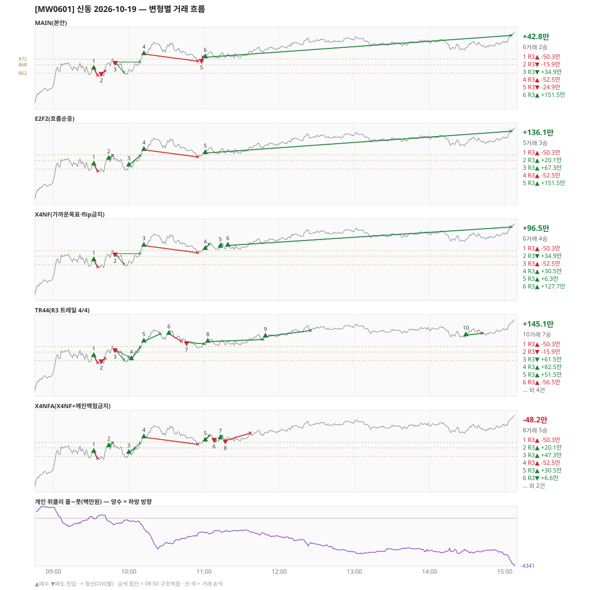

# [MW0601] 신동 일일 리포트 — 2026-10-19

> **MW0601 리포트** · 생성 2026-10-19 15:40 · 규격 `SD-2026-09-29-v2` · 상품 `wk_mon` (최근접 만기 월위클리 (만기 2026-10-19))
> 가상거래다 — 주문 없음(절대원칙 §6). 손익은 미니선물 2계약 · CYBOS 요율 · 1틱 슬리피지 기준.

## 0. 한눈에

| 시장 | R1 장전 | R2 개장확정 | R1 적중(09:00→15:05) |
|---|---|---|---|
| 854.38 → 888.62 (+34.24) · 고 889.04 · 저 850.92 · 폭 38.1pt | 콜−풋 +987 → **하방** | NONE | ❌ 불적중 |

| 변형 | 거래 | 승 | R2 | R3 | **순손익** | 최악 거래 | MAIN 대비 | 기록 |
|---|---|---|---|---|---|---|---|---|
| MAIN(본안) | 6 | 2 | +0.0만 | +42.8만 | **+42.8만** | -52.5만 | — | 라이브 |
| E2F2(흐름순응) | 5 | 3 | +0.0만 | +136.1만 | **+136.1만** | -52.5만 | +93.3만 | 라이브 |
| X4NF(가까운목표·flip금지) | 6 | 4 | +0.0만 | +96.5만 | **+96.5만** | -52.5만 | +53.8만 | 라이브 |
| TR44(R3 트레일 4/4) | 10 | 7 | +0.0만 | +145.1만 | **+145.1만** | -56.5만 | +102.3만 | 라이브 |
| X4NFA(X4NF+깨진맥점금지) | 8 | 5 | +0.0만 | -48.2만 | **-48.2만** | -56.1만 | -90.9만 | 라이브 |

**오늘의 한 줄** — MAIN +42.8만(6거래 2승), 최선은 TR44(R3 트레일 4/4) +145.1만(MAIN 대비 +102.3만).

## 1. 차트

## 2. 거래 흐름 — MAIN

| # | 규칙 | 방향 | 진입 | 맥점 | 손절 | 1차 · 최종 | 청산(다리별) | MFE | 손익 | 누적 |
|---|---|---|---|---|---|---|---|---|---|---|
| 1 | R3 | 매수 | 09:32 865.32 (탐지 09:33) | 862.0 | 860.50 | 871.50 · 871.50 | 손절 09:35 860.50 · 손절 09:35 860.50 | 0.9 | **-50.3만** | -50.3만 |
| 2 | R3 | 매도 | 09:38 862.12 (탐지 09:39) | 862.0 | 863.50 | 838.50 · 784.93 | 손절 09:41 863.50 · 손절 09:41 863.50 | 2.7 | **-15.9만** | -66.2만 |
| 3 | R3 | 매도 | 09:49 869.88 (탐지 09:50) | 868.0 | 873.16 | 862.50 · 838.50 | 1차 09:56 862.50 · 본전 10:09 869.88 | 9.3 | **+34.9만** | -31.3만 |
| 4 | R3 | 매수 | 10:12 875.54 (탐지 10:13) | 872.0 | 870.50 | - · - | 손절 10:55 870.50 · 손절 10:55 870.50 | 9.4 | **-52.5만** | -83.8만 |
| 5 | R3 | 매도 | 10:58 871.22 (탐지 10:59) | 872.0 | 873.50 | 862.50 · 838.50 | 손절 10:59 873.50 · 손절 10:59 873.50 | 0.3 | **-24.9만** | -108.7만 |
| 6 | R3 | 매수 | 11:01 873.26 (탐지 11:02) | 872.0 | 870.50 | - · - | 시간 15:05 888.62 · 시간 15:05 888.62 | 15.8 | **+151.5만** | +42.8만 |

## 3. 섀도 흐름 — MAIN 과 무엇이 달랐나

### E2F2(흐름순응) — +136.1만 (MAIN 대비 +93.3만)

- 09:38 R3 매도: MAIN 진입 862.12 → **F2 차단(당일 흐름 역방향)** (MAIN 손익 -15.9만 제외)
- 09:49 R3 매도: MAIN 진입 869.88 → **F2 차단(당일 흐름 역방향)** (MAIN 손익 +34.9만 제외)
- 10:58 R3 매도: MAIN 진입 871.22 → **F2 차단(당일 흐름 역방향)** (MAIN 손익 -24.9만 제외)
- 09:44 R3 매수: **섀도만 진입** 869.30 (앞 거래가 없어 신호가 살아남) → +20.1만
- 10:00 R3 매수: **섀도만 진입** 864.58 (앞 거래가 없어 신호가 살아남) → +67.3만

| # | 규칙 | 방향 | 진입 | 맥점 | 손절 | 1차 · 최종 | 청산(다리별) | MFE | 손익 | 누적 |
|---|---|---|---|---|---|---|---|---|---|---|
| 1 | R3 | 매수 | 09:32 865.32 (탐지 09:33) | 862.0 | 860.50 | 871.50 · 871.50 | 손절 09:35 860.50 · 손절 09:35 860.50 | 0.9 | **-50.3만** | -50.3만 |
| 2 | R3 | 매수 | 09:44 869.30 (탐지 09:45) | 868.0 | 866.50 | 871.50 · 871.50 | 1차 09:47 871.50 · 최종 09:47 871.50 | 3.4 | **+20.1만** | -30.2만 |
| 3 | R3 | 매수 | 10:00 864.58 (탐지 10:01) | 868.0 | 860.06 | 871.50 · 871.50 | 1차 10:09 871.50 · 최종 10:09 871.50 | 8.1 | **+67.3만** | +37.1만 |
| 4 | R3 | 매수 | 10:12 875.54 (탐지 10:13) | 872.0 | 870.50 | - · - | 손절 10:55 870.50 · 손절 10:55 870.50 | 9.4 | **-52.5만** | -15.4만 |
| 5 | R3 | 매수 | 11:01 873.26 (탐지 11:02) | 872.0 | 870.46 | - · - | 시간 15:05 888.62 · 시간 15:05 888.62 | 15.8 | **+151.5만** | +136.1만 |

### X4NF(가까운목표·flip금지) — +96.5만 (MAIN 대비 +53.8만)

- 09:38 R3 매도: MAIN 진입 862.12 → **flip 금지(같은 맥점 862.0 반대 방향)** (MAIN 손익 -15.9만 제외)
- 10:58 R3 매도: MAIN 진입 871.22 → **flip 금지(같은 맥점 872.0 반대 방향)** (MAIN 손익 -24.9만 제외)
- 11:01 R3 매수: 청산 차이 — MAIN 시간/시간 → 1차/최종 (+151.5만 → +30.5만, 차 -121.0만)
- 11:13 R3 매수: **섀도만 진입** 874.84 (앞 거래가 없어 신호가 살아남) → +6.3만
- 11:19 R3 매수: **섀도만 진입** 875.64 (앞 거래가 없어 신호가 살아남) → +127.7만

| # | 규칙 | 방향 | 진입 | 맥점 | 손절 | 1차 · 최종 | 청산(다리별) | MFE | 손익 | 누적 |
|---|---|---|---|---|---|---|---|---|---|---|
| 1 | R3 | 매수 | 09:32 865.32 (탐지 09:33) | 862.0 | 860.50 | 867.50 · 871.50 | 손절 09:35 860.50 · 손절 09:35 860.50 | 0.9 | **-50.3만** | -50.3만 |
| 2 | R3 | 매도 | 09:49 869.88 (탐지 09:50) | 868.0 | 873.16 | 862.50 · 838.50 | 1차 09:56 862.50 · 본전 10:09 869.88 | 9.3 | **+34.9만** | -15.4만 |
| 3 | R3 | 매수 | 10:12 875.54 (탐지 10:13) | 872.0 | 870.50 | - · - | 손절 10:55 870.50 · 손절 10:55 870.50 | 9.4 | **-52.5만** | -67.9만 |
| 4 | R3 | 매수 | 11:01 873.26 (탐지 11:02) | 872.0 | 870.46 | 876.50 · 876.50 | 1차 11:04 876.50 · 최종 11:04 876.50 | 3.3 | **+30.5만** | -37.4만 |
| 5 | R3 | 매수 | 11:13 874.84 (탐지 11:14) | 877.0 | 871.12 | 876.50 · 876.50 | 1차 11:14 876.50 · 본전 11:14 874.84 | 1.7 | **+6.3만** | -31.1만 |
| 6 | R3 | 매수 | 11:19 875.64 (탐지 11:20) | 872.0 | 870.50 | - · - | 시간 15:05 888.62 · 시간 15:05 888.62 | 13.4 | **+127.7만** | +96.5만 |

### TR44(R3 트레일 4/4) — +145.1만 (MAIN 대비 +102.3만)

- 09:49 R3 매도: 청산 차이 — MAIN 1차/본전 → 1차/트레일 (+34.9만 → +61.5만, 차 +26.6만)
- 10:12 R3 매수: 청산 차이 — MAIN 손절/손절 → 트레일/트레일 (-52.5만 → +51.5만, 차 +104.0만)
- 10:58 R3 매도: MAIN 진입 871.22 → **앞 거래 보유 중/시점 이동** (MAIN 손익 -24.9만 제외)
- 11:01 R3 매수: MAIN 진입 873.26 → **앞 거래 보유 중/시점 이동** (MAIN 손익 +151.5만 제외)
- 10:02 R3 매수: **섀도만 진입** 863.06 (앞 거래가 없어 신호가 살아남) → +82.5만
- 10:32 R3 매수: **섀도만 진입** 880.94 (앞 거래가 없어 신호가 살아남) → -56.5만
- 10:46 R3 매도: **섀도만 진입** 874.86 (앞 거래가 없어 신호가 살아남) → +8.5만
- 11:03 R3 매수: **섀도만 진입** 875.38 (앞 거래가 없어 신호가 살아남) → +12.9만
- 11:49 R3 매수: **섀도만 진입** 879.02 (앞 거래가 없어 신호가 살아남) → +39.7만
- 14:29 R3 매수: **섀도만 진입** 879.92 (앞 거래가 없어 신호가 살아남) → +11.3만

| # | 규칙 | 방향 | 진입 | 맥점 | 손절 | 1차 · 최종 | 청산(다리별) | MFE | 손익 | 누적 |
|---|---|---|---|---|---|---|---|---|---|---|
| 1 | R3 | 매수 | 09:32 865.32 (탐지 09:33) | 862.0 | 860.50 | 871.50 · 871.50 | 손절 09:35 860.50 · 손절 09:35 860.50 | 0.9 | **-50.3만** | -50.3만 |
| 2 | R3 | 매도 | 09:38 862.12 (탐지 09:39) | 862.0 | 863.50 | 838.50 · 784.93 | 손절 09:41 863.50 · 손절 09:41 863.50 | 2.7 | **-15.9만** | -66.2만 |
| 3 | R3 | 매도 | 09:49 869.88 (탐지 09:50) | 868.0 | 873.16 | 862.50 · 838.50 | 1차 09:56 862.50 · 트레일 10:00 864.56 | 9.3 | **+61.5만** | -4.7만 |
| 4 | R3 | 매수 | 10:02 863.06 (탐지 10:03) | 862.0 | 860.50 | 871.50 · 871.50 | 1차 10:09 871.50 · 최종 10:09 871.50 | 9.6 | **+82.5만** | +77.8만 |
| 5 | R3 | 매수 | 10:12 875.54 (탐지 10:13) | 872.0 | 870.50 | - · - | 트레일 10:25 880.90 · 트레일 10:25 880.90 | 9.4 | **+51.5만** | +129.3만 |
| 6 | R3 | 매수 | 10:32 880.94 (탐지 10:33) | 877.0 | 875.50 | - · - | 손절 10:42 875.50 · 손절 10:42 875.50 | 2.8 | **-56.5만** | +72.8만 |
| 7 | R3 | 매도 | 10:46 874.86 (탐지 10:47) | 877.0 | 878.50 | 862.50 · 838.50 | 트레일 11:00 873.80 · 트레일 11:00 873.80 | 5.1 | **+8.5만** | +81.3만 |
| 8 | R3 | 매수 | 11:03 875.38 (탐지 11:04) | 872.0 | 870.50 | - · - | 트레일 11:47 876.88 · 트레일 11:47 876.88 | 5.5 | **+12.9만** | +94.1만 |
| 9 | R3 | 매수 | 11:49 879.02 (탐지 11:50) | 877.0 | 875.50 | - · - | 트레일 12:25 883.20 · 트레일 12:25 883.20 | 8.2 | **+39.7만** | +133.8만 |
| 10 | R3 | 매수 | 14:29 879.92 (탐지 14:30) | 877.0 | 875.50 | - · - | 트레일 14:42 881.26 · 트레일 14:42 881.26 | 5.3 | **+11.3만** | +145.1만 |

### X4NFA(X4NF+깨진맥점금지) — -48.2만 (MAIN 대비 -90.9만)

- 09:38 R3 매도: MAIN 진입 862.12 → **flip 금지(같은 맥점 862.0 반대 방향)** (MAIN 손익 -15.9만 제외)
- 09:49 R3 매도: MAIN 진입 869.88 → **깨진 맥점 차단(진입 869.88 · 맥점 868.0)** (MAIN 손익 +34.9만 제외)
- 10:58 R3 매도: MAIN 진입 871.22 → **flip 금지(같은 맥점 872.0 반대 방향)** (MAIN 손익 -24.9만 제외)
- 11:01 R3 매수: 청산 차이 — MAIN 시간/시간 → 1차/최종 (+151.5만 → +30.5만, 차 -121.0만)
- 09:44 R3 매수: **섀도만 진입** 869.30 (앞 거래가 없어 신호가 살아남) → +20.1만
- 10:00 R3 매수: **섀도만 진입** 864.58 (앞 거래가 없어 신호가 살아남) → +47.3만
- 11:08 R3 매도: **섀도만 진입** 874.22 (앞 거래가 없어 신호가 살아남) → +6.6만
- 11:13 R3 매수: **섀도만 진입** 874.84 (앞 거래가 없어 신호가 살아남) → +6.3만
- 11:17 R3 매도: **섀도만 진입** 873.10 (앞 거래가 없어 신호가 살아남) → -56.1만

| # | 규칙 | 방향 | 진입 | 맥점 | 손절 | 1차 · 최종 | 청산(다리별) | MFE | 손익 | 누적 |
|---|---|---|---|---|---|---|---|---|---|---|
| 1 | R3 | 매수 | 09:32 865.32 (탐지 09:33) | 862.0 | 860.50 | 867.50 · 871.50 | 손절 09:35 860.50 · 손절 09:35 860.50 | 0.9 | **-50.3만** | -50.3만 |
| 2 | R3 | 매수 | 09:44 869.30 (탐지 09:45) | 868.0 | 866.50 | 871.50 · 871.50 | 1차 09:47 871.50 · 최종 09:47 871.50 | 3.4 | **+20.1만** | -30.2만 |
| 3 | R3 | 매수 | 10:00 864.58 (탐지 10:01) | 862.0 | 860.06 | 867.50 · 871.50 | 1차 10:05 867.50 · 최종 10:09 871.50 | 8.1 | **+47.3만** | +17.1만 |
| 4 | R3 | 매수 | 10:12 875.54 (탐지 10:13) | 872.0 | 870.50 | - · - | 손절 10:55 870.50 · 손절 10:55 870.50 | 9.4 | **-52.5만** | -35.4만 |
| 5 | R3 | 매수 | 11:01 873.26 (탐지 11:02) | 872.0 | 870.46 | 876.50 · 876.50 | 1차 11:04 876.50 · 최종 11:04 876.50 | 3.3 | **+30.5만** | -4.9만 |
| 6 | R3 | 매도 | 11:08 874.22 (탐지 11:09) | 877.0 | 878.50 | 872.50 · 838.50 | 1차 11:09 872.50 · 본전 11:09 874.22 | 2.0 | **+6.6만** | +1.7만 |
| 7 | R3 | 매수 | 11:13 874.84 (탐지 11:14) | 872.0 | 870.50 | 876.50 · 876.50 | 1차 11:14 876.50 · 본전 11:14 874.84 | 1.7 | **+6.3만** | +7.9만 |
| 8 | R3 | 매도 | 11:17 873.10 (탐지 11:18) | 877.0 | 878.50 | 868.50 · 838.50 | 손절 11:37 878.50 · 손절 11:37 878.50 | 0.8 | **-56.1만** | -48.2만 |

## 4. 누적 채점 (라이브 기록 · 판정 창)

| 변형 | 채점 시작 | 거래일 | 거래 | 승률 | 순손익 | 최악일 | R3 (건 · 승률 · 순) | 판정 |
|---|---|---|---|---|---|---|---|---|
| MAIN(본안) | 2026-09-30 | 12 | 52 | 33% | **-174.1만** | -140.3만 | 46 · 30% · -62.3만 | R3 중단 판정 12/10일 |
| E2F2(흐름순응) | 2026-09-30 | 12 | 46 | 41% | **+327.5만** | -137.8만 | 40 · 42% · +464.9만 | MAIN 비교 12/10일 |
| X4NF(가까운목표·flip금지) | 2026-09-30 | 12 | 53 | 49% | **+50.0만** | -121.9만 | 47 · 49% · +161.8만 | MAIN 비교 12/10일 |
| TR44(R3 트레일 4/4) | 2026-09-30 | 12 | 74 | 55% | **+113.1만** | -95.9만 | 68 · 56% · +224.9만 | MAIN 비교 12/10일 |
| X4NFA(X4NF+깨진맥점금지) | 2026-09-30 | 12 | 52 | 50% | **+86.6만** | -121.9만 | 46 · 50% · +198.4만 | MAIN 비교 12/10일 |

> 판정 전 집계다 — 인용·규격 변경 근거로 쓰지 말 것. R3 중단 기준: 순손익 < 0 **그리고** 승률 < 35%.

## 5. 러너 섀도 — 미륵이 × 신동 (CREON 요율)

- 오늘 기록 없음 — 미륵이 시스템 진입이 없었거나 장후 기록 전이다

## 6. 개선 방향 (자동 관찰 — 판정 아님)

- **진입 품질** — MAIN 손실 4건 중 3건은 유리한 쪽으로 4pt 도 못 갔다(MFE 0.9, 2.7, 0.3). 청산을 바꿔서는 못 막는 손실이다 → 진입 필터(E2F2·X4NF·X4NFA) 쪽 관찰 대상.
- **청산** — MAIN 손실 1건은 4pt 이상 유리하게 갔다가 손절됐다(MFE 9.4) → 트레일(TR44) 쪽 관찰 대상.
- **맥점 반복** — 862.0 에서 R3 2회(매수→매도) · 합 -66.2만. 박스권에서 같은 맥점을 양쪽으로 번갈아 잡았다.
- **맥점 반복** — 872.0 에서 R3 3회(매수→매도→매수) · 합 +74.0만. 박스권에서 같은 맥점을 양쪽으로 번갈아 잡았다.
- **깨진 맥점 진입 2건** — 흐름 반전을 기다리는 사이 가격이 맥점을 다시 넘어간 뒤 들어갔다(09:38 매도 862.12/맥점 862.0 -15.9만, 09:49 매도 869.88/맥점 868.0 +34.9만) · 합 +19.0만 → X4NFA 가 막는 진입이다.
- **목표 없는 진입 2건** — 가격이 08:50 맥점 범위 밖이라 손절·15:05 로만 끝날 수 있었다(10:12 -52.5만, 11:01 +151.5만).
- **탐지 지연** — 라이브 진입 6건, 규칙가 대비 실현가능가 차 +0(음수 = 늦게 알아채 손해).
- **오늘 최선은 TR44(R3 트레일 4/4)** (+145.1만, MAIN 대비 +102.3만). 하루 결과다 — 판정은 사전등록 창(10거래일)으로만.
- ⚠ 규격 변경은 사전등록 §6(새 버전 · 재채점)으로만. 이 절은 관찰이다.

---
재생성: `python scripts/shindong_daily_report.py 2026-10-19`
