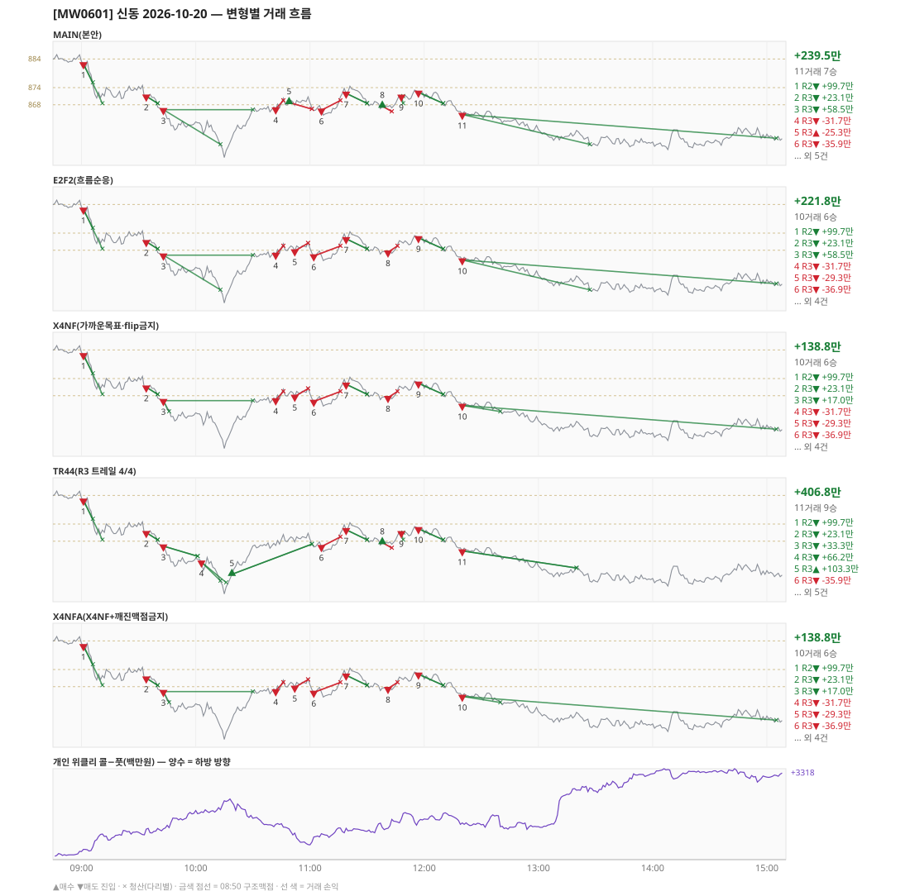

# [MW0601] 신동 일일 리포트 — 2026-10-20

> **MW0601 리포트** · 생성 2026-10-20 15:40 · 규격 `SD-2026-09-29-v2` · 상품 `wk_thu` (최근접 만기 목위클리 (만기 2026-10-22))
> 가상거래다 — 주문 없음(절대원칙 §6). 손익은 미니선물 2계약 · CYBOS 요율 · 1틱 슬리피지 기준.

## 0. 한눈에

| 시장 | R1 장전 | R2 개장확정 | R1 적중(09:00→15:05) |
|---|---|---|---|
| 883.10 → 856.32 (-26.78) · 고 886.72 · 저 849.22 · 폭 37.5pt | 콜−풋 +316 → **하방** | CONFIRMED 09:01 | ✅ 적중 |

| 변형 | 거래 | 승 | R2 | R3 | **순손익** | 최악 거래 | MAIN 대비 | 기록 |
|---|---|---|---|---|---|---|---|---|
| MAIN(본안) | 11 | 7 | +99.7만 | +139.9만 | **+239.5만** | -35.9만 | — | 라이브 |
| E2F2(흐름순응) | 10 | 6 | +99.7만 | +122.2만 | **+221.8만** | -36.9만 | -17.7만 | 라이브 |
| X4NF(가까운목표·flip금지) | 10 | 6 | +99.7만 | +39.2만 | **+138.8만** | -36.9만 | -100.7만 | 라이브 |
| TR44(R3 트레일 4/4) | 11 | 9 | +99.7만 | +307.1만 | **+406.8만** | -35.9만 | +167.2만 | 라이브 |
| X4NFA(X4NF+깨진맥점금지) | 10 | 6 | +99.7만 | +39.2만 | **+138.8만** | -36.9만 | -100.7만 | 라이브 |

**오늘의 한 줄** — MAIN +239.5만(11거래 7승), 최선은 TR44(R3 트레일 4/4) +406.8만(MAIN 대비 +167.2만).

## 1. 차트

## 2. 거래 흐름 — MAIN

| # | 규칙 | 방향 | 진입 | 맥점 | 손절 | 1차 · 최종 | 청산(다리별) | MFE | 손익 | 누적 |
|---|---|---|---|---|---|---|---|---|---|---|
| 1 | R2 | 매도 | 09:01 882.30 (탐지 09:02) | - | 887.72 | 875.78 · 868.50 | 1차 09:06 875.78 · 최종 09:11 868.50 | 13.9 | **+99.7만** | +99.7만 |
| 2 | R3 | 매도 | 09:34 871.00 (탐지 09:35) | 874.0 | 875.88 | 868.50 · 868.50 | 1차 09:40 868.50 · 최종 09:40 868.50 | 4.3 | **+23.1만** | +122.8만 |
| 3 | R3 | 매도 | 09:43 866.30 (탐지 09:44) | 868.0 | 869.50 | 854.20 · 846.52 | 1차 10:13 854.20 · 본전 10:30 866.30 | 17.1 | **+58.5만** | +181.3만 |
| 4 | R3 | 매도 | 10:42 866.54 (탐지 10:43) | 868.0 | 869.50 | 854.20 · 846.52 | 손절 10:46 869.50 · 손절 10:46 869.50 | 0.1 | **-31.7만** | +149.5만 |
| 5 | R3 | 매수 | 10:49 868.82 (탐지 10:50) | 868.0 | 866.50 | 888.50 · 897.50 | 손절 11:01 866.50 · 손절 11:01 866.50 | 2.2 | **-25.3만** | +124.2만 |
| 6 | R3 | 매도 | 11:06 866.12 (탐지 11:07) | 868.0 | 869.50 | 854.20 · 846.52 | 손절 11:16 869.50 · 손절 11:16 869.50 | 2.7 | **-35.9만** | +88.3만 |
| 7 | R3 | 매도 | 11:19 872.02 (탐지 11:20) | 874.0 | 875.50 | 868.50 · 868.50 | 1차 11:30 868.50 · 최종 11:30 868.50 | 3.9 | **+33.3만** | +121.6만 |
| 8 | R3 | 매수 | 11:38 867.54 (탐지 11:39) | 868.0 | 865.66 | 888.50 · 897.50 | 손절 11:43 865.66 · 손절 11:43 865.66 | 1.1 | **-20.9만** | +100.7만 |
| 9 | R3 | 매도 | 11:48 870.96 (탐지 11:49) | 868.0 | 872.36 | 868.50 · 868.50 | 1차 11:49 868.50 · 본전 11:49 870.96 | 2.7 | **+10.3만** | +111.0만 |
| 10 | R3 | 매도 | 11:57 872.36 (탐지 11:58) | 874.0 | 875.50 | 868.50 · 868.50 | 1차 12:10 868.50 · 최종 12:10 868.50 | 4.6 | **+36.7만** | +147.7만 |
| 11 | R3 | 매도 | 12:20 864.64 (탐지 12:21) | 868.0 | 870.32 | 854.20 · 846.52 | 1차 13:27 854.20 · 시간 15:05 856.32 | 12.4 | **+91.8만** | +239.5만 |

## 3. 섀도 흐름 — MAIN 과 무엇이 달랐나

### E2F2(흐름순응) — +221.8만 (MAIN 대비 -17.7만)

- 10:49 R3 매수: MAIN 진입 868.82 → **F2 차단(당일 흐름 역방향)** (MAIN 손익 -25.3만 제외)
- 11:06 R3 매도: MAIN 진입 866.12 → **앞 거래 보유 중/시점 이동** (MAIN 손익 -35.9만 제외)
- 11:38 R3 매수: MAIN 진입 867.54 → **F2 차단(당일 흐름 역방향)** (MAIN 손익 -20.9만 제외)
- 11:48 R3 매도: MAIN 진입 870.96 → **앞 거래 보유 중/시점 이동** (MAIN 손익 +10.3만 제외)
- 10:52 R3 매도: **섀도만 진입** 867.76 (앞 거래가 없어 신호가 살아남) → -29.3만
- 11:02 R3 매도: **섀도만 진입** 866.02 (앞 거래가 없어 신호가 살아남) → -36.9만
- 11:41 R3 매도: **섀도만 진입** 867.38 (앞 거래가 없어 신호가 살아남) → -23.3만

| # | 규칙 | 방향 | 진입 | 맥점 | 손절 | 1차 · 최종 | 청산(다리별) | MFE | 손익 | 누적 |
|---|---|---|---|---|---|---|---|---|---|---|
| 1 | R2 | 매도 | 09:01 882.30 (탐지 09:02) | - | 887.72 | 875.78 · 868.50 | 1차 09:06 875.78 · 최종 09:11 868.50 | 13.9 | **+99.7만** | +99.7만 |
| 2 | R3 | 매도 | 09:34 871.00 (탐지 09:35) | 874.0 | 875.88 | 868.50 · 868.50 | 1차 09:40 868.50 · 최종 09:40 868.50 | 4.3 | **+23.1만** | +122.8만 |
| 3 | R3 | 매도 | 09:43 866.30 (탐지 09:44) | 868.0 | 869.50 | 854.20 · 846.52 | 1차 10:13 854.20 · 본전 10:30 866.30 | 17.1 | **+58.5만** | +181.3만 |
| 4 | R3 | 매도 | 10:42 866.54 (탐지 10:43) | 868.0 | 869.50 | 854.20 · 846.52 | 손절 10:46 869.50 · 손절 10:46 869.50 | 0.1 | **-31.7만** | +149.5만 |
| 5 | R3 | 매도 | 10:52 867.76 (탐지 10:53) | 868.0 | 870.48 | 854.20 · 846.52 | 손절 10:59 870.48 · 손절 10:59 870.48 | 0.2 | **-29.3만** | +120.2만 |
| 6 | R3 | 매도 | 11:02 866.02 (탐지 11:03) | 868.0 | 869.50 | 854.20 · 846.52 | 손절 11:16 869.50 · 손절 11:16 869.50 | 2.6 | **-36.9만** | +83.3만 |
| 7 | R3 | 매도 | 11:19 872.02 (탐지 11:20) | 874.0 | 875.50 | 868.50 · 868.50 | 1차 11:30 868.50 · 최종 11:30 868.50 | 3.9 | **+33.3만** | +116.6만 |
| 8 | R3 | 매도 | 11:41 867.38 (탐지 11:42) | 868.0 | 869.50 | 854.20 · 846.52 | 손절 11:46 869.50 · 손절 11:46 869.50 | 1.9 | **-23.3만** | +93.3만 |
| 9 | R3 | 매도 | 11:57 872.36 (탐지 11:58) | 874.0 | 875.50 | 868.50 · 868.50 | 1차 12:10 868.50 · 최종 12:10 868.50 | 4.6 | **+36.7만** | +130.0만 |
| 10 | R3 | 매도 | 12:20 864.64 (탐지 12:21) | 868.0 | 870.32 | 854.20 · 846.52 | 1차 13:27 854.20 · 시간 15:05 856.32 | 12.4 | **+91.8만** | +221.8만 |

### X4NF(가까운목표·flip금지) — +138.8만 (MAIN 대비 -100.7만)

- 09:43 R3 매도: 목표가 차이 — 1차 854.20 → 862.50 (+58.5만 → +17.0만, 차 -41.5만)
- 10:49 R3 매수: MAIN 진입 868.82 → **flip 금지(같은 맥점 868.0 반대 방향)** (MAIN 손익 -25.3만 제외)
- 11:06 R3 매도: MAIN 진입 866.12 → **flip 금지(같은 맥점 868.0 반대 방향)** (MAIN 손익 -35.9만 제외)
- 11:38 R3 매수: MAIN 진입 867.54 → **flip 금지(같은 맥점 868.0 반대 방향)** (MAIN 손익 -20.9만 제외)
- 11:48 R3 매도: MAIN 진입 870.96 → **flip 금지(같은 맥점 868.0 반대 방향)** (MAIN 손익 +10.3만 제외)
- 12:20 R3 매도: 목표가 차이 — 1차 854.20 → 862.50 (+91.8만 → +50.3만, 차 -41.5만)
- 10:52 R3 매도: **섀도만 진입** 867.76 (앞 거래가 없어 신호가 살아남) → -29.3만
- 11:02 R3 매도: **섀도만 진입** 866.02 (앞 거래가 없어 신호가 살아남) → -36.9만
- 11:41 R3 매도: **섀도만 진입** 867.38 (앞 거래가 없어 신호가 살아남) → -23.3만

| # | 규칙 | 방향 | 진입 | 맥점 | 손절 | 1차 · 최종 | 청산(다리별) | MFE | 손익 | 누적 |
|---|---|---|---|---|---|---|---|---|---|---|
| 1 | R2 | 매도 | 09:01 882.30 (탐지 09:02) | - | 887.72 | 875.78 · 868.50 | 1차 09:06 875.78 · 최종 09:11 868.50 | 13.9 | **+99.7만** | +99.7만 |
| 2 | R3 | 매도 | 09:34 871.00 (탐지 09:35) | 874.0 | 875.88 | 868.50 · 868.50 | 1차 09:40 868.50 · 최종 09:40 868.50 | 4.3 | **+23.1만** | +122.8만 |
| 3 | R3 | 매도 | 09:43 866.30 (탐지 09:44) | 868.0 | 869.50 | 862.50 · 846.52 | 1차 09:46 862.50 · 본전 10:30 866.30 | 17.1 | **+17.0만** | +139.8만 |
| 4 | R3 | 매도 | 10:42 866.54 (탐지 10:43) | 868.0 | 869.50 | 862.50 · 846.52 | 손절 10:46 869.50 · 손절 10:46 869.50 | 0.1 | **-31.7만** | +108.1만 |
| 5 | R3 | 매도 | 10:52 867.76 (탐지 10:53) | 868.0 | 870.48 | 862.50 · 846.52 | 손절 10:59 870.48 · 손절 10:59 870.48 | 0.2 | **-29.3만** | +78.7만 |
| 6 | R3 | 매도 | 11:02 866.02 (탐지 11:03) | 868.0 | 869.50 | 862.50 · 846.52 | 손절 11:16 869.50 · 손절 11:16 869.50 | 2.6 | **-36.9만** | +41.8만 |
| 7 | R3 | 매도 | 11:19 872.02 (탐지 11:20) | 874.0 | 875.50 | 868.50 · 868.50 | 1차 11:30 868.50 · 최종 11:30 868.50 | 3.9 | **+33.3만** | +75.1만 |
| 8 | R3 | 매도 | 11:41 867.38 (탐지 11:42) | 868.0 | 869.50 | 862.50 · 846.52 | 손절 11:46 869.50 · 손절 11:46 869.50 | 1.9 | **-23.3만** | +51.8만 |
| 9 | R3 | 매도 | 11:57 872.36 (탐지 11:58) | 874.0 | 875.50 | 868.50 · 868.50 | 1차 12:10 868.50 · 최종 12:10 868.50 | 4.6 | **+36.7만** | +88.5만 |
| 10 | R3 | 매도 | 12:20 864.64 (탐지 12:21) | 868.0 | 870.32 | 862.50 · 846.52 | 1차 12:40 862.50 · 시간 15:05 856.32 | 12.4 | **+50.3만** | +138.8만 |

### TR44(R3 트레일 4/4) — +406.8만 (MAIN 대비 +167.2만)

- 09:43 R3 매도: 청산 차이 — MAIN 1차/본전 → 트레일/트레일 (+58.5만 → +33.3만, 차 -25.2만)
- 10:42 R3 매도: MAIN 진입 866.54 → **앞 거래 보유 중/시점 이동** (MAIN 손익 -31.7만 제외)
- 10:49 R3 매수: MAIN 진입 868.82 → **앞 거래 보유 중/시점 이동** (MAIN 손익 -25.3만 제외)
- 12:20 R3 매도: 청산 차이 — MAIN 1차/시간 → 트레일/트레일 (+91.8만 → +57.7만, 차 -34.1만)
- 10:03 R3 매도: **섀도만 진입** 860.72 (앞 거래가 없어 신호가 살아남) → +66.2만
- 10:19 R3 매수: **섀도만 진입** 856.46 (앞 거래가 없어 신호가 살아남) → +103.3만

| # | 규칙 | 방향 | 진입 | 맥점 | 손절 | 1차 · 최종 | 청산(다리별) | MFE | 손익 | 누적 |
|---|---|---|---|---|---|---|---|---|---|---|
| 1 | R2 | 매도 | 09:01 882.30 (탐지 09:02) | - | 887.72 | 875.78 · 868.50 | 1차 09:06 875.78 · 최종 09:11 868.50 | 13.9 | **+99.7만** | +99.7만 |
| 2 | R3 | 매도 | 09:34 871.00 (탐지 09:35) | 874.0 | 875.88 | 868.50 · 868.50 | 1차 09:40 868.50 · 최종 09:40 868.50 | 4.3 | **+23.1만** | +122.8만 |
| 3 | R3 | 매도 | 09:43 866.30 (탐지 09:44) | 868.0 | 869.50 | 854.20 · 846.52 | 트레일 10:01 862.76 · 트레일 10:01 862.76 | 7.5 | **+33.3만** | +156.1만 |
| 4 | R3 | 매도 | 10:03 860.72 (탐지 10:04) | 862.0 | 863.50 | 854.20 · 846.52 | 1차 10:13 854.20 · 트레일 10:16 853.60 | 11.5 | **+66.2만** | +222.3만 |
| 5 | R3 | 매수 | 10:19 856.46 (탐지 10:20) | 851.0 | 849.50 | 888.50 · 897.50 | 트레일 11:01 867.00 · 트레일 11:01 867.00 | 14.5 | **+103.3만** | +325.6만 |
| 6 | R3 | 매도 | 11:06 866.12 (탐지 11:07) | 868.0 | 869.50 | 854.20 · 846.52 | 손절 11:16 869.50 · 손절 11:16 869.50 | 2.7 | **-35.9만** | +289.7만 |
| 7 | R3 | 매도 | 11:19 872.02 (탐지 11:20) | 874.0 | 875.50 | 868.50 · 868.50 | 1차 11:30 868.50 · 최종 11:30 868.50 | 3.9 | **+33.3만** | +323.0만 |
| 8 | R3 | 매수 | 11:38 867.54 (탐지 11:39) | 868.0 | 865.66 | 888.50 · 897.50 | 손절 11:43 865.66 · 손절 11:43 865.66 | 1.1 | **-20.9만** | +302.1만 |
| 9 | R3 | 매도 | 11:48 870.96 (탐지 11:49) | 868.0 | 872.36 | 868.50 · 868.50 | 1차 11:49 868.50 · 본전 11:49 870.96 | 2.7 | **+10.3만** | +312.4만 |
| 10 | R3 | 매도 | 11:57 872.36 (탐지 11:58) | 874.0 | 875.50 | 868.50 · 868.50 | 1차 12:10 868.50 · 최종 12:10 868.50 | 4.6 | **+36.7만** | +349.0만 |
| 11 | R3 | 매도 | 12:20 864.64 (탐지 12:21) | 868.0 | 870.32 | 854.20 · 846.52 | 트레일 13:20 858.66 · 트레일 13:20 858.66 | 10.0 | **+57.7만** | +406.8만 |

### X4NFA(X4NF+깨진맥점금지) — +138.8만 (MAIN 대비 -100.7만)

- 09:43 R3 매도: 목표가 차이 — 1차 854.20 → 862.50 (+58.5만 → +17.0만, 차 -41.5만)
- 10:49 R3 매수: MAIN 진입 868.82 → **flip 금지(같은 맥점 868.0 반대 방향)** (MAIN 손익 -25.3만 제외)
- 11:06 R3 매도: MAIN 진입 866.12 → **flip 금지(같은 맥점 868.0 반대 방향)** (MAIN 손익 -35.9만 제외)
- 11:38 R3 매수: MAIN 진입 867.54 → **flip 금지(같은 맥점 868.0 반대 방향)** (MAIN 손익 -20.9만 제외)
- 11:48 R3 매도: MAIN 진입 870.96 → **flip 금지(같은 맥점 868.0 반대 방향)** (MAIN 손익 +10.3만 제외)
- 12:20 R3 매도: 목표가 차이 — 1차 854.20 → 862.50 (+91.8만 → +50.3만, 차 -41.5만)
- 10:52 R3 매도: **섀도만 진입** 867.76 (앞 거래가 없어 신호가 살아남) → -29.3만
- 11:02 R3 매도: **섀도만 진입** 866.02 (앞 거래가 없어 신호가 살아남) → -36.9만
- 11:41 R3 매도: **섀도만 진입** 867.38 (앞 거래가 없어 신호가 살아남) → -23.3만

| # | 규칙 | 방향 | 진입 | 맥점 | 손절 | 1차 · 최종 | 청산(다리별) | MFE | 손익 | 누적 |
|---|---|---|---|---|---|---|---|---|---|---|
| 1 | R2 | 매도 | 09:01 882.30 (탐지 09:02) | - | 887.72 | 875.78 · 868.50 | 1차 09:06 875.78 · 최종 09:11 868.50 | 13.9 | **+99.7만** | +99.7만 |
| 2 | R3 | 매도 | 09:34 871.00 (탐지 09:35) | 874.0 | 875.88 | 868.50 · 868.50 | 1차 09:40 868.50 · 최종 09:40 868.50 | 4.3 | **+23.1만** | +122.8만 |
| 3 | R3 | 매도 | 09:43 866.30 (탐지 09:44) | 868.0 | 869.50 | 862.50 · 846.52 | 1차 09:46 862.50 · 본전 10:30 866.30 | 17.1 | **+17.0만** | +139.8만 |
| 4 | R3 | 매도 | 10:42 866.54 (탐지 10:43) | 868.0 | 869.50 | 862.50 · 846.52 | 손절 10:46 869.50 · 손절 10:46 869.50 | 0.1 | **-31.7만** | +108.1만 |
| 5 | R3 | 매도 | 10:52 867.76 (탐지 10:53) | 868.0 | 870.48 | 862.50 · 846.52 | 손절 10:59 870.48 · 손절 10:59 870.48 | 0.2 | **-29.3만** | +78.7만 |
| 6 | R3 | 매도 | 11:02 866.02 (탐지 11:03) | 868.0 | 869.50 | 862.50 · 846.52 | 손절 11:16 869.50 · 손절 11:16 869.50 | 2.6 | **-36.9만** | +41.8만 |
| 7 | R3 | 매도 | 11:19 872.02 (탐지 11:20) | 874.0 | 875.50 | 868.50 · 868.50 | 1차 11:30 868.50 · 최종 11:30 868.50 | 3.9 | **+33.3만** | +75.1만 |
| 8 | R3 | 매도 | 11:41 867.38 (탐지 11:42) | 868.0 | 869.50 | 862.50 · 846.52 | 손절 11:46 869.50 · 손절 11:46 869.50 | 1.9 | **-23.3만** | +51.8만 |
| 9 | R3 | 매도 | 11:57 872.36 (탐지 11:58) | 874.0 | 875.50 | 868.50 · 868.50 | 1차 12:10 868.50 · 최종 12:10 868.50 | 4.6 | **+36.7만** | +88.5만 |
| 10 | R3 | 매도 | 12:20 864.64 (탐지 12:21) | 868.0 | 870.32 | 862.50 · 846.52 | 1차 12:40 862.50 · 시간 15:05 856.32 | 12.4 | **+50.3만** | +138.8만 |

## 4. 누적 채점 (라이브 기록 · 판정 창)

| 변형 | 채점 시작 | 거래일 | 거래 | 승률 | 순손익 | 최악일 | R3 (건 · 승률 · 순) | 판정 |
|---|---|---|---|---|---|---|---|---|
| MAIN(본안) | 2026-09-30 | 13 | 63 | 38% | **+65.4만** | -140.3만 | 56 · 36% · +77.5만 | R3 중단 판정 13/10일 |
| E2F2(흐름순응) | 2026-09-30 | 13 | 56 | 45% | **+549.4만** | -137.8만 | 49 · 45% · +587.0만 | MAIN 비교 13/10일 |
| X4NF(가까운목표·flip금지) | 2026-09-30 | 13 | 63 | 51% | **+188.8만** | -121.9만 | 56 · 50% · +201.0만 | MAIN 비교 13/10일 |
| TR44(R3 트레일 4/4) | 2026-09-30 | 13 | 85 | 59% | **+519.9만** | -95.9만 | 78 · 59% · +532.0만 | MAIN 비교 13/10일 |
| X4NFA(X4NF+깨진맥점금지) | 2026-09-30 | 13 | 62 | 52% | **+225.5만** | -121.9만 | 55 · 51% · +237.6만 | MAIN 비교 13/10일 |

> 판정 전 집계다 — 인용·규격 변경 근거로 쓰지 말 것. R3 중단 기준: 순손익 < 0 **그리고** 승률 < 35%.

## 5. 러너 섀도 — 미륵이 × 신동 (CREON 요율)

- 오늘 기록 없음 — 미륵이 시스템 진입이 없었거나 장후 기록 전이다

## 6. 개선 방향 (자동 관찰 — 판정 아님)

- **진입 품질** — MAIN 손실 4건 중 4건은 유리한 쪽으로 4pt 도 못 갔다(MFE 0.1, 2.2, 2.7, 1.1). 청산을 바꿔서는 못 막는 손실이다 → 진입 필터(E2F2·X4NF·X4NFA) 쪽 관찰 대상.
- **맥점 반복** — 874.0 에서 R3 3회(매도→매도→매도) · 합 +93.1만. 박스권에서 같은 맥점을 반복해서 잡았다.
- **맥점 반복** — 868.0 에서 R3 7회(매도→매도→매수→매도→매수→매도→매도) · 합 +46.8만. 박스권에서 같은 맥점을 양쪽으로 번갈아 잡았다.
- **깨진 맥점 진입 2건** — 흐름 반전을 기다리는 사이 가격이 맥점을 다시 넘어간 뒤 들어갔다(11:38 매수 867.54/맥점 868.0 -20.9만, 11:48 매도 870.96/맥점 868.0 +10.3만) · 합 -10.6만 → X4NFA 가 막는 진입이다.
- **탐지 지연** — 라이브 진입 11건, 규칙가 대비 실현가능가 차 +0(음수 = 늦게 알아채 손해).
- **오늘 최선은 TR44(R3 트레일 4/4)** (+406.8만, MAIN 대비 +167.2만). 하루 결과다 — 판정은 사전등록 창(10거래일)으로만.
- ⚠ 규격 변경은 사전등록 §6(새 버전 · 재채점)으로만. 이 절은 관찰이다.

---
재생성: `python scripts/shindong_daily_report.py 2026-10-20`
