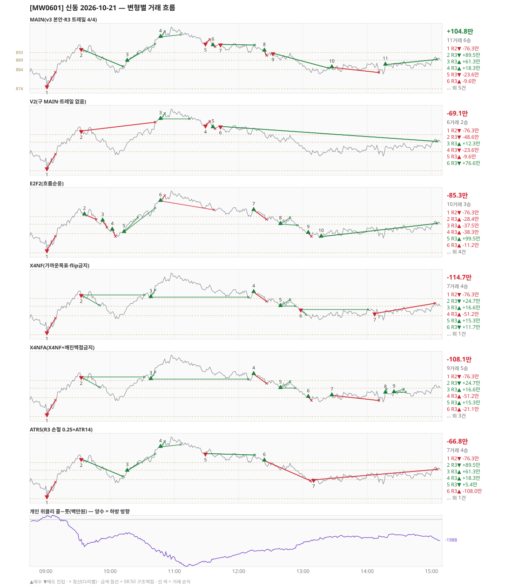

# [MW0601] 신동 일일 리포트 — 2026-10-21

> **MW0601 리포트** · 생성 2026-10-21 15:40 · 규격 `SD-2026-10-21-v3` · 상품 `wk_thu` (최근접 만기 목위클리 (만기 2026-10-22))
> 가상거래다 — 주문 없음(절대원칙 §6). 손익은 미니선물 2계약 · CYBOS 요율 · 1틱 슬리피지 기준.

## 0. 한눈에

| 시장 | R1 장전 | R2 개장확정 | R1 적중(09:00→15:05) |
|---|---|---|---|
| 880.72 → 889.40 (+8.68) · 고 906.40 · 저 873.66 · 폭 32.7pt | 콜−풋 +184 → **하방** | CONFIRMED 09:01 | ❌ 불적중 |

| 변형 | 거래 | 승 | R2 | R3 | **순손익** | 최악 거래 | MAIN 대비 | 기록 |
|---|---|---|---|---|---|---|---|---|
| MAIN(v3 본안·R3 트레일 4/4) | 11 | 6 | -76.3만 | +181.2만 | **+104.8만** | -76.3만 | — | 라이브 |
| V2(구 MAIN·트레일 없음) | 6 | 2 | -76.3만 | +7.3만 | **-69.1만** | -76.3만 | -173.9만 | 라이브 |
| E2F2(흐름순응) | 10 | 3 | -76.3만 | -8.9만 | **-85.3만** | -76.3만 | -190.1만 | 라이브 |
| X4NF(가까운목표·flip금지) | 7 | 4 | -76.3만 | -38.4만 | **-114.7만** | -76.3만 | -219.5만 | 라이브 |
| X4NFA(X4NF+깨진맥점금지) | 9 | 5 | -76.3만 | -31.8만 | **-108.1만** | -76.3만 | -212.9만 | 라이브 |
| ATRS(R3 손절 0.25×ATR14) | 7 | 4 | -76.3만 | +9.5만 | **-66.8만** | -108.0만 | -171.7만 | 라이브 |

**오늘의 한 줄** — MAIN +104.8만(11거래 6승).

## 1. 차트

## 2. 거래 흐름 — MAIN

| # | 규칙 | 방향 | 진입 | 맥점 | 손절 | 1차 · 최종 | 청산(다리별) | MFE | 손익 | 누적 |
|---|---|---|---|---|---|---|---|---|---|---|
| 1 | R2 | 매도 | 09:01 875.30 (탐지 09:02) | - | 882.72 | 865.77 · 864.50 | 손절 09:09 882.72 · 손절 09:09 882.72 | -0.1 | **-76.3만** | -76.3만 |
| 2 | R3 | 매도 | 09:33 894.86 (탐지 09:34) | 898.0 | 899.50 | 874.16 · 864.50 | 트레일 10:12 885.70 · 트레일 10:12 885.70 | 13.2 | **+89.5만** | +13.1만 |
| 3 | R3 | 매수 | 10:16 888.68 (탐지 10:17) | 884.0 | 882.50 | 892.50 · 897.50 | 1차 10:26 892.50 · 최종 10:42 897.50 | 11.1 | **+61.3만** | +74.4만 |
| 4 | R3 | 매수 | 10:47 901.20 (탐지 10:48) | 898.0 | 896.50 | 904.07 · 912.99 | 1차 10:51 904.07 · 트레일 11:06 902.40 | 5.2 | **+18.3만** | +92.7만 |
| 5 | R3 | 매도 | 11:29 897.72 (탐지 11:30) | 898.0 | 899.86 | 874.16 · 864.50 | 손절 11:33 899.86 · 손절 11:33 899.86 | 0.0 | **-23.6만** | +69.1만 |
| 6 | R3 | 매수 | 11:36 896.82 (탐지 11:37) | 898.0 | 896.08 | 904.07 · 912.99 | 손절 11:38 896.08 · 손절 11:38 896.08 | 0.5 | **-9.6만** | +59.6만 |
| 7 | R3 | 매도 | 11:43 897.28 (탐지 11:44) | 898.0 | 899.50 | 874.16 · 864.50 | 트레일 12:15 896.96 · 트레일 12:15 896.96 | 4.3 | **+1.0만** | +60.6만 |
| 8 | R3 | 매수 | 12:24 894.02 (탐지 12:25) | 893.0 | 891.50 | 897.50 · 912.99 | 손절 12:26 891.50 · 손절 12:26 891.50 | 0.0 | **-27.4만** | +33.2만 |
| 9 | R3 | 매도 | 12:32 892.64 (탐지 12:33) | 893.0 | 894.50 | 874.16 · 864.50 | 트레일 13:24 884.84 · 트레일 13:24 884.84 | 11.8 | **+75.9만** | +109.1만 |
| 10 | R3 | 매수 | 13:27 885.24 (탐지 13:28) | 884.0 | 882.50 | 892.50 · 897.50 | 손절 14:11 882.50 · 손절 14:11 882.50 | 2.8 | **-29.5만** | +79.6만 |
| 11 | R3 | 매수 | 14:17 886.66 (탐지 14:18) | 884.0 | 881.02 | 892.50 · 897.50 | 시간 15:05 889.40 · 시간 15:05 889.40 | 4.2 | **+25.3만** | +104.8만 |

## 3. 섀도 흐름 — MAIN 과 무엇이 달랐나

### V2(구 MAIN·트레일 없음) — -69.1만 (MAIN 대비 -173.9만)

- 09:33 R3 매도: 청산 차이 — MAIN 트레일/트레일 → 손절/손절 (+89.5만 → -48.6만, 차 -138.0만)
- 10:16 R3 매수: MAIN 진입 888.68 → **앞 거래 보유 중/시점 이동** (MAIN 손익 +61.3만 제외)
- 10:47 R3 매수: 청산 차이 — MAIN 1차/트레일 → 1차/본전 (+18.3만 → +12.3만, 차 -6.0만)
- 11:43 R3 매도: 청산 차이 — MAIN 트레일/트레일 → 시간/시간 (+1.0만 → +76.6만, 차 +75.6만)
- 12:24 R3 매수: MAIN 진입 894.02 → **앞 거래 보유 중/시점 이동** (MAIN 손익 -27.4만 제외)
- 12:32 R3 매도: MAIN 진입 892.64 → **앞 거래 보유 중/시점 이동** (MAIN 손익 +75.9만 제외)
- 13:27 R3 매수: MAIN 진입 885.24 → **앞 거래 보유 중/시점 이동** (MAIN 손익 -29.5만 제외)
- 14:17 R3 매수: MAIN 진입 886.66 → **앞 거래 보유 중/시점 이동** (MAIN 손익 +25.3만 제외)

| # | 규칙 | 방향 | 진입 | 맥점 | 손절 | 1차 · 최종 | 청산(다리별) | MFE | 손익 | 누적 |
|---|---|---|---|---|---|---|---|---|---|---|
| 1 | R2 | 매도 | 09:01 875.30 (탐지 09:02) | - | 882.72 | 865.77 · 864.50 | 손절 09:09 882.72 · 손절 09:09 882.72 | -0.1 | **-76.3만** | -76.3만 |
| 2 | R3 | 매도 | 09:33 894.86 (탐지 09:34) | 898.0 | 899.50 | 874.16 · 864.50 | 손절 10:42 899.50 · 손절 10:42 899.50 | 13.2 | **-48.6만** | -124.9만 |
| 3 | R3 | 매수 | 10:47 901.20 (탐지 10:48) | 898.0 | 896.50 | 904.07 · 912.99 | 1차 10:51 904.07 · 본전 11:14 901.20 | 5.2 | **+12.3만** | -112.6만 |
| 4 | R3 | 매도 | 11:29 897.72 (탐지 11:30) | 898.0 | 899.86 | 874.16 · 864.50 | 손절 11:33 899.86 · 손절 11:33 899.86 | 0.0 | **-23.6만** | -136.1만 |
| 5 | R3 | 매수 | 11:36 896.82 (탐지 11:37) | 898.0 | 896.08 | 904.07 · 912.99 | 손절 11:38 896.08 · 손절 11:38 896.08 | 0.5 | **-9.6만** | -145.7만 |
| 6 | R3 | 매도 | 11:43 897.28 (탐지 11:44) | 898.0 | 899.50 | 874.16 · 864.50 | 시간 15:05 889.40 · 시간 15:05 889.40 | 16.4 | **+76.6만** | -69.1만 |

### E2F2(흐름순응) — -85.3만 (MAIN 대비 -190.1만)

- 09:33 R3 매도: MAIN 진입 894.86 → **F2 차단(당일 흐름 역방향)** (MAIN 손익 +89.5만 제외)
- 10:16 R3 매수: MAIN 진입 888.68 → **앞 거래 보유 중/시점 이동** (MAIN 손익 +61.3만 제외)
- 10:47 R3 매수: 청산 차이 — MAIN 1차/트레일 → 1차/손절 (+18.3만 → -11.2만, 차 -29.5만)
- 11:29 R3 매도: MAIN 진입 897.72 → **F2 차단(당일 흐름 역방향)** (MAIN 손익 -23.6만 제외)
- 11:36 R3 매수: MAIN 진입 896.82 → **앞 거래 보유 중/시점 이동** (MAIN 손익 -9.6만 제외)
- 11:43 R3 매도: MAIN 진입 897.28 → **F2 차단(당일 흐름 역방향)** (MAIN 손익 +1.0만 제외)
- 12:24 R3 매수: MAIN 진입 894.02 → **앞 거래 보유 중/시점 이동** (MAIN 손익 -27.4만 제외)
- 12:32 R3 매도: MAIN 진입 892.64 → **F2 차단(당일 흐름 역방향)** (MAIN 손익 +75.9만 제외)
- 13:27 R3 매수: MAIN 진입 885.24 → **앞 거래 보유 중/시점 이동** (MAIN 손익 -29.5만 제외)
- 14:17 R3 매수: MAIN 진입 886.66 → **앞 거래 보유 중/시점 이동** (MAIN 손익 +25.3만 제외)
- 09:36 R3 매수: **섀도만 진입** 894.12 (앞 거래가 없어 신호가 살아남) → -28.4만
- 09:53 R3 매수: **섀도만 진입** 890.88 (앞 거래가 없어 신호가 살아남) → -37.5만
- 10:02 R3 매수: **섀도만 진입** 886.12 (앞 거래가 없어 신호가 살아남) → -38.3만
- 10:13 R3 매수: **섀도만 진입** 884.86 (앞 거래가 없어 신호가 살아남) → +99.5만
- 12:14 R3 매수: **섀도만 진입** 896.40 (앞 거래가 없어 신호가 살아남) → -51.2만
- 12:39 R3 매수: **섀도만 진입** 889.04 (앞 거래가 없어 신호가 살아남) → +12.1만
- 13:05 R3 매수: **섀도만 진입** 884.40 (앞 거래가 없어 신호가 살아남) → -21.1만
- 13:17 R3 매수: **섀도만 진입** 882.46 (앞 거래가 없어 신호가 살아남) → +67.3만

| # | 규칙 | 방향 | 진입 | 맥점 | 손절 | 1차 · 최종 | 청산(다리별) | MFE | 손익 | 누적 |
|---|---|---|---|---|---|---|---|---|---|---|
| 1 | R2 | 매도 | 09:01 875.30 (탐지 09:02) | - | 882.72 | 865.77 · 864.50 | 손절 09:09 882.72 · 손절 09:09 882.72 | -0.1 | **-76.3만** | -76.3만 |
| 2 | R3 | 매수 | 09:36 894.12 (탐지 09:37) | 893.0 | 891.50 | 897.50 · 912.99 | 손절 09:47 891.50 · 손절 09:47 891.50 | 3.3 | **-28.4만** | -104.7만 |
| 3 | R3 | 매수 | 09:53 890.88 (탐지 09:54) | 889.0 | 887.34 | 892.50 · 897.50 | 손절 09:57 887.34 · 손절 09:57 887.34 | 0.0 | **-37.5만** | -142.2만 |
| 4 | R3 | 매수 | 10:02 886.12 (탐지 10:03) | 884.0 | 882.50 | 892.50 · 897.50 | 손절 10:05 882.50 · 손절 10:05 882.50 | 0.4 | **-38.3만** | -180.6만 |
| 5 | R3 | 매수 | 10:13 884.86 (탐지 10:14) | 884.0 | 882.04 | 892.50 · 897.50 | 1차 10:26 892.50 · 최종 10:42 897.50 | 14.9 | **+99.5만** | -81.1만 |
| 6 | R3 | 매수 | 10:47 901.20 (탐지 10:48) | 898.0 | 896.50 | 904.07 · 912.99 | 1차 10:51 904.07 · 손절 11:37 896.50 | 5.2 | **-11.2만** | -92.3만 |
| 7 | R3 | 매수 | 12:14 896.40 (탐지 12:15) | 893.0 | 891.50 | 904.07 · 912.99 | 손절 12:26 891.50 · 손절 12:26 891.50 | 0.6 | **-51.2만** | -143.5만 |
| 8 | R3 | 매수 | 12:39 889.04 (탐지 12:40) | 893.0 | 888.40 | 892.50 · 897.50 | 1차 12:48 892.50 · 손절 12:55 888.40 | 3.7 | **+12.1만** | -131.4만 |
| 9 | R3 | 매수 | 13:05 884.40 (탐지 13:06) | 884.0 | 882.50 | 892.50 · 897.50 | 손절 13:08 882.50 · 손절 13:08 882.50 | 0.6 | **-21.1만** | -152.5만 |
| 10 | R3 | 매수 | 13:17 882.46 (탐지 13:18) | 884.0 | 880.34 | 892.50 · 897.50 | 시간 15:05 889.40 · 시간 15:05 889.40 | 8.4 | **+67.3만** | -85.3만 |

### X4NF(가까운목표·flip금지) — -114.7만 (MAIN 대비 -219.5만)

- 09:33 R3 매도: 청산 차이 — MAIN 트레일/트레일 → 1차/본전 (+89.5만 → +24.7만, 차 -64.7만)
- 10:16 R3 매수: MAIN 진입 888.68 → **앞 거래 보유 중/시점 이동** (MAIN 손익 +61.3만 제외)
- 10:47 R3 매수: MAIN 진입 901.20 → **flip 금지(같은 맥점 898.0 반대 방향)** (MAIN 손익 +18.3만 제외)
- 11:29 R3 매도: MAIN 진입 897.72 → **flip 금지(같은 맥점 898.0 반대 방향)** (MAIN 손익 -23.6만 제외)
- 11:36 R3 매수: MAIN 진입 896.82 → **flip 금지(같은 맥점 898.0 반대 방향)** (MAIN 손익 -9.6만 제외)
- 11:43 R3 매도: MAIN 진입 897.28 → **flip 금지(같은 맥점 898.0 반대 방향)** (MAIN 손익 +1.0만 제외)
- 12:24 R3 매수: MAIN 진입 894.02 → **앞 거래 보유 중/시점 이동** (MAIN 손익 -27.4만 제외)
- 12:32 R3 매도: MAIN 진입 892.64 → **flip 금지(같은 맥점 893.0 반대 방향)** (MAIN 손익 +75.9만 제외)
- 13:27 R3 매수: MAIN 진입 885.24 → **앞 거래 보유 중/시점 이동** (MAIN 손익 -29.5만 제외)
- 14:17 R3 매수: MAIN 진입 886.66 → **앞 거래 보유 중/시점 이동** (MAIN 손익 +25.3만 제외)
- 10:38 R3 매수: **섀도만 진입** 893.76 (앞 거래가 없어 신호가 살아남) → +16.6만
- 12:14 R3 매수: **섀도만 진입** 896.40 (앞 거래가 없어 신호가 살아남) → -51.2만
- 12:39 R3 매수: **섀도만 진입** 889.04 (앞 거래가 없어 신호가 살아남) → +15.3만
- 12:58 R3 매도: **섀도만 진입** 887.24 (앞 거래가 없어 신호가 살아남) → +11.7만
- 14:07 R3 매도: **섀도만 진입** 885.16 (앞 거래가 없어 신호가 살아남) → -55.5만

| # | 규칙 | 방향 | 진입 | 맥점 | 손절 | 1차 · 최종 | 청산(다리별) | MFE | 손익 | 누적 |
|---|---|---|---|---|---|---|---|---|---|---|
| 1 | R2 | 매도 | 09:01 875.30 (탐지 09:02) | - | 882.72 | 865.77 · 864.50 | 손절 09:09 882.72 · 손절 09:09 882.72 | -0.1 | **-76.3만** | -76.3만 |
| 2 | R3 | 매도 | 09:33 894.86 (탐지 09:34) | 898.0 | 899.50 | 889.50 · 864.50 | 1차 09:50 889.50 · 본전 10:32 894.86 | 13.2 | **+24.7만** | -51.6만 |
| 3 | R3 | 매수 | 10:38 893.76 (탐지 10:39) | 893.0 | 891.50 | 897.50 · 912.99 | 1차 10:42 897.50 · 본전 12:09 893.76 | 12.6 | **+16.6만** | -34.9만 |
| 4 | R3 | 매수 | 12:14 896.40 (탐지 12:15) | 893.0 | 891.50 | 904.07 · 912.99 | 손절 12:26 891.50 · 손절 12:26 891.50 | 0.6 | **-51.2만** | -86.1만 |
| 5 | R3 | 매수 | 12:39 889.04 (탐지 12:40) | 893.0 | 888.40 | 892.50 · 897.50 | 1차 12:48 892.50 · 본전 12:53 889.04 | 3.7 | **+15.3만** | -70.8만 |
| 6 | R3 | 매도 | 12:58 887.24 (탐지 12:59) | 889.0 | 890.50 | 884.50 · 864.50 | 1차 13:03 884.50 · 본전 14:01 887.24 | 6.4 | **+11.7만** | -59.2만 |
| 7 | R3 | 매도 | 14:07 885.16 (탐지 14:08) | 889.0 | 890.50 | 874.50 · 864.50 | 손절 15:03 890.50 · 손절 15:03 890.50 | 3.6 | **-55.5만** | -114.7만 |

### X4NFA(X4NF+깨진맥점금지) — -108.1만 (MAIN 대비 -212.9만)

- 09:33 R3 매도: 청산 차이 — MAIN 트레일/트레일 → 1차/본전 (+89.5만 → +24.7만, 차 -64.7만)
- 10:16 R3 매수: MAIN 진입 888.68 → **앞 거래 보유 중/시점 이동** (MAIN 손익 +61.3만 제외)
- 10:47 R3 매수: MAIN 진입 901.20 → **flip 금지(같은 맥점 898.0 반대 방향)** (MAIN 손익 +18.3만 제외)
- 11:29 R3 매도: MAIN 진입 897.72 → **flip 금지(같은 맥점 898.0 반대 방향)** (MAIN 손익 -23.6만 제외)
- 11:36 R3 매수: MAIN 진입 896.82 → **flip 금지(같은 맥점 898.0 반대 방향)** (MAIN 손익 -9.6만 제외)
- 11:43 R3 매도: MAIN 진입 897.28 → **flip 금지(같은 맥점 898.0 반대 방향)** (MAIN 손익 +1.0만 제외)
- 12:24 R3 매수: MAIN 진입 894.02 → **앞 거래 보유 중/시점 이동** (MAIN 손익 -27.4만 제외)
- 12:32 R3 매도: MAIN 진입 892.64 → **flip 금지(같은 맥점 893.0 반대 방향)** (MAIN 손익 +75.9만 제외)
- 14:17 R3 매수: 청산 차이 — MAIN 시간/시간 → 1차/본전 (+25.3만 → +7.2만, 차 -18.1만)
- 10:38 R3 매수: **섀도만 진입** 893.76 (앞 거래가 없어 신호가 살아남) → +16.6만
- 12:14 R3 매수: **섀도만 진입** 896.40 (앞 거래가 없어 신호가 살아남) → -51.2만
- 12:39 R3 매수: **섀도만 진입** 889.04 (앞 거래가 없어 신호가 살아남) → +15.3만
- 13:05 R3 매수: **섀도만 진입** 884.40 (앞 거래가 없어 신호가 살아남) → -21.1만
- 14:25 R3 매수: **섀도만 진입** 886.84 (앞 거래가 없어 신호가 살아남) → +6.3만

| # | 규칙 | 방향 | 진입 | 맥점 | 손절 | 1차 · 최종 | 청산(다리별) | MFE | 손익 | 누적 |
|---|---|---|---|---|---|---|---|---|---|---|
| 1 | R2 | 매도 | 09:01 875.30 (탐지 09:02) | - | 882.72 | 865.77 · 864.50 | 손절 09:09 882.72 · 손절 09:09 882.72 | -0.1 | **-76.3만** | -76.3만 |
| 2 | R3 | 매도 | 09:33 894.86 (탐지 09:34) | 898.0 | 899.50 | 889.50 · 864.50 | 1차 09:50 889.50 · 본전 10:32 894.86 | 13.2 | **+24.7만** | -51.6만 |
| 3 | R3 | 매수 | 10:38 893.76 (탐지 10:39) | 893.0 | 891.50 | 897.50 · 912.99 | 1차 10:42 897.50 · 본전 12:09 893.76 | 12.6 | **+16.6만** | -34.9만 |
| 4 | R3 | 매수 | 12:14 896.40 (탐지 12:15) | 893.0 | 891.50 | 904.07 · 912.99 | 손절 12:26 891.50 · 손절 12:26 891.50 | 0.6 | **-51.2만** | -86.1만 |
| 5 | R3 | 매수 | 12:39 889.04 (탐지 12:40) | 889.0 | 887.50 | 892.50 · 897.50 | 1차 12:48 892.50 · 본전 12:53 889.04 | 3.7 | **+15.3만** | -70.8만 |
| 6 | R3 | 매수 | 13:05 884.40 (탐지 13:06) | 884.0 | 882.50 | 888.50 · 897.50 | 손절 13:08 882.50 · 손절 13:08 882.50 | 0.6 | **-21.1만** | -92.0만 |
| 7 | R3 | 매수 | 13:27 885.24 (탐지 13:28) | 884.0 | 882.50 | 888.50 · 897.50 | 손절 14:11 882.50 · 손절 14:11 882.50 | 2.8 | **-29.5만** | -121.5만 |
| 8 | R3 | 매수 | 14:17 886.66 (탐지 14:18) | 884.0 | 881.02 | 888.50 · 897.50 | 1차 14:18 888.50 · 본전 14:18 886.66 | 1.8 | **+7.2만** | -114.3만 |
| 9 | R3 | 매수 | 14:25 886.84 (탐지 14:26) | 884.0 | 882.50 | 888.50 · 897.50 | 1차 14:34 888.50 · 본전 14:36 886.84 | 1.8 | **+6.3만** | -108.1만 |

### ATRS(R3 손절 0.25×ATR14) — -66.8만 (MAIN 대비 -171.7만)

- 11:29 R3 매도: 손절 폭 차이 — 손절 899.86 → 908.31 · 청산 손절/손절 → 트레일/트레일 (-23.6만 → +5.4만, 차 +29.0만)
- 11:36 R3 매수: MAIN 진입 896.82 → **앞 거래 보유 중/시점 이동** (MAIN 손익 -9.6만 제외)
- 11:43 R3 매도: MAIN 진입 897.28 → **앞 거래 보유 중/시점 이동** (MAIN 손익 +1.0만 제외)
- 12:24 R3 매수: 손절 폭 차이 — 손절 891.50 → 883.43 · 청산 손절/손절 → 손절/손절 (-27.4만 → -108.0만, 차 -80.7만)
- 12:32 R3 매도: MAIN 진입 892.64 → **앞 거래 보유 중/시점 이동** (MAIN 손익 +75.9만 제외)
- 13:27 R3 매수: MAIN 진입 885.24 → **앞 거래 보유 중/시점 이동** (MAIN 손익 -29.5만 제외)
- 14:17 R3 매수: MAIN 진입 886.66 → **앞 거래 보유 중/시점 이동** (MAIN 손익 +25.3만 제외)
- 13:10 R3 매도: **섀도만 진입** 883.92 (앞 거래가 없어 신호가 살아남) → -56.9만

| # | 규칙 | 방향 | 진입 | 맥점 | 손절 | 1차 · 최종 | 청산(다리별) | MFE | 손익 | 누적 |
|---|---|---|---|---|---|---|---|---|---|---|
| 1 | R2 | 매도 | 09:01 875.30 (탐지 09:02) | - | 882.72 | 865.77 · 864.50 | 손절 09:09 882.72 · 손절 09:09 882.72 | -0.1 | **-76.3만** | -76.3만 |
| 2 | R3 | 매도 | 09:33 894.86 (탐지 09:34) | 898.0 | 905.45 | 874.16 · 864.50 | 트레일 10:12 885.70 · 트레일 10:12 885.70 | 13.2 | **+89.5만** | +13.1만 |
| 3 | R3 | 매수 | 10:16 888.68 (탐지 10:17) | 884.0 | 878.09 | 892.50 · 897.50 | 1차 10:26 892.50 · 최종 10:42 897.50 | 11.1 | **+61.3만** | +74.4만 |
| 4 | R3 | 매수 | 10:47 901.20 (탐지 10:48) | 898.0 | 890.61 | 904.07 · 912.99 | 1차 10:51 904.07 · 트레일 11:06 902.40 | 5.2 | **+18.3만** | +92.7만 |
| 5 | R3 | 매도 | 11:29 897.72 (탐지 11:30) | 898.0 | 908.31 | 874.16 · 864.50 | 트레일 12:15 896.96 · 트레일 12:15 896.96 | 4.8 | **+5.4만** | +98.1만 |
| 6 | R3 | 매수 | 12:24 894.02 (탐지 12:25) | 893.0 | 883.43 | 897.50 · 912.99 | 손절 13:07 883.43 · 손절 13:07 883.43 | 0.0 | **-108.0만** | -9.9만 |
| 7 | R3 | 매도 | 13:10 883.92 (탐지 13:11) | 884.0 | 894.51 | 874.16 · 864.50 | 시간 15:05 889.40 · 시간 15:05 889.40 | 3.1 | **-56.9만** | -66.8만 |

## 4. 누적 채점 (라이브 기록 · 판정 창)

| 변형 | 채점 시작 | 거래일 | 거래 | 승률 | 순손익 | 최악일 | R3 (건 · 승률 · 순) | 판정 |
|---|---|---|---|---|---|---|---|---|
| MAIN(v3 본안·R3 트레일 4/4) | 2026-10-21 | 1 | 11 | 55% | **+104.8만** | +104.8만 | 10 · 60% · +181.2만 | R3 중단 판정 1/10일 |
| V2(구 MAIN·트레일 없음) | 2026-10-21 | 1 | 6 | 33% | **-69.1만** | -69.1만 | 5 · 40% · +7.3만 | MAIN 비교 1/10일 |
| E2F2(흐름순응) | 2026-10-21 | 1 | 10 | 30% | **-85.3만** | -85.3만 | 9 · 33% · -8.9만 | MAIN 비교 1/10일 |
| X4NF(가까운목표·flip금지) | 2026-10-21 | 1 | 7 | 57% | **-114.7만** | -114.7만 | 6 · 67% · -38.4만 | MAIN 비교 1/10일 |
| X4NFA(X4NF+깨진맥점금지) | 2026-10-21 | 1 | 9 | 56% | **-108.1만** | -108.1만 | 8 · 62% · -31.8만 | MAIN 비교 1/10일 |
| ATRS(R3 손절 0.25×ATR14) | 2026-10-21 | 1 | 7 | 57% | **-66.8만** | -66.8만 | 6 · 67% · +9.5만 | MAIN 비교 1/10일 |

> 판정 전 집계다 — 인용·규격 변경 근거로 쓰지 말 것. R3 중단 기준: 순손익 < 0 **그리고** 승률 < 35%.

## 5. 러너 섀도 — 미륵이 × 신동 (CREON 요율)

- 오늘 기록 없음 — 미륵이 시스템 진입이 없었거나 장후 기록 전이다

## 6. 개선 방향 (자동 관찰 — 판정 아님)

- **진입 품질** — MAIN 손실 5건 중 5건은 유리한 쪽으로 4pt 도 못 갔다(MFE -0.1, 0.0, 0.5, 0.0, 2.8). 청산을 바꿔서는 못 막는 손실이다 → 진입 필터(E2F2·X4NF·X4NFA) 쪽 관찰 대상.
- **맥점 반복** — 898.0 에서 R3 5회(매도→매수→매도→매수→매도) · 합 +75.7만. 박스권에서 같은 맥점을 양쪽으로 번갈아 잡았다.
- **맥점 반복** — 884.0 에서 R3 3회(매수→매수→매수) · 합 +57.0만. 박스권에서 같은 맥점을 반복해서 잡았다.
- **맥점 반복** — 893.0 에서 R3 2회(매수→매도) · 합 +48.5만. 박스권에서 같은 맥점을 양쪽으로 번갈아 잡았다.
- **깨진 맥점 진입 1건** — 흐름 반전을 기다리는 사이 가격이 맥점을 다시 넘어간 뒤 들어갔다(11:36 매수 896.82/맥점 898.0 -9.6만) · 합 -9.6만 → X4NFA 가 막는 진입이다.
- **탐지 지연** — 라이브 진입 11건, 규칙가 대비 실현가능가 차 +0(음수 = 늦게 알아채 손해).
- **오늘은 MAIN 이 최선** (+104.8만).
- ⚠ 규격 변경은 사전등록 §6(새 버전 · 재채점)으로만. 이 절은 관찰이다.

---
재생성: `python scripts/shindong_daily_report.py 2026-10-21`
