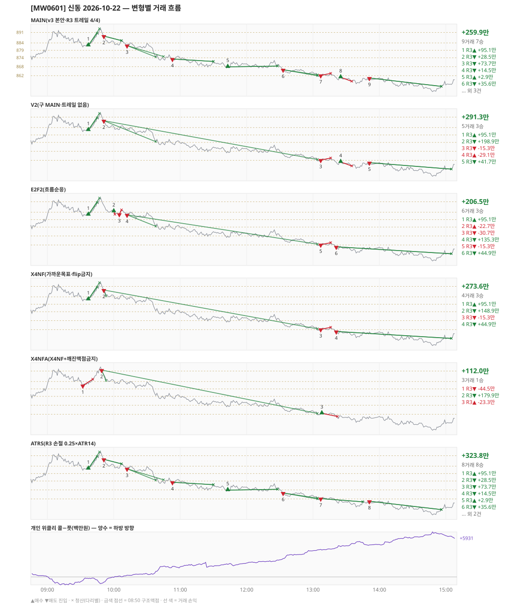

# [MW0601] 신동 일일 리포트 — 2026-10-22

> **MW0601 리포트** · 생성 2026-10-22 17:11 · 규격 `SD-2026-10-21-v3` · 상품 `wk_thu` (최근접 만기 목위클리 (만기 2026-10-22))
> **아래 변형 손익은 엔진 재생(가상)이다** — 장후 최종 흐름으로 하루를 다시 돌린 값. 미니선물 2계약 · CYBOS 요율 · 1틱 슬리피지 기준. **실제 체결 손익은 §2-1 실거래 대사.**

## 0. 한눈에

| 시장 | R1 장전 | R2 개장확정 | R1 적중(09:00→15:05) |
|---|---|---|---|
| 882.00 → 856.04 (-25.96) · 고 894.06 · 저 850.80 · 폭 43.3pt | 콜−풋 +134 → **하방** | NONE | ✅ 적중 |

| 변형 | 거래 | 승 | R2 | R3 | **순손익** | 최악 거래 | MAIN 대비 | 기록 |
|---|---|---|---|---|---|---|---|---|
| MAIN(v3 본안·R3 트레일 4/4) | 9 | 7 | +0.0만 | +259.9만 | **+259.9만** | -29.1만 | — | 재생(장중 기록) |
| V2(구 MAIN·트레일 없음) | 5 | 3 | +0.0만 | +291.3만 | **+291.3만** | -29.1만 | +31.4만 | 재생(장중 기록) |
| E2F2(흐름순응) | 6 | 3 | +0.0만 | +206.5만 | **+206.5만** | -30.7만 | -53.4만 | 재생(장중 기록) |
| X4NF(가까운목표·flip금지) | 4 | 3 | +0.0만 | +273.6만 | **+273.6만** | -15.3만 | +13.6만 | 재생(장중 기록) |
| X4NFA(X4NF+깨진맥점금지) | 3 | 1 | +0.0만 | +112.0만 | **+112.0만** | -44.5만 | -147.9만 | 재생(장중 기록) |
| ATRS(R3 손절 0.25×ATR14) | 8 | 8 | +0.0만 | +323.8만 | **+323.8만** | +2.9만 | +63.9만 | 재생(장중 기록) |

**실거래(실제 체결)** — 9포지션 +112.7만 · 브로커 net +112.7만 · 재생 MAIN 과 차 -147.2만 → §2-1

**오늘의 한 줄** — MAIN +259.9만(9거래 7승), 최선은 ATRS(R3 손절 0.25×ATR14) +323.8만(MAIN 대비 +63.9만).

## 1. 차트

## 2. 거래 흐름 — MAIN

| # | 규칙 | 방향 | 진입 | 맥점 | 손절 | 1차 · 최종 | 청산(다리별) | MFE | 손익 | 누적 |
|---|---|---|---|---|---|---|---|---|---|---|
| 1 | R3 | 매수 | 09:37 882.30 (탐지 09:38) | 884.0 | 880.32 | 890.50 · 893.50 | 1차 09:45 890.50 · 최종 09:47 893.50 | 11.2 | **+95.1만** | +95.1만 |
| 2 | R3 | 매도 | 09:51 888.58 (탐지 09:52) | 891.0 | 892.50 | 874.50 · 862.50 | 트레일 10:07 885.52 · 트레일 10:07 885.52 | 7.1 | **+28.5만** | +123.5만 |
| 3 | R3 | 매도 | 10:12 882.22 (탐지 10:13) | 884.0 | 885.82 | 874.50 · 862.50 | 1차 10:38 874.50 · 트레일 10:45 874.80 | 11.4 | **+73.7만** | +197.2만 |
| 4 | R3 | 매도 | 10:53 873.18 (탐지 10:54) | 874.0 | 876.50 | 862.50 · 861.96 | 트레일 11:30 871.52 · 트레일 11:30 871.52 | 5.7 | **+14.5만** | +211.7만 |
| 5 | R3 | 매수 | 11:43 867.92 (탐지 11:44) | 868.0 | 866.32 | 890.50 · 893.50 | 트레일 12:28 868.42 · 트레일 12:28 868.42 | 4.5 | **+2.9만** | +214.6만 |
| 6 | R3 | 매도 | 12:33 865.98 (탐지 12:34) | 868.0 | 869.50 | 862.50 · 861.96 | 1차 13:04 862.50 · 최종 13:04 861.96 | 4.4 | **+35.6만** | +250.2만 |
| 7 | R3 | 매도 | 13:07 862.18 (탐지 13:08) | 862.0 | 863.50 | 825.38 · 825.38 | 손절 13:16 863.50 · 손절 13:16 863.50 | 0.9 | **-15.3만** | +234.9만 |
| 8 | R3 | 매수 | 13:25 860.90 (탐지 13:26) | 862.0 | 858.20 | 890.50 · 893.50 | 손절 13:35 858.20 · 손절 13:35 858.20 | 0.2 | **-29.1만** | +205.8만 |
| 9 | R3 | 매도 | 13:51 860.42 (탐지 13:52) | 862.0 | 863.50 | 825.38 · 825.38 | 트레일 14:56 854.80 · 트레일 14:56 854.80 | 9.6 | **+54.1만** | +259.9만 |

## 2-1. 실거래 대사 — 실제 체결 vs 재생 MAIN

| # | 구분 | 신호 | 실거래 | 재생 MAIN | 비고 |
|---|---|---|---|---|---|
| 1 | 실거래만 — 재생에서 철회 | `R3\|09:32\|-1` | 09:33 매도 2계약 @881.93 · -38.4만 | - | 철회 이벤트 있음 |
| 2 | 재생만 — 미집행 | `R3\|09:37\|+1` | - | 09:37 매수 @882.30 · +95.1만 | 늦게 알아챔 |
| 3 | 일치 | `R3\|09:51\|-1` | 09:52 매도 2계약 @888.29 · +27.4만 | 09:51 매도 @888.58 · +28.5만 | 차 -1.1만 |
| 4 | 일치 | `R3\|10:12\|-1` | 10:13 매도 2계약 @882.15 · +74.4만 | 10:12 매도 @882.22 · +73.7만 | 차 +0.7만 |
| 5 | 실거래만 — 재생에서 철회 | `R3\|10:50\|+1` | 10:51 매수 2계약 @875.42 · -31.7만 | - | 최종 재생에 없음 |
| 6 | 일치 | `R3\|10:53\|-1` | 10:54 매도 2계약 @873.27 · +15.3만 | 10:53 매도 @873.18 · +14.5만 | 차 +0.8만 |
| 7 | 일치 | `R3\|11:43\|+1` | 11:44 매수 2계약 @868.07 · +3.1만 | 11:43 매수 @867.92 · +2.9만 | 차 +0.2만 |
| 8 | 일치 | `R3\|12:33\|-1` | 12:34 매도 2계약 @866.27 · +40.1만 | 12:33 매도 @865.98 · +35.6만 | 차 +4.5만 |
| 9 | 일치 | `R3\|13:07\|-1` | 13:08 매도 2계약 @862.13 · -17.3만 | 13:07 매도 @862.18 · -15.3만 | 차 -2.0만 |
| 10 | 실거래만 — 재생에서 철회 | `R3\|13:21\|-1` | 13:22 매도 2계약 @860.47 · +40.1만 | - | 철회 이벤트 있음 |
| 11 | 재생만 — 미집행 | `R3\|13:25\|+1` | - | 13:25 매수 @860.90 · -29.1만 | 집행 기록 없음(미측정) |
| 12 | 재생만 — 미집행 | `R3\|13:51\|-1` | - | 13:51 매도 @860.42 · +54.1만 | 집행 기록 없음(미측정) |

| 구분 | 건 | 실거래 | 재생 MAIN |
|---|---|---|---|
| 일치 | 6 | +142.8만 | +139.8만 |
| 실거래만 — 재생에서 철회 | 3 | -30.1만 | - |
| 재생만 — 미집행 | 3 | - | +120.1만 |
| **합** | | **+112.7만** | **+259.9만** |

- 브로커 실측 net(계좌 전체, `daily_broker_pnl` · live): **+112.7만** · 신동 실거래 합과 차 +35
- 재생은 장후 최종 흐름으로 다시 돌린 값이라, 장중에 나왔다가 정정으로 사라진 신호(철회)는 빠지고 보유 중·늦음으로 못 친 신호는 들어간다. **실거래 손익은 이 절의 「실거래」 열이다.**

## 3. 섀도 흐름 — MAIN 과 무엇이 달랐나

### V2(구 MAIN·트레일 없음) — +291.3만 (MAIN 대비 +31.4만)

- 09:51 R3 매도: 청산 차이 — MAIN 트레일/트레일 → 1차/최종 (+28.5만 → +198.9만, 차 +170.4만)
- 10:12 R3 매도: MAIN 진입 882.22 → **앞 거래 보유 중/시점 이동** (MAIN 손익 +73.7만 제외)
- 10:53 R3 매도: MAIN 진입 873.18 → **앞 거래 보유 중/시점 이동** (MAIN 손익 +14.5만 제외)
- 11:43 R3 매수: MAIN 진입 867.92 → **앞 거래 보유 중/시점 이동** (MAIN 손익 +2.9만 제외)
- 12:33 R3 매도: MAIN 진입 865.98 → **앞 거래 보유 중/시점 이동** (MAIN 손익 +35.6만 제외)
- 13:51 R3 매도: 청산 차이 — MAIN 트레일/트레일 → 시간/시간 (+54.1만 → +41.7만, 차 -12.4만)

| # | 규칙 | 방향 | 진입 | 맥점 | 손절 | 1차 · 최종 | 청산(다리별) | MFE | 손익 | 누적 |
|---|---|---|---|---|---|---|---|---|---|---|
| 1 | R3 | 매수 | 09:37 882.30 (탐지 09:38) | 884.0 | 880.32 | 890.50 · 893.50 | 1차 09:45 890.50 · 최종 09:47 893.50 | 11.2 | **+95.1만** | +95.1만 |
| 2 | R3 | 매도 | 09:51 888.58 (탐지 09:52) | 891.0 | 892.50 | 874.50 · 862.50 | 1차 10:38 874.50 · 최종 13:04 862.50 | 27.0 | **+198.9만** | +293.9만 |
| 3 | R3 | 매도 | 13:07 862.18 (탐지 13:08) | 862.0 | 863.50 | 825.38 · 825.38 | 손절 13:16 863.50 · 손절 13:16 863.50 | 0.9 | **-15.3만** | +278.6만 |
| 4 | R3 | 매수 | 13:25 860.90 (탐지 13:26) | 862.0 | 858.20 | 890.50 · 893.50 | 손절 13:35 858.20 · 손절 13:35 858.20 | 0.2 | **-29.1만** | +249.6만 |
| 5 | R3 | 매도 | 13:51 860.42 (탐지 13:52) | 862.0 | 863.50 | 825.38 · 825.38 | 시간 15:05 856.04 · 시간 15:05 856.04 | 9.6 | **+41.7만** | +291.3만 |

### E2F2(흐름순응) — +206.5만 (MAIN 대비 -53.4만)

- 09:51 R3 매도: MAIN 진입 888.58 → **F2 차단(당일 흐름 역방향)** (MAIN 손익 +28.5만 제외)
- 10:12 R3 매도: 청산 차이 — MAIN 1차/트레일 → 1차/최종 (+73.7만 → +135.3만, 차 +61.6만)
- 10:53 R3 매도: MAIN 진입 873.18 → **앞 거래 보유 중/시점 이동** (MAIN 손익 +14.5만 제외)
- 11:43 R3 매수: MAIN 진입 867.92 → **F2 차단(당일 흐름 역방향)** (MAIN 손익 +2.9만 제외)
- 12:33 R3 매도: MAIN 진입 865.98 → **앞 거래 보유 중/시점 이동** (MAIN 손익 +35.6만 제외)
- 13:25 R3 매수: MAIN 진입 860.90 → **F2 차단(당일 흐름 역방향)** (MAIN 손익 -29.1만 제외)
- 13:51 R3 매도: MAIN 진입 860.42 → **앞 거래 보유 중/시점 이동** (MAIN 손익 +54.1만 제외)
- 10:00 R3 매수: **섀도만 진입** 884.56 (앞 거래가 없어 신호가 살아남) → -22.7만
- 10:05 R3 매도: **섀도만 진입** 882.64 (앞 거래가 없어 신호가 살아남) → -30.7만
- 13:21 R3 매도: **섀도만 진입** 860.74 (앞 거래가 없어 신호가 살아남) → +44.9만

| # | 규칙 | 방향 | 진입 | 맥점 | 손절 | 1차 · 최종 | 청산(다리별) | MFE | 손익 | 누적 |
|---|---|---|---|---|---|---|---|---|---|---|
| 1 | R3 | 매수 | 09:37 882.30 (탐지 09:38) | 884.0 | 880.32 | 890.50 · 893.50 | 1차 09:45 890.50 · 최종 09:47 893.50 | 11.2 | **+95.1만** | +95.1만 |
| 2 | R3 | 매수 | 10:00 884.56 (탐지 10:01) | 884.0 | 882.50 | 890.50 · 893.50 | 손절 10:01 882.50 · 손절 10:01 882.50 | 0.1 | **-22.7만** | +72.3만 |
| 3 | R3 | 매도 | 10:05 882.64 (탐지 10:06) | 884.0 | 885.50 | 874.50 · 862.50 | 손절 10:07 885.50 · 손절 10:07 885.50 | 0.6 | **-30.7만** | +41.6만 |
| 4 | R3 | 매도 | 10:12 882.22 (탐지 10:13) | 884.0 | 885.82 | 874.50 · 862.50 | 1차 10:38 874.50 · 최종 13:04 862.50 | 20.6 | **+135.3만** | +176.9만 |
| 5 | R3 | 매도 | 13:07 862.18 (탐지 13:08) | 862.0 | 863.50 | 825.38 · 825.38 | 손절 13:16 863.50 · 손절 13:16 863.50 | 0.9 | **-15.3만** | +161.6만 |
| 6 | R3 | 매도 | 13:21 860.74 (탐지 13:22) | 862.0 | 863.50 | 825.38 · 825.38 | 시간 15:05 856.04 · 시간 15:05 856.04 | 9.9 | **+44.9만** | +206.5만 |

### X4NF(가까운목표·flip금지) — +273.6만 (MAIN 대비 +13.6만)

- 09:51 R3 매도: 청산 차이 — MAIN 트레일/트레일 → 1차/최종 (+28.5만 → +148.9만, 차 +120.4만)
- 10:12 R3 매도: MAIN 진입 882.22 → **flip 금지(같은 맥점 884.0 반대 방향)** (MAIN 손익 +73.7만 제외)
- 10:53 R3 매도: MAIN 진입 873.18 → **앞 거래 보유 중/시점 이동** (MAIN 손익 +14.5만 제외)
- 11:43 R3 매수: MAIN 진입 867.92 → **앞 거래 보유 중/시점 이동** (MAIN 손익 +2.9만 제외)
- 12:33 R3 매도: MAIN 진입 865.98 → **flip 금지(같은 맥점 868.0 반대 방향)** (MAIN 손익 +35.6만 제외)
- 13:25 R3 매수: MAIN 진입 860.90 → **flip 금지(같은 맥점 862.0 반대 방향)** (MAIN 손익 -29.1만 제외)
- 13:51 R3 매도: MAIN 진입 860.42 → **flip 금지(같은 맥점 862.0 반대 방향)** (MAIN 손익 +54.1만 제외)
- 13:21 R3 매도: **섀도만 진입** 860.74 (앞 거래가 없어 신호가 살아남) → +44.9만

| # | 규칙 | 방향 | 진입 | 맥점 | 손절 | 1차 · 최종 | 청산(다리별) | MFE | 손익 | 누적 |
|---|---|---|---|---|---|---|---|---|---|---|
| 1 | R3 | 매수 | 09:37 882.30 (탐지 09:38) | 884.0 | 880.32 | 890.50 · 893.50 | 1차 09:45 890.50 · 최종 09:47 893.50 | 11.2 | **+95.1만** | +95.1만 |
| 2 | R3 | 매도 | 09:51 888.58 (탐지 09:52) | 891.0 | 892.50 | 884.50 · 862.50 | 1차 09:53 884.50 · 최종 13:04 862.50 | 27.0 | **+148.9만** | +243.9만 |
| 3 | R3 | 매도 | 13:07 862.18 (탐지 13:08) | 862.0 | 863.50 | 825.38 · 825.38 | 손절 13:16 863.50 · 손절 13:16 863.50 | 0.9 | **-15.3만** | +228.6만 |
| 4 | R3 | 매도 | 13:21 860.74 (탐지 13:22) | 862.0 | 863.50 | 825.38 · 825.38 | 시간 15:05 856.04 · 시간 15:05 856.04 | 9.9 | **+44.9만** | +273.6만 |

### X4NFA(X4NF+깨진맥점금지) — +112.0만 (MAIN 대비 -147.9만)

- 09:37 R3 매수: MAIN 진입 882.30 → **깨진 맥점 차단(진입 882.30 · 맥점 884.0)** (MAIN 손익 +95.1만 제외)
- 09:51 R3 매도: MAIN 진입 888.58 → **앞 거래 보유 중/시점 이동** (MAIN 손익 +28.5만 제외)
- 10:12 R3 매도: MAIN 진입 882.22 → **flip 금지(같은 맥점 884.0 반대 방향)** (MAIN 손익 +73.7만 제외)
- 10:53 R3 매도: MAIN 진입 873.18 → **앞 거래 보유 중/시점 이동** (MAIN 손익 +14.5만 제외)
- 11:43 R3 매수: MAIN 진입 867.92 → **깨진 맥점 차단(진입 867.92 · 맥점 868.0)** (MAIN 손익 +2.9만 제외)
- 12:33 R3 매도: MAIN 진입 865.98 → **flip 금지(같은 맥점 868.0 반대 방향)** (MAIN 손익 +35.6만 제외)
- 13:07 R3 매도: MAIN 진입 862.18 → **깨진 맥점 차단(진입 862.18 · 맥점 862.0)** (MAIN 손익 -15.3만 제외)
- 13:25 R3 매수: MAIN 진입 860.90 → **flip 금지(같은 맥점 862.0 반대 방향)** (MAIN 손익 -29.1만 제외)
- 13:51 R3 매도: MAIN 진입 860.42 → **flip 금지(같은 맥점 862.0 반대 방향)** (MAIN 손익 +54.1만 제외)
- 09:32 R3 매도: **섀도만 진입** 881.26 (앞 거래가 없어 신호가 살아남) → -44.5만
- 09:49 R3 매도: **섀도만 진입** 891.68 (앞 거래가 없어 신호가 살아남) → +179.9만
- 13:08 R3 매수: **섀도만 진입** 862.62 (앞 거래가 없어 신호가 살아남) → -23.3만

| # | 규칙 | 방향 | 진입 | 맥점 | 손절 | 1차 · 최종 | 청산(다리별) | MFE | 손익 | 누적 |
|---|---|---|---|---|---|---|---|---|---|---|
| 1 | R3 | 매도 | 09:32 881.26 (탐지 09:33) | 884.0 | 885.50 | 879.50 · 862.50 | 손절 09:41 885.50 · 손절 09:41 885.50 | 0.4 | **-44.5만** | -44.5만 |
| 2 | R3 | 매도 | 09:49 891.68 (탐지 09:50) | 894.0 | 895.50 | 884.50 · 862.50 | 1차 09:53 884.50 · 최종 13:04 862.50 | 30.1 | **+179.9만** | +135.3만 |
| 3 | R3 | 매수 | 13:08 862.62 (탐지 13:09) | 862.0 | 860.50 | 867.50 · 893.50 | 손절 13:22 860.50 · 손절 13:22 860.50 | 1.2 | **-23.3만** | +112.0만 |

### ATRS(R3 손절 0.25×ATR14) — +323.8만 (MAIN 대비 +63.9만)

- 13:07 R3 매도: 손절 폭 차이 — 손절 863.50 → 873.31 · 청산 손절/손절 → 트레일/트레일 (-15.3만 → +19.5만, 차 +34.8만)
- 13:25 R3 매수: MAIN 진입 860.90 → **앞 거래 보유 중/시점 이동** (MAIN 손익 -29.1만 제외)

| # | 규칙 | 방향 | 진입 | 맥점 | 손절 | 1차 · 최종 | 청산(다리별) | MFE | 손익 | 누적 |
|---|---|---|---|---|---|---|---|---|---|---|
| 1 | R3 | 매수 | 09:37 882.30 (탐지 09:38) | 884.0 | 871.17 | 890.50 · 893.50 | 1차 09:45 890.50 · 최종 09:47 893.50 | 11.2 | **+95.1만** | +95.1만 |
| 2 | R3 | 매도 | 09:51 888.58 (탐지 09:52) | 891.0 | 899.71 | 874.50 · 862.50 | 트레일 10:07 885.52 · 트레일 10:07 885.52 | 7.1 | **+28.5만** | +123.5만 |
| 3 | R3 | 매도 | 10:12 882.22 (탐지 10:13) | 884.0 | 893.35 | 874.50 · 862.50 | 1차 10:38 874.50 · 트레일 10:45 874.80 | 11.4 | **+73.7만** | +197.2만 |
| 4 | R3 | 매도 | 10:53 873.18 (탐지 10:54) | 874.0 | 884.31 | 862.50 · 861.96 | 트레일 11:30 871.52 · 트레일 11:30 871.52 | 5.7 | **+14.5만** | +211.7만 |
| 5 | R3 | 매수 | 11:43 867.92 (탐지 11:44) | 868.0 | 856.79 | 890.50 · 893.50 | 트레일 12:28 868.42 · 트레일 12:28 868.42 | 4.5 | **+2.9만** | +214.6만 |
| 6 | R3 | 매도 | 12:33 865.98 (탐지 12:34) | 868.0 | 877.11 | 862.50 · 861.96 | 1차 13:04 862.50 · 최종 13:04 861.96 | 4.4 | **+35.6만** | +250.2만 |
| 7 | R3 | 매도 | 13:07 862.18 (탐지 13:08) | 862.0 | 873.31 | 825.38 · 825.38 | 트레일 13:45 860.02 · 트레일 13:45 860.02 | 6.2 | **+19.5만** | +269.7만 |
| 8 | R3 | 매도 | 13:51 860.42 (탐지 13:52) | 862.0 | 871.55 | 825.38 · 825.38 | 트레일 14:56 854.80 · 트레일 14:56 854.80 | 9.6 | **+54.1만** | +323.8만 |

## 4. 누적 채점 (라이브 기록 · 판정 창)

| 변형 | 채점 시작 | 거래일 | 거래 | 승률 | 순손익 | 최악일 | R3 (건 · 승률 · 순) | 판정 |
|---|---|---|---|---|---|---|---|---|
| MAIN(v3 본안·R3 트레일 4/4) | 2026-10-21 | 2 | 20 | 65% | **+364.7만** | +104.8만 | 19 · 68% · +441.1만 | R3 중단 판정 2/10일 |
| V2(구 MAIN·트레일 없음) | 2026-10-21 | 2 | 11 | 45% | **+222.2만** | -69.1만 | 10 · 50% · +298.5만 | MAIN 비교 2/10일 |
| E2F2(흐름순응) | 2026-10-21 | 2 | 16 | 38% | **+121.2만** | -85.3만 | 15 · 40% · +197.6만 | MAIN 비교 2/10일 |
| X4NF(가까운목표·flip금지) | 2026-10-21 | 2 | 11 | 64% | **+158.8만** | -114.7만 | 10 · 70% · +235.2만 | MAIN 비교 2/10일 |
| X4NFA(X4NF+깨진맥점금지) | 2026-10-21 | 2 | 12 | 50% | **+4.0만** | -108.1만 | 11 · 55% · +80.3만 | MAIN 비교 2/10일 |
| ATRS(R3 손절 0.25×ATR14) | 2026-10-21 | 2 | 15 | 80% | **+257.0만** | -66.8만 | 14 · 86% · +333.3만 | MAIN 비교 2/10일 |
| **실집행(실제 체결 · 참고)** | 2026-10-21 | 2 | 19 | 63% | **+335.4만** | +112.7만 | - | 판정 기준 아님 |

> 판정 전 집계다 — 인용·규격 변경 근거로 쓰지 말 것. R3 중단 기준: 순손익 < 0 **그리고** 승률 < 35%.
> 「실집행」 = `trades.db` 신동 체결(포지션 단위, 거래일 = 체결이 있던 날). 재생에서 철회됐지만 실제로 친 거래가 **들어가고**, 보유 중·늦음으로 못 친 재생 거래는 **빠진다**. 사전등록 판정은 위 MAIN 재생 행으로만 한다.

## 5. 러너 섀도 — 미륵이 × 신동 (CREON 요율)

- 오늘 기록 없음 — 미륵이 시스템 진입이 없었거나 장후 기록 전이다

## 6. 개선 방향 (자동 관찰 — 판정 아님)

- **진입 품질** — MAIN 손실 2건 중 2건은 유리한 쪽으로 4pt 도 못 갔다(MFE 0.9, 0.2). 청산을 바꿔서는 못 막는 손실이다 → 진입 필터(E2F2·X4NF·X4NFA) 쪽 관찰 대상.
- **맥점 반복** — 884.0 에서 R3 2회(매수→매도) · 합 +168.7만. 박스권에서 같은 맥점을 양쪽으로 번갈아 잡았다.
- **맥점 반복** — 868.0 에서 R3 2회(매수→매도) · 합 +38.5만. 박스권에서 같은 맥점을 양쪽으로 번갈아 잡았다.
- **맥점 반복** — 862.0 에서 R3 3회(매도→매수→매도) · 합 +9.7만. 박스권에서 같은 맥점을 양쪽으로 번갈아 잡았다.
- **깨진 맥점 진입 4건** — 흐름 반전을 기다리는 사이 가격이 맥점을 다시 넘어간 뒤 들어갔다(09:37 매수 882.30/맥점 884.0 +95.1만, 11:43 매수 867.92/맥점 868.0 +2.9만, 13:07 매도 862.18/맥점 862.0 -15.3만, 13:25 매수 860.90/맥점 862.0 -29.1만) · 합 +53.6만 → X4NFA 가 막는 진입이다.
- **탐지 지연** — 재생 진입 9건, 규칙가 대비 실현가능가 차 +0(음수 = 늦게 알아채 손해).
- **오늘 최선은 ATRS(R3 손절 0.25×ATR14)** (+323.8만, MAIN 대비 +63.9만). 하루 결과다 — 판정은 사전등록 창(10거래일)으로만.
- ⚠ 규격 변경은 사전등록 §6(새 버전 · 재채점)으로만. 이 절은 관찰이다.

---
재생성: `python scripts/shindong_daily_report.py 2026-10-22`
