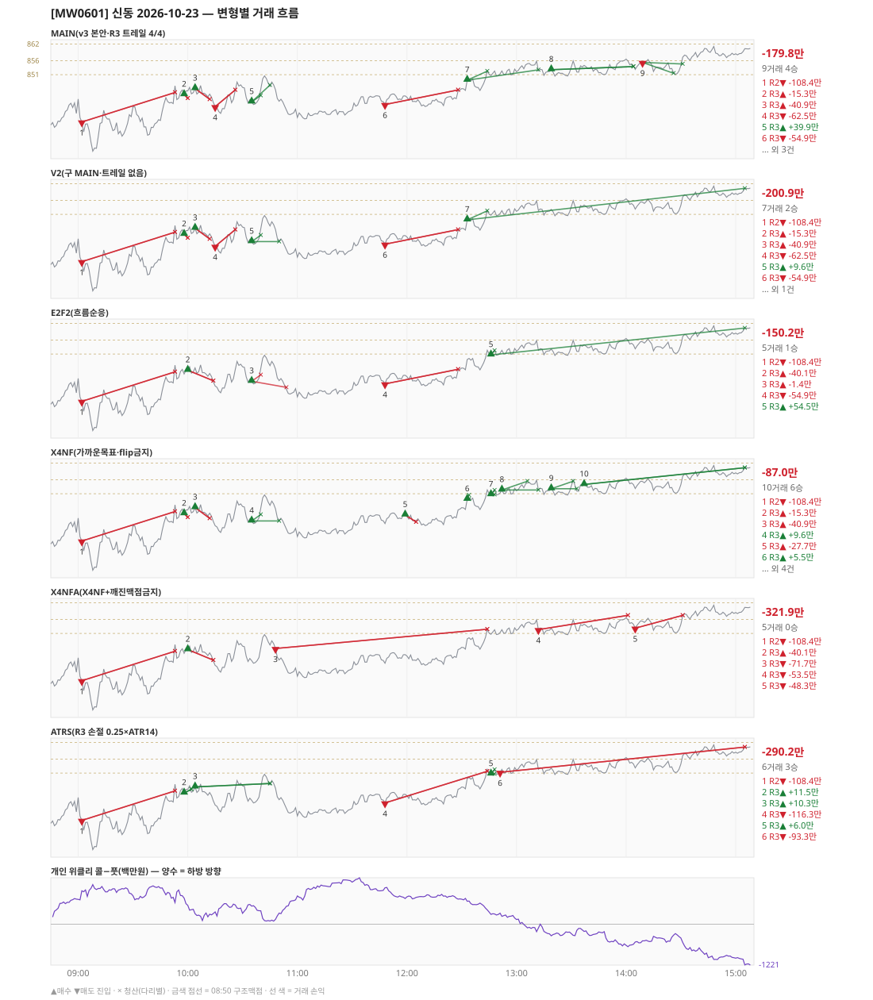

# [MW0601] 신동 일일 리포트 — 2026-10-23

> **MW0601 리포트** · 생성 2026-10-23 15:40 · 규격 `SD-2026-10-21-v3` · 상품 `wk_mon` (최근접 만기 월위클리 (만기 2026-10-26))
> **아래 변형 손익은 엔진 재생(가상)이다** — 장후 최종 흐름으로 하루를 다시 돌린 값. 미니선물 2계약 · CYBOS 요율 · 1틱 슬리피지 기준. **실제 체결 손익은 §2-1 실거래 대사.**

## 0. 한눈에

| 시장 | R1 장전 | R2 개장확정 | R1 적중(09:00→15:05) |
|---|---|---|---|
| 842.22 → 860.38 (+18.16) · 고 861.30 · 저 823.00 · 폭 38.3pt | 콜−풋 +750 → **하방** | CONFIRMED 09:02 | ❌ 불적중 |

| 변형 | 거래 | 승 | R2 | R3 | **순손익** | 최악 거래 | MAIN 대비 | 기록 |
|---|---|---|---|---|---|---|---|---|
| MAIN(v3 본안·R3 트레일 4/4) | 9 | 4 | -108.4만 | -71.3만 | **-179.8만** | -108.4만 | — | 재생(장중 기록) |
| V2(구 MAIN·트레일 없음) | 7 | 2 | -108.4만 | -92.5만 | **-200.9만** | -108.4만 | -21.2만 | 재생(장중 기록) |
| E2F2(흐름순응) | 5 | 1 | -108.4만 | -41.8만 | **-150.2만** | -108.4만 | +29.6만 | 재생(장중 기록) |
| X4NF(가까운목표·flip금지) | 10 | 6 | -108.4만 | +21.5만 | **-87.0만** | -108.4만 | +92.8만 | 재생(장중 기록) |
| X4NFA(X4NF+깨진맥점금지) | 5 | 0 | -108.4만 | -213.5만 | **-321.9만** | -108.4만 | -142.1만 | 재생(장중 기록) |
| ATRS(R3 손절 0.25×ATR14) | 6 | 3 | -108.4만 | -181.7만 | **-290.2만** | -116.3만 | -110.4만 | 재생(장중 기록) |

**실거래(실제 체결)** — 9포지션 -237.7만 · 브로커 net -237.7만 · 재생 MAIN 과 차 -58.0만 → §2-1

**오늘의 한 줄** — MAIN -179.8만(9거래 4승), 최선은 X4NF(가까운목표·flip금지) -87.0만(MAIN 대비 +92.8만).

## 1. 차트

## 2. 거래 흐름 — MAIN

| # | 규칙 | 방향 | 진입 | 맥점 | 손절 | 1차 · 최종 | 청산(다리별) | MFE | 손익 | 누적 |
|---|---|---|---|---|---|---|---|---|---|---|
| 1 | R2 | 매도 | 09:02 833.94 (탐지 09:03) | - | 844.58 | 812.60 · 765.62 | 손절 09:53 844.58 · 손절 09:53 844.58 | 10.9 | **-108.4만** | -108.4만 |
| 2 | R3 | 매수 | 09:58 843.82 (탐지 09:59) | 844.0 | 842.50 | 852.27 · 861.50 | 손절 10:00 842.50 · 손절 10:00 842.50 | 3.2 | **-15.3만** | -123.7만 |
| 3 | R3 | 매수 | 10:04 846.00 (탐지 10:05) | 844.0 | 842.12 | 852.27 · 861.50 | 손절 10:12 842.12 · 손절 10:12 842.12 | 2.1 | **-40.9만** | -164.6만 |
| 4 | R3 | 매도 | 10:15 839.46 (탐지 10:16) | 844.0 | 845.50 | 823.50 · 765.62 | 손절 10:26 845.50 · 손절 10:26 845.50 | 3.3 | **-62.5만** | -227.0만 |
| 5 | R3 | 매수 | 10:35 841.18 (탐지 10:36) | 844.0 | 838.98 | 843.50 · 861.50 | 1차 10:40 843.50 · 트레일 10:45 847.24 | 10.1 | **+39.9만** | -187.1만 |
| 6 | R3 | 매도 | 11:48 840.22 (탐지 11:49) | 844.0 | 845.50 | 823.50 · 765.62 | 손절 12:28 845.50 · 손절 12:28 845.50 | 1.1 | **-54.9만** | -241.9만 |
| 7 | R3 | 매수 | 12:33 849.00 (탐지 12:34) | 844.0 | 842.50 | 852.27 · 861.50 | 1차 12:44 852.27 · 트레일 13:12 852.72 | 7.7 | **+33.0만** | -208.9만 |
| 8 | R3 | 매수 | 13:19 852.78 (탐지 13:20) | 851.0 | 849.50 | 861.50 · 861.50 | 트레일 14:04 853.90 · 트레일 14:04 853.90 | 5.1 | **+9.1만** | -199.8만 |
| 9 | R3 | 매도 | 14:09 855.38 (탐지 14:10) | 856.0 | 857.50 | 851.50 · 823.50 | 1차 14:26 851.50 · 트레일 14:31 854.86 | 4.5 | **+20.0만** | -179.8만 |

## 2-1. 실거래 대사 — 실제 체결 vs 재생 MAIN

| # | 구분 | 신호 | 실거래 | 재생 MAIN | 비고 |
|---|---|---|---|---|---|
| 1 | 일치 | `R2\|09:02\|-1` | 09:03 매도 3계약 @834.07 · -160.6만 | 09:02 매도 @833.94 · -108.4만 | 차 -52.1만 |
| 2 | 일치 | `R3\|09:58\|+1` | 09:59 매수 3계약 @844.07 · -26.7만 | 09:58 매수 @843.82 · -15.3만 | 차 -11.4만 |
| 3 | 일치 | `R3\|10:04\|+1` | 10:05 매수 3계약 @846.44 · -66.3만 | 10:04 매수 @846.00 · -40.9만 | 차 -25.4만 |
| 4 | 일치 | `R3\|10:15\|-1` | 10:16 매도 3계약 @840.28 · -80.8만 | 10:15 매도 @839.46 · -62.5만 | 차 -18.3만 |
| 5 | 일치 | `R3\|10:35\|+1` | 10:36 매수 3계약 @841.93 · +88.6만 | 10:35 매수 @841.18 · +39.9만 | 차 +48.7만 |
| 6 | 일치 | `R3\|11:48\|-1` | 11:49 매도 3계약 @840.52 · -76.3만 | 11:48 매도 @840.22 · -54.9만 | 차 -21.4만 |
| 7 | 일치 | `R3\|12:33\|+1` | 12:34 매수 3계약 @848.80 · +36.9만 | 12:33 매수 @849.00 · +33.0만 | 차 +3.9만 |
| 8 | 일치 | `R3\|13:19\|+1` | 13:20 매수 3계약 @852.07 · +26.3만 | 13:19 매수 @852.78 · +9.1만 | 차 +17.2만 |
| 9 | 일치 | `R3\|14:09\|-1` | 14:10 매도 3계약 @855.09 · +21.0만 | 14:09 매도 @855.38 · +20.0만 | 차 +1.0만 |

| 구분 | 건 | 실거래 | 재생 MAIN |
|---|---|---|---|
| 일치 | 9 | -237.7만 | -179.8만 |
| **합** | | **-237.7만** | **-179.8만** |

- 브로커 실측 net(계좌 전체, `daily_broker_pnl` · live): **-237.7만** · 신동 실거래 합과 차 -46
- 재생은 장후 최종 흐름으로 다시 돌린 값이라, 장중에 나왔다가 정정으로 사라진 신호(철회)는 빠지고 보유 중·늦음으로 못 친 신호는 들어간다. **실거래 손익은 이 절의 「실거래」 열이다.**

## 2-2. 철회 섀도 — 철회 시 본전 이상이면 청산 → 새 신호 수용(계측만)

- 오늘 보유 중 철회 0건 — 섀도 대상 없음.

## 3. 섀도 흐름 — MAIN 과 무엇이 달랐나

### V2(구 MAIN·트레일 없음) — -200.9만 (MAIN 대비 -21.2만)

- 10:35 R3 매수: 청산 차이 — MAIN 1차/트레일 → 1차/본전 (+39.9만 → +9.6만, 차 -30.3만)
- 12:33 R3 매수: 청산 차이 — MAIN 1차/트레일 → 1차/시간 (+33.0만 → +71.3만, 차 +38.3만)
- 13:19 R3 매수: MAIN 진입 852.78 → **앞 거래 보유 중/시점 이동** (MAIN 손익 +9.1만 제외)
- 14:09 R3 매도: MAIN 진입 855.38 → **앞 거래 보유 중/시점 이동** (MAIN 손익 +20.0만 제외)

| # | 규칙 | 방향 | 진입 | 맥점 | 손절 | 1차 · 최종 | 청산(다리별) | MFE | 손익 | 누적 |
|---|---|---|---|---|---|---|---|---|---|---|
| 1 | R2 | 매도 | 09:02 833.94 (탐지 09:03) | - | 844.58 | 812.60 · 765.62 | 손절 09:53 844.58 · 손절 09:53 844.58 | 10.9 | **-108.4만** | -108.4만 |
| 2 | R3 | 매수 | 09:58 843.82 (탐지 09:59) | 844.0 | 842.50 | 852.27 · 861.50 | 손절 10:00 842.50 · 손절 10:00 842.50 | 3.2 | **-15.3만** | -123.7만 |
| 3 | R3 | 매수 | 10:04 846.00 (탐지 10:05) | 844.0 | 842.12 | 852.27 · 861.50 | 손절 10:12 842.12 · 손절 10:12 842.12 | 2.1 | **-40.9만** | -164.6만 |
| 4 | R3 | 매도 | 10:15 839.46 (탐지 10:16) | 844.0 | 845.50 | 823.50 · 765.62 | 손절 10:26 845.50 · 손절 10:26 845.50 | 3.3 | **-62.5만** | -227.0만 |
| 5 | R3 | 매수 | 10:35 841.18 (탐지 10:36) | 844.0 | 838.98 | 843.50 · 861.50 | 1차 10:40 843.50 · 본전 10:50 841.18 | 10.1 | **+9.6만** | -217.4만 |
| 6 | R3 | 매도 | 11:48 840.22 (탐지 11:49) | 844.0 | 845.50 | 823.50 · 765.62 | 손절 12:28 845.50 · 손절 12:28 845.50 | 1.1 | **-54.9만** | -272.2만 |
| 7 | R3 | 매수 | 12:33 849.00 (탐지 12:34) | 844.0 | 842.50 | 852.27 · 861.50 | 1차 12:44 852.27 · 시간 15:05 860.38 | 12.3 | **+71.3만** | -200.9만 |

### E2F2(흐름순응) — -150.2만 (MAIN 대비 +29.6만)

- 09:58 R3 매수: MAIN 진입 843.82 → **F2 차단(당일 흐름 역방향)** (MAIN 손익 -15.3만 제외)
- 10:04 R3 매수: MAIN 진입 846.00 → **앞 거래 보유 중/시점 이동** (MAIN 손익 -40.9만 제외)
- 10:15 R3 매도: MAIN 진입 839.46 → **F2 차단(당일 흐름 역방향)** (MAIN 손익 -62.5만 제외)
- 10:35 R3 매수: 청산 차이 — MAIN 1차/트레일 → 1차/손절 (+39.9만 → -1.4만, 차 -41.3만)
- 12:33 R3 매수: MAIN 진입 849.00 → **앞 거래 보유 중/시점 이동** (MAIN 손익 +33.0만 제외)
- 13:19 R3 매수: MAIN 진입 852.78 → **앞 거래 보유 중/시점 이동** (MAIN 손익 +9.1만 제외)
- 14:09 R3 매도: MAIN 진입 855.38 → **F2 차단(당일 흐름 역방향)** (MAIN 손익 +20.0만 제외)
- 10:00 R3 매수: **섀도만 진입** 845.16 (앞 거래가 없어 신호가 살아남) → -40.1만
- 12:46 R3 매수: **섀도만 진입** 850.68 (앞 거래가 없어 신호가 살아남) → +54.5만

| # | 규칙 | 방향 | 진입 | 맥점 | 손절 | 1차 · 최종 | 청산(다리별) | MFE | 손익 | 누적 |
|---|---|---|---|---|---|---|---|---|---|---|
| 1 | R2 | 매도 | 09:02 833.94 (탐지 09:03) | - | 844.58 | 812.60 · 765.62 | 손절 09:53 844.58 · 손절 09:53 844.58 | 10.9 | **-108.4만** | -108.4만 |
| 2 | R3 | 매수 | 10:00 845.16 (탐지 10:01) | 844.0 | 841.36 | 852.27 · 861.50 | 손절 10:14 841.36 · 손절 10:14 841.36 | 4.0 | **-40.1만** | -148.5만 |
| 3 | R3 | 매수 | 10:35 841.18 (탐지 10:36) | 844.0 | 838.98 | 843.50 · 861.50 | 1차 10:40 843.50 · 손절 10:54 838.98 | 10.1 | **-1.4만** | -149.9만 |
| 4 | R3 | 매도 | 11:48 840.22 (탐지 11:49) | 844.0 | 845.50 | 823.50 · 765.62 | 손절 12:28 845.50 · 손절 12:28 845.50 | 1.1 | **-54.9만** | -204.7만 |
| 5 | R3 | 매수 | 12:46 850.68 (탐지 12:47) | 851.0 | 849.50 | 852.27 · 861.50 | 1차 12:48 852.27 · 시간 15:05 860.38 | 10.6 | **+54.5만** | -150.2만 |

### X4NF(가까운목표·flip금지) — -87.0만 (MAIN 대비 +92.8만)

- 10:15 R3 매도: MAIN 진입 839.46 → **flip 금지(같은 맥점 844.0 반대 방향)** (MAIN 손익 -62.5만 제외)
- 10:35 R3 매수: 청산 차이 — MAIN 1차/트레일 → 1차/본전 (+39.9만 → +9.6만, 차 -30.3만)
- 11:48 R3 매도: MAIN 진입 840.22 → **flip 금지(같은 맥점 844.0 반대 방향)** (MAIN 손익 -54.9만 제외)
- 12:33 R3 매수: 청산 차이 — MAIN 1차/트레일 → 1차/본전 (+33.0만 → +5.5만, 차 -27.5만)
- 13:19 R3 매수: 청산 차이 — MAIN 트레일/트레일 → 1차/본전 (+9.1만 → +11.6만, 차 +2.5만)
- 14:09 R3 매도: MAIN 진입 855.38 → **앞 거래 보유 중/시점 이동** (MAIN 손익 +20.0만 제외)
- 11:59 R3 매수: **섀도만 진입** 843.36 (앞 거래가 없어 신호가 살아남) → -27.7만
- 12:46 R3 매수: **섀도만 진입** 850.68 (앞 거래가 없어 신호가 살아남) → +6.0만
- 12:52 R3 매수: **섀도만 진입** 852.32 (앞 거래가 없어 신호가 살아남) → +13.9만
- 13:37 R3 매수: **섀도만 진입** 854.32 (앞 거래가 없어 신호가 살아남) → +58.5만

| # | 규칙 | 방향 | 진입 | 맥점 | 손절 | 1차 · 최종 | 청산(다리별) | MFE | 손익 | 누적 |
|---|---|---|---|---|---|---|---|---|---|---|
| 1 | R2 | 매도 | 09:02 833.94 (탐지 09:03) | - | 844.58 | 812.60 · 765.62 | 손절 09:53 844.58 · 손절 09:53 844.58 | 10.9 | **-108.4만** | -108.4만 |
| 2 | R3 | 매수 | 09:58 843.82 (탐지 09:59) | 844.0 | 842.50 | 850.50 · 861.50 | 손절 10:00 842.50 · 손절 10:00 842.50 | 3.2 | **-15.3만** | -123.7만 |
| 3 | R3 | 매수 | 10:04 846.00 (탐지 10:05) | 844.0 | 842.12 | 850.50 · 861.50 | 손절 10:12 842.12 · 손절 10:12 842.12 | 2.1 | **-40.9만** | -164.6만 |
| 4 | R3 | 매수 | 10:35 841.18 (탐지 10:36) | 844.0 | 838.98 | 843.50 · 861.50 | 1차 10:40 843.50 · 본전 10:50 841.18 | 10.1 | **+9.6만** | -154.9만 |
| 5 | R3 | 매수 | 11:59 843.36 (탐지 12:00) | 844.0 | 840.80 | 850.50 · 861.50 | 손절 12:05 840.80 · 손절 12:05 840.80 | 0.4 | **-27.7만** | -182.6만 |
| 6 | R3 | 매수 | 12:33 849.00 (탐지 12:34) | 844.0 | 842.50 | 850.50 · 861.50 | 1차 12:34 850.50 · 본전 12:34 849.00 | 1.5 | **+5.5만** | -177.0만 |
| 7 | R3 | 매수 | 12:46 850.68 (탐지 12:47) | 851.0 | 849.50 | 852.27 · 861.50 | 1차 12:48 852.27 · 본전 12:48 850.68 | 1.6 | **+6.0만** | -171.0만 |
| 8 | R3 | 매수 | 12:52 852.32 (탐지 12:53) | 851.0 | 849.50 | 855.50 · 861.50 | 1차 13:06 855.50 · 본전 13:12 852.32 | 4.4 | **+13.9만** | -157.1만 |
| 9 | R3 | 매수 | 13:19 852.78 (탐지 13:20) | 851.0 | 849.50 | 855.50 · 861.50 | 1차 13:31 855.50 · 본전 13:33 852.78 | 3.3 | **+11.6만** | -145.5만 |
| 10 | R3 | 매수 | 13:37 854.32 (탐지 13:38) | 851.0 | 849.50 | 861.50 · 861.50 | 시간 15:05 860.38 · 시간 15:05 860.38 | 7.0 | **+58.5만** | -87.0만 |

### X4NFA(X4NF+깨진맥점금지) — -321.9만 (MAIN 대비 -142.1만)

- 09:58 R3 매수: MAIN 진입 843.82 → **깨진 맥점 차단(진입 843.82 · 맥점 844.0)** (MAIN 손익 -15.3만 제외)
- 10:04 R3 매수: MAIN 진입 846.00 → **앞 거래 보유 중/시점 이동** (MAIN 손익 -40.9만 제외)
- 10:15 R3 매도: MAIN 진입 839.46 → **flip 금지(같은 맥점 844.0 반대 방향)** (MAIN 손익 -62.5만 제외)
- 10:35 R3 매수: MAIN 진입 841.18 → **flip 금지(같은 맥점 844.0 반대 방향)** (MAIN 손익 +39.9만 제외)
- 11:48 R3 매도: MAIN 진입 840.22 → **flip 금지(같은 맥점 844.0 반대 방향)** (MAIN 손익 -54.9만 제외)
- 12:33 R3 매수: MAIN 진입 849.00 → **flip 금지(같은 맥점 844.0 반대 방향)** (MAIN 손익 +33.0만 제외)
- 13:19 R3 매수: MAIN 진입 852.78 → **앞 거래 보유 중/시점 이동** (MAIN 손익 +9.1만 제외)
- 14:09 R3 매도: MAIN 진입 855.38 → **앞 거래 보유 중/시점 이동** (MAIN 손익 +20.0만 제외)
- 10:00 R3 매수: **섀도만 진입** 845.16 (앞 거래가 없어 신호가 살아남) → -40.1만
- 10:48 R3 매도: **섀도만 진입** 845.54 (앞 거래가 없어 신호가 살아남) → -71.7만
- 13:12 R3 매도: **섀도만 진입** 852.36 (앞 거래가 없어 신호가 살아남) → -53.5만
- 14:05 R3 매도: **섀도만 진입** 852.88 (앞 거래가 없어 신호가 살아남) → -48.3만

| # | 규칙 | 방향 | 진입 | 맥점 | 손절 | 1차 · 최종 | 청산(다리별) | MFE | 손익 | 누적 |
|---|---|---|---|---|---|---|---|---|---|---|
| 1 | R2 | 매도 | 09:02 833.94 (탐지 09:03) | - | 844.58 | 812.60 · 765.62 | 손절 09:53 844.58 · 손절 09:53 844.58 | 10.9 | **-108.4만** | -108.4만 |
| 2 | R3 | 매수 | 10:00 845.16 (탐지 10:01) | 844.0 | 841.36 | 850.50 · 861.50 | 손절 10:14 841.36 · 손절 10:14 841.36 | 4.0 | **-40.1만** | -148.5만 |
| 3 | R3 | 매도 | 10:48 845.54 (탐지 10:49) | 851.0 | 852.50 | 823.50 · 765.62 | 손절 12:44 852.50 · 손절 12:44 852.50 | 11.7 | **-71.7만** | -220.2만 |
| 4 | R3 | 매도 | 13:12 852.36 (탐지 13:13) | 856.0 | 857.50 | 844.50 · 765.62 | 손절 14:01 857.50 · 손절 14:01 857.50 | 2.8 | **-53.5만** | -273.6만 |
| 5 | R3 | 매도 | 14:05 852.88 (탐지 14:06) | 856.0 | 857.50 | 844.50 · 765.62 | 손절 14:31 857.50 · 손절 14:31 857.50 | 2.0 | **-48.3만** | -321.9만 |

### ATRS(R3 손절 0.25×ATR14) — -290.2만 (MAIN 대비 -110.4만)

- 09:58 R3 매수: 손절 폭 차이 — 손절 842.50 → 832.39 · 청산 손절/손절 → 트레일/트레일 (-15.3만 → +11.5만, 차 +26.8만)
- 10:04 R3 매수: 손절 폭 차이 — 손절 842.12 → 834.57 · 청산 손절/손절 → 트레일/트레일 (-40.9만 → +10.3만, 차 +51.2만)
- 10:15 R3 매도: MAIN 진입 839.46 → **앞 거래 보유 중/시점 이동** (MAIN 손익 -62.5만 제외)
- 10:35 R3 매수: MAIN 진입 841.18 → **앞 거래 보유 중/시점 이동** (MAIN 손익 +39.9만 제외)
- 11:48 R3 매도: 손절 폭 차이 — 손절 845.50 → 851.65 · 청산 손절/손절 → 손절/손절 (-54.9만 → -116.3만, 차 -61.5만)
- 12:33 R3 매수: MAIN 진입 849.00 → **앞 거래 보유 중/시점 이동** (MAIN 손익 +33.0만 제외)
- 13:19 R3 매수: MAIN 진입 852.78 → **앞 거래 보유 중/시점 이동** (MAIN 손익 +9.1만 제외)
- 14:09 R3 매도: MAIN 진입 855.38 → **앞 거래 보유 중/시점 이동** (MAIN 손익 +20.0만 제외)
- 12:46 R3 매수: **섀도만 진입** 850.68 (앞 거래가 없어 신호가 살아남) → +6.0만
- 12:51 R3 매도: **섀도만 진입** 851.26 (앞 거래가 없어 신호가 살아남) → -93.3만

| # | 규칙 | 방향 | 진입 | 맥점 | 손절 | 1차 · 최종 | 청산(다리별) | MFE | 손익 | 누적 |
|---|---|---|---|---|---|---|---|---|---|---|
| 1 | R2 | 매도 | 09:02 833.94 (탐지 09:03) | - | 844.58 | 812.60 · 765.62 | 손절 09:53 844.58 · 손절 09:53 844.58 | 10.9 | **-108.4만** | -108.4만 |
| 2 | R3 | 매수 | 09:58 843.82 (탐지 09:59) | 844.0 | 832.39 | 852.27 · 861.50 | 트레일 10:02 845.18 · 트레일 10:02 845.18 | 5.4 | **+11.5만** | -96.9만 |
| 3 | R3 | 매수 | 10:04 846.00 (탐지 10:05) | 844.0 | 834.57 | 852.27 · 861.50 | 트레일 10:45 847.24 · 트레일 10:45 847.24 | 5.2 | **+10.3만** | -86.6만 |
| 4 | R3 | 매도 | 11:48 840.22 (탐지 11:49) | 844.0 | 851.65 | 823.50 · 765.62 | 손절 12:44 851.65 · 손절 12:44 851.65 | 1.1 | **-116.3만** | -202.9만 |
| 5 | R3 | 매수 | 12:46 850.68 (탐지 12:47) | 851.0 | 839.25 | 852.27 · 861.50 | 1차 12:48 852.27 · 본전 12:48 850.68 | 1.6 | **+6.0만** | -196.9만 |
| 6 | R3 | 매도 | 12:51 851.26 (탐지 12:52) | 851.0 | 862.69 | 823.50 · 765.62 | 시간 15:05 860.38 · 시간 15:05 860.38 | 1.7 | **-93.3만** | -290.2만 |

## 4. 누적 채점 (라이브 기록 · 판정 창)

| 변형 | 채점 시작 | 거래일 | 거래 | 승률 | 순손익 | 최악일 | R3 (건 · 승률 · 순) | 판정 |
|---|---|---|---|---|---|---|---|---|
| MAIN(v3 본안·R3 트레일 4/4) | 2026-10-21 | 3 | 29 | 59% | **+185.0만** | -179.8만 | 27 · 63% · +369.7만 | R3 중단 판정 3/10일 |
| V2(구 MAIN·트레일 없음) | 2026-10-21 | 3 | 18 | 39% | **+21.3만** | -200.9만 | 16 · 44% · +206.1만 | MAIN 비교 3/10일 |
| E2F2(흐름순응) | 2026-10-21 | 3 | 21 | 33% | **-29.0만** | -150.2만 | 19 · 37% · +155.8만 | MAIN 비교 3/10일 |
| X4NF(가까운목표·flip금지) | 2026-10-21 | 3 | 21 | 62% | **+71.9만** | -114.7만 | 19 · 68% · +256.6만 | MAIN 비교 3/10일 |
| X4NFA(X4NF+깨진맥점금지) | 2026-10-21 | 3 | 17 | 35% | **-318.0만** | -321.9만 | 15 · 40% · -133.2만 | MAIN 비교 3/10일 |
| ATRS(R3 손절 0.25×ATR14) | 2026-10-21 | 3 | 21 | 71% | **-33.2만** | -290.2만 | 19 · 79% · +151.6만 | MAIN 비교 3/10일 |
| **실집행(실제 체결 · 참고)** | 2026-10-21 | 3 | 28 | 57% | **+97.7만** | -237.7만 | - | 판정 기준 아님 |

> 판정 전 집계다 — 인용·규격 변경 근거로 쓰지 말 것. R3 중단 기준: 순손익 < 0 **그리고** 승률 < 35%.
> 「실집행」 = `trades.db` 신동 체결(포지션 단위, 거래일 = 체결이 있던 날). 재생에서 철회됐지만 실제로 친 거래가 **들어가고**, 보유 중·늦음으로 못 친 재생 거래는 **빠진다**. 사전등록 판정은 위 MAIN 재생 행으로만 한다.

## 5. 러너 섀도 — 미륵이 × 신동 (CREON 요율)

- 오늘 기록 없음 — 미륵이 시스템 진입이 없었거나 장후 기록 전이다

## 6. 개선 방향 (자동 관찰 — 판정 아님)

- **진입 품질** — MAIN 손실 5건 중 4건은 유리한 쪽으로 4pt 도 못 갔다(MFE 3.2, 2.1, 3.3, 1.1). 청산을 바꿔서는 못 막는 손실이다 → 진입 필터(E2F2·X4NF·X4NFA) 쪽 관찰 대상.
- **청산** — MAIN 손실 1건은 4pt 이상 유리하게 갔다가 손절됐다(MFE 10.9) → 트레일 간격(R3)·R2 청산 쪽 관찰 대상.
- **맥점 반복** — 844.0 에서 R3 6회(매수→매수→매도→매수→매도→매수) · 합 -100.5만. 박스권에서 같은 맥점을 양쪽으로 번갈아 잡았다.
- **깨진 맥점 진입 2건** — 흐름 반전을 기다리는 사이 가격이 맥점을 다시 넘어간 뒤 들어갔다(09:58 매수 843.82/맥점 844.0 -15.3만, 10:35 매수 841.18/맥점 844.0 +39.9만) · 합 +24.7만 → X4NFA 가 막는 진입이다.
- **탐지 지연** — 재생 진입 9건, 규칙가 대비 실현가능가 차 +0(음수 = 늦게 알아채 손해).
- **오늘 최선은 X4NF(가까운목표·flip금지)** (-87.0만, MAIN 대비 +92.8만). 하루 결과다 — 판정은 사전등록 창(10거래일)으로만.
- ⚠ 규격 변경은 사전등록 §6(새 버전 · 재채점)으로만. 이 절은 관찰이다.

---
재생성: `python scripts/shindong_daily_report.py 2026-10-23`
