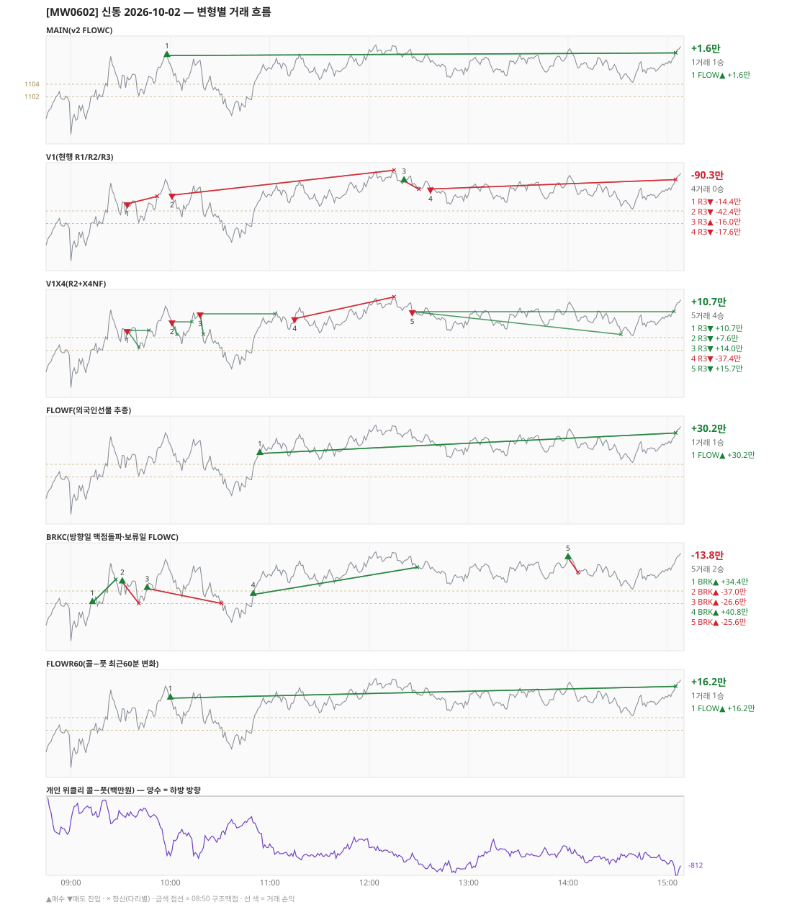

# [MW0602] 신동 일일 리포트 — 2026-10-02

> **MW0602 리포트** · 생성 2026-10-02 15:40 · 규격 `SD-2026-09-30-v2.1` · 상품 `wk_mon` (최근접 만기 월위클리 (만기 2026-10-06))
> 가상거래다 — 주문 없음(절대원칙 §6). 손익은 미니선물 2계약 · CYBOS 요율 · 1틱 슬리피지 기준.

## 0. 한눈에

| 시장 | R1 장전 | R2 개장확정(V1) | R1 적중(09:00→15:05) |
|---|---|---|---|
| 1096.02 → 1109.00 (+12.98) · 고 1110.78 · 저 1095.38 · 폭 15.4pt | 콜−풋 -410 → **상방** | NONE | ✅ 적중 |

| 변형 | 거래 | 승 | 규칙별 | **순손익** | 최악 거래 | MAIN 대비 | 기록 |
|---|---|---|---|---|---|---|---|
| MAIN(v2 FLOWC) | 1 | 1 | FLOW +1.6만 | **+1.6만** | +1.6만 | — | 라이브 |
| V1(현행 R1/R2/R3) | 4 | 0 | R3 -90.3만 | **-90.3만** | -42.4만 | -91.9만 | 라이브 |
| V1X4(R2+X4NF) | 5 | 4 | R3 +10.7만 | **+10.7만** | -37.4만 | +9.1만 | 라이브 |
| FLOWF(외국인선물 추종) | 1 | 1 | FLOW +30.2만 | **+30.2만** | +30.2만 | +28.6만 | 라이브 |
| BRKC(방향일 맥점돌파·보류일 FLOWC) | 5 | 2 | BRK -13.8만 | **-13.8만** | -37.0만 | -15.5만 | 라이브 |
| FLOWR60(콜−풋 최근60분 변화) | 1 | 1 | FLOW +16.2만 | **+16.2만** | +16.2만 | +14.6만 | 라이브 |

**오늘의 한 줄** — MAIN +1.6만(1거래 1승), 최선은 FLOWF(외국인선물 추종) +30.2만(MAIN 대비 +28.6만).

## 1. 차트

## 2. 거래 흐름 — MAIN

| # | 규칙 | 방향 | 진입 | 맥점 | 손절 | 1차 · 최종 | 청산(다리별) | MFE | 손익 | 누적 |
|---|---|---|---|---|---|---|---|---|---|---|
| 1 | FLOW | 매수 | 09:58 1108.58 (탐지 09:59) | - | 1090.31 | 1120.58 · 1120.58 | 시간 15:05 1109.00 · 시간 15:05 1109.00 | 2.2 | **+1.6만** | +1.6만 |

## 3. 섀도 흐름 — 변형별 거래(v1 계열은 V1 과 무엇이 달랐나)

### V1(현행 R1/R2/R3) — -90.3만 (MAIN 대비 -91.9만)

- v1(R1/R2/R3) 대조군 — 되돌림 판정의 기준. 아래 v1 계열 섀도는 이 거래와 대조한다

| # | 규칙 | 방향 | 진입 | 맥점 | 손절 | 1차 · 최종 | 청산(다리별) | MFE | 손익 | 누적 |
|---|---|---|---|---|---|---|---|---|---|---|
| 1 | R3 | 매도 | 09:34 1105.14 (탐지 09:35) | 1104.0 | 1106.32 | 1095.50 · 1081.50 | 손절 09:52 1106.32 · 손절 09:52 1106.32 | 3.1 | **-14.4만** | -14.4만 |
| 2 | R3 | 매도 | 10:01 1106.52 (탐지 10:02) | 1109.0 | 1110.50 | 1095.50 · 1081.50 | 손절 12:15 1110.50 · 손절 12:15 1110.50 | 8.0 | **-42.4만** | -56.7만 |
| 3 | R3 | 매수 | 12:21 1108.80 (탐지 12:22) | 1109.0 | 1107.46 | 1112.19 · 1112.50 | 손절 12:30 1107.46 · 손절 12:30 1107.46 | 0.9 | **-16.0만** | -72.7만 |
| 4 | R3 | 매도 | 12:37 1107.50 (탐지 12:38) | 1109.0 | 1110.50 | 1095.50 · 1081.50 | 시간 15:05 1109.00 · 시간 15:05 1109.00 | 3.6 | **-17.6만** | -90.3만 |

### V1X4(R2+X4NF) — +10.7만 (MAIN 대비 +9.1만)

- 09:34 R3 매도: 청산 차이 — V1 손절/손절 → 1차/본전 (-14.4만 → +10.7만, 차 +25.1만)
- 10:01 R3 매도: 청산 차이 — V1 손절/손절 → 1차/본전 (-42.4만 → +7.6만, 차 +50.0만)
- 12:21 R3 매수: V1 진입 1108.80 → **flip 금지(같은 맥점 1109.0 반대 방향)** (V1 손익 -16.0만 제외)
- 12:37 R3 매도: V1 진입 1107.50 → **flip 금지(같은 맥점 1109.0 반대 방향)** (V1 손익 -17.6만 제외)
- 10:18 R3 매도: **섀도만 진입** 1107.80 (앞 거래가 없어 신호가 살아남) → +14.0만
- 11:15 R3 매도: **섀도만 진입** 1107.02 (앞 거래가 없어 신호가 살아남) → -37.4만
- 12:26 R3 매도: **섀도만 진입** 1108.14 (앞 거래가 없어 신호가 살아남) → +15.7만

| # | 규칙 | 방향 | 진입 | 맥점 | 손절 | 1차 · 최종 | 청산(다리별) | MFE | 손익 | 누적 |
|---|---|---|---|---|---|---|---|---|---|---|
| 1 | R3 | 매도 | 09:34 1105.14 (탐지 09:35) | 1104.0 | 1106.32 | 1102.50 · 1081.50 | 1차 09:41 1102.50 · 본전 09:47 1105.14 | 3.1 | **+10.7만** | +10.7만 |
| 2 | R3 | 매도 | 10:01 1106.52 (탐지 10:02) | 1109.0 | 1110.50 | 1104.50 · 1081.50 | 1차 10:04 1104.50 · 본전 10:13 1106.52 | 3.8 | **+7.6만** | +18.4만 |
| 3 | R3 | 매도 | 10:18 1107.80 (탐지 10:19) | 1109.0 | 1110.50 | 1104.50 · 1081.50 | 1차 10:20 1104.50 · 본전 11:03 1107.80 | 9.2 | **+14.0만** | +32.4만 |
| 4 | R3 | 매도 | 11:15 1107.02 (탐지 11:16) | 1109.0 | 1110.50 | 1104.50 · 1081.50 | 손절 12:15 1110.50 · 손절 12:15 1110.50 | 2.3 | **-37.4만** | -5.0만 |
| 5 | R3 | 매도 | 12:26 1108.14 (탐지 12:27) | 1109.0 | 1110.58 | 1104.50 · 1081.50 | 1차 14:32 1104.50 · 본전 15:04 1108.14 | 4.2 | **+15.7만** | +10.7만 |

### FLOWF(외국인선물 추종) — +30.2만 (MAIN 대비 +28.6만)

- 별개 규칙(family) — MAIN·V1 과 거래 단위 대조는 하지 않는다. 손익·최악·거래 수로만 비교

| # | 규칙 | 방향 | 진입 | 맥점 | 손절 | 1차 · 최종 | 청산(다리별) | MFE | 손익 | 누적 |
|---|---|---|---|---|---|---|---|---|---|---|
| 1 | FLOW | 매수 | 10:54 1105.72 (탐지 10:55) | - | 1087.45 | 1117.72 · 1117.72 | 시간 15:05 1109.00 · 시간 15:05 1109.00 | 5.1 | **+30.2만** | +30.2만 |

### BRKC(방향일 맥점돌파·보류일 FLOWC) — -13.8만 (MAIN 대비 -15.5만)

- 별개 규칙(family) — MAIN·V1 과 거래 단위 대조는 하지 않는다. 손익·최악·거래 수로만 비교

| # | 규칙 | 방향 | 진입 | 맥점 | 손절 | 1차 · 최종 | 청산(다리별) | MFE | 손익 | 누적 |
|---|---|---|---|---|---|---|---|---|---|---|
| 1 | BRK | 매수 | 09:13 1102.14 (탐지 09:14) | 1102.0 | 1100.00 | 1110.14 · 1110.14 | 트레일 09:27 1105.84 · 트레일 09:27 1105.84 | 6.7 | **+34.4만** | +34.4만 |
| 2 | BRK | 매수 | 09:31 1105.44 (탐지 09:32) | 1104.0 | 1102.00 | 1113.44 · 1113.44 | 손절 09:41 1102.00 · 손절 09:41 1102.00 | 0.7 | **-37.0만** | -2.5만 |
| 3 | BRK | 매수 | 09:46 1104.40 (탐지 09:47) | 1104.0 | 1102.00 | 1112.40 · 1112.40 | 손절 10:31 1102.00 · 손절 10:31 1102.00 | 5.0 | **-26.6만** | -29.1만 |
| 4 | BRK | 매수 | 10:50 1103.44 (탐지 10:51) | 1102.0 | 1100.00 | 1111.44 · 1111.44 | 트레일 12:29 1107.78 · 트레일 12:29 1107.78 | 7.3 | **+40.8만** | +11.7만 |
| 5 | BRK | 매수 | 14:00 1109.30 (탐지 14:01) | 1109.0 | 1107.00 | 1117.30 · 1117.30 | 손절 14:06 1107.00 · 손절 14:06 1107.00 | 0.8 | **-25.6만** | -13.8만 |

### FLOWR60(콜−풋 최근60분 변화) — +16.2만 (MAIN 대비 +14.6만)

- 별개 규칙(family) — MAIN·V1 과 거래 단위 대조는 하지 않는다. 손익·최악·거래 수로만 비교

| # | 규칙 | 방향 | 진입 | 맥점 | 손절 | 1차 · 최종 | 청산(다리별) | MFE | 손익 | 누적 |
|---|---|---|---|---|---|---|---|---|---|---|
| 1 | FLOW | 매수 | 10:00 1107.12 (탐지 10:01) | - | 1088.85 | 1119.12 · 1119.12 | 시간 15:05 1109.00 · 시간 15:05 1109.00 | 3.7 | **+16.2만** | +16.2만 |

## 4. 누적 채점 (라이브 기록 · 판정 창)

| 변형 | 채점 시작 | 거래일 | 거래 | 승률 | 순손익 | 최악일 | R3 (건 · 승률 · 순) | 판정 |
|---|---|---|---|---|---|---|---|---|
| MAIN(v2 FLOWC) | 2026-10-01 | 2 | 2 | 50% | **-180.3만** | -181.9만 | 0 · - · +0.0만 | v2 vs V1 되돌림 판정 2/20일 |
| V1(현행 R1/R2/R3) | 2026-10-01 | 2 | 12 | 25% | **-171.5만** | -90.3만 | 11 · 27% · -105.8만 | 대조군 2/20일 (v1 R3 중단 판정은 채점표) |
| V1X4(R2+X4NF) | 2026-10-01 | 2 | 13 | 62% | **-25.5만** | -36.3만 | 12 · 67% · +40.2만 | MAIN 비교 2/20일 |
| FLOWF(외국인선물 추종) | 2026-10-01 | 2 | 3 | 67% | **-131.8만** | -162.0만 | 0 · - · +0.0만 | MAIN 비교 2/20일 |
| BRKC(방향일 맥점돌파·보류일 FLOWC) | 2026-10-01 | 2 | 10 | 40% | **+13.3만** | -13.8만 | 0 · - · +0.0만 | MAIN 비교 2/20일 |
| FLOWR60(콜−풋 최근60분 변화) | 2026-10-02 | 1 | 1 | 100% | **+16.2만** | +16.2만 | 0 · - · +0.0만 | MAIN 비교 1/20일 |

> 판정 전 집계다 — 인용·규격 변경 근거로 쓰지 말 것. 되돌림: V1 이 MAIN 보다 순손익·최악일 **둘 다** 나으면 v1 복귀. 섀도: MAIN 대비 순손익 우위 **그리고** 최악일 개선 → 채택 후보(자동 승격 없음).

## 5. 러너 섀도 — 미륵이 × 신동 (CREON 요율)

- 오늘 기록 없음 — 미륵이 시스템 진입이 없었거나 장후 기록 전이다

## 6. 개선 방향 (자동 관찰 — 판정 아님)

- **탐지 지연** — 라이브 진입 1건, 규칙가 대비 실현가능가 차 +0(음수 = 늦게 알아채 손해).
- **오늘 최선은 FLOWF(외국인선물 추종)** (+30.2만, MAIN 대비 +28.6만). 하루 결과다 — 판정은 사전등록 창(20거래일)으로만.
- **v1 대조** — V1 -90.3만 vs MAIN +1.6만 (차 +91.9만). 되돌림 판정은 20거래일 누적으로만.
- ⚠ 규격 변경은 사전등록 §6(새 버전 · 재채점)으로만. 이 절은 관찰이다.

---
재생성: `python scripts/shindong_daily_report.py 2026-10-02`
