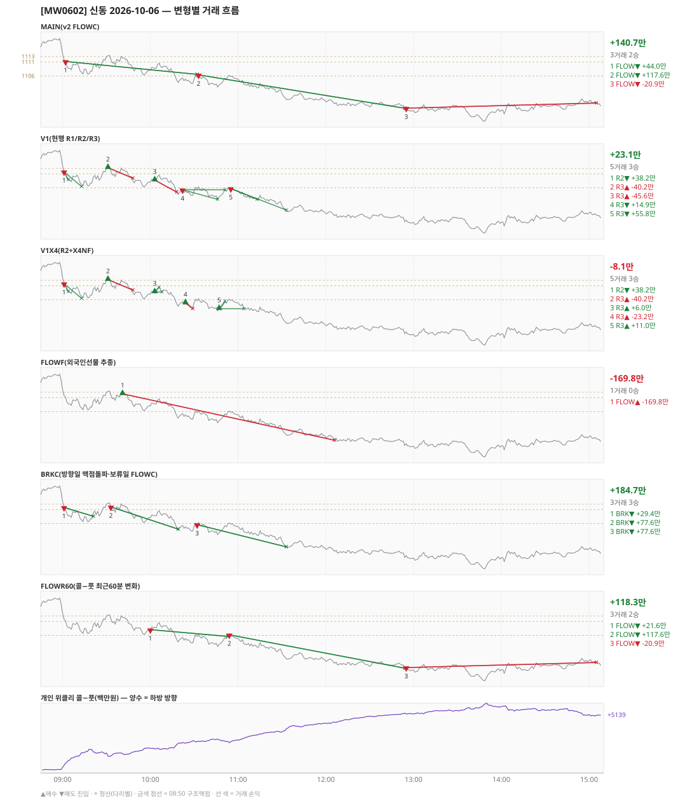

# [MW0602] 신동 일일 리포트 — 2026-10-06

> **MW0602 리포트** · 생성 2026-10-06 15:40 · 규격 `SD-2026-09-30-v2.1` · 상품 `wk_mon` (최근접 만기 월위클리 (만기 2026-10-06))
> 가상거래다 — 주문 없음(절대원칙 §6). 손익은 미니선물 2계약 · CYBOS 요율 · 1틱 슬리피지 기준.

## 0. 한눈에

| 시장 | R1 장전 | R2 개장확정(V1) | R1 적중(09:00→15:05) |
|---|---|---|---|
| 1113.94 → 1096.28 (-17.66) · 고 1117.44 · 저 1089.44 · 폭 28.0pt | 콜−풋 +312 → **하방** | CONFIRMED 09:01 | ✅ 적중 |

| 변형 | 거래 | 승 | 규칙별 | **순손익** | 최악 거래 | MAIN 대비 | 기록 |
|---|---|---|---|---|---|---|---|
| MAIN(v2 FLOWC) | 3 | 2 | FLOW +140.7만 | **+140.7만** | -20.9만 | — | 라이브 |
| V1(현행 R1/R2/R3) | 5 | 3 | R2 +38.2만 · R3 -15.1만 | **+23.1만** | -45.6만 | -117.6만 | 라이브 |
| V1X4(R2+X4NF) | 5 | 3 | R2 +38.2만 · R3 -46.3만 | **-8.1만** | -40.2만 | -148.8만 | 라이브 |
| FLOWF(외국인선물 추종) | 1 | 0 | FLOW -169.8만 | **-169.8만** | -169.8만 | -310.5만 | 라이브 |
| BRKC(방향일 맥점돌파·보류일 FLOWC) | 3 | 3 | BRK +184.7만 | **+184.7만** | +29.4만 | +44.0만 | 라이브 |
| FLOWR60(콜−풋 최근60분 변화) | 3 | 2 | FLOW +118.3만 | **+118.3만** | -20.9만 | -22.4만 | 라이브 |

**오늘의 한 줄** — MAIN +140.7만(3거래 2승), 최선은 BRKC(방향일 맥점돌파·보류일 FLOWC) +184.7만(MAIN 대비 +44.0만).

## 1. 차트

## 2. 거래 흐름 — MAIN

| # | 규칙 | 방향 | 진입 | 맥점 | 손절 | 1차 · 최종 | 청산(다리별) | MFE | 손익 | 누적 |
|---|---|---|---|---|---|---|---|---|---|---|
| 1 | FLOW | 매도 | 09:02 1111.24 (탐지 09:03) | - | 1127.96 | 1099.24 · 1099.24 | 트레일 10:32 1106.58 · 트레일 10:32 1106.58 | 8.7 | **+44.0만** | +44.0만 |
| 2 | FLOW | 매도 | 10:33 1106.40 (탐지 10:34) | - | 1123.12 | 1094.40 · 1094.40 | 1차 12:54 1094.40 · 최종 12:54 1094.40 | 12.6 | **+117.6만** | +161.7만 |
| 3 | FLOW | 매도 | 12:55 1094.44 (탐지 12:56) | - | 1111.16 | 1082.44 · 1082.44 | 시간 15:05 1096.28 · 시간 15:05 1096.28 | 5.0 | **-20.9만** | +140.7만 |

## 3. 섀도 흐름 — 변형별 거래(v1 계열은 V1 과 무엇이 달랐나)

### V1(현행 R1/R2/R3) — +23.1만 (MAIN 대비 -117.6만)

- v1(R1/R2/R3) 대조군 — 되돌림 판정의 기준. 아래 v1 계열 섀도는 이 거래와 대조한다

| # | 규칙 | 방향 | 진입 | 맥점 | 손절 | 1차 · 최종 | 청산(다리별) | MFE | 손익 | 누적 |
|---|---|---|---|---|---|---|---|---|---|---|
| 1 | R2 | 매도 | 09:01 1111.80 (탐지 09:02) | - | 1118.44 | 1108.99 · 1106.50 | 1차 09:04 1108.99 · 최종 09:13 1106.50 | 5.4 | **+38.2만** | +38.2만 |
| 2 | R3 | 매수 | 09:31 1113.26 (탐지 09:32) | 1111.0 | 1109.50 | 1119.50 · 1126.50 | 손절 09:48 1109.50 · 손절 09:48 1109.50 | 0.7 | **-40.2만** | -2.0만 |
| 3 | R3 | 매수 | 10:03 1108.80 (탐지 10:04) | 1106.0 | 1104.50 | 1119.50 · 1126.50 | 손절 10:18 1104.50 · 손절 10:18 1104.50 | 2.2 | **-45.6만** | -47.6만 |
| 4 | R3 | 매도 | 10:22 1105.34 (탐지 10:23) | 1106.0 | 1107.50 | 1101.87 · 1098.02 | 1차 10:46 1101.87 · 본전 10:51 1105.34 | 3.7 | **+14.9만** | -32.7만 |
| 5 | R3 | 매도 | 10:55 1105.76 (탐지 10:56) | 1106.0 | 1107.50 | 1101.87 · 1098.02 | 1차 11:13 1101.87 · 최종 11:33 1098.02 | 8.4 | **+55.8만** | +23.1만 |

### V1X4(R2+X4NF) — -8.1만 (MAIN 대비 -148.8만)

- 10:03 R3 매수: 청산 차이 — V1 손절/손절 → 1차/본전 (-45.6만 → +6.0만, 차 +51.6만)
- 10:22 R3 매도: V1 진입 1105.34 → **flip 금지(같은 맥점 1106.0 반대 방향)** (V1 손익 +14.9만 제외)
- 10:55 R3 매도: V1 진입 1105.76 → **앞 거래 보유 중/시점 이동** (V1 손익 +55.8만 제외)
- 10:24 R3 매수: **섀도만 진입** 1104.88 (앞 거래가 없어 신호가 살아남) → -23.2만
- 10:47 R3 매수: **섀도만 진입** 1102.80 (앞 거래가 없어 신호가 살아남) → +11.0만

| # | 규칙 | 방향 | 진입 | 맥점 | 손절 | 1차 · 최종 | 청산(다리별) | MFE | 손익 | 누적 |
|---|---|---|---|---|---|---|---|---|---|---|
| 1 | R2 | 매도 | 09:01 1111.80 (탐지 09:02) | - | 1118.44 | 1108.99 · 1106.50 | 1차 09:04 1108.99 · 최종 09:13 1106.50 | 5.4 | **+38.2만** | +38.2만 |
| 2 | R3 | 매수 | 09:31 1113.26 (탐지 09:32) | 1111.0 | 1109.50 | 1115.50 · 1126.50 | 손절 09:48 1109.50 · 손절 09:48 1109.50 | 0.7 | **-40.2만** | -2.0만 |
| 3 | R3 | 매수 | 10:03 1108.80 (탐지 10:04) | 1106.0 | 1104.50 | 1110.50 · 1126.50 | 1차 10:06 1110.50 · 본전 10:08 1108.80 | 2.2 | **+6.0만** | +4.0만 |
| 4 | R3 | 매수 | 10:24 1104.88 (탐지 10:25) | 1106.0 | 1102.82 | 1110.50 · 1126.50 | 손절 10:29 1102.82 · 손절 10:29 1102.82 | 0.3 | **-23.2만** | -19.2만 |
| 5 | R3 | 매수 | 10:47 1102.80 (탐지 10:48) | 1102.0 | 1100.50 | 1105.50 · 1126.50 | 1차 10:51 1105.50 · 본전 11:04 1102.80 | 4.1 | **+11.0만** | -8.1만 |

### FLOWF(외국인선물 추종) — -169.8만 (MAIN 대비 -310.5만)

- 별개 규칙(family) — MAIN·V1 과 거래 단위 대조는 하지 않는다. 손익·최악·거래 수로만 비교

| # | 규칙 | 방향 | 진입 | 맥점 | 손절 | 1차 · 최종 | 청산(다리별) | MFE | 손익 | 누적 |
|---|---|---|---|---|---|---|---|---|---|---|
| 1 | FLOW | 매수 | 09:41 1112.42 (탐지 09:42) | - | 1095.70 | 1124.42 · 1124.42 | 손절 12:06 1095.70 · 손절 12:06 1095.70 | 0.7 | **-169.8만** | -169.8만 |

### BRKC(방향일 맥점돌파·보류일 FLOWC) — +184.7만 (MAIN 대비 +44.0만)

- 별개 규칙(family) — MAIN·V1 과 거래 단위 대조는 하지 않는다. 손익·최악·거래 수로만 비교

| # | 규칙 | 방향 | 진입 | 맥점 | 손절 | 1차 · 최종 | 청산(다리별) | MFE | 손익 | 누적 |
|---|---|---|---|---|---|---|---|---|---|---|
| 1 | BRK | 매도 | 09:01 1111.80 (탐지 09:02) | 1113.0 | 1115.00 | 1103.80 · 1103.80 | 트레일 09:21 1108.60 · 트레일 09:21 1108.60 | 6.2 | **+29.4만** | +29.4만 |
| 2 | BRK | 매도 | 09:33 1112.00 (탐지 09:34) | 1113.0 | 1115.00 | 1104.00 · 1104.00 | 1차 10:19 1104.00 · 최종 10:19 1104.00 | 8.7 | **+77.6만** | +107.0만 |
| 3 | BRK | 매도 | 10:32 1105.60 (탐지 10:33) | 1106.0 | 1108.00 | 1097.60 · 1097.60 | 1차 11:33 1097.60 · 최종 11:33 1097.60 | 8.3 | **+77.6만** | +184.7만 |

### FLOWR60(콜−풋 최근60분 변화) — +118.3만 (MAIN 대비 -22.4만)

- 별개 규칙(family) — MAIN·V1 과 거래 단위 대조는 하지 않는다. 손익·최악·거래 수로만 비교

| # | 규칙 | 방향 | 진입 | 맥점 | 손절 | 1차 · 최종 | 청산(다리별) | MFE | 손익 | 누적 |
|---|---|---|---|---|---|---|---|---|---|---|
| 1 | FLOW | 매도 | 10:00 1108.08 (탐지 10:01) | - | 1124.80 | 1096.08 · 1096.08 | 트레일 10:53 1105.66 · 트레일 10:53 1105.66 | 6.4 | **+21.6만** | +21.6만 |
| 2 | FLOW | 매도 | 10:54 1106.22 (탐지 10:55) | - | 1122.94 | 1094.22 · 1094.22 | 1차 12:54 1094.22 · 최종 12:54 1094.22 | 12.5 | **+117.6만** | +139.3만 |
| 3 | FLOW | 매도 | 12:55 1094.44 (탐지 12:56) | - | 1111.16 | 1082.44 · 1082.44 | 시간 15:05 1096.28 · 시간 15:05 1096.28 | 5.0 | **-20.9만** | +118.3만 |

## 4. 누적 채점 (라이브 기록 · 판정 창)

| 변형 | 채점 시작 | 거래일 | 거래 | 승률 | 순손익 | 최악일 | R3 (건 · 승률 · 순) | 판정 |
|---|---|---|---|---|---|---|---|---|
| MAIN(v2 FLOWC) | 2026-10-01 | 3 | 5 | 60% | **-39.5만** | -181.9만 | 0 · - · +0.0만 | v2 vs V1 되돌림 판정 3/20일 |
| V1(현행 R1/R2/R3) | 2026-10-01 | 3 | 17 | 35% | **-148.5만** | -90.3만 | 15 · 33% · -120.9만 | 대조군 3/20일 (v1 R3 중단 판정은 채점표) |
| V1X4(R2+X4NF) | 2026-10-01 | 3 | 18 | 61% | **-33.6만** | -36.3만 | 16 · 62% · -6.1만 | MAIN 비교 3/20일 |
| FLOWF(외국인선물 추종) | 2026-10-01 | 3 | 4 | 50% | **-301.5만** | -169.8만 | 0 · - · +0.0만 | MAIN 비교 3/20일 |
| BRKC(방향일 맥점돌파·보류일 FLOWC) | 2026-10-01 | 3 | 13 | 54% | **+198.0만** | -13.8만 | 0 · - · +0.0만 | MAIN 비교 3/20일 |
| FLOWR60(콜−풋 최근60분 변화) | 2026-10-02 | 2 | 4 | 75% | **+134.5만** | +16.2만 | 0 · - · +0.0만 | MAIN 비교 2/20일 |

> 판정 전 집계다 — 인용·규격 변경 근거로 쓰지 말 것. 되돌림: V1 이 MAIN 보다 순손익·최악일 **둘 다** 나으면 v1 복귀. 섀도: MAIN 대비 순손익 우위 **그리고** 최악일 개선 → 채택 후보(자동 승격 없음).

## 5. 러너 섀도 — 미륵이 × 신동 (CREON 요율)

| 미륵이 진입 | 방향 | 조건 | 러너 | 실제 | 러너 적용 | 차이 | 필터 B |
|---|---|---|---|---|---|---|---|
| 11:08 1103.13 ×2 | 매도 | 충족 | BE 11:09 | +2.3만 | +2.6만 | **+0.4만** | 통과 |
| 11:15 1101.81 ×2 | 매도 | 충족 | TP1 미도달 | +4.3만 | +4.3만 | **+0.0만** | 통과 |

- 합: 실제 +6.6만 → 러너 +6.9만 (차 +0.4만)

## 6. 개선 방향 (자동 관찰 — 판정 아님)

- **청산** — MAIN 손실 1건은 4pt 이상 유리하게 갔다가 손절됐다(MFE 5.0) → 트레일 발동·거리 쪽 관찰 대상.
- **탐지 지연** — 라이브 진입 3건, 규칙가 대비 실현가능가 차 +0(음수 = 늦게 알아채 손해).
- **오늘 최선은 BRKC(방향일 맥점돌파·보류일 FLOWC)** (+184.7만, MAIN 대비 +44.0만). 하루 결과다 — 판정은 사전등록 창(20거래일)으로만.
- **v1 대조** — V1 +23.1만 vs MAIN +140.7만 (차 +117.6만). 되돌림 판정은 20거래일 누적으로만.
- ⚠ 규격 변경은 사전등록 §6(새 버전 · 재채점)으로만. 이 절은 관찰이다.

---
재생성: `python scripts/shindong_daily_report.py 2026-10-06`
