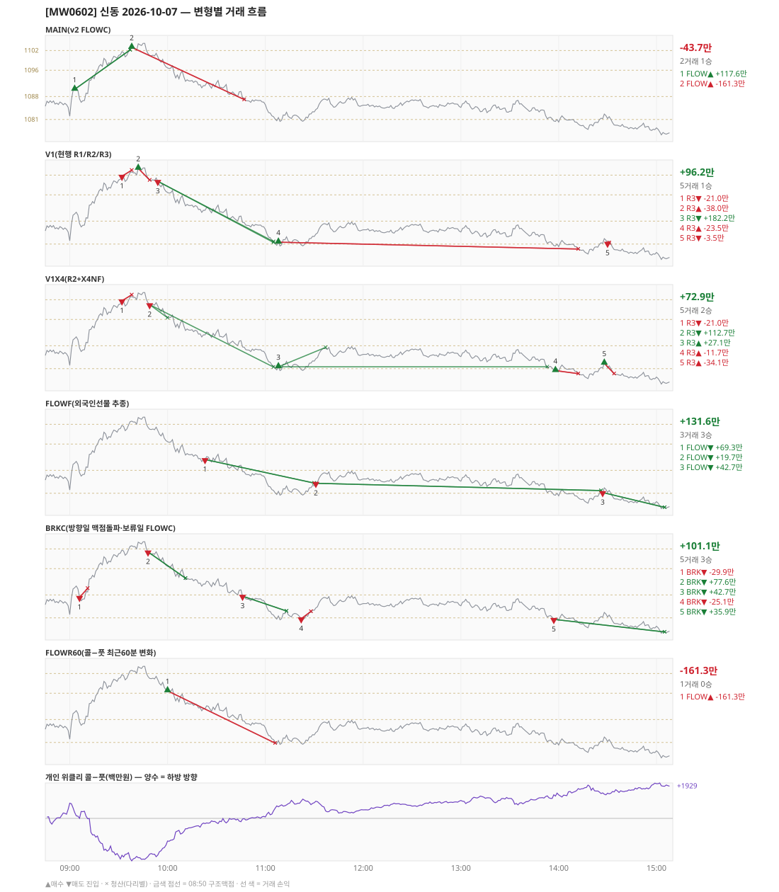

# [MW0602] 신동 일일 리포트 — 2026-10-07

> **MW0602 리포트** · 생성 2026-10-07 15:40 · 규격 `SD-2026-09-30-v2.1` · 상품 `mon` (먼스리 만기주 — 목위클리 대신 먼스리 (만기 2026-10-08))
> 가상거래다 — 주문 없음(절대원칙 §6). 손익은 미니선물 2계약 · CYBOS 요율 · 1틱 슬리피지 기준.

## 0. 한눈에

| 시장 | R1 장전 | R2 개장확정(V1) | R1 적중(09:00→15:05) |
|---|---|---|---|
| 1082.00 → 1076.72 (-5.28) · 고 1104.86 · 저 1076.02 · 폭 28.8pt | 콜−풋 +540 → **하방** | NONE | ✅ 적중 |

| 변형 | 거래 | 승 | 규칙별 | **순손익** | 최악 거래 | MAIN 대비 | 기록 |
|---|---|---|---|---|---|---|---|
| MAIN(v2 FLOWC) | 2 | 1 | FLOW -43.7만 | **-43.7만** | -161.3만 | — | 라이브 |
| V1(현행 R1/R2/R3) | 5 | 1 | R3 +96.2만 | **+96.2만** | -38.0만 | +139.9만 | 라이브 |
| V1X4(R2+X4NF) | 5 | 2 | R3 +72.9만 | **+72.9만** | -34.1만 | +116.6만 | 라이브 |
| FLOWF(외국인선물 추종) | 3 | 3 | FLOW +131.6만 | **+131.6만** | +19.7만 | +175.3만 | 라이브 |
| BRKC(방향일 맥점돌파·보류일 FLOWC) | 5 | 3 | BRK +101.1만 | **+101.1만** | -29.9만 | +144.8만 | 라이브 |
| FLOWR60(콜−풋 최근60분 변화) | 1 | 0 | FLOW -161.3만 | **-161.3만** | -161.3만 | -117.6만 | 라이브 |

**오늘의 한 줄** — MAIN -43.7만(2거래 1승), 최선은 FLOWF(외국인선물 추종) +131.6만(MAIN 대비 +175.3만).

## 1. 차트

## 2. 거래 흐름 — MAIN

| # | 규칙 | 방향 | 진입 | 맥점 | 손절 | 1차 · 최종 | 청산(다리별) | MFE | 손익 | 누적 |
|---|---|---|---|---|---|---|---|---|---|---|
| 1 | FLOW | 매수 | 09:03 1090.18 (탐지 09:04) | - | 1074.30 | 1102.18 · 1102.18 | 1차 09:37 1102.18 · 최종 09:37 1102.18 | 12.8 | **+117.6만** | +117.6만 |
| 2 | FLOW | 매수 | 09:38 1102.96 (탐지 09:39) | - | 1087.08 | 1114.96 · 1114.96 | 손절 10:47 1087.08 · 손절 10:47 1087.08 | 1.9 | **-161.3만** | -43.7만 |

## 3. 섀도 흐름 — 변형별 거래(v1 계열은 V1 과 무엇이 달랐나)

### V1(현행 R1/R2/R3) — +96.2만 (MAIN 대비 +139.9만)

- v1(R1/R2/R3) 대조군 — 되돌림 판정의 기준. 아래 v1 계열 섀도는 이 거래와 대조한다

| # | 규칙 | 방향 | 진입 | 맥점 | 손절 | 1차 · 최종 | 청산(다리별) | MFE | 손익 | 누적 |
|---|---|---|---|---|---|---|---|---|---|---|
| 1 | R3 | 매도 | 09:32 1101.66 (탐지 09:33) | 1102.0 | 1103.50 | 1081.80 · 1081.50 | 손절 09:38 1103.50 · 손절 09:38 1103.50 | 2.5 | **-21.0만** | -21.0만 |
| 2 | R3 | 매수 | 09:42 1104.04 (탐지 09:43) | 1102.0 | 1100.50 | 1109.47 · - | 손절 09:49 1100.50 · 손절 09:49 1100.50 | 0.8 | **-38.0만** | -58.9만 |
| 3 | R3 | 매도 | 09:54 1100.10 (탐지 09:55) | 1102.0 | 1103.50 | 1081.80 · 1081.50 | 1차 11:05 1081.80 · 최종 11:05 1081.50 | 19.2 | **+182.2만** | +123.2만 |
| 4 | R3 | 매수 | 11:08 1081.60 (탐지 11:09) | 1081.0 | 1079.50 | 1101.50 · 1101.50 | 손절 14:12 1079.50 · 손절 14:12 1079.50 | 6.3 | **-23.5만** | +99.7만 |
| 5 | R3 | 매도 | 14:30 1081.28 (탐지 14:31) | 1081.0 | 1083.30 | 1081.50 · 1081.50 | 1차 14:31 1081.50 · 본전 14:31 1081.28 | 0.4 | **-3.5만** | +96.2만 |

### V1X4(R2+X4NF) — +72.9만 (MAIN 대비 +116.6만)

- 09:42 R3 매수: V1 진입 1104.04 → **flip 금지(같은 맥점 1102.0 반대 방향)** (V1 손익 -38.0만 제외)
- 09:54 R3 매도: V1 진입 1100.10 → **flip 금지(같은 맥점 1102.0 반대 방향)** (V1 손익 +182.2만 제외)
- 11:08 R3 매수: 청산 차이 — V1 손절/손절 → 1차/본전 (-23.5만 → +27.1만, 차 +50.6만)
- 14:30 R3 매도: V1 진입 1081.28 → **flip 금지(같은 맥점 1081.0 반대 방향)** (V1 손익 -3.5만 제외)
- 09:49 R3 매도: **섀도만 진입** 1100.50 (앞 거래가 없어 신호가 살아남) → +112.7만
- 13:58 R3 매수: **섀도만 진입** 1080.42 (앞 거래가 없어 신호가 살아남) → -11.7만
- 14:28 R3 매수: **섀도만 진입** 1082.66 (앞 거래가 없어 신호가 살아남) → -34.1만

| # | 규칙 | 방향 | 진입 | 맥점 | 손절 | 1차 · 최종 | 청산(다리별) | MFE | 손익 | 누적 |
|---|---|---|---|---|---|---|---|---|---|---|
| 1 | R3 | 매도 | 09:32 1101.66 (탐지 09:33) | 1102.0 | 1103.50 | 1096.50 · 1081.50 | 손절 09:38 1103.50 · 손절 09:38 1103.50 | 2.5 | **-21.0만** | -21.0만 |
| 2 | R3 | 매도 | 09:49 1100.50 (탐지 09:50) | 1102.0 | 1103.50 | 1096.50 · 1081.50 | 1차 10:00 1096.50 · 최종 11:05 1081.50 | 19.6 | **+112.7만** | +91.7만 |
| 3 | R3 | 매수 | 11:08 1081.60 (탐지 11:09) | 1081.0 | 1079.50 | 1087.50 · 1101.50 | 1차 11:37 1087.50 · 본전 13:53 1081.60 | 6.3 | **+27.1만** | +118.8만 |
| 4 | R3 | 매수 | 13:58 1080.42 (탐지 13:59) | 1081.0 | 1079.50 | 1087.50 · 1101.50 | 손절 14:12 1079.50 · 손절 14:12 1079.50 | 2.4 | **-11.7만** | +107.0만 |
| 5 | R3 | 매수 | 14:28 1082.66 (탐지 14:29) | 1081.0 | 1079.50 | 1087.50 · 1101.50 | 손절 14:34 1079.50 · 손절 14:34 1079.50 | 0.1 | **-34.1만** | +72.9만 |

### FLOWF(외국인선물 추종) — +131.6만 (MAIN 대비 +175.3만)

- 별개 규칙(family) — MAIN·V1 과 거래 단위 대조는 하지 않는다. 손익·최악·거래 수로만 비교

| # | 규칙 | 방향 | 진입 | 맥점 | 손절 | 1차 · 최종 | 청산(다리별) | MFE | 손익 | 누적 |
|---|---|---|---|---|---|---|---|---|---|---|
| 1 | FLOW | 매도 | 10:23 1091.28 (탐지 10:24) | - | 1107.16 | 1079.28 · 1079.28 | 트레일 11:30 1084.10 · 트레일 11:30 1084.10 | 11.2 | **+69.3만** | +69.3만 |
| 2 | FLOW | 매도 | 11:31 1084.04 (탐지 11:32) | - | 1099.92 | 1072.04 · 1072.04 | 트레일 14:26 1081.82 · 트레일 14:26 1081.82 | 6.2 | **+19.7만** | +88.9만 |
| 3 | FLOW | 매도 | 14:27 1081.24 (탐지 14:28) | - | 1097.12 | 1069.24 · 1069.24 | 시간 15:05 1076.72 · 시간 15:05 1076.72 | 5.2 | **+42.7만** | +131.6만 |

### BRKC(방향일 맥점돌파·보류일 FLOWC) — +101.1만 (MAIN 대비 +144.8만)

- 별개 규칙(family) — MAIN·V1 과 거래 단위 대조는 하지 않는다. 손익·최악·거래 수로만 비교

| # | 규칙 | 방향 | 진입 | 맥점 | 손절 | 1차 · 최종 | 청산(다리별) | MFE | 손익 | 누적 |
|---|---|---|---|---|---|---|---|---|---|---|
| 1 | BRK | 매도 | 09:06 1087.26 (탐지 09:07) | 1088.0 | 1090.00 | 1079.26 · 1079.26 | 손절 09:11 1090.00 · 손절 09:11 1090.00 | 1.7 | **-29.9만** | -29.9만 |
| 2 | BRK | 매도 | 09:48 1101.08 (탐지 09:49) | 1102.0 | 1104.00 | 1093.08 · 1093.08 | 1차 10:11 1093.08 · 최종 10:11 1093.08 | 8.7 | **+77.6만** | +47.7만 |
| 3 | BRK | 매도 | 10:46 1087.62 (탐지 10:47) | 1088.0 | 1090.00 | 1079.62 · 1079.62 | 트레일 11:13 1083.10 · 트레일 11:13 1083.10 | 7.5 | **+42.7만** | +90.4만 |
| 4 | BRK | 매도 | 11:22 1080.74 (탐지 11:23) | 1081.0 | 1083.00 | 1072.74 · 1072.74 | 손절 11:28 1083.00 · 손절 11:28 1083.00 | 0.6 | **-25.1만** | +65.3만 |
| 5 | BRK | 매도 | 13:57 1080.56 (탐지 13:58) | 1081.0 | 1083.00 | 1072.56 · 1072.56 | 시간 15:05 1076.72 · 시간 15:05 1076.72 | 4.5 | **+35.9만** | +101.1만 |

### FLOWR60(콜−풋 최근60분 변화) — -161.3만 (MAIN 대비 -117.6만)

- 별개 규칙(family) — MAIN·V1 과 거래 단위 대조는 하지 않는다. 손익·최악·거래 수로만 비교

| # | 규칙 | 방향 | 진입 | 맥점 | 손절 | 1차 · 최종 | 청산(다리별) | MFE | 손익 | 누적 |
|---|---|---|---|---|---|---|---|---|---|---|
| 1 | FLOW | 매수 | 10:00 1096.70 (탐지 10:01) | - | 1080.82 | 1108.70 · 1108.70 | 손절 11:06 1080.82 · 손절 11:06 1080.82 | 0.9 | **-161.3만** | -161.3만 |

## 4. 누적 채점 (라이브 기록 · 판정 창)

| 변형 | 채점 시작 | 거래일 | 거래 | 승률 | 순손익 | 최악일 | R3 (건 · 승률 · 순) | 판정 |
|---|---|---|---|---|---|---|---|---|
| MAIN(v2 FLOWC) | 2026-10-01 | 4 | 7 | 57% | **-83.2만** | -181.9만 | 0 · - · +0.0만 | v2 vs V1 되돌림 판정 4/20일 |
| V1(현행 R1/R2/R3) | 2026-10-01 | 4 | 22 | 32% | **-52.3만** | -90.3만 | 20 · 30% · -24.7만 | 대조군 4/20일 (v1 R3 중단 판정은 채점표) |
| V1X4(R2+X4NF) | 2026-10-01 | 4 | 23 | 57% | **+39.3만** | -36.3만 | 21 · 57% · +66.8만 | MAIN 비교 4/20일 |
| FLOWF(외국인선물 추종) | 2026-10-01 | 4 | 7 | 71% | **-169.9만** | -169.8만 | 0 · - · +0.0만 | MAIN 비교 4/20일 |
| BRKC(방향일 맥점돌파·보류일 FLOWC) | 2026-10-01 | 4 | 18 | 56% | **+299.2만** | -13.8만 | 0 · - · +0.0만 | MAIN 비교 4/20일 |
| FLOWR60(콜−풋 최근60분 변화) | 2026-10-02 | 3 | 5 | 60% | **-26.8만** | -161.3만 | 0 · - · +0.0만 | MAIN 비교 3/20일 |

> 판정 전 집계다 — 인용·규격 변경 근거로 쓰지 말 것. 되돌림: V1 이 MAIN 보다 순손익·최악일 **둘 다** 나으면 v1 복귀. 섀도: MAIN 대비 순손익 우위 **그리고** 최악일 개선 → 채택 후보(자동 승격 없음).

## 5. 러너 섀도 — 미륵이 × 신동 (CREON 요율)

| 미륵이 진입 | 방향 | 조건 | 러너 | 실제 | 러너 적용 | 차이 | 필터 B |
|---|---|---|---|---|---|---|---|
| 10:43 1088.20 ×2 | 매도 | 충족 | TP1 미도달 | -5.7만 | -5.7만 | **+0.0만** | 통과 |
| 10:52 1086.37 ×2 | 매도 | 충족 | TP1 미도달 | -2.9만 | -2.9만 | **+0.0만** | 통과 |
| 10:56 1086.72 ×2 | 매도 | 충족 | TP1 미도달 | -3.1만 | -3.1만 | **+0.0만** | 통과 |
| 11:07 1081.16 ×1 | 매도 | 충족 | TP1 미도달 | +0.7만 | +0.7만 | **+0.0만** | 제외 |
| 11:12 1082.36 ×1 | 매도 | 충족 | TP1 미도달 | +0.9만 | +0.9만 | **+0.0만** | 제외 |

- 합: 실제 -10.2만 → 러너 -10.2만 (차 +0.0만)

## 6. 개선 방향 (자동 관찰 — 판정 아님)

- **진입 품질** — MAIN 손실 1건 중 1건은 유리한 쪽으로 4pt 도 못 갔다(MFE 1.9). 청산을 바꿔서는 못 막는 손실이다 → 진입 조건(문턱 K·R1 방향) 쪽 관찰 대상.
- **탐지 지연** — 라이브 진입 2건, 규칙가 대비 실현가능가 차 +0(음수 = 늦게 알아채 손해).
- **오늘 최선은 FLOWF(외국인선물 추종)** (+131.6만, MAIN 대비 +175.3만). 하루 결과다 — 판정은 사전등록 창(20거래일)으로만.
- **v1 대조** — V1 +96.2만 vs MAIN -43.7만 (차 -139.9만). 되돌림 판정은 20거래일 누적으로만.
- ⚠ 규격 변경은 사전등록 §6(새 버전 · 재채점)으로만. 이 절은 관찰이다.

---
재생성: `python scripts/shindong_daily_report.py 2026-10-07`
