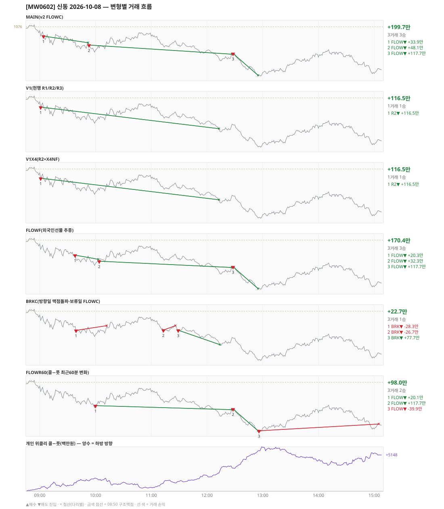

# [MW0602] 신동 일일 리포트 — 2026-10-08

> **MW0602 리포트** · 생성 2026-10-08 18:21 · 규격 `SD-2026-09-30-v2.1` · 상품 `mon` (먼스리 만기주 — 목위클리 대신 먼스리 (만기 2026-10-08))
> 가상거래다 — 주문 없음(절대원칙 §6). 손익은 미니선물 2계약 · CYBOS 요율 · 1틱 슬리피지 기준.

## 0. 한눈에

| 시장 | R1 장전 | R2 개장확정(V1) | R1 적중(09:00→15:05) |
|---|---|---|---|
| 1073.86 → 1053.02 (-20.84) · 고 1075.70 · 저 1048.04 · 폭 27.7pt | 콜−풋 +392 → **하방** | CONFIRMED 09:01 | ✅ 적중 |

| 변형 | 거래 | 승 | 규칙별 | **순손익** | 최악 거래 | MAIN 대비 | 기록 |
|---|---|---|---|---|---|---|---|
| MAIN(v2 FLOWC) | 3 | 3 | FLOW +199.7만 | **+199.7만** | +33.9만 | — | 라이브 |
| V1(현행 R1/R2/R3) | 1 | 1 | R2 +116.5만 | **+116.5만** | +116.5만 | -83.2만 | 라이브 |
| V1X4(R2+X4NF) | 1 | 1 | R2 +116.5만 | **+116.5만** | +116.5만 | -83.2만 | 라이브 |
| FLOWF(외국인선물 추종) | 3 | 3 | FLOW +170.4만 | **+170.4만** | +20.3만 | -29.4만 | 라이브 |
| BRKC(방향일 맥점돌파·보류일 FLOWC) | 3 | 1 | BRK +22.7만 | **+22.7만** | -28.3만 | -177.0만 | 라이브 |
| FLOWR60(콜−풋 최근60분 변화) | 3 | 2 | FLOW +98.0만 | **+98.0만** | -39.9만 | -101.8만 | 라이브 |

**오늘의 한 줄** — MAIN +199.7만(3거래 3승).

## 1. 차트

## 2. 거래 흐름 — MAIN

| # | 규칙 | 방향 | 진입 | 맥점 | 손절 | 1차 · 최종 | 청산(다리별) | MFE | 손익 | 누적 |
|---|---|---|---|---|---|---|---|---|---|---|
| 1 | FLOW | 매도 | 09:04 1070.84 (탐지 09:05) | - | 1087.03 | 1058.84 · 1058.84 | 트레일 09:52 1067.20 · 트레일 09:52 1067.20 | 7.6 | **+33.9만** | +33.9만 |
| 2 | FLOW | 매도 | 09:53 1065.94 (탐지 09:54) | - | 1082.13 | 1053.94 · 1053.94 | 트레일 12:27 1060.88 · 트레일 12:27 1060.88 | 9.1 | **+48.1만** | +82.0만 |
| 3 | FLOW | 매도 | 12:28 1061.28 (탐지 12:29) | - | 1077.47 | 1049.28 · 1049.28 | 1차 12:55 1049.28 · 최종 12:55 1049.28 | 12.6 | **+117.7만** | +199.7만 |

## 3. 섀도 흐름 — 변형별 거래(v1 계열은 V1 과 무엇이 달랐나)

### V1(현행 R1/R2/R3) — +116.5만 (MAIN 대비 -83.2만)

- v1(R1/R2/R3) 대조군 — 되돌림 판정의 기준. 아래 v1 계열 섀도는 이 거래와 대조한다

| # | 규칙 | 방향 | 진입 | 맥점 | 손절 | 1차 · 최종 | 청산(다리별) | MFE | 손익 | 누적 |
|---|---|---|---|---|---|---|---|---|---|---|
| 1 | R2 | 매도 | 09:01 1070.90 (탐지 09:02) | - | 1076.70 | 1059.02 · 1059.02 | 1차 12:13 1059.02 · 최종 12:13 1059.02 | 12.3 | **+116.5만** | +116.5만 |

### V1X4(R2+X4NF) — +116.5만 (MAIN 대비 -83.2만)

- V1 과 같다

| # | 규칙 | 방향 | 진입 | 맥점 | 손절 | 1차 · 최종 | 청산(다리별) | MFE | 손익 | 누적 |
|---|---|---|---|---|---|---|---|---|---|---|
| 1 | R2 | 매도 | 09:01 1070.90 (탐지 09:02) | - | 1076.70 | 1059.02 · 1059.02 | 1차 12:13 1059.02 · 최종 12:13 1059.02 | 12.3 | **+116.5만** | +116.5만 |

### FLOWF(외국인선물 추종) — +170.4만 (MAIN 대비 -29.4만)

- 별개 규칙(family) — MAIN·V1 과 거래 단위 대조는 하지 않는다. 손익·최악·거래 수로만 비교

| # | 규칙 | 방향 | 진입 | 맥점 | 손절 | 1차 · 최종 | 청산(다리별) | MFE | 손익 | 누적 |
|---|---|---|---|---|---|---|---|---|---|---|
| 1 | FLOW | 매도 | 09:38 1067.68 (탐지 09:39) | - | 1083.87 | 1055.68 · 1055.68 | 트레일 10:03 1065.40 · 트레일 10:03 1065.40 | 6.3 | **+20.3만** | +20.3만 |
| 2 | FLOW | 매도 | 10:04 1064.36 (탐지 10:05) | - | 1080.55 | 1052.36 · 1052.36 | 트레일 12:27 1060.88 · 트레일 12:27 1060.88 | 7.5 | **+32.3만** | +52.6만 |
| 3 | FLOW | 매도 | 12:28 1061.28 (탐지 12:29) | - | 1077.47 | 1049.28 · 1049.28 | 1차 12:55 1049.28 · 최종 12:55 1049.28 | 12.6 | **+117.7만** | +170.4만 |

### BRKC(방향일 맥점돌파·보류일 FLOWC) — +22.7만 (MAIN 대비 -177.0만)

- 별개 규칙(family) — MAIN·V1 과 거래 단위 대조는 하지 않는다. 손익·최악·거래 수로만 비교

| # | 규칙 | 방향 | 진입 | 맥점 | 손절 | 1차 · 최종 | 청산(다리별) | MFE | 손익 | 누적 |
|---|---|---|---|---|---|---|---|---|---|---|
| 1 | BRK | 매도 | 09:39 1065.42 (탐지 09:40) | 1066.0 | 1068.00 | 1057.42 · 1057.42 | 손절 10:12 1068.00 · 손절 10:12 1068.00 | 4.0 | **-28.3만** | -28.3만 |
| 2 | BRK | 매도 | 11:13 1065.58 (탐지 11:14) | 1066.0 | 1068.00 | 1057.58 · 1057.58 | 손절 11:26 1068.00 · 손절 11:26 1068.00 | 1.0 | **-26.7만** | -55.0만 |
| 3 | BRK | 매도 | 11:29 1065.52 (탐지 11:30) | 1066.0 | 1068.00 | 1057.52 · 1057.52 | 1차 12:14 1057.52 · 최종 12:14 1057.52 | 8.1 | **+77.7만** | +22.7만 |

### FLOWR60(콜−풋 최근60분 변화) — +98.0만 (MAIN 대비 -101.8만)

- 별개 규칙(family) — MAIN·V1 과 거래 단위 대조는 하지 않는다. 손익·최악·거래 수로만 비교

| # | 규칙 | 방향 | 진입 | 맥점 | 손절 | 1차 · 최종 | 청산(다리별) | MFE | 손익 | 누적 |
|---|---|---|---|---|---|---|---|---|---|---|
| 1 | FLOW | 매도 | 10:00 1063.14 (탐지 10:01) | - | 1079.33 | 1051.14 · 1051.14 | 트레일 12:27 1060.88 · 트레일 12:27 1060.88 | 6.3 | **+20.1만** | +20.1만 |
| 2 | FLOW | 매도 | 12:28 1061.28 (탐지 12:29) | - | 1077.47 | 1049.28 · 1049.28 | 1차 12:55 1049.28 · 최종 12:55 1049.28 | 12.6 | **+117.7만** | +137.8만 |
| 3 | FLOW | 매도 | 12:56 1049.28 (탐지 12:57) | - | 1065.47 | 1037.28 · 1037.28 | 시간 15:05 1053.02 · 시간 15:05 1053.02 | 1.2 | **-39.9만** | +98.0만 |

## 4. 누적 채점 (라이브 기록 · 판정 창)

| 변형 | 채점 시작 | 거래일 | 거래 | 승률 | 순손익 | 최악일 | R3 (건 · 승률 · 순) | 판정 |
|---|---|---|---|---|---|---|---|---|
| MAIN(v2 FLOWC) | 2026-10-01 | 5 | 10 | 70% | **+116.5만** | -181.9만 | 0 · - · +0.0만 | v2 vs V1 되돌림 판정 5/20일 |
| V1(현행 R1/R2/R3) | 2026-10-01 | 5 | 23 | 35% | **+64.3만** | -90.3만 | 20 · 30% · -24.7만 | 대조군 5/20일 (v1 R3 중단 판정은 채점표) |
| V1X4(R2+X4NF) | 2026-10-01 | 5 | 24 | 58% | **+155.8만** | -36.3만 | 21 · 57% · +66.8만 | MAIN 비교 5/20일 |
| FLOWF(외국인선물 추종) | 2026-10-01 | 5 | 10 | 80% | **+0.4만** | -169.8만 | 0 · - · +0.0만 | MAIN 비교 5/20일 |
| BRKC(방향일 맥점돌파·보류일 FLOWC) | 2026-10-01 | 5 | 21 | 52% | **+321.9만** | -13.8만 | 0 · - · +0.0만 | MAIN 비교 5/20일 |
| FLOWR60(콜−풋 최근60분 변화) | 2026-10-02 | 4 | 8 | 62% | **+71.2만** | -161.3만 | 0 · - · +0.0만 | MAIN 비교 4/20일 |

> 판정 전 집계다 — 인용·규격 변경 근거로 쓰지 말 것. 되돌림: V1 이 MAIN 보다 순손익·최악일 **둘 다** 나으면 v1 복귀. 섀도: MAIN 대비 순손익 우위 **그리고** 최악일 개선 → 채택 후보(자동 승격 없음).

## 5. 러너 섀도 — 미륵이 × 신동 (CREON 요율)

| 미륵이 진입 | 방향 | 조건 | 러너 | 실제 | 러너 적용 | 차이 | 필터 B |
|---|---|---|---|---|---|---|---|
| 10:54 1071.44 ×2 | 매수 | 불충족 | 신동 방향 반대 | -3.6만 | -3.6만 | **+0.0만** | 제외 |
| 13:03 1051.94 ×1 | 매도 | 충족 | TP1 미도달 | +0.0만 | +0.0만 | **+0.0만** | 제외 |
| 14:47 1054.97 ×2 | 매도 | 충족 | TP1 미도달 | -12.6만 | -12.6만 | **+0.0만** | 제외 |

- 합: 실제 -16.2만 → 러너 -16.2만 (차 +0.0만)

## 6. 개선 방향 (자동 관찰 — 판정 아님)

- **탐지 지연** — 라이브 진입 3건, 규칙가 대비 실현가능가 차 +0(음수 = 늦게 알아채 손해).
- **오늘은 MAIN 이 최선** (+199.7만).
- **v1 대조** — V1 +116.5만 vs MAIN +199.7만 (차 +83.2만). 되돌림 판정은 20거래일 누적으로만.
- ⚠ 규격 변경은 사전등록 §6(새 버전 · 재채점)으로만. 이 절은 관찰이다.

---
재생성: `python scripts/shindong_daily_report.py 2026-10-08`
