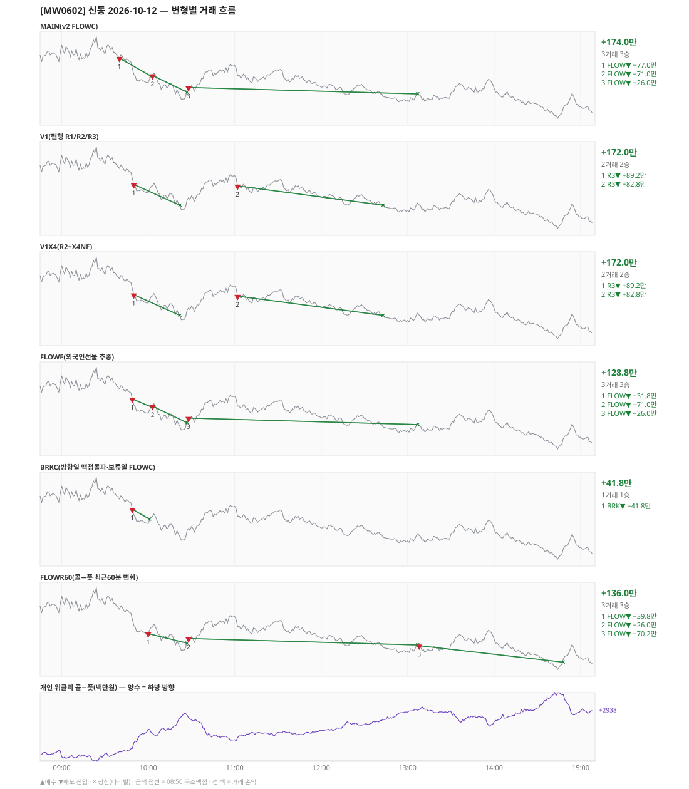

# [MW0602] 신동 일일 리포트 — 2026-10-12

> **MW0602 리포트** · 생성 2026-10-12 15:40 · 규격 `SD-2026-09-30-v2.1` · 상품 `wk_mon` (최근접 만기 월위클리 (만기 2026-10-12))
> 가상거래다 — 주문 없음(절대원칙 §6). 손익은 미니선물 2계약 · CYBOS 요율 · 1틱 슬리피지 기준.

## 0. 한눈에

| 시장 | R1 장전 | R2 개장확정(V1) | R1 적중(09:00→15:05) |
|---|---|---|---|
| 1037.66 → 1010.54 (-27.12) · 고 1041.48 · 저 1004.48 · 폭 37.0pt | 콜−풋 +538 → **하방** | NONE | ✅ 적중 |

| 변형 | 거래 | 승 | 규칙별 | **순손익** | 최악 거래 | MAIN 대비 | 기록 |
|---|---|---|---|---|---|---|---|
| MAIN(v2 FLOWC) | 3 | 3 | FLOW +174.0만 | **+174.0만** | +26.0만 | — | 라이브 |
| V1(현행 R1/R2/R3) | 2 | 2 | R3 +172.0만 | **+172.0만** | +82.8만 | -2.0만 | 라이브 |
| V1X4(R2+X4NF) | 2 | 2 | R3 +172.0만 | **+172.0만** | +82.8만 | -2.0만 | 라이브 |
| FLOWF(외국인선물 추종) | 3 | 3 | FLOW +128.8만 | **+128.8만** | +26.0만 | -45.2만 | 라이브 |
| BRKC(방향일 맥점돌파·보류일 FLOWC) | 1 | 1 | BRK +41.8만 | **+41.8만** | +41.8만 | -132.2만 | 라이브 |
| FLOWR60(콜−풋 최근60분 변화) | 3 | 3 | FLOW +136.0만 | **+136.0만** | +26.0만 | -38.0만 | 라이브 |

**오늘의 한 줄** — MAIN +174.0만(3거래 3승).

## 1. 차트

## 2. 거래 흐름 — MAIN

| # | 규칙 | 방향 | 진입 | 맥점 | 손절 | 1차 · 최종 | 청산(다리별) | MFE | 손익 | 누적 |
|---|---|---|---|---|---|---|---|---|---|---|
| 1 | FLOW | 매도 | 09:40 1031.86 (탐지 09:41) | - | 1048.32 | 1019.86 · 1019.86 | 트레일 10:02 1023.92 · 트레일 10:02 1023.92 | 11.9 | **+77.0만** | +77.0만 |
| 2 | FLOW | 매도 | 10:03 1024.20 (탐지 10:04) | - | 1040.66 | 1012.20 · 1012.20 | 트레일 10:27 1016.86 · 트레일 10:27 1016.86 | 11.3 | **+71.0만** | +148.0만 |
| 3 | FLOW | 매도 | 10:28 1018.92 (탐지 10:29) | - | 1035.38 | 1006.92 · 1006.92 | 트레일 13:07 1016.08 · 트레일 13:07 1016.08 | 6.8 | **+26.0만** | +174.0만 |

## 3. 섀도 흐름 — 변형별 거래(v1 계열은 V1 과 무엇이 달랐나)

### V1(현행 R1/R2/R3) — +172.0만 (MAIN 대비 -2.0만)

- v1(R1/R2/R3) 대조군 — 되돌림 판정의 기준. 아래 v1 계열 섀도는 이 거래와 대조한다

| # | 규칙 | 방향 | 진입 | 맥점 | 손절 | 1차 · 최종 | 청산(다리별) | MFE | 손익 | 누적 |
|---|---|---|---|---|---|---|---|---|---|---|
| 1 | R3 | 매도 | 09:50 1024.74 (탐지 09:51) | 1030.0 | 1031.50 | 1015.60 · 1015.60 | 1차 10:22 1015.60 · 최종 10:22 1015.60 | 9.6 | **+89.2만** | +89.2만 |
| 2 | R3 | 매도 | 11:02 1024.10 (탐지 11:03) | 1030.0 | 1031.50 | 1015.60 · 1015.60 | 1차 12:43 1015.60 · 최종 12:43 1015.60 | 9.4 | **+82.8만** | +172.0만 |

### V1X4(R2+X4NF) — +172.0만 (MAIN 대비 -2.0만)

- V1 과 같다

| # | 규칙 | 방향 | 진입 | 맥점 | 손절 | 1차 · 최종 | 청산(다리별) | MFE | 손익 | 누적 |
|---|---|---|---|---|---|---|---|---|---|---|
| 1 | R3 | 매도 | 09:50 1024.74 (탐지 09:51) | 1030.0 | 1031.50 | 1015.60 · 1015.60 | 1차 10:22 1015.60 · 최종 10:22 1015.60 | 9.6 | **+89.2만** | +89.2만 |
| 2 | R3 | 매도 | 11:02 1024.10 (탐지 11:03) | 1030.0 | 1031.50 | 1015.60 · 1015.60 | 1차 12:43 1015.60 · 최종 12:43 1015.60 | 9.4 | **+82.8만** | +172.0만 |

### FLOWF(외국인선물 추종) — +128.8만 (MAIN 대비 -45.2만)

- 별개 규칙(family) — MAIN·V1 과 거래 단위 대조는 하지 않는다. 손익·최악·거래 수로만 비교

| # | 규칙 | 방향 | 진입 | 맥점 | 손절 | 1차 · 최종 | 청산(다리별) | MFE | 손익 | 누적 |
|---|---|---|---|---|---|---|---|---|---|---|
| 1 | FLOW | 매도 | 09:49 1027.34 (탐지 09:50) | - | 1043.80 | 1015.34 · 1015.34 | 트레일 10:02 1023.92 · 트레일 10:02 1023.92 | 7.4 | **+31.8만** | +31.8만 |
| 2 | FLOW | 매도 | 10:03 1024.20 (탐지 10:04) | - | 1040.66 | 1012.20 · 1012.20 | 트레일 10:27 1016.86 · 트레일 10:27 1016.86 | 11.3 | **+71.0만** | +102.8만 |
| 3 | FLOW | 매도 | 10:28 1018.92 (탐지 10:29) | - | 1035.38 | 1006.92 · 1006.92 | 트레일 13:07 1016.08 · 트레일 13:07 1016.08 | 6.8 | **+26.0만** | +128.8만 |

### BRKC(방향일 맥점돌파·보류일 FLOWC) — +41.8만 (MAIN 대비 -132.2만)

- 별개 규칙(family) — MAIN·V1 과 거래 단위 대조는 하지 않는다. 손익·최악·거래 수로만 비교

| # | 규칙 | 방향 | 진입 | 맥점 | 손절 | 1차 · 최종 | 청산(다리별) | MFE | 손익 | 누적 |
|---|---|---|---|---|---|---|---|---|---|---|
| 1 | BRK | 매도 | 09:49 1027.34 (탐지 09:50) | 1030.0 | 1032.00 | 1019.34 · 1019.34 | 트레일 10:01 1022.92 · 트레일 10:01 1022.92 | 7.4 | **+41.8만** | +41.8만 |

### FLOWR60(콜−풋 최근60분 변화) — +136.0만 (MAIN 대비 -38.0만)

- 별개 규칙(family) — MAIN·V1 과 거래 단위 대조는 하지 않는다. 손익·최악·거래 수로만 비교

| # | 규칙 | 방향 | 진입 | 맥점 | 손절 | 1차 · 최종 | 청산(다리별) | MFE | 손익 | 누적 |
|---|---|---|---|---|---|---|---|---|---|---|
| 1 | FLOW | 매도 | 10:00 1021.08 (탐지 10:01) | - | 1037.54 | 1009.08 · 1009.08 | 트레일 10:27 1016.86 · 트레일 10:27 1016.86 | 8.2 | **+39.8만** | +39.8만 |
| 2 | FLOW | 매도 | 10:28 1018.92 (탐지 10:29) | - | 1035.38 | 1006.92 · 1006.92 | 트레일 13:07 1016.08 · 트레일 13:07 1016.08 | 6.8 | **+26.0만** | +65.8만 |
| 3 | FLOW | 매도 | 13:08 1015.74 (탐지 13:09) | - | 1032.20 | 1003.74 · 1003.74 | 트레일 14:48 1008.48 · 트레일 14:48 1008.48 | 11.3 | **+70.2만** | +136.0만 |

## 4. 누적 채점 (라이브 기록 · 판정 창)

| 변형 | 채점 시작 | 거래일 | 거래 | 승률 | 순손익 | 최악일 | R3 (건 · 승률 · 순) | 판정 |
|---|---|---|---|---|---|---|---|---|
| MAIN(v2 FLOWC) | 2026-10-01 | 6 | 13 | 77% | **+290.5만** | -181.9만 | 0 · - · +0.0만 | v2 vs V1 되돌림 판정 6/20일 |
| V1(현행 R1/R2/R3) | 2026-10-01 | 6 | 25 | 40% | **+236.2만** | -90.3만 | 22 · 36% · +147.3만 | 대조군 6/20일 (v1 R3 중단 판정은 채점표) |
| V1X4(R2+X4NF) | 2026-10-01 | 6 | 26 | 62% | **+327.8만** | -36.3만 | 23 · 61% · +238.8만 | MAIN 비교 6/20일 |
| FLOWF(외국인선물 추종) | 2026-10-01 | 6 | 13 | 85% | **+129.2만** | -169.8만 | 0 · - · +0.0만 | MAIN 비교 6/20일 |
| BRKC(방향일 맥점돌파·보류일 FLOWC) | 2026-10-01 | 6 | 22 | 55% | **+363.7만** | -13.8만 | 0 · - · +0.0만 | MAIN 비교 6/20일 |
| FLOWR60(콜−풋 최근60분 변화) | 2026-10-02 | 5 | 11 | 73% | **+207.2만** | -161.3만 | 0 · - · +0.0만 | MAIN 비교 5/20일 |

> 판정 전 집계다 — 인용·규격 변경 근거로 쓰지 말 것. 되돌림: V1 이 MAIN 보다 순손익·최악일 **둘 다** 나으면 v1 복귀. 섀도: MAIN 대비 순손익 우위 **그리고** 최악일 개선 → 채택 후보(자동 승격 없음).

## 5. 러너 섀도 — 미륵이 × 신동 (CREON 요율)

| 미륵이 진입 | 방향 | 조건 | 러너 | 실제 | 러너 적용 | 차이 | 필터 B |
|---|---|---|---|---|---|---|---|
| 10:30 1017.84 ×2 | 매도 | 충족 | TP1 미도달 | -21.5만 | -21.5만 | **+0.0만** | 제외 |
| 11:29 1026.37 ×2 | 매수 | 불충족 | 신동 방향 반대 | -5.2만 | -5.2만 | **+0.0만** | 제외 |
| 12:01 1019.10 ×2 | 매도 | 충족 | TP1 미도달 | -3.5만 | -3.5만 | **+0.0만** | 통과 |
| 12:47 1014.48 ×1 | 매도 | 충족 | TP1 미도달 | +1.4만 | +1.4만 | **+0.0만** | 제외 |
| 13:00 1012.92 ×1 | 매도 | 충족 | TP1 미도달 | +0.5만 | +0.5만 | **+0.0만** | 제외 |
| 13:05 1013.20 ×1 | 매도 | 충족 | TP1 미도달 | -8.9만 | -8.9만 | **+0.0만** | 제외 |
| 14:32 1011.08 ×1 | 매도 | 충족 | TP1 미도달 | +10.9만 | +10.9만 | **+0.0만** | 제외 |
| 14:39 1008.24 ×1 | 매도 | 충족 | TP1 미도달 | +15.0만 | +15.0만 | **+0.0만** | 제외 |

- 합: 실제 -11.2만 → 러너 -11.2만 (차 +0.0만)

## 6. 개선 방향 (자동 관찰 — 판정 아님)

- **탐지 지연** — 라이브 진입 3건, 규칙가 대비 실현가능가 차 +0(음수 = 늦게 알아채 손해).
- **오늘은 MAIN 이 최선** (+174.0만).
- **v1 대조** — V1 +172.0만 vs MAIN +174.0만 (차 +2.0만). 되돌림 판정은 20거래일 누적으로만.
- ⚠ 규격 변경은 사전등록 §6(새 버전 · 재채점)으로만. 이 절은 관찰이다.

---
재생성: `python scripts/shindong_daily_report.py 2026-10-12`
