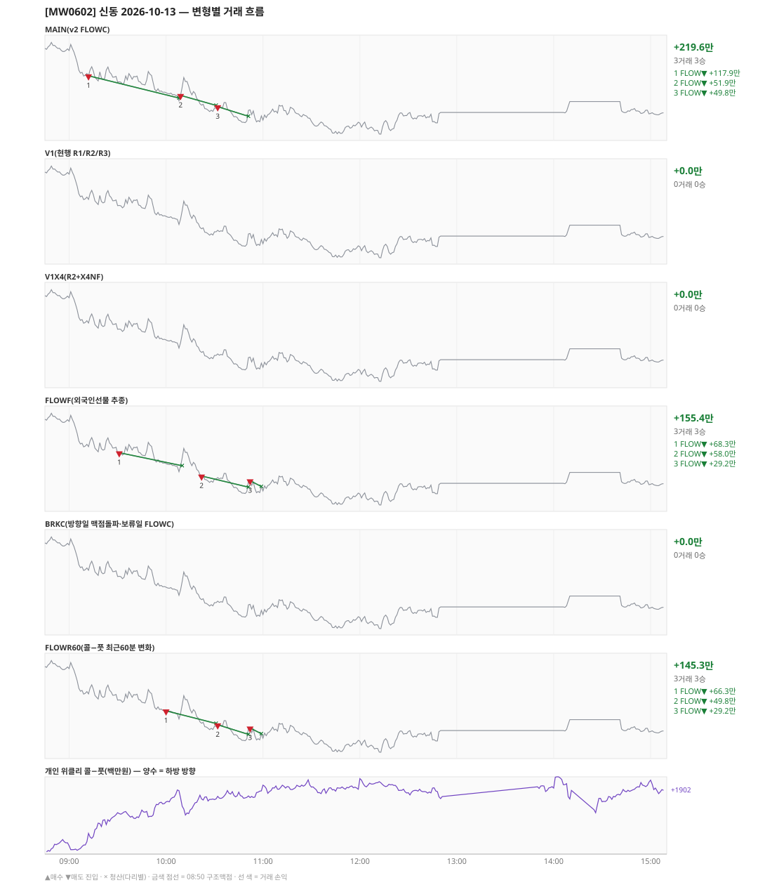

# [MW0602] 신동 일일 리포트 — 2026-10-13

> **MW0602 리포트** · 생성 2026-10-13 15:40 · 규격 `SD-2026-09-30-v2.1` · 상품 `wk_thu` (최근접 만기 목위클리 (만기 2026-10-15))
> 가상거래다 — 주문 없음(절대원칙 §6). 손익은 미니선물 2계약 · CYBOS 요율 · 1틱 슬리피지 기준.

## 0. 한눈에

| 시장 | R1 장전 | R2 개장확정(V1) | R1 적중(09:00→15:05) |
|---|---|---|---|
| 973.54 → 938.86 (-34.68) · 고 978.78 · 저 928.02 · 폭 50.8pt | 콜−풋 +338 → **하방** | NONE | ✅ 적중 |

| 변형 | 거래 | 승 | 규칙별 | **순손익** | 최악 거래 | MAIN 대비 | 기록 |
|---|---|---|---|---|---|---|---|
| MAIN(v2 FLOWC) | 3 | 3 | FLOW +219.6만 | **+219.6만** | +49.8만 | — | 라이브 |
| V1(현행 R1/R2/R3) | 0 | 0 | - | **+0.0만** | +0.0만 | -219.6만 | 라이브 |
| V1X4(R2+X4NF) | 0 | 0 | - | **+0.0만** | +0.0만 | -219.6만 | 라이브 |
| FLOWF(외국인선물 추종) | 3 | 3 | FLOW +155.4만 | **+155.4만** | +29.2만 | -64.2만 | 라이브 |
| BRKC(방향일 맥점돌파·보류일 FLOWC) | 0 | 0 | - | **+0.0만** | +0.0만 | -219.6만 | 라이브 |
| FLOWR60(콜−풋 최근60분 변화) | 3 | 3 | FLOW +145.3만 | **+145.3만** | +29.2만 | -74.4만 | 라이브 |

**오늘의 한 줄** — MAIN +219.6만(3거래 3승).

## 1. 차트

## 2. 거래 흐름 — MAIN

| # | 규칙 | 방향 | 진입 | 맥점 | 손절 | 1차 · 최종 | 청산(다리별) | MFE | 손익 | 누적 |
|---|---|---|---|---|---|---|---|---|---|---|
| 1 | FLOW | 매도 | 09:12 959.88 (탐지 09:13) | - | 977.40 | 947.88 · 947.88 | 1차 10:08 947.88 · 최종 10:08 947.88 | 13.5 | **+117.9만** | +117.9만 |
| 2 | FLOW | 매도 | 10:09 949.32 (탐지 10:10) | - | 966.84 | 937.32 · 937.32 | 트레일 10:31 943.90 · 트레일 10:31 943.90 | 9.4 | **+51.9만** | +169.9만 |
| 3 | FLOW | 매도 | 10:32 943.20 (탐지 10:33) | - | 960.72 | 931.20 · 931.20 | 트레일 10:51 938.00 · 트레일 10:51 938.00 | 9.2 | **+49.8만** | +219.6만 |

## 3. 섀도 흐름 — 변형별 거래(v1 계열은 V1 과 무엇이 달랐나)

### V1(현행 R1/R2/R3) — +0.0만 (MAIN 대비 -219.6만)

- v1(R1/R2/R3) 대조군 — 되돌림 판정의 기준. 아래 v1 계열 섀도는 이 거래와 대조한다

| # | 규칙 | 방향 | 진입 | 맥점 | 손절 | 1차 · 최종 | 청산(다리별) | MFE | 손익 | 누적 |
|---|---|---|---|---|---|---|---|---|---|---|
| - | 거래 없음 | | | | | | | | | |

### V1X4(R2+X4NF) — +0.0만 (MAIN 대비 -219.6만)

- V1 과 같다

| # | 규칙 | 방향 | 진입 | 맥점 | 손절 | 1차 · 최종 | 청산(다리별) | MFE | 손익 | 누적 |
|---|---|---|---|---|---|---|---|---|---|---|
| - | 거래 없음 | | | | | | | | | |

### FLOWF(외국인선물 추종) — +155.4만 (MAIN 대비 -64.2만)

- 별개 규칙(family) — MAIN·V1 과 거래 단위 대조는 하지 않는다. 손익·최악·거래 수로만 비교

| # | 규칙 | 방향 | 진입 | 맥점 | 손절 | 1차 · 최종 | 청산(다리별) | MFE | 손익 | 누적 |
|---|---|---|---|---|---|---|---|---|---|---|
| 1 | FLOW | 매도 | 09:31 956.64 (탐지 09:32) | - | 974.16 | 944.64 · 944.64 | 트레일 10:10 949.58 · 트레일 10:10 949.58 | 11.1 | **+68.3만** | +68.3만 |
| 2 | FLOW | 매도 | 10:22 944.02 (탐지 10:23) | - | 961.54 | 932.02 · 932.02 | 트레일 10:51 938.00 · 트레일 10:51 938.00 | 10.0 | **+58.0만** | +126.3만 |
| 3 | FLOW | 매도 | 10:52 941.50 (탐지 10:53) | - | 959.02 | 929.50 · 929.50 | 트레일 10:59 938.36 · 트레일 10:59 938.36 | 7.1 | **+29.2만** | +155.4만 |

### BRKC(방향일 맥점돌파·보류일 FLOWC) — +0.0만 (MAIN 대비 -219.6만)

- 별개 규칙(family) — MAIN·V1 과 거래 단위 대조는 하지 않는다. 손익·최악·거래 수로만 비교

| # | 규칙 | 방향 | 진입 | 맥점 | 손절 | 1차 · 최종 | 청산(다리별) | MFE | 손익 | 누적 |
|---|---|---|---|---|---|---|---|---|---|---|
| - | 거래 없음 | | | | | | | | | |

### FLOWR60(콜−풋 최근60분 변화) — +145.3만 (MAIN 대비 -74.4만)

- 별개 규칙(family) — MAIN·V1 과 거래 단위 대조는 하지 않는다. 손익·최악·거래 수로만 비교

| # | 규칙 | 방향 | 진입 | 맥점 | 손절 | 1차 · 최종 | 청산(다리별) | MFE | 손익 | 누적 |
|---|---|---|---|---|---|---|---|---|---|---|
| 1 | FLOW | 매도 | 10:00 950.76 (탐지 10:01) | - | 968.28 | 938.76 · 938.76 | 트레일 10:31 943.90 · 트레일 10:31 943.90 | 10.9 | **+66.3만** | +66.3만 |
| 2 | FLOW | 매도 | 10:32 943.20 (탐지 10:33) | - | 960.72 | 931.20 · 931.20 | 트레일 10:51 938.00 · 트레일 10:51 938.00 | 9.2 | **+49.8만** | +116.1만 |
| 3 | FLOW | 매도 | 10:52 941.50 (탐지 10:53) | - | 959.02 | 929.50 · 929.50 | 트레일 10:59 938.36 · 트레일 10:59 938.36 | 7.1 | **+29.2만** | +145.3만 |

## 4. 누적 채점 (라이브 기록 · 판정 창)

| 변형 | 채점 시작 | 거래일 | 거래 | 승률 | 순손익 | 최악일 | R3 (건 · 승률 · 순) | 판정 |
|---|---|---|---|---|---|---|---|---|
| MAIN(v2 FLOWC) | 2026-10-01 | 7 | 16 | 81% | **+510.1만** | -181.9만 | 0 · - · +0.0만 | v2 vs V1 되돌림 판정 7/20일 |
| V1(현행 R1/R2/R3) | 2026-10-01 | 7 | 25 | 40% | **+236.2만** | -90.3만 | 22 · 36% · +147.3만 | 대조군 7/20일 (v1 R3 중단 판정은 채점표) |
| V1X4(R2+X4NF) | 2026-10-01 | 7 | 26 | 62% | **+327.8만** | -36.3만 | 23 · 61% · +238.8만 | MAIN 비교 7/20일 |
| FLOWF(외국인선물 추종) | 2026-10-01 | 7 | 16 | 88% | **+284.7만** | -169.8만 | 0 · - · +0.0만 | MAIN 비교 7/20일 |
| BRKC(방향일 맥점돌파·보류일 FLOWC) | 2026-10-01 | 7 | 22 | 55% | **+363.7만** | -13.8만 | 0 · - · +0.0만 | MAIN 비교 7/20일 |
| FLOWR60(콜−풋 최근60분 변화) | 2026-10-02 | 6 | 14 | 79% | **+352.5만** | -161.3만 | 0 · - · +0.0만 | MAIN 비교 6/20일 |

> 판정 전 집계다 — 인용·규격 변경 근거로 쓰지 말 것. 되돌림: V1 이 MAIN 보다 순손익·최악일 **둘 다** 나으면 v1 복귀. 섀도: MAIN 대비 순손익 우위 **그리고** 최악일 개선 → 채택 후보(자동 승격 없음).

## 5. 러너 섀도 — 미륵이 × 신동 (CREON 요율)

- 오늘 기록 없음 — 미륵이 시스템 진입이 없었거나 장후 기록 전이다

## 6. 개선 방향 (자동 관찰 — 판정 아님)

- **탐지 지연** — 라이브 진입 3건, 규칙가 대비 실현가능가 차 +0(음수 = 늦게 알아채 손해).
- **오늘은 MAIN 이 최선** (+219.6만).
- **v1 대조** — V1 +0.0만 vs MAIN +219.6만 (차 +219.6만). 되돌림 판정은 20거래일 누적으로만.
- ⚠ 규격 변경은 사전등록 §6(새 버전 · 재채점)으로만. 이 절은 관찰이다.

---
재생성: `python scripts/shindong_daily_report.py 2026-10-13`
