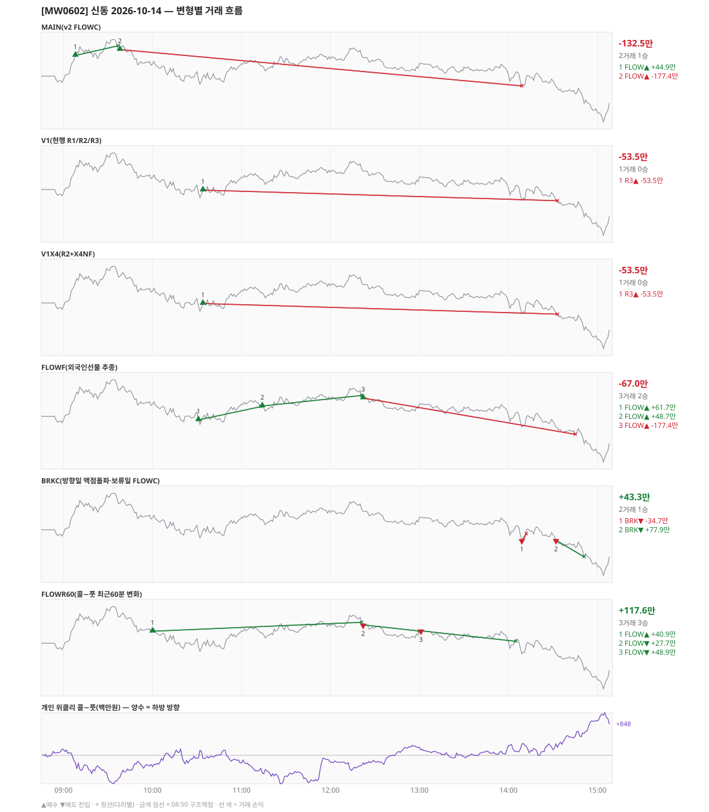

# [MW0602] 신동 일일 리포트 — 2026-10-14

> **MW0602 리포트** · 생성 2026-10-14 16:56 · 규격 `SD-2026-09-30-v2.1` · 상품 `wk_thu` (최근접 만기 목위클리 (만기 2026-10-15))
> 가상거래다 — 주문 없음(절대원칙 §6). 손익은 미니선물 2계약 · CYBOS 요율 · 1틱 슬리피지 기준.

## 0. 한눈에

| 시장 | R1 장전 | R2 개장확정(V1) | R1 적중(09:00→15:05) |
|---|---|---|---|
| 950.20 → 932.24 (-17.96) · 고 970.58 · 저 928.94 · 폭 41.6pt | 콜−풋 +173 → **하방** | NONE | ✅ 적중 |

| 변형 | 거래 | 승 | 규칙별 | **순손익** | 최악 거래 | MAIN 대비 | 기록 |
|---|---|---|---|---|---|---|---|
| MAIN(v2 FLOWC) | 2 | 1 | FLOW -132.5만 | **-132.5만** | -177.4만 | — | 라이브 |
| V1(현행 R1/R2/R3) | 1 | 0 | R3 -53.5만 | **-53.5만** | -53.5만 | +79.1만 | 라이브 |
| V1X4(R2+X4NF) | 1 | 0 | R3 -53.5만 | **-53.5만** | -53.5만 | +79.1만 | 라이브 |
| FLOWF(외국인선물 추종) | 3 | 2 | FLOW -67.0만 | **-67.0만** | -177.4만 | +65.5만 | 라이브 |
| BRKC(방향일 맥점돌파·보류일 FLOWC) | 2 | 1 | BRK +43.3만 | **+43.3만** | -34.7만 | +175.8만 | 라이브 |
| FLOWR60(콜−풋 최근60분 변화) | 3 | 3 | FLOW +117.6만 | **+117.6만** | +27.7만 | +250.1만 | 라이브 |

**오늘의 한 줄** — MAIN -132.5만(2거래 1승), 최선은 FLOWR60(콜−풋 최근60분 변화) +117.6만(MAIN 대비 +250.1만).

## 1. 차트

## 2. 거래 흐름 — MAIN

| # | 규칙 | 방향 | 진입 | 맥점 | 손절 | 1차 · 최종 | 청산(다리별) | MFE | 손익 | 누적 |
|---|---|---|---|---|---|---|---|---|---|---|
| 1 | FLOW | 매수 | 09:08 961.86 (탐지 09:09) | - | 944.34 | 973.86 · 973.86 | 트레일 09:37 966.58 · 트레일 09:37 966.58 | 8.7 | **+44.9만** | +44.9만 |
| 2 | FLOW | 매수 | 09:38 964.70 (탐지 09:39) | - | 947.18 | 976.70 · 976.70 | 손절 14:09 947.18 · 손절 14:09 947.18 | 2.2 | **-177.4만** | -132.5만 |

## 3. 섀도 흐름 — 변형별 거래(v1 계열은 V1 과 무엇이 달랐나)

### V1(현행 R1/R2/R3) — -53.5만 (MAIN 대비 +79.1만)

- v1(R1/R2/R3) 대조군 — 되돌림 판정의 기준. 아래 v1 계열 섀도는 이 거래와 대조한다

| # | 규칙 | 방향 | 진입 | 맥점 | 손절 | 1차 · 최종 | 청산(다리별) | MFE | 손익 | 누적 |
|---|---|---|---|---|---|---|---|---|---|---|
| 1 | R3 | 매수 | 10:34 951.62 (탐지 10:35) | 948.0 | 946.50 | 980.13 · 1017.50 | 손절 14:33 946.50 · 손절 14:33 946.50 | 14.4 | **-53.5만** | -53.5만 |

### V1X4(R2+X4NF) — -53.5만 (MAIN 대비 +79.1만)

- V1 과 같다

| # | 규칙 | 방향 | 진입 | 맥점 | 손절 | 1차 · 최종 | 청산(다리별) | MFE | 손익 | 누적 |
|---|---|---|---|---|---|---|---|---|---|---|
| 1 | R3 | 매수 | 10:34 951.62 (탐지 10:35) | 948.0 | 946.50 | 980.13 · 1017.50 | 손절 14:33 946.50 · 손절 14:33 946.50 | 14.4 | **-53.5만** | -53.5만 |

### FLOWF(외국인선물 추종) — -67.0만 (MAIN 대비 +65.5만)

- 별개 규칙(family) — MAIN·V1 과 거래 단위 대조는 하지 않는다. 손익·최악·거래 수로만 비교

| # | 규칙 | 방향 | 진입 | 맥점 | 손절 | 1차 · 최종 | 청산(다리별) | MFE | 손익 | 누적 |
|---|---|---|---|---|---|---|---|---|---|---|
| 1 | FLOW | 매수 | 10:31 950.20 (탐지 10:32) | - | 932.68 | 962.20 · 962.20 | 트레일 11:13 956.60 · 트레일 11:13 956.60 | 10.4 | **+61.7만** | +61.7만 |
| 2 | FLOW | 매수 | 11:14 956.90 (탐지 11:15) | - | 939.38 | 968.90 · 968.90 | 트레일 12:21 962.00 · 트레일 12:21 962.00 | 9.1 | **+48.7만** | +110.4만 |
| 3 | FLOW | 매수 | 12:22 960.76 (탐지 12:23) | - | 943.24 | 972.76 · 972.76 | 손절 14:45 943.24 · 손절 14:45 943.24 | 0.4 | **-177.4만** | -67.0만 |

### BRKC(방향일 맥점돌파·보류일 FLOWC) — +43.3만 (MAIN 대비 +175.8만)

- 별개 규칙(family) — MAIN·V1 과 거래 단위 대조는 하지 않는다. 손익·최악·거래 수로만 비교

| # | 규칙 | 방향 | 진입 | 맥점 | 손절 | 1차 · 최종 | 청산(다리별) | MFE | 손익 | 누적 |
|---|---|---|---|---|---|---|---|---|---|---|
| 1 | BRK | 매도 | 14:09 946.76 (탐지 14:10) | 948.0 | 950.00 | 938.76 · 938.76 | 손절 14:12 950.00 · 손절 14:12 950.00 | -0.0 | **-34.7만** | -34.7만 |
| 2 | BRK | 매도 | 14:32 946.88 (탐지 14:33) | 948.0 | 950.00 | 938.88 · 938.88 | 1차 14:51 938.88 · 최종 14:51 938.88 | 8.2 | **+77.9만** | +43.3만 |

### FLOWR60(콜−풋 최근60분 변화) — +117.6만 (MAIN 대비 +250.1만)

- 별개 규칙(family) — MAIN·V1 과 거래 단위 대조는 하지 않는다. 손익·최악·거래 수로만 비교

| # | 규칙 | 방향 | 진입 | 맥점 | 손절 | 1차 · 최종 | 청산(다리별) | MFE | 손익 | 누적 |
|---|---|---|---|---|---|---|---|---|---|---|
| 1 | FLOW | 매수 | 10:00 957.68 (탐지 10:01) | - | 940.16 | 969.68 · 969.68 | 트레일 12:21 962.00 · 트레일 12:21 962.00 | 8.3 | **+40.9만** | +40.9만 |
| 2 | FLOW | 매도 | 12:22 960.76 (탐지 12:23) | - | 978.28 | 948.76 · 948.76 | 트레일 13:00 957.76 · 트레일 13:00 957.76 | 7.0 | **+27.7만** | +68.6만 |
| 3 | FLOW | 매도 | 13:01 957.92 (탐지 13:02) | - | 975.44 | 945.92 · 945.92 | 트레일 14:05 952.80 · 트레일 14:05 952.80 | 9.1 | **+48.9만** | +117.6만 |

## 4. 누적 채점 (라이브 기록 · 판정 창)

| 변형 | 채점 시작 | 거래일 | 거래 | 승률 | 순손익 | 최악일 | R3 (건 · 승률 · 순) | 판정 |
|---|---|---|---|---|---|---|---|---|
| MAIN(v2 FLOWC) | 2026-10-01 | 8 | 18 | 78% | **+377.6만** | -181.9만 | 0 · - · +0.0만 | v2 vs V1 되돌림 판정 8/20일 |
| V1(현행 R1/R2/R3) | 2026-10-01 | 8 | 26 | 38% | **+182.8만** | -90.3만 | 23 · 35% · +93.8만 | 대조군 8/20일 (v1 R3 중단 판정은 채점표) |
| V1X4(R2+X4NF) | 2026-10-01 | 8 | 27 | 59% | **+274.3만** | -53.5만 | 24 · 58% · +185.3만 | MAIN 비교 8/20일 |
| FLOWF(외국인선물 추종) | 2026-10-01 | 8 | 19 | 84% | **+217.7만** | -169.8만 | 0 · - · +0.0만 | MAIN 비교 8/20일 |
| BRKC(방향일 맥점돌파·보류일 FLOWC) | 2026-10-01 | 8 | 24 | 54% | **+407.0만** | -13.8만 | 0 · - · +0.0만 | MAIN 비교 8/20일 |
| FLOWR60(콜−풋 최근60분 변화) | 2026-10-02 | 7 | 17 | 82% | **+470.1만** | -161.3만 | 0 · - · +0.0만 | MAIN 비교 7/20일 |

> 판정 전 집계다 — 인용·규격 변경 근거로 쓰지 말 것. 되돌림: V1 이 MAIN 보다 순손익·최악일 **둘 다** 나으면 v1 복귀. 섀도: MAIN 대비 순손익 우위 **그리고** 최악일 개선 → 채택 후보(자동 승격 없음).

## 5. 러너 섀도 — 미륵이 × 신동 (CREON 요율)

- 오늘 기록 없음 — 미륵이 시스템 진입이 없었거나 장후 기록 전이다

## 6. 개선 방향 (자동 관찰 — 판정 아님)

- **진입 품질** — MAIN 손실 1건 중 1건은 유리한 쪽으로 4pt 도 못 갔다(MFE 2.2). 청산을 바꿔서는 못 막는 손실이다 → 진입 조건(문턱 K·R1 방향) 쪽 관찰 대상.
- **탐지 지연** — 라이브 진입 2건, 규칙가 대비 실현가능가 차 +0(음수 = 늦게 알아채 손해).
- **오늘 최선은 FLOWR60(콜−풋 최근60분 변화)** (+117.6만, MAIN 대비 +250.1만). 하루 결과다 — 판정은 사전등록 창(20거래일)으로만.
- **v1 대조** — V1 -53.5만 vs MAIN -132.5만 (차 -79.1만). 되돌림 판정은 20거래일 누적으로만.
- ⚠ 규격 변경은 사전등록 §6(새 버전 · 재채점)으로만. 이 절은 관찰이다.

---
재생성: `python scripts/shindong_daily_report.py 2026-10-14`
