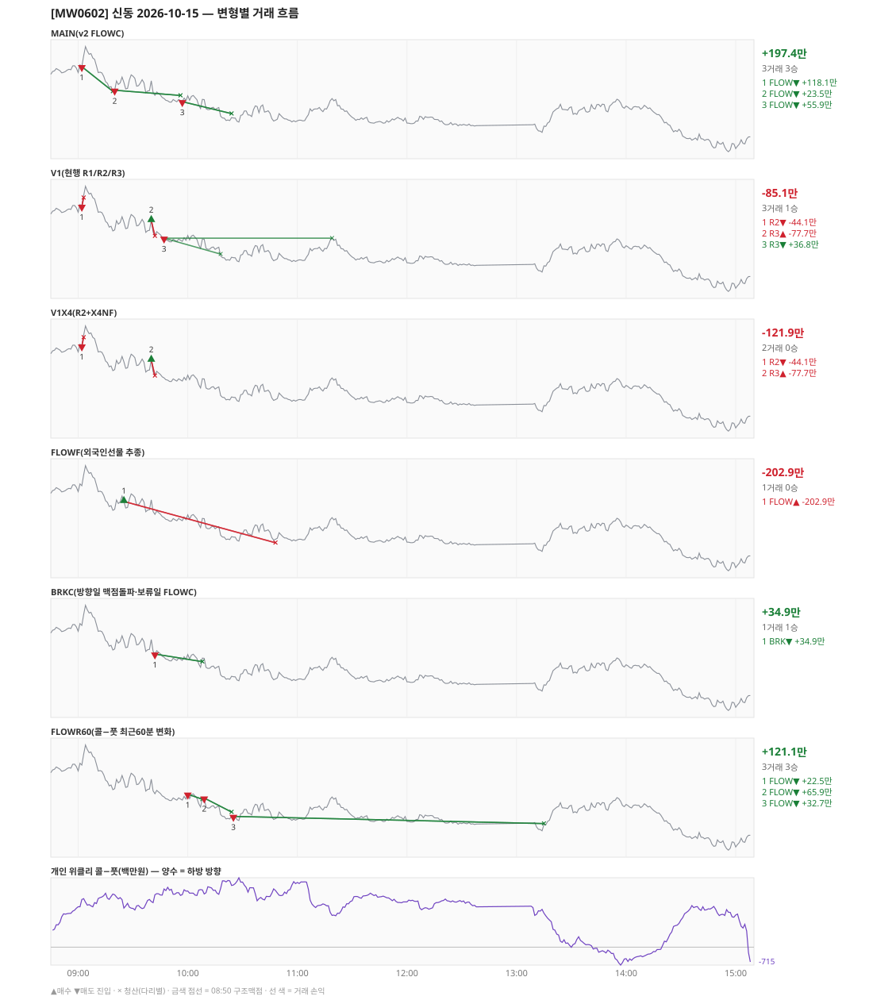

# [MW0602] 신동 일일 리포트 — 2026-10-15

> **MW0602 리포트** · 생성 2026-10-15 15:40 · 규격 `SD-2026-10-15-v2.2` · 상품 `wk_thu` (최근접 만기 목위클리 (만기 2026-10-15))
> 가상거래다 — 주문 없음(절대원칙 §6). 손익은 미니선물 2계약 · CYBOS 요율 · 1틱 슬리피지 기준.

## 0. 한눈에

| 시장 | R1 장전 | R2 개장확정(V1) | R1 적중(09:00→15:05) |
|---|---|---|---|
| 885.06 → 850.40 (-34.66) · 고 897.92 · 저 846.28 · 폭 51.6pt | 콜−풋 +1884 → **하방** | CONFIRMED 09:02 | ✅ 적중 |

| 변형 | 거래 | 승 | 규칙별 | **순손익** | 최악 거래 | MAIN 대비 | 기록 |
|---|---|---|---|---|---|---|---|
| MAIN(v2 FLOWC) | 3 | 3 | FLOW +197.4만 | **+197.4만** | +23.5만 | — | 라이브 |
| V1(현행 R1/R2/R3) | 3 | 1 | R2 -44.1만 · R3 -40.9만 | **-85.1만** | -77.7만 | -282.5만 | 라이브 |
| V1X4(R2+X4NF) | 2 | 0 | R2 -44.1만 · R3 -77.7만 | **-121.9만** | -77.7만 | -319.3만 | 라이브 |
| FLOWF(외국인선물 추종) | 1 | 0 | FLOW -202.9만 | **-202.9만** | -202.9만 | -400.3만 | 라이브 |
| BRKC(방향일 맥점돌파·보류일 FLOWC) | 1 | 1 | BRK +34.9만 | **+34.9만** | +34.9만 | -162.6만 | 라이브 |
| FLOWR60(콜−풋 최근60분 변화) | 3 | 3 | FLOW +121.1만 | **+121.1만** | +22.5만 | -76.4만 | 라이브 |

**오늘의 한 줄** — MAIN +197.4만(3거래 3승).

## 1. 차트

## 2. 거래 흐름 — MAIN

| # | 규칙 | 방향 | 진입 | 맥점 | 손절 | 1차 · 최종 | 청산(다리별) | MFE | 손익 | 누적 |
|---|---|---|---|---|---|---|---|---|---|---|
| 1 | FLOW | 매도 | 09:02 887.92 (탐지 09:03) | - | 908.00 | 875.92 · 875.92 | 1차 09:19 875.92 · 최종 09:19 875.92 | 12.9 | **+118.1만** | +118.1만 |
| 2 | FLOW | 매도 | 09:20 876.46 (탐지 09:21) | - | 896.54 | 864.46 · 864.46 | 트레일 09:56 873.90 · 트레일 09:56 873.90 | 6.6 | **+23.5만** | +141.6만 |
| 3 | FLOW | 매도 | 09:57 870.90 (탐지 09:58) | - | 890.98 | 858.90 · 858.90 | 트레일 10:24 865.10 · 트레일 10:24 865.10 | 9.8 | **+55.9만** | +197.4만 |

## 3. 섀도 흐름 — 변형별 거래(v1 계열은 V1 과 무엇이 달랐나)

### V1(현행 R1/R2/R3) — -85.1만 (MAIN 대비 -282.5만)

- v1(R1/R2/R3) 대조군 — 되돌림 판정의 기준. 아래 v1 계열 섀도는 이 거래와 대조한다

| # | 규칙 | 방향 | 진입 | 맥점 | 손절 | 1차 · 최종 | 청산(다리별) | MFE | 손익 | 누적 |
|---|---|---|---|---|---|---|---|---|---|---|
| 1 | R2 | 매도 | 09:02 887.92 (탐지 09:03) | - | 892.12 | 873.91 · 845.78 | 손절 09:03 892.12 · 손절 09:03 892.12 | 1.0 | **-44.1만** | -44.1만 |
| 2 | R3 | 매수 | 09:40 881.06 (탐지 09:41) | 875.0 | 873.50 | 897.50 · 949.50 | 손절 09:42 873.50 · 손절 09:42 873.50 | 0.0 | **-77.7만** | -121.9만 |
| 3 | R3 | 매도 | 09:47 872.46 (탐지 09:48) | 875.0 | 876.50 | 864.70 · 845.78 | 1차 10:18 864.70 · 본전 11:19 872.46 | 12.5 | **+36.8만** | -85.1만 |

### V1X4(R2+X4NF) — -121.9만 (MAIN 대비 -319.3만)

- 09:47 R3 매도: V1 진입 872.46 → **flip 금지(같은 맥점 875.0 반대 방향)** (V1 손익 +36.8만 제외)

| # | 규칙 | 방향 | 진입 | 맥점 | 손절 | 1차 · 최종 | 청산(다리별) | MFE | 손익 | 누적 |
|---|---|---|---|---|---|---|---|---|---|---|
| 1 | R2 | 매도 | 09:02 887.92 (탐지 09:03) | - | 892.12 | 873.91 · 845.78 | 손절 09:03 892.12 · 손절 09:03 892.12 | 1.0 | **-44.1만** | -44.1만 |
| 2 | R3 | 매수 | 09:40 881.06 (탐지 09:41) | 875.0 | 873.50 | 897.50 · 949.50 | 손절 09:42 873.50 · 손절 09:42 873.50 | 0.0 | **-77.7만** | -121.9만 |

### FLOWF(외국인선물 추종) — -202.9만 (MAIN 대비 -400.3만)

- 별개 규칙(family) — MAIN·V1 과 거래 단위 대조는 하지 않는다. 손익·최악·거래 수로만 비교

| # | 규칙 | 방향 | 진입 | 맥점 | 손절 | 1차 · 최종 | 청산(다리별) | MFE | 손익 | 누적 |
|---|---|---|---|---|---|---|---|---|---|---|
| 1 | FLOW | 매수 | 09:25 880.26 (탐지 09:26) | - | 860.18 | 892.26 · 892.26 | 손절 10:48 860.18 · 손절 10:48 860.18 | 4.1 | **-202.9만** | -202.9만 |

### BRKC(방향일 맥점돌파·보류일 FLOWC) — +34.9만 (MAIN 대비 -162.6만)

- 별개 규칙(family) — MAIN·V1 과 거래 단위 대조는 하지 않는다. 손익·최악·거래 수로만 비교

| # | 규칙 | 방향 | 진입 | 맥점 | 손절 | 1차 · 최종 | 청산(다리별) | MFE | 손익 | 누적 |
|---|---|---|---|---|---|---|---|---|---|---|
| 1 | BRK | 매도 | 09:42 873.98 (탐지 09:43) | 875.0 | 877.00 | 865.98 · 865.98 | 트레일 10:08 870.28 · 트레일 10:08 870.28 | 6.7 | **+34.9만** | +34.9만 |

### FLOWR60(콜−풋 최근60분 변화) — +121.1만 (MAIN 대비 -76.4만)

- 별개 규칙(family) — MAIN·V1 과 거래 단위 대조는 하지 않는다. 손익·최악·거래 수로만 비교

| # | 규칙 | 방향 | 진입 | 맥점 | 손절 | 1차 · 최종 | 청산(다리별) | MFE | 손익 | 누적 |
|---|---|---|---|---|---|---|---|---|---|---|
| 1 | FLOW | 매도 | 10:00 873.74 (탐지 10:01) | - | 893.82 | 861.74 · 861.74 | 트레일 10:08 871.28 · 트레일 10:08 871.28 | 6.5 | **+22.5만** | +22.5만 |
| 2 | FLOW | 매도 | 10:09 871.90 (탐지 10:10) | - | 891.98 | 859.90 · 859.90 | 트레일 10:24 865.10 · 트레일 10:24 865.10 | 10.8 | **+65.9만** | +88.4만 |
| 3 | FLOW | 매도 | 10:25 862.96 (탐지 10:26) | - | 883.04 | 850.96 · 850.96 | 트레일 13:15 859.48 · 트레일 13:15 859.48 | 7.5 | **+32.7만** | +121.1만 |

## 4. 누적 채점 (라이브 기록 · 판정 창)

| 변형 | 채점 시작 | 거래일 | 거래 | 승률 | 순손익 | 최악일 | R3 (건 · 승률 · 순) | 판정 |
|---|---|---|---|---|---|---|---|---|
| MAIN(v2 FLOWC) | 2026-10-15 | 1 | 3 | 100% | **+197.4만** | +197.4만 | 0 · - · +0.0만 | v2 vs V1 되돌림 판정 1/20일 |
| V1(현행 R1/R2/R3) | 2026-10-15 | 1 | 3 | 33% | **-85.1만** | -85.1만 | 2 · 50% · -40.9만 | 대조군 1/20일 (v1 R3 중단 판정은 채점표) |
| V1X4(R2+X4NF) | 2026-10-15 | 1 | 2 | 0% | **-121.9만** | -121.9만 | 1 · 0% · -77.7만 | MAIN 비교 1/20일 |
| FLOWF(외국인선물 추종) | 2026-10-15 | 1 | 1 | 0% | **-202.9만** | -202.9만 | 0 · - · +0.0만 | MAIN 비교 1/20일 |
| BRKC(방향일 맥점돌파·보류일 FLOWC) | 2026-10-15 | 1 | 1 | 100% | **+34.9만** | +34.9만 | 0 · - · +0.0만 | MAIN 비교 1/20일 |
| FLOWR60(콜−풋 최근60분 변화) | 2026-10-15 | 1 | 3 | 100% | **+121.1만** | +121.1만 | 0 · - · +0.0만 | MAIN 비교 1/20일 |

> 판정 전 집계다 — 인용·규격 변경 근거로 쓰지 말 것. 되돌림: V1 이 MAIN 보다 순손익·최악일 **둘 다** 나으면 v1 복귀. 섀도: MAIN 대비 순손익 우위 **그리고** 최악일 개선 → 채택 후보(자동 승격 없음).

## 5. 러너 섀도 — 미륵이 × 신동 (CREON 요율)

- 오늘 기록 없음 — 미륵이 시스템 진입이 없었거나 장후 기록 전이다

## 6. 개선 방향 (자동 관찰 — 판정 아님)

- **탐지 지연** — 라이브 진입 3건, 규칙가 대비 실현가능가 차 +0(음수 = 늦게 알아채 손해).
- **오늘은 MAIN 이 최선** (+197.4만).
- **v1 대조** — V1 -85.1만 vs MAIN +197.4만 (차 +282.5만). 되돌림 판정은 20거래일 누적으로만.
- ⚠ 규격 변경은 사전등록 §6(새 버전 · 재채점)으로만. 이 절은 관찰이다.

---
재생성: `python scripts/shindong_daily_report.py 2026-10-15`
