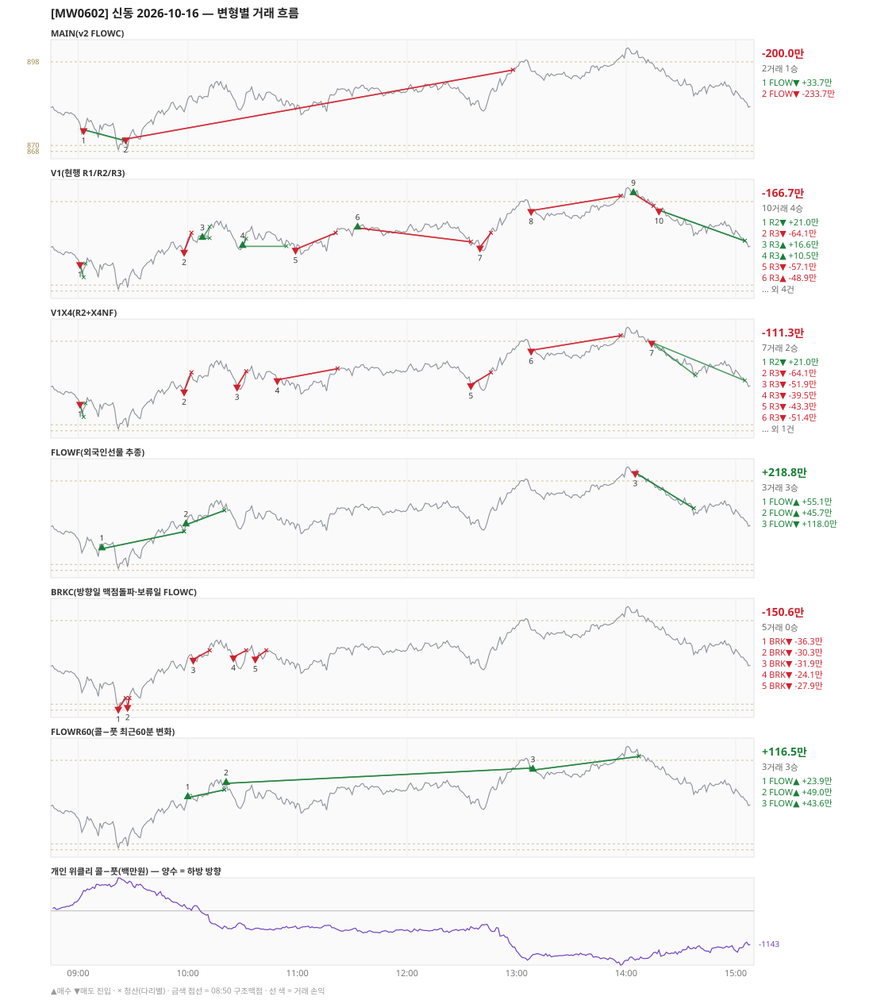

# [MW0602] 신동 일일 리포트 — 2026-10-16

> **MW0602 리포트** · 생성 2026-10-16 15:40 · 규격 `SD-2026-10-15-v2.2` · 상품 `wk_mon` (최근접 만기 월위클리 (만기 2026-10-19))
> 가상거래다 — 주문 없음(절대원칙 §6). 손익은 미니선물 2계약 · CYBOS 요율 · 1틱 슬리피지 기준.

## 0. 한눈에

| 시장 | R1 장전 | R2 개장확정(V1) | R1 적중(09:00→15:05) |
|---|---|---|---|
| 878.56 → 884.80 (+6.24) · 고 903.32 · 저 867.68 · 폭 35.6pt | 콜−풋 +298 → **하방** | CONFIRMED 09:01 | ❌ 불적중 |

| 변형 | 거래 | 승 | 규칙별 | **순손익** | 최악 거래 | MAIN 대비 | 기록 |
|---|---|---|---|---|---|---|---|
| MAIN(v2 FLOWC) | 2 | 1 | FLOW -200.0만 | **-200.0만** | -233.7만 | — | 라이브 |
| V1(현행 R1/R2/R3) | 10 | 4 | R2 +21.0만 · R3 -187.7만 | **-166.7만** | -64.1만 | +33.3만 | 라이브 |
| V1X4(R2+X4NF) | 7 | 2 | R2 +21.0만 · R3 -132.3만 | **-111.3만** | -64.1만 | +88.7만 | 라이브 |
| FLOWF(외국인선물 추종) | 3 | 3 | FLOW +218.8만 | **+218.8만** | +45.7만 | +418.8만 | 라이브 |
| BRKC(방향일 맥점돌파·보류일 FLOWC) | 5 | 0 | BRK -150.6만 | **-150.6만** | -36.3만 | +49.4만 | 라이브 |
| FLOWR60(콜−풋 최근60분 변화) | 3 | 3 | FLOW +116.5만 | **+116.5만** | +23.9만 | +316.6만 | 라이브 |

**오늘의 한 줄** — MAIN -200.0만(2거래 1승), 최선은 FLOWF(외국인선물 추종) +218.8만(MAIN 대비 +418.8만).

## 1. 차트

## 2. 거래 흐름 — MAIN

| # | 규칙 | 방향 | 진입 | 맥점 | 손절 | 1차 · 최종 | 청산(다리별) | MFE | 손익 | 누적 |
|---|---|---|---|---|---|---|---|---|---|---|
| 1 | FLOW | 매도 | 09:03 875.26 (탐지 09:04) | - | 898.42 | 863.26 · 863.26 | 트레일 09:25 871.68 · 트레일 09:25 871.68 | 7.6 | **+33.7만** | +33.7만 |
| 2 | FLOW | 매도 | 09:26 872.14 (탐지 09:27) | - | 895.30 | 860.14 · 860.14 | 손절 12:58 895.30 · 손절 12:58 895.30 | 4.0 | **-233.7만** | -200.0만 |

## 3. 섀도 흐름 — 변형별 거래(v1 계열은 V1 과 무엇이 달랐나)

### V1(현행 R1/R2/R3) — -166.7만 (MAIN 대비 +33.3만)

- v1(R1/R2/R3) 대조군 — 되돌림 판정의 기준. 아래 v1 계열 섀도는 이 거래와 대조한다

| # | 규칙 | 방향 | 진입 | 맥점 | 손절 | 1차 · 최종 | 청산(다리별) | MFE | 손익 | 누적 |
|---|---|---|---|---|---|---|---|---|---|---|
| 1 | R2 | 매도 | 09:01 877.16 (탐지 09:02) | - | 882.26 | 872.56 · 862.50 | 1차 09:03 872.56 · 본전 09:04 877.16 | 5.0 | **+21.0만** | +21.0만 |
| 2 | R3 | 매도 | 09:58 881.30 (탐지 09:59) | 886.0 | 887.50 | 868.50 · 862.50 | 손절 10:02 887.50 · 손절 10:02 887.50 | -0.1 | **-64.1만** | -43.1만 |
| 3 | R3 | 매수 | 10:08 885.72 (탐지 10:09) | 886.0 | 884.50 | 889.46 · 937.50 | 1차 10:12 889.46 · 본전 10:12 885.72 | 4.3 | **+16.6만** | -26.5만 |
| 4 | R3 | 매수 | 10:30 883.00 (탐지 10:31) | 886.0 | 880.80 | 885.50 · 937.50 | 1차 10:32 885.50 · 본전 10:54 883.00 | 7.7 | **+10.5만** | -16.0만 |
| 5 | R3 | 매도 | 10:59 882.00 (탐지 11:00) | 886.0 | 887.50 | 868.50 · 862.50 | 손절 11:21 887.50 · 손절 11:21 887.50 | 1.8 | **-57.1만** | -73.2만 |
| 6 | R3 | 매수 | 11:33 889.18 (탐지 11:34) | 886.0 | 884.50 | 937.50 · 937.50 | 손절 12:35 884.50 · 손절 12:35 884.50 | 2.3 | **-48.9만** | -122.1만 |
| 7 | R3 | 매도 | 12:40 882.70 (탐지 12:41) | 886.0 | 887.50 | 868.50 · 862.50 | 손절 12:46 887.50 · 손절 12:46 887.50 | 2.3 | **-50.1만** | -172.2만 |
| 8 | R3 | 매도 | 13:08 894.98 (탐지 13:09) | 898.0 | 899.90 | 868.50 · 862.50 | 손절 13:57 899.90 · 손절 13:57 899.90 | 3.5 | **-51.4만** | -223.6만 |
| 9 | R3 | 매수 | 14:04 900.70 (탐지 14:05) | 898.0 | 896.50 | 937.50 · 937.50 | 손절 14:15 896.50 · 손절 14:15 896.50 | 1.2 | **-44.2만** | -267.8만 |
| 10 | R3 | 매도 | 14:18 895.12 (탐지 14:19) | 898.0 | 899.50 | 868.50 · 862.50 | 시간 15:05 884.80 · 시간 15:05 884.80 | 11.4 | **+101.1만** | -166.7만 |

### V1X4(R2+X4NF) — -111.3만 (MAIN 대비 +88.7만)

- 10:08 R3 매수: V1 진입 885.72 → **flip 금지(같은 맥점 886.0 반대 방향)** (V1 손익 +16.6만 제외)
- 10:30 R3 매수: V1 진입 883.00 → **앞 거래 보유 중/시점 이동** (V1 손익 +10.5만 제외)
- 10:59 R3 매도: V1 진입 882.00 → **flip 금지(같은 맥점 886.0 반대 방향)** (V1 손익 -57.1만 제외)
- 11:33 R3 매수: V1 진입 889.18 → **flip 금지(같은 맥점 886.0 반대 방향)** (V1 손익 -48.9만 제외)
- 12:40 R3 매도: V1 진입 882.70 → **flip 금지(같은 맥점 886.0 반대 방향)** (V1 손익 -50.1만 제외)
- 14:04 R3 매수: V1 진입 900.70 → **flip 금지(같은 맥점 898.0 반대 방향)** (V1 손익 -44.2만 제외)
- 14:18 R3 매도: V1 진입 895.12 → **flip 금지(같은 맥점 898.0 반대 방향)** (V1 손익 +101.1만 제외)
- 10:27 R3 매도: **섀도만 진입** 882.92 (앞 거래가 없어 신호가 살아남) → -51.9만
- 10:49 R3 매도: **섀도만 진입** 885.08 (앞 거래가 없어 신호가 살아남) → -39.5만
- 12:35 R3 매도: **섀도만 진입** 883.38 (앞 거래가 없어 신호가 살아남) → -43.3만
- 14:14 R3 매도: **섀도만 진입** 897.66 (앞 거래가 없어 신호가 살아남) → +118.1만

| # | 규칙 | 방향 | 진입 | 맥점 | 손절 | 1차 · 최종 | 청산(다리별) | MFE | 손익 | 누적 |
|---|---|---|---|---|---|---|---|---|---|---|
| 1 | R2 | 매도 | 09:01 877.16 (탐지 09:02) | - | 882.26 | 872.56 · 862.50 | 1차 09:03 872.56 · 본전 09:04 877.16 | 5.0 | **+21.0만** | +21.0만 |
| 2 | R3 | 매도 | 09:58 881.30 (탐지 09:59) | 886.0 | 887.50 | 870.50 · 862.50 | 손절 10:02 887.50 · 손절 10:02 887.50 | -0.1 | **-64.1만** | -43.1만 |
| 3 | R3 | 매도 | 10:27 882.92 (탐지 10:28) | 886.0 | 887.90 | 870.50 · 862.50 | 손절 10:32 887.90 · 손절 10:32 887.90 | 1.6 | **-51.9만** | -95.1만 |
| 4 | R3 | 매도 | 10:49 885.08 (탐지 10:50) | 886.0 | 888.82 | 870.50 · 862.50 | 손절 11:22 888.82 · 손절 11:22 888.82 | 4.9 | **-39.5만** | -134.6만 |
| 5 | R3 | 매도 | 12:35 883.38 (탐지 12:36) | 886.0 | 887.50 | 870.50 · 862.50 | 손절 12:46 887.50 · 손절 12:46 887.50 | 3.0 | **-43.3만** | -178.0만 |
| 6 | R3 | 매도 | 13:08 894.98 (탐지 13:09) | 898.0 | 899.90 | 886.50 · 862.50 | 손절 13:57 899.90 · 손절 13:57 899.90 | 3.5 | **-51.4만** | -229.3만 |
| 7 | R3 | 매도 | 14:14 897.66 (탐지 14:15) | 898.0 | 899.82 | 886.50 · 862.50 | 1차 14:38 886.50 · 시간 15:05 884.80 | 13.9 | **+118.1만** | -111.3만 |

### FLOWF(외국인선물 추종) — +218.8만 (MAIN 대비 +418.8만)

- 별개 규칙(family) — MAIN·V1 과 거래 단위 대조는 하지 않는다. 손익·최악·거래 수로만 비교

| # | 규칙 | 방향 | 진입 | 맥점 | 손절 | 1차 · 최종 | 청산(다리별) | MFE | 손익 | 누적 |
|---|---|---|---|---|---|---|---|---|---|---|
| 1 | FLOW | 매수 | 09:13 875.28 (탐지 09:14) | - | 852.12 | 887.28 · 887.28 | 트레일 09:58 881.00 · 트레일 09:58 881.00 | 9.7 | **+55.1만** | +55.1만 |
| 2 | FLOW | 매수 | 09:59 883.32 (탐지 10:00) | - | 860.16 | 895.32 · 895.32 | 트레일 10:20 888.10 · 트레일 10:20 888.10 | 8.8 | **+45.7만** | +100.7만 |
| 3 | FLOW | 매도 | 14:05 900.80 (탐지 14:06) | - | 923.96 | 888.80 · 888.80 | 1차 14:37 888.80 · 최종 14:37 888.80 | 14.2 | **+118.0만** | +218.8만 |

### BRKC(방향일 맥점돌파·보류일 FLOWC) — -150.6만 (MAIN 대비 +49.4만)

- 별개 규칙(family) — MAIN·V1 과 거래 단위 대조는 하지 않는다. 손익·최악·거래 수로만 비교

| # | 규칙 | 방향 | 진입 | 맥점 | 손절 | 1차 · 최종 | 청산(다리별) | MFE | 손익 | 누적 |
|---|---|---|---|---|---|---|---|---|---|---|
| 1 | BRK | 매도 | 09:22 868.58 (탐지 09:23) | 870.0 | 872.00 | 860.58 · 860.58 | 손절 09:26 872.00 · 손절 09:26 872.00 | 0.6 | **-36.3만** | -36.3만 |
| 2 | BRK | 매도 | 09:27 869.18 (탐지 09:28) | 870.0 | 872.00 | 861.18 · 861.18 | 손절 09:28 872.00 · 손절 09:28 872.00 | 1.0 | **-30.3만** | -66.6만 |
| 3 | BRK | 매도 | 10:03 885.02 (탐지 10:04) | 886.0 | 888.00 | 877.02 · 877.02 | 손절 10:12 888.00 · 손절 10:12 888.00 | 1.9 | **-31.9만** | -98.6만 |
| 4 | BRK | 매도 | 10:25 885.80 (탐지 10:26) | 886.0 | 888.00 | 877.80 · 877.80 | 손절 10:32 888.00 · 손절 10:32 888.00 | 4.5 | **-24.1만** | -122.7만 |
| 5 | BRK | 매도 | 10:37 885.42 (탐지 10:38) | 886.0 | 888.00 | 877.42 · 877.42 | 손절 10:43 888.00 · 손절 10:43 888.00 | 0.9 | **-27.9만** | -150.6만 |

### FLOWR60(콜−풋 최근60분 변화) — +116.5만 (MAIN 대비 +316.6만)

- 별개 규칙(family) — MAIN·V1 과 거래 단위 대조는 하지 않는다. 손익·최악·거래 수로만 비교

| # | 규칙 | 방향 | 진입 | 맥점 | 손절 | 1차 · 최종 | 청산(다리별) | MFE | 손익 | 누적 |
|---|---|---|---|---|---|---|---|---|---|---|
| 1 | FLOW | 매수 | 10:00 885.50 (탐지 10:01) | - | 862.34 | 897.50 · 897.50 | 트레일 10:20 888.10 · 트레일 10:20 888.10 | 6.6 | **+23.9만** | +23.9만 |
| 2 | FLOW | 매수 | 10:21 890.28 (탐지 10:22) | - | 867.12 | 902.28 · 902.28 | 트레일 13:08 895.40 · 트레일 13:08 895.40 | 9.1 | **+49.0만** | +72.9만 |
| 3 | FLOW | 매수 | 13:09 894.74 (탐지 13:10) | - | 871.58 | 906.74 · 906.74 | 트레일 14:07 899.32 · 트레일 14:07 899.32 | 8.6 | **+43.6만** | +116.5만 |

## 4. 누적 채점 (라이브 기록 · 판정 창)

| 변형 | 채점 시작 | 거래일 | 거래 | 승률 | 순손익 | 최악일 | R3 (건 · 승률 · 순) | 판정 |
|---|---|---|---|---|---|---|---|---|
| MAIN(v2 FLOWC) | 2026-10-15 | 2 | 5 | 80% | **-2.6만** | -200.0만 | 0 · - · +0.0만 | v2 vs V1 되돌림 판정 2/20일 |
| V1(현행 R1/R2/R3) | 2026-10-15 | 2 | 13 | 38% | **-251.8만** | -166.7만 | 11 · 36% · -228.6만 | 대조군 2/20일 (v1 R3 중단 판정은 채점표) |
| V1X4(R2+X4NF) | 2026-10-15 | 2 | 9 | 22% | **-233.1만** | -121.9만 | 7 · 14% · -210.0만 | MAIN 비교 2/20일 |
| FLOWF(외국인선물 추종) | 2026-10-15 | 2 | 4 | 75% | **+15.9만** | -202.9만 | 0 · - · +0.0만 | MAIN 비교 2/20일 |
| BRKC(방향일 맥점돌파·보류일 FLOWC) | 2026-10-15 | 2 | 6 | 17% | **-115.7만** | -150.6만 | 0 · - · +0.0만 | MAIN 비교 2/20일 |
| FLOWR60(콜−풋 최근60분 변화) | 2026-10-15 | 2 | 6 | 100% | **+237.6만** | +116.5만 | 0 · - · +0.0만 | MAIN 비교 2/20일 |

> 판정 전 집계다 — 인용·규격 변경 근거로 쓰지 말 것. 되돌림: V1 이 MAIN 보다 순손익·최악일 **둘 다** 나으면 v1 복귀. 섀도: MAIN 대비 순손익 우위 **그리고** 최악일 개선 → 채택 후보(자동 승격 없음).

## 5. 러너 섀도 — 미륵이 × 신동 (CREON 요율)

- 오늘 기록 없음 — 미륵이 시스템 진입이 없었거나 장후 기록 전이다

## 6. 개선 방향 (자동 관찰 — 판정 아님)

- **진입 품질** — MAIN 손실 1건 중 1건은 유리한 쪽으로 4pt 도 못 갔다(MFE 4.0). 청산을 바꿔서는 못 막는 손실이다 → 진입 조건(문턱 K·R1 방향) 쪽 관찰 대상.
- **탐지 지연** — 라이브 진입 2건, 규칙가 대비 실현가능가 차 +0(음수 = 늦게 알아채 손해).
- **오늘 최선은 FLOWF(외국인선물 추종)** (+218.8만, MAIN 대비 +418.8만). 하루 결과다 — 판정은 사전등록 창(20거래일)으로만.
- **v1 대조** — V1 -166.7만 vs MAIN -200.0만 (차 -33.3만). 되돌림 판정은 20거래일 누적으로만.
- ⚠ 규격 변경은 사전등록 §6(새 버전 · 재채점)으로만. 이 절은 관찰이다.

---
재생성: `python scripts/shindong_daily_report.py 2026-10-16`
