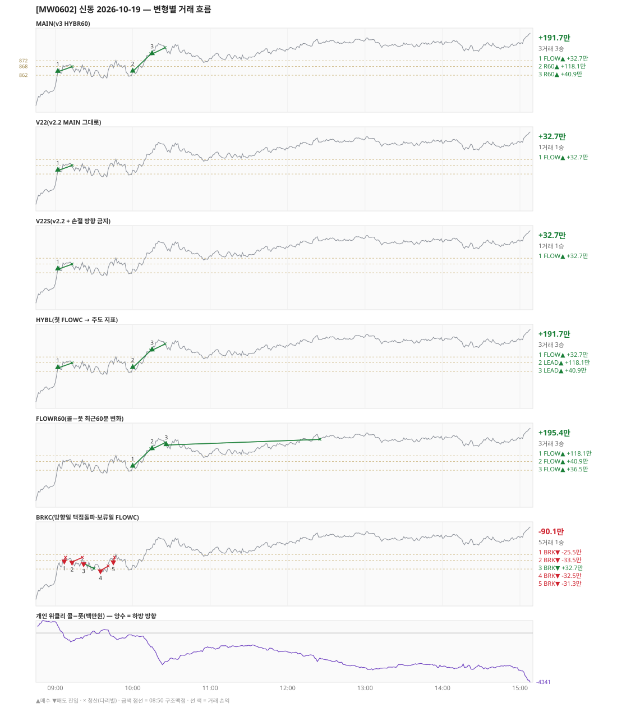

# [MW0602] 신동 일일 리포트 — 2026-10-19

> **MW0602 리포트** · 생성 2026-10-19 15:40 · 규격 `SD-2026-10-19-v3` · 상품 `wk_mon` (최근접 만기 월위클리 (만기 2026-10-19))
> 가상거래다 — 주문 없음(절대원칙 §6). 손익은 미니선물 2계약 · CYBOS 요율 · 1틱 슬리피지 기준.

## 0. 한눈에

| 시장 | R1 장전 | R2 개장확정(V1) | R1 적중(09:00→15:05) |
|---|---|---|---|
| 854.38 → 888.62 (+34.24) · 고 889.04 · 저 850.92 · 폭 38.1pt | 콜−풋 +987 → **하방** | NONE | ❌ 불적중 |

| 변형 | 거래 | 승 | 규칙별 | **순손익** | 최악 거래 | MAIN 대비 | 기록 |
|---|---|---|---|---|---|---|---|
| MAIN(v3 HYBR60) | 3 | 3 | FLOW +32.7만 · R60 +159.0만 | **+191.7만** | +32.7만 | — | 라이브 |
| V22(v2.2 MAIN 그대로) | 1 | 1 | FLOW +32.7만 | **+32.7만** | +32.7만 | -159.0만 | 라이브 |
| V22S(v2.2 + 손절 방향 금지) | 1 | 1 | FLOW +32.7만 | **+32.7만** | +32.7만 | -159.0만 | 라이브 |
| HYBL(첫 FLOWC → 주도 지표) | 3 | 3 | FLOW +32.7만 · LEAD +159.0만 | **+191.7만** | +32.7만 | +0.0만 | 라이브 |
| FLOWR60(콜−풋 최근60분 변화) | 3 | 3 | FLOW +195.4만 | **+195.4만** | +36.5만 | +3.8만 | 라이브 |
| BRKC(방향일 맥점돌파·보류일 FLOWC) | 5 | 1 | BRK -90.1만 | **-90.1만** | -33.5만 | -281.8만 | 라이브 |

**오늘의 한 줄** — MAIN +191.7만(3거래 3승), 최선은 FLOWR60(콜−풋 최근60분 변화) +195.4만(MAIN 대비 +3.8만).

## 1. 차트

## 2. 거래 흐름 — MAIN

| # | 규칙 | 방향 | 진입 | 맥점 | 손절 | 1차 · 최종 | 청산(다리별) | MFE | 손익 | 누적 |
|---|---|---|---|---|---|---|---|---|---|---|
| 1 | FLOW | 매수 | 09:02 864.38 (탐지 09:03) | - | 840.49 | 876.38 · 876.38 | 트레일 09:13 867.86 · 트레일 09:13 867.86 | 7.5 | **+32.7만** | +32.7만 |
| 2 | R60 | 매수 | 10:00 864.58 (탐지 10:01) | - | 840.69 | 876.58 · 876.58 | 1차 10:14 876.58 · 최종 10:14 876.58 | 12.3 | **+118.1만** | +150.8만 |
| 3 | R60 | 매수 | 10:15 876.60 (탐지 10:16) | - | 852.71 | 888.60 · 888.60 | 트레일 10:25 880.90 · 트레일 10:25 880.90 | 8.3 | **+40.9만** | +191.7만 |

## 3. 섀도 흐름 — 변형별 거래(v1 계열은 V1 과 무엇이 달랐나)

### V22(v2.2 MAIN 그대로) — +32.7만 (MAIN 대비 -159.0만)

- 별개 규칙(family) — MAIN·V1 과 거래 단위 대조는 하지 않는다. 손익·최악·거래 수로만 비교

| # | 규칙 | 방향 | 진입 | 맥점 | 손절 | 1차 · 최종 | 청산(다리별) | MFE | 손익 | 누적 |
|---|---|---|---|---|---|---|---|---|---|---|
| 1 | FLOW | 매수 | 09:02 864.38 (탐지 09:03) | - | 840.49 | 876.38 · 876.38 | 트레일 09:13 867.86 · 트레일 09:13 867.86 | 7.5 | **+32.7만** | +32.7만 |

### V22S(v2.2 + 손절 방향 금지) — +32.7만 (MAIN 대비 -159.0만)

- 별개 규칙(family) — MAIN·V1 과 거래 단위 대조는 하지 않는다. 손익·최악·거래 수로만 비교

| # | 규칙 | 방향 | 진입 | 맥점 | 손절 | 1차 · 최종 | 청산(다리별) | MFE | 손익 | 누적 |
|---|---|---|---|---|---|---|---|---|---|---|
| 1 | FLOW | 매수 | 09:02 864.38 (탐지 09:03) | - | 840.49 | 876.38 · 876.38 | 트레일 09:13 867.86 · 트레일 09:13 867.86 | 7.5 | **+32.7만** | +32.7만 |

### HYBL(첫 FLOWC → 주도 지표) — +191.7만 (MAIN 대비 +0.0만)

- 별개 규칙(family) — MAIN·V1 과 거래 단위 대조는 하지 않는다. 손익·최악·거래 수로만 비교

| # | 규칙 | 방향 | 진입 | 맥점 | 손절 | 1차 · 최종 | 청산(다리별) | MFE | 손익 | 누적 |
|---|---|---|---|---|---|---|---|---|---|---|
| 1 | FLOW | 매수 | 09:02 864.38 (탐지 09:03) | - | 840.49 | 876.38 · 876.38 | 트레일 09:13 867.86 · 트레일 09:13 867.86 | 7.5 | **+32.7만** | +32.7만 |
| 2 | LEAD | 매수 | 10:00 864.58 (탐지 10:01) | - | 840.69 | 876.58 · 876.58 | 1차 10:14 876.58 · 최종 10:14 876.58 | 12.3 | **+118.1만** | +150.8만 |
| 3 | LEAD | 매수 | 10:15 876.60 (탐지 10:16) | - | 852.71 | 888.60 · 888.60 | 트레일 10:25 880.90 · 트레일 10:25 880.90 | 8.3 | **+40.9만** | +191.7만 |

### FLOWR60(콜−풋 최근60분 변화) — +195.4만 (MAIN 대비 +3.8만)

- 별개 규칙(family) — MAIN·V1 과 거래 단위 대조는 하지 않는다. 손익·최악·거래 수로만 비교

| # | 규칙 | 방향 | 진입 | 맥점 | 손절 | 1차 · 최종 | 청산(다리별) | MFE | 손익 | 누적 |
|---|---|---|---|---|---|---|---|---|---|---|
| 1 | FLOW | 매수 | 10:00 864.58 (탐지 10:01) | - | 840.69 | 876.58 · 876.58 | 1차 10:14 876.58 · 최종 10:14 876.58 | 12.3 | **+118.1만** | +118.1만 |
| 2 | FLOW | 매수 | 10:15 876.60 (탐지 10:16) | - | 852.71 | 888.60 · 888.60 | 트레일 10:25 880.90 · 트레일 10:25 880.90 | 8.3 | **+40.9만** | +159.0만 |
| 3 | FLOW | 매수 | 10:26 879.34 (탐지 10:27) | - | 855.45 | 891.34 · 891.34 | 트레일 12:25 883.20 · 트레일 12:25 883.20 | 7.9 | **+36.5만** | +195.4만 |

### BRKC(방향일 맥점돌파·보류일 FLOWC) — -90.1만 (MAIN 대비 -281.8만)

- 별개 규칙(family) — MAIN·V1 과 거래 단위 대조는 하지 않는다. 손익·최악·거래 수로만 비교

| # | 규칙 | 방향 | 진입 | 맥점 | 손절 | 1차 · 최종 | 청산(다리별) | MFE | 손익 | 누적 |
|---|---|---|---|---|---|---|---|---|---|---|
| 1 | BRK | 매도 | 09:07 867.66 (탐지 09:08) | 868.0 | 870.00 | 859.66 · 859.66 | 손절 09:08 870.00 · 손절 09:08 870.00 | 0.1 | **-25.5만** | -25.5만 |
| 2 | BRK | 매도 | 09:13 866.86 (탐지 09:14) | 868.0 | 870.00 | 858.86 · 858.86 | 손절 09:21 870.00 · 손절 09:21 870.00 | 4.3 | **-33.5만** | -59.0만 |
| 3 | BRK | 매도 | 09:22 865.82 (탐지 09:23) | 868.0 | 870.00 | 857.82 · 857.82 | 트레일 09:30 862.34 · 트레일 09:30 862.34 | 6.5 | **+32.7만** | -26.3만 |
| 4 | BRK | 매도 | 09:35 860.96 (탐지 09:36) | 862.0 | 864.00 | 852.96 · 852.96 | 손절 09:41 864.00 · 손절 09:41 864.00 | 2.3 | **-32.5만** | -58.8만 |
| 5 | BRK | 매도 | 09:45 867.08 (탐지 09:46) | 868.0 | 870.00 | 859.08 · 859.08 | 손절 09:46 870.00 · 손절 09:46 870.00 | 0.1 | **-31.3만** | -90.1만 |

## 4. 누적 채점 (라이브 기록 · 판정 창)

| 변형 | 채점 시작 | 거래일 | 거래 | 승률 | 순손익 | 최악일 | R3 (건 · 승률 · 순) | 판정 |
|---|---|---|---|---|---|---|---|---|
| MAIN(v3 HYBR60) | 2026-10-19 | 1 | 3 | 100% | **+191.7만** | +191.7만 | 0 · - · +0.0만 | v3 vs V22 되돌림 판정 1/20일 |
| V22(v2.2 MAIN 그대로) | 2026-10-19 | 1 | 1 | 100% | **+32.7만** | +32.7만 | 0 · - · +0.0만 | 되돌림 기준 1/20일 |
| V22S(v2.2 + 손절 방향 금지) | 2026-10-19 | 1 | 1 | 100% | **+32.7만** | +32.7만 | 0 · - · +0.0만 | MAIN 비교 1/20일 |
| HYBL(첫 FLOWC → 주도 지표) | 2026-10-19 | 1 | 3 | 100% | **+191.7만** | +191.7만 | 0 · - · +0.0만 | MAIN 비교 1/20일 |
| FLOWR60(콜−풋 최근60분 변화) | 2026-10-19 | 1 | 3 | 100% | **+195.4만** | +195.4만 | 0 · - · +0.0만 | MAIN 비교 1/20일 |
| BRKC(방향일 맥점돌파·보류일 FLOWC) | 2026-10-19 | 1 | 5 | 20% | **-90.1만** | -90.1만 | 0 · - · +0.0만 | MAIN 비교 1/20일 |

> 판정 전 집계다 — 인용·규격 변경 근거로 쓰지 말 것. 되돌림: V22 가 MAIN 보다 순손익·최악일 **둘 다** 나으면 v2.2 복귀. 섀도: MAIN 대비 순손익 우위 **그리고** 최악일 개선 → 채택 후보(자동 승격 없음).

## 5. 러너 섀도 — 미륵이 × 신동 (CREON 요율)

- 오늘 기록 없음 — 미륵이 시스템 진입이 없었거나 장후 기록 전이다

## 6. 개선 방향 (자동 관찰 — 판정 아님)

- **탐지 지연** — 라이브 진입 3건, 규칙가 대비 실현가능가 차 +0(음수 = 늦게 알아채 손해).
- **오늘 최선은 FLOWR60(콜−풋 최근60분 변화)** (+195.4만, MAIN 대비 +3.8만). 하루 결과다 — 판정은 사전등록 창(20거래일)으로만.
- **되돌림 대조** — V22(v2.2 MAIN 그대로) +32.7만 vs MAIN +191.7만 (차 +159.0만). 되돌림 판정은 20거래일 누적으로만.
- ⚠ 규격 변경은 사전등록 §6(새 버전 · 재채점)으로만. 이 절은 관찰이다.

---
재생성: `python scripts/shindong_daily_report.py 2026-10-19`
