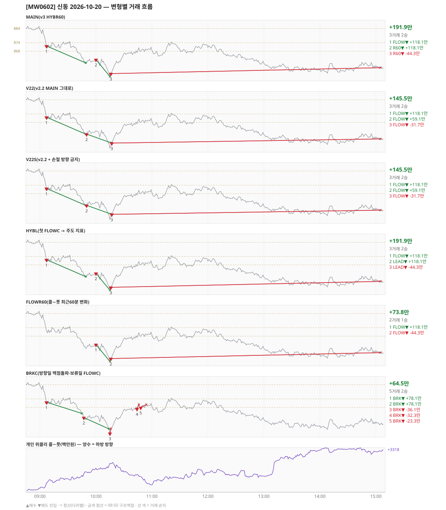

# [MW0602] 신동 일일 리포트 — 2026-10-20

> **MW0602 리포트** · 생성 2026-10-20 15:40 · 규격 `SD-2026-10-19-v3` · 상품 `wk_thu` (최근접 만기 목위클리 (만기 2026-10-22))
> 가상거래다 — 주문 없음(절대원칙 §6). 손익은 미니선물 2계약 · CYBOS 요율 · 1틱 슬리피지 기준.

## 0. 한눈에

| 시장 | R1 장전 | R2 개장확정(V1) | R1 적중(09:00→15:05) |
|---|---|---|---|
| 883.10 → 856.32 (-26.78) · 고 886.72 · 저 849.22 · 폭 37.5pt | 콜−풋 +316 → **하방** | CONFIRMED 09:01 | ✅ 적중 |

| 변형 | 거래 | 승 | 규칙별 | **순손익** | 최악 거래 | MAIN 대비 | 기록 |
|---|---|---|---|---|---|---|---|
| MAIN(v3 HYBR60) | 3 | 2 | FLOW +118.1만 · R60 +73.8만 | **+191.9만** | -44.3만 | — | 라이브 |
| V22(v2.2 MAIN 그대로) | 3 | 2 | FLOW +145.5만 | **+145.5만** | -31.7만 | -46.4만 | 라이브 |
| V22S(v2.2 + 손절 방향 금지) | 3 | 2 | FLOW +145.5만 | **+145.5만** | -31.7만 | -46.4만 | 라이브 |
| HYBL(첫 FLOWC → 주도 지표) | 3 | 2 | FLOW +118.1만 · LEAD +73.8만 | **+191.9만** | -44.3만 | +0.0만 | 라이브 |
| FLOWR60(콜−풋 최근60분 변화) | 2 | 1 | FLOW +73.8만 | **+73.8만** | -44.3만 | -118.1만 | 라이브 |
| BRKC(방향일 맥점돌파·보류일 FLOWC) | 5 | 2 | BRK +64.5만 | **+64.5만** | -36.1만 | -127.4만 | 라이브 |

**오늘의 한 줄** — MAIN +191.9만(3거래 2승).

## 1. 차트

## 2. 거래 흐름 — MAIN

| # | 규칙 | 방향 | 진입 | 맥점 | 손절 | 1차 · 최종 | 청산(다리별) | MFE | 손익 | 누적 |
|---|---|---|---|---|---|---|---|---|---|---|
| 1 | FLOW | 매도 | 09:07 871.68 (탐지 09:08) | - | 896.78 | 859.68 · 859.68 | 1차 09:49 859.68 · 최종 09:49 859.68 | 12.7 | **+118.1만** | +118.1만 |
| 2 | R60 | 매도 | 10:00 862.06 (탐지 10:01) | - | 887.16 | 850.06 · 850.06 | 1차 10:15 850.06 · 최종 10:15 850.06 | 12.5 | **+118.1만** | +236.2만 |
| 3 | R60 | 매도 | 10:16 852.10 (탐지 10:17) | - | 877.20 | 840.10 · 840.10 | 시간 15:05 856.32 · 시간 15:05 856.32 | 0.6 | **-44.3만** | +191.9만 |

## 3. 섀도 흐름 — 변형별 거래(v1 계열은 V1 과 무엇이 달랐나)

### V22(v2.2 MAIN 그대로) — +145.5만 (MAIN 대비 -46.4만)

- 별개 규칙(family) — MAIN·V1 과 거래 단위 대조는 하지 않는다. 손익·최악·거래 수로만 비교

| # | 규칙 | 방향 | 진입 | 맥점 | 손절 | 1차 · 최종 | 청산(다리별) | MFE | 손익 | 누적 |
|---|---|---|---|---|---|---|---|---|---|---|
| 1 | FLOW | 매도 | 09:07 871.68 (탐지 09:08) | - | 896.78 | 859.68 · 859.68 | 1차 09:49 859.68 · 최종 09:49 859.68 | 12.7 | **+118.1만** | +118.1만 |
| 2 | FLOW | 매도 | 09:50 859.72 (탐지 09:51) | - | 884.82 | 847.72 · 847.72 | 트레일 10:16 853.60 · 트레일 10:16 853.60 | 10.5 | **+59.1만** | +177.2만 |
| 3 | FLOW | 매도 | 10:17 853.36 (탐지 10:18) | - | 878.46 | 841.36 · 841.36 | 시간 15:05 856.32 · 시간 15:05 856.32 | 1.2 | **-31.7만** | +145.5만 |

### V22S(v2.2 + 손절 방향 금지) — +145.5만 (MAIN 대비 -46.4만)

- 별개 규칙(family) — MAIN·V1 과 거래 단위 대조는 하지 않는다. 손익·최악·거래 수로만 비교

| # | 규칙 | 방향 | 진입 | 맥점 | 손절 | 1차 · 최종 | 청산(다리별) | MFE | 손익 | 누적 |
|---|---|---|---|---|---|---|---|---|---|---|
| 1 | FLOW | 매도 | 09:07 871.68 (탐지 09:08) | - | 896.78 | 859.68 · 859.68 | 1차 09:49 859.68 · 최종 09:49 859.68 | 12.7 | **+118.1만** | +118.1만 |
| 2 | FLOW | 매도 | 09:50 859.72 (탐지 09:51) | - | 884.82 | 847.72 · 847.72 | 트레일 10:16 853.60 · 트레일 10:16 853.60 | 10.5 | **+59.1만** | +177.2만 |
| 3 | FLOW | 매도 | 10:17 853.36 (탐지 10:18) | - | 878.46 | 841.36 · 841.36 | 시간 15:05 856.32 · 시간 15:05 856.32 | 1.2 | **-31.7만** | +145.5만 |

### HYBL(첫 FLOWC → 주도 지표) — +191.9만 (MAIN 대비 +0.0만)

- 별개 규칙(family) — MAIN·V1 과 거래 단위 대조는 하지 않는다. 손익·최악·거래 수로만 비교

| # | 규칙 | 방향 | 진입 | 맥점 | 손절 | 1차 · 최종 | 청산(다리별) | MFE | 손익 | 누적 |
|---|---|---|---|---|---|---|---|---|---|---|
| 1 | FLOW | 매도 | 09:07 871.68 (탐지 09:08) | - | 896.78 | 859.68 · 859.68 | 1차 09:49 859.68 · 최종 09:49 859.68 | 12.7 | **+118.1만** | +118.1만 |
| 2 | LEAD | 매도 | 10:00 862.06 (탐지 10:01) | - | 887.16 | 850.06 · 850.06 | 1차 10:15 850.06 · 최종 10:15 850.06 | 12.5 | **+118.1만** | +236.2만 |
| 3 | LEAD | 매도 | 10:16 852.10 (탐지 10:17) | - | 877.20 | 840.10 · 840.10 | 시간 15:05 856.32 · 시간 15:05 856.32 | 0.6 | **-44.3만** | +191.9만 |

### FLOWR60(콜−풋 최근60분 변화) — +73.8만 (MAIN 대비 -118.1만)

- 별개 규칙(family) — MAIN·V1 과 거래 단위 대조는 하지 않는다. 손익·최악·거래 수로만 비교

| # | 규칙 | 방향 | 진입 | 맥점 | 손절 | 1차 · 최종 | 청산(다리별) | MFE | 손익 | 누적 |
|---|---|---|---|---|---|---|---|---|---|---|
| 1 | FLOW | 매도 | 10:00 862.06 (탐지 10:01) | - | 887.16 | 850.06 · 850.06 | 1차 10:15 850.06 · 최종 10:15 850.06 | 12.5 | **+118.1만** | +118.1만 |
| 2 | FLOW | 매도 | 10:16 852.10 (탐지 10:17) | - | 877.20 | 840.10 · 840.10 | 시간 15:05 856.32 · 시간 15:05 856.32 | 0.6 | **-44.3만** | +73.8만 |

### BRKC(방향일 맥점돌파·보류일 FLOWC) — +64.5만 (MAIN 대비 -127.4만)

- 별개 규칙(family) — MAIN·V1 과 거래 단위 대조는 하지 않는다. 손익·최악·거래 수로만 비교

| # | 규칙 | 방향 | 진입 | 맥점 | 손절 | 1차 · 최종 | 청산(다리별) | MFE | 손익 | 누적 |
|---|---|---|---|---|---|---|---|---|---|---|
| 1 | BRK | 매도 | 09:07 871.68 (탐지 09:08) | 874.0 | 876.00 | 863.68 · 863.68 | 1차 09:45 863.68 · 최종 09:45 863.68 | 9.0 | **+78.1만** | +78.1만 |
| 2 | BRK | 매도 | 09:47 860.74 (탐지 09:48) | 862.0 | 864.00 | 852.74 · 852.74 | 1차 10:14 852.74 · 최종 10:14 852.74 | 8.4 | **+78.1만** | +156.2만 |
| 3 | BRK | 매도 | 10:15 849.60 (탐지 10:16) | 851.0 | 853.00 | 841.60 · 841.60 | 손절 10:16 853.00 · 손절 10:16 853.00 | 0.4 | **-36.1만** | +120.1만 |
| 4 | BRK | 매도 | 10:44 866.98 (탐지 10:45) | 868.0 | 870.00 | 858.98 · 858.98 | 손절 10:46 870.00 · 손절 10:46 870.00 | 0.3 | **-32.3만** | +87.8만 |
| 5 | BRK | 매도 | 10:48 867.88 (탐지 10:49) | 868.0 | 870.00 | 859.88 · 859.88 | 손절 10:54 870.00 · 손절 10:54 870.00 | 0.3 | **-23.3만** | +64.5만 |

## 4. 누적 채점 (라이브 기록 · 판정 창)

| 변형 | 채점 시작 | 거래일 | 거래 | 승률 | 순손익 | 최악일 | R3 (건 · 승률 · 순) | 판정 |
|---|---|---|---|---|---|---|---|---|
| MAIN(v3 HYBR60) | 2026-10-19 | 2 | 6 | 83% | **+383.6만** | +191.7만 | 0 · - · +0.0만 | v3 vs V22 되돌림 판정 2/20일 |
| V22(v2.2 MAIN 그대로) | 2026-10-19 | 2 | 4 | 75% | **+178.2만** | +32.7만 | 0 · - · +0.0만 | 되돌림 기준 2/20일 |
| V22S(v2.2 + 손절 방향 금지) | 2026-10-19 | 2 | 4 | 75% | **+178.2만** | +32.7만 | 0 · - · +0.0만 | MAIN 비교 2/20일 |
| HYBL(첫 FLOWC → 주도 지표) | 2026-10-19 | 2 | 6 | 83% | **+383.6만** | +191.7만 | 0 · - · +0.0만 | MAIN 비교 2/20일 |
| FLOWR60(콜−풋 최근60분 변화) | 2026-10-19 | 2 | 5 | 80% | **+269.3만** | +73.8만 | 0 · - · +0.0만 | MAIN 비교 2/20일 |
| BRKC(방향일 맥점돌파·보류일 FLOWC) | 2026-10-19 | 2 | 10 | 30% | **-25.6만** | -90.1만 | 0 · - · +0.0만 | MAIN 비교 2/20일 |

> 판정 전 집계다 — 인용·규격 변경 근거로 쓰지 말 것. 되돌림: V22 가 MAIN 보다 순손익·최악일 **둘 다** 나으면 v2.2 복귀. 섀도: MAIN 대비 순손익 우위 **그리고** 최악일 개선 → 채택 후보(자동 승격 없음).

## 5. 러너 섀도 — 미륵이 × 신동 (CREON 요율)

- 오늘 기록 없음 — 미륵이 시스템 진입이 없었거나 장후 기록 전이다

## 6. 개선 방향 (자동 관찰 — 판정 아님)

- **진입 품질** — MAIN 손실 1건 중 1건은 유리한 쪽으로 4pt 도 못 갔다(MFE 0.6). 청산을 바꿔서는 못 막는 손실이다 → 진입 조건(문턱 K·R1 방향) 쪽 관찰 대상.
- **탐지 지연** — 라이브 진입 3건, 규칙가 대비 실현가능가 차 +0(음수 = 늦게 알아채 손해).
- **오늘은 MAIN 이 최선** (+191.9만).
- **되돌림 대조** — V22(v2.2 MAIN 그대로) +145.5만 vs MAIN +191.9만 (차 +46.4만). 되돌림 판정은 20거래일 누적으로만.
- ⚠ 규격 변경은 사전등록 §6(새 버전 · 재채점)으로만. 이 절은 관찰이다.

---
재생성: `python scripts/shindong_daily_report.py 2026-10-20`
