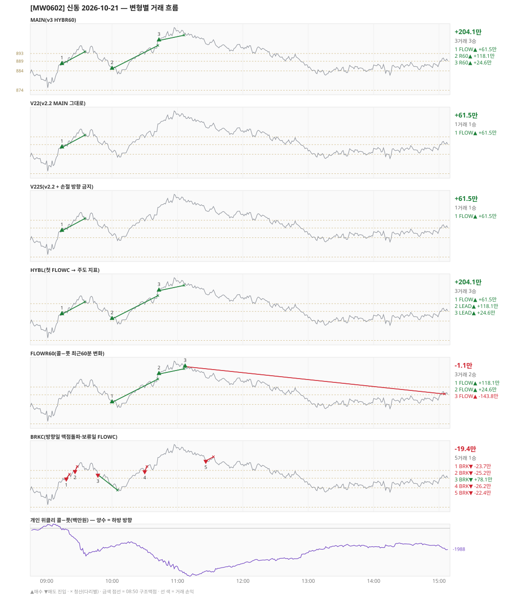

# [MW0602] 신동 일일 리포트 — 2026-10-21

> **MW0602 리포트** · 생성 2026-10-21 15:40 · 규격 `SD-2026-10-19-v3` · 상품 `wk_thu` (최근접 만기 목위클리 (만기 2026-10-22))
> 가상거래다 — 주문 없음(절대원칙 §6). 손익은 미니선물 2계약 · CYBOS 요율 · 1틱 슬리피지 기준.

## 0. 한눈에

| 시장 | R1 장전 | R2 개장확정(V1) | R1 적중(09:00→15:05) |
|---|---|---|---|
| 880.72 → 889.40 (+8.68) · 고 906.40 · 저 873.66 · 폭 32.7pt | 콜−풋 +184 → **하방** | CONFIRMED 09:01 | ❌ 불적중 |

| 변형 | 거래 | 승 | 규칙별 | **순손익** | 최악 거래 | MAIN 대비 | 기록 |
|---|---|---|---|---|---|---|---|
| MAIN(v3 HYBR60) | 3 | 3 | FLOW +61.5만 · R60 +142.7만 | **+204.1만** | +24.6만 | — | 라이브 |
| V22(v2.2 MAIN 그대로) | 1 | 1 | FLOW +61.5만 | **+61.5만** | +61.5만 | -142.7만 | 라이브 |
| V22S(v2.2 + 손절 방향 금지) | 1 | 1 | FLOW +61.5만 | **+61.5만** | +61.5만 | -142.7만 | 라이브 |
| HYBL(첫 FLOWC → 주도 지표) | 3 | 3 | FLOW +61.5만 · LEAD +142.7만 | **+204.1만** | +24.6만 | +0.0만 | 라이브 |
| FLOWR60(콜−풋 최근60분 변화) | 3 | 2 | FLOW -1.1만 | **-1.1만** | -143.8만 | -205.2만 | 라이브 |
| BRKC(방향일 맥점돌파·보류일 FLOWC) | 5 | 1 | BRK -19.4만 | **-19.4만** | -26.2만 | -223.5만 | 라이브 |

**오늘의 한 줄** — MAIN +204.1만(3거래 3승).

## 1. 차트

## 2. 거래 흐름 — MAIN

| # | 규칙 | 방향 | 진입 | 맥점 | 손절 | 1차 · 최종 | 청산(다리별) | MFE | 손익 | 누적 |
|---|---|---|---|---|---|---|---|---|---|---|
| 1 | FLOW | 매수 | 09:14 887.54 (탐지 09:15) | - | 862.09 | 899.54 · 899.54 | 트레일 09:35 893.90 · 트레일 09:35 893.90 | 10.4 | **+61.5만** | +61.5만 |
| 2 | R60 | 매수 | 10:00 885.10 (탐지 10:01) | - | 859.65 | 897.10 · 897.10 | 1차 10:42 897.10 · 최종 10:42 897.10 | 14.7 | **+118.1만** | +179.5만 |
| 3 | R60 | 매수 | 10:43 899.72 (탐지 10:44) | - | 874.27 | 911.72 · 911.72 | 트레일 11:06 902.40 · 트레일 11:06 902.40 | 6.7 | **+24.6만** | +204.1만 |

## 3. 섀도 흐름 — 변형별 거래(v1 계열은 V1 과 무엇이 달랐나)

### V22(v2.2 MAIN 그대로) — +61.5만 (MAIN 대비 -142.7만)

- 별개 규칙(family) — MAIN·V1 과 거래 단위 대조는 하지 않는다. 손익·최악·거래 수로만 비교

| # | 규칙 | 방향 | 진입 | 맥점 | 손절 | 1차 · 최종 | 청산(다리별) | MFE | 손익 | 누적 |
|---|---|---|---|---|---|---|---|---|---|---|
| 1 | FLOW | 매수 | 09:14 887.54 (탐지 09:15) | - | 862.09 | 899.54 · 899.54 | 트레일 09:35 893.90 · 트레일 09:35 893.90 | 10.4 | **+61.5만** | +61.5만 |

### V22S(v2.2 + 손절 방향 금지) — +61.5만 (MAIN 대비 -142.7만)

- 별개 규칙(family) — MAIN·V1 과 거래 단위 대조는 하지 않는다. 손익·최악·거래 수로만 비교

| # | 규칙 | 방향 | 진입 | 맥점 | 손절 | 1차 · 최종 | 청산(다리별) | MFE | 손익 | 누적 |
|---|---|---|---|---|---|---|---|---|---|---|
| 1 | FLOW | 매수 | 09:14 887.54 (탐지 09:15) | - | 862.09 | 899.54 · 899.54 | 트레일 09:35 893.90 · 트레일 09:35 893.90 | 10.4 | **+61.5만** | +61.5만 |

### HYBL(첫 FLOWC → 주도 지표) — +204.1만 (MAIN 대비 +0.0만)

- 별개 규칙(family) — MAIN·V1 과 거래 단위 대조는 하지 않는다. 손익·최악·거래 수로만 비교

| # | 규칙 | 방향 | 진입 | 맥점 | 손절 | 1차 · 최종 | 청산(다리별) | MFE | 손익 | 누적 |
|---|---|---|---|---|---|---|---|---|---|---|
| 1 | FLOW | 매수 | 09:14 887.54 (탐지 09:15) | - | 862.09 | 899.54 · 899.54 | 트레일 09:35 893.90 · 트레일 09:35 893.90 | 10.4 | **+61.5만** | +61.5만 |
| 2 | LEAD | 매수 | 10:00 885.10 (탐지 10:01) | - | 859.65 | 897.10 · 897.10 | 1차 10:42 897.10 · 최종 10:42 897.10 | 14.7 | **+118.1만** | +179.5만 |
| 3 | LEAD | 매수 | 10:43 899.72 (탐지 10:44) | - | 874.27 | 911.72 · 911.72 | 트레일 11:06 902.40 · 트레일 11:06 902.40 | 6.7 | **+24.6만** | +204.1만 |

### FLOWR60(콜−풋 최근60분 변화) — -1.1만 (MAIN 대비 -205.2만)

- 별개 규칙(family) — MAIN·V1 과 거래 단위 대조는 하지 않는다. 손익·최악·거래 수로만 비교

| # | 규칙 | 방향 | 진입 | 맥점 | 손절 | 1차 · 최종 | 청산(다리별) | MFE | 손익 | 누적 |
|---|---|---|---|---|---|---|---|---|---|---|
| 1 | FLOW | 매수 | 10:00 885.10 (탐지 10:01) | - | 859.65 | 897.10 · 897.10 | 1차 10:42 897.10 · 최종 10:42 897.10 | 14.7 | **+118.1만** | +118.1만 |
| 2 | FLOW | 매수 | 10:43 899.72 (탐지 10:44) | - | 874.27 | 911.72 · 911.72 | 트레일 11:06 902.40 · 트레일 11:06 902.40 | 6.7 | **+24.6만** | +142.7만 |
| 3 | FLOW | 매수 | 11:07 903.56 (탐지 11:08) | - | 878.11 | 915.56 · 915.56 | 시간 15:05 889.40 · 시간 15:05 889.40 | 0.7 | **-143.8만** | -1.1만 |

### BRKC(방향일 맥점돌파·보류일 FLOWC) — -19.4만 (MAIN 대비 -223.5만)

- 별개 규칙(family) — MAIN·V1 과 거래 단위 대조는 하지 않는다. 손익·최악·거래 수로만 비교

| # | 규칙 | 방향 | 진입 | 맥점 | 손절 | 1차 · 최종 | 청산(다리별) | MFE | 손익 | 누적 |
|---|---|---|---|---|---|---|---|---|---|---|
| 1 | BRK | 매도 | 09:18 888.84 (탐지 09:19) | 889.0 | 891.00 | 880.84 · 880.84 | 손절 09:21 891.00 · 손절 09:21 891.00 | 1.6 | **-23.7만** | -23.7만 |
| 2 | BRK | 매도 | 09:26 892.70 (탐지 09:27) | 893.0 | 895.00 | 884.70 · 884.70 | 손절 09:28 895.00 · 손절 09:28 895.00 | 0.2 | **-25.2만** | -48.9만 |
| 3 | BRK | 매도 | 09:47 890.82 (탐지 09:48) | 893.0 | 895.00 | 882.82 · 882.82 | 1차 10:05 882.82 · 최종 10:05 882.82 | 8.6 | **+78.1만** | +29.2만 |
| 4 | BRK | 매도 | 10:30 892.60 (탐지 10:31) | 893.0 | 895.00 | 884.60 · 884.60 | 손절 10:32 895.00 · 손절 10:32 895.00 | 0.0 | **-26.2만** | +3.0만 |
| 5 | BRK | 매도 | 11:26 897.98 (탐지 11:27) | 898.0 | 900.00 | 889.98 · 889.98 | 손절 11:33 900.00 · 손절 11:33 900.00 | 0.9 | **-22.4만** | -19.4만 |

## 4. 누적 채점 (라이브 기록 · 판정 창)

| 변형 | 채점 시작 | 거래일 | 거래 | 승률 | 순손익 | 최악일 | R3 (건 · 승률 · 순) | 판정 |
|---|---|---|---|---|---|---|---|---|
| MAIN(v3 HYBR60) | 2026-10-19 | 3 | 9 | 89% | **+587.8만** | +191.7만 | 0 · - · +0.0만 | v3 vs V22 되돌림 판정 3/20일 |
| V22(v2.2 MAIN 그대로) | 2026-10-19 | 3 | 5 | 80% | **+239.7만** | +32.7만 | 0 · - · +0.0만 | 되돌림 기준 3/20일 |
| V22S(v2.2 + 손절 방향 금지) | 2026-10-19 | 3 | 5 | 80% | **+239.7만** | +32.7만 | 0 · - · +0.0만 | MAIN 비교 3/20일 |
| HYBL(첫 FLOWC → 주도 지표) | 2026-10-19 | 3 | 9 | 89% | **+587.8만** | +191.7만 | 0 · - · +0.0만 | MAIN 비교 3/20일 |
| FLOWR60(콜−풋 최근60분 변화) | 2026-10-19 | 3 | 8 | 75% | **+268.2만** | -1.1만 | 0 · - · +0.0만 | MAIN 비교 3/20일 |
| BRKC(방향일 맥점돌파·보류일 FLOWC) | 2026-10-19 | 3 | 15 | 27% | **-44.9만** | -90.1만 | 0 · - · +0.0만 | MAIN 비교 3/20일 |

> 판정 전 집계다 — 인용·규격 변경 근거로 쓰지 말 것. 되돌림: V22 가 MAIN 보다 순손익·최악일 **둘 다** 나으면 v2.2 복귀. 섀도: MAIN 대비 순손익 우위 **그리고** 최악일 개선 → 채택 후보(자동 승격 없음).

## 5. 러너 섀도 — 미륵이 × 신동 (CREON 요율)

- 오늘 기록 없음 — 미륵이 시스템 진입이 없었거나 장후 기록 전이다

## 6. 개선 방향 (자동 관찰 — 판정 아님)

- **탐지 지연** — 라이브 진입 3건, 규칙가 대비 실현가능가 차 +0(음수 = 늦게 알아채 손해).
- **오늘은 MAIN 이 최선** (+204.1만).
- **되돌림 대조** — V22(v2.2 MAIN 그대로) +61.5만 vs MAIN +204.1만 (차 +142.7만). 되돌림 판정은 20거래일 누적으로만.
- ⚠ 규격 변경은 사전등록 §6(새 버전 · 재채점)으로만. 이 절은 관찰이다.

---
재생성: `python scripts/shindong_daily_report.py 2026-10-21`
