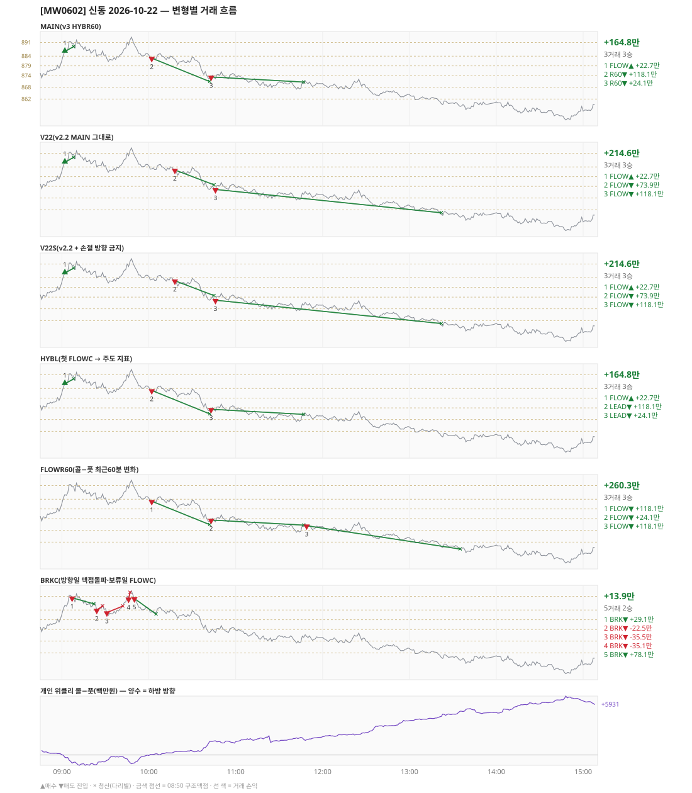

# [MW0602] 신동 일일 리포트 — 2026-10-22

> **MW0602 리포트** · 생성 2026-10-22 17:44 · 규격 `SD-2026-10-19-v3` · 상품 `wk_thu` (최근접 만기 목위클리 (만기 2026-10-22))
> **아래 변형 손익은 엔진 재생(가상)이다** — 장후 최종 흐름으로 하루를 다시 돌린 값. 미니선물 2계약 · CYBOS 요율 · 1틱 슬리피지 기준. **실제 체결 손익은 §2-1 실거래 대사.**

## 0. 한눈에

| 시장 | R1 장전 | R2 개장확정(V1) | R1 적중(09:00→15:05) |
|---|---|---|---|
| 882.00 → 856.04 (-25.96) · 고 894.06 · 저 850.80 · 폭 43.3pt | 콜−풋 +134 → **하방** | NONE | ✅ 적중 |

| 변형 | 거래 | 승 | 규칙별 | **순손익** | 최악 거래 | MAIN 대비 | 기록 |
|---|---|---|---|---|---|---|---|
| MAIN(v3 HYBR60) | 3 | 3 | FLOW +22.7만 · R60 +142.2만 | **+164.8만** | +22.7만 | — | 재생(장중 기록) |
| V22(v2.2 MAIN 그대로) | 3 | 3 | FLOW +214.6만 | **+214.6만** | +22.7만 | +49.8만 | 재생(장중 기록) |
| V22S(v2.2 + 손절 방향 금지) | 3 | 3 | FLOW +214.6만 | **+214.6만** | +22.7만 | +49.8만 | 재생(장중 기록) |
| HYBL(첫 FLOWC → 주도 지표) | 3 | 3 | FLOW +22.7만 · LEAD +142.2만 | **+164.8만** | +22.7만 | +0.0만 | 재생(장중 기록) |
| FLOWR60(콜−풋 최근60분 변화) | 3 | 3 | FLOW +260.3만 | **+260.3만** | +24.1만 | +95.4만 | 재생(장중 기록) |
| BRKC(방향일 맥점돌파·보류일 FLOWC) | 5 | 2 | BRK +13.9만 | **+13.9만** | -35.5만 | -150.9만 | 재생(장중 기록) |

**실거래(실제 체결)** — 3포지션 +169.4만 · 브로커 net +169.4만 · 재생 MAIN 과 차 +4.6만 → §2-1

**오늘의 한 줄** — MAIN +164.8만(3거래 3승), 최선은 FLOWR60(콜−풋 최근60분 변화) +260.3만(MAIN 대비 +95.4만).

## 1. 차트

## 2. 거래 흐름 — MAIN

| # | 규칙 | 방향 | 진입 | 맥점 | 손절 | 1차 · 최종 | 청산(다리별) | MFE | 손익 | 누적 |
|---|---|---|---|---|---|---|---|---|---|---|
| 1 | FLOW | 매수 | 09:02 886.40 (탐지 09:03) | - | 859.67 | 898.40 · 898.40 | 트레일 09:08 888.88 · 트레일 09:08 888.88 | 6.5 | **+22.7만** | +22.7만 |
| 2 | R60 | 매도 | 10:02 882.96 (탐지 10:03) | - | 909.69 | 870.96 · 870.96 | 1차 10:42 870.96 · 최종 10:42 870.96 | 12.2 | **+118.1만** | +140.7만 |
| 3 | R60 | 매도 | 10:43 873.30 (탐지 10:44) | - | 900.03 | 861.30 · 861.30 | 트레일 11:47 870.68 · 트레일 11:47 870.68 | 6.6 | **+24.1만** | +164.8만 |

## 2-1. 실거래 대사 — 실제 체결 vs 재생 MAIN

| # | 구분 | 신호 | 실거래 | 재생 MAIN | 비고 |
|---|---|---|---|---|---|
| 1 | 일치 | `FLOW\|09:02\|+1` | 09:03 매수 2계약 @885.79 · +29.4만 | 09:02 매수 @886.40 · +22.7만 | 차 +6.7만 |
| 2 | 일치 | `R60\|10:02\|-1` | 10:03 매도 2계약 @883.15 · +113.3만 | 10:02 매도 @882.96 · +118.1만 | 차 -4.8만 |
| 3 | 일치 | `R60\|10:43\|-1` | 10:44 매도 2계약 @873.37 · +26.8만 | 10:43 매도 @873.30 · +24.1만 | 차 +2.7만 |

| 구분 | 건 | 실거래 | 재생 MAIN |
|---|---|---|---|
| 일치 | 3 | +169.4만 | +164.8만 |
| **합** | | **+169.4만** | **+164.8만** |

- 브로커 실측 net(계좌 전체, `daily_broker_pnl` · -): **+169.4만** · 신동 실거래 합과 차 +22
- 재생은 장후 최종 흐름으로 다시 돌린 값이라, 장중에 나왔다가 정정으로 사라진 신호(철회)는 빠지고 보유 중·늦음으로 못 친 신호는 들어간다. **실거래 손익은 이 절의 「실거래」 열이다.**

## 3. 섀도 흐름 — 변형별 거래(v1 계열은 V1 과 무엇이 달랐나)

### V22(v2.2 MAIN 그대로) — +214.6만 (MAIN 대비 +49.8만)

- 별개 규칙(family) — MAIN·V1 과 거래 단위 대조는 하지 않는다. 손익·최악·거래 수로만 비교

| # | 규칙 | 방향 | 진입 | 맥점 | 손절 | 1차 · 최종 | 청산(다리별) | MFE | 손익 | 누적 |
|---|---|---|---|---|---|---|---|---|---|---|
| 1 | FLOW | 매수 | 09:02 886.40 (탐지 09:03) | - | 859.67 | 898.40 · 898.40 | 트레일 09:08 888.88 · 트레일 09:08 888.88 | 6.5 | **+22.7만** | +22.7만 |
| 2 | FLOW | 매도 | 10:18 882.40 (탐지 10:19) | - | 909.13 | 870.40 · 870.40 | 트레일 10:45 874.80 · 트레일 10:45 874.80 | 11.6 | **+73.9만** | +96.5만 |
| 3 | FLOW | 매도 | 10:46 872.44 (탐지 10:47) | - | 899.17 | 860.44 · 860.44 | 1차 13:22 860.44 · 최종 13:22 860.44 | 12.9 | **+118.1만** | +214.6만 |

### V22S(v2.2 + 손절 방향 금지) — +214.6만 (MAIN 대비 +49.8만)

- 별개 규칙(family) — MAIN·V1 과 거래 단위 대조는 하지 않는다. 손익·최악·거래 수로만 비교

| # | 규칙 | 방향 | 진입 | 맥점 | 손절 | 1차 · 최종 | 청산(다리별) | MFE | 손익 | 누적 |
|---|---|---|---|---|---|---|---|---|---|---|
| 1 | FLOW | 매수 | 09:02 886.40 (탐지 09:03) | - | 859.67 | 898.40 · 898.40 | 트레일 09:08 888.88 · 트레일 09:08 888.88 | 6.5 | **+22.7만** | +22.7만 |
| 2 | FLOW | 매도 | 10:18 882.40 (탐지 10:19) | - | 909.13 | 870.40 · 870.40 | 트레일 10:45 874.80 · 트레일 10:45 874.80 | 11.6 | **+73.9만** | +96.5만 |
| 3 | FLOW | 매도 | 10:46 872.44 (탐지 10:47) | - | 899.17 | 860.44 · 860.44 | 1차 13:22 860.44 · 최종 13:22 860.44 | 12.9 | **+118.1만** | +214.6만 |

### HYBL(첫 FLOWC → 주도 지표) — +164.8만 (MAIN 대비 +0.0만)

- 별개 규칙(family) — MAIN·V1 과 거래 단위 대조는 하지 않는다. 손익·최악·거래 수로만 비교

| # | 규칙 | 방향 | 진입 | 맥점 | 손절 | 1차 · 최종 | 청산(다리별) | MFE | 손익 | 누적 |
|---|---|---|---|---|---|---|---|---|---|---|
| 1 | FLOW | 매수 | 09:02 886.40 (탐지 09:03) | - | 859.67 | 898.40 · 898.40 | 트레일 09:08 888.88 · 트레일 09:08 888.88 | 6.5 | **+22.7만** | +22.7만 |
| 2 | LEAD | 매도 | 10:02 882.96 (탐지 10:03) | - | 909.69 | 870.96 · 870.96 | 1차 10:42 870.96 · 최종 10:42 870.96 | 12.2 | **+118.1만** | +140.7만 |
| 3 | LEAD | 매도 | 10:43 873.30 (탐지 10:44) | - | 900.03 | 861.30 · 861.30 | 트레일 11:47 870.68 · 트레일 11:47 870.68 | 6.6 | **+24.1만** | +164.8만 |

### FLOWR60(콜−풋 최근60분 변화) — +260.3만 (MAIN 대비 +95.4만)

- 별개 규칙(family) — MAIN·V1 과 거래 단위 대조는 하지 않는다. 손익·최악·거래 수로만 비교

| # | 규칙 | 방향 | 진입 | 맥점 | 손절 | 1차 · 최종 | 청산(다리별) | MFE | 손익 | 누적 |
|---|---|---|---|---|---|---|---|---|---|---|
| 1 | FLOW | 매도 | 10:02 882.96 (탐지 10:03) | - | 909.69 | 870.96 · 870.96 | 1차 10:42 870.96 · 최종 10:42 870.96 | 12.2 | **+118.1만** | +118.1만 |
| 2 | FLOW | 매도 | 10:43 873.30 (탐지 10:44) | - | 900.03 | 861.30 · 861.30 | 트레일 11:47 870.68 · 트레일 11:47 870.68 | 6.6 | **+24.1만** | +142.2만 |
| 3 | FLOW | 매도 | 11:49 870.40 (탐지 11:50) | - | 897.13 | 858.40 · 858.40 | 1차 13:35 858.40 · 최종 13:35 858.40 | 12.8 | **+118.1만** | +260.3만 |

### BRKC(방향일 맥점돌파·보류일 FLOWC) — +13.9만 (MAIN 대비 -150.9만)

- 별개 규칙(family) — MAIN·V1 과 거래 단위 대조는 하지 않는다. 손익·최악·거래 수로만 비교

| # | 규칙 | 방향 | 진입 | 맥점 | 손절 | 1차 · 최종 | 청산(다리별) | MFE | 손익 | 누적 |
|---|---|---|---|---|---|---|---|---|---|---|
| 1 | BRK | 매도 | 09:07 890.26 (탐지 09:08) | 891.0 | 893.00 | 882.26 · 882.26 | 트레일 09:22 887.14 · 트레일 09:22 887.14 | 6.1 | **+29.1만** | +29.1만 |
| 2 | BRK | 매도 | 09:24 883.96 (탐지 09:25) | 884.0 | 886.00 | 875.96 · 875.96 | 손절 09:28 886.00 · 손절 09:28 886.00 | -0.0 | **-22.5만** | +6.5만 |
| 3 | BRK | 매도 | 09:31 882.66 (탐지 09:32) | 884.0 | 886.00 | 874.66 · 874.66 | 손절 09:42 886.00 · 손절 09:42 886.00 | 1.8 | **-35.5만** | -29.0만 |
| 4 | BRK | 매도 | 09:46 889.70 (탐지 09:47) | 891.0 | 893.00 | 881.70 · 881.70 | 손절 09:47 893.00 · 손절 09:47 893.00 | 0.2 | **-35.1만** | -64.2만 |
| 5 | BRK | 매도 | 09:50 889.86 (탐지 09:51) | 891.0 | 893.00 | 881.86 · 881.86 | 1차 10:05 881.86 · 최종 10:05 881.86 | 8.3 | **+78.1만** | +13.9만 |

## 4. 누적 채점 (라이브 기록 · 판정 창)

| 변형 | 채점 시작 | 거래일 | 거래 | 승률 | 순손익 | 최악일 | R3 (건 · 승률 · 순) | 판정 |
|---|---|---|---|---|---|---|---|---|
| MAIN(v3 HYBR60) | 2026-10-19 | 4 | 12 | 92% | **+752.6만** | +164.8만 | 0 · - · +0.0만 | v3 vs V22 되돌림 판정 4/20일 |
| V22(v2.2 MAIN 그대로) | 2026-10-19 | 4 | 8 | 88% | **+454.3만** | +32.7만 | 0 · - · +0.0만 | 되돌림 기준 4/20일 |
| V22S(v2.2 + 손절 방향 금지) | 2026-10-19 | 4 | 8 | 88% | **+454.3만** | +32.7만 | 0 · - · +0.0만 | MAIN 비교 4/20일 |
| HYBL(첫 FLOWC → 주도 지표) | 2026-10-19 | 4 | 12 | 92% | **+752.6만** | +164.8만 | 0 · - · +0.0만 | MAIN 비교 4/20일 |
| FLOWR60(콜−풋 최근60분 변화) | 2026-10-19 | 4 | 11 | 82% | **+528.5만** | -1.1만 | 0 · - · +0.0만 | MAIN 비교 4/20일 |
| BRKC(방향일 맥점돌파·보류일 FLOWC) | 2026-10-19 | 4 | 20 | 30% | **-31.0만** | -90.1만 | 0 · - · +0.0만 | MAIN 비교 4/20일 |
| **실집행(실제 체결 · 참고)** | 2026-10-19 | 4 | 12 | 92% | **+543.9만** | +84.8만 | - | 판정 기준 아님 |

> 판정 전 집계다 — 인용·규격 변경 근거로 쓰지 말 것. 되돌림: V22 가 MAIN 보다 순손익·최악일 **둘 다** 나으면 v2.2 복귀. 섀도: MAIN 대비 순손익 우위 **그리고** 최악일 개선 → 채택 후보(자동 승격 없음).
> 「실집행」 = `trades.db` 신동 체결(포지션 단위, 거래일 = 체결이 있던 날). 재생에서 철회됐지만 실제로 친 거래가 **들어가고**, 보유 중·늦음·기각으로 못 친 재생 거래는 **빠진다**. 사전등록 판정은 위 재생 행으로만 한다.

## 5. 러너 섀도 — 미륵이 × 신동 (CREON 요율)

- 오늘 기록 없음 — 미륵이 시스템 진입이 없었거나 장후 기록 전이다

## 6. 개선 방향 (자동 관찰 — 판정 아님)

- **탐지 지연** — 재생 진입 3건, 규칙가 대비 실현가능가 차 +0(음수 = 늦게 알아채 손해).
- **오늘 최선은 FLOWR60(콜−풋 최근60분 변화)** (+260.3만, MAIN 대비 +95.4만). 하루 결과다 — 판정은 사전등록 창(20거래일)으로만.
- **되돌림 대조** — V22(v2.2 MAIN 그대로) +214.6만 vs MAIN +164.8만 (차 -49.8만). 되돌림 판정은 20거래일 누적으로만.
- ⚠ 규격 변경은 사전등록 §6(새 버전 · 재채점)으로만. 이 절은 관찰이다.

---
재생성: `python scripts/shindong_daily_report.py 2026-10-22`
