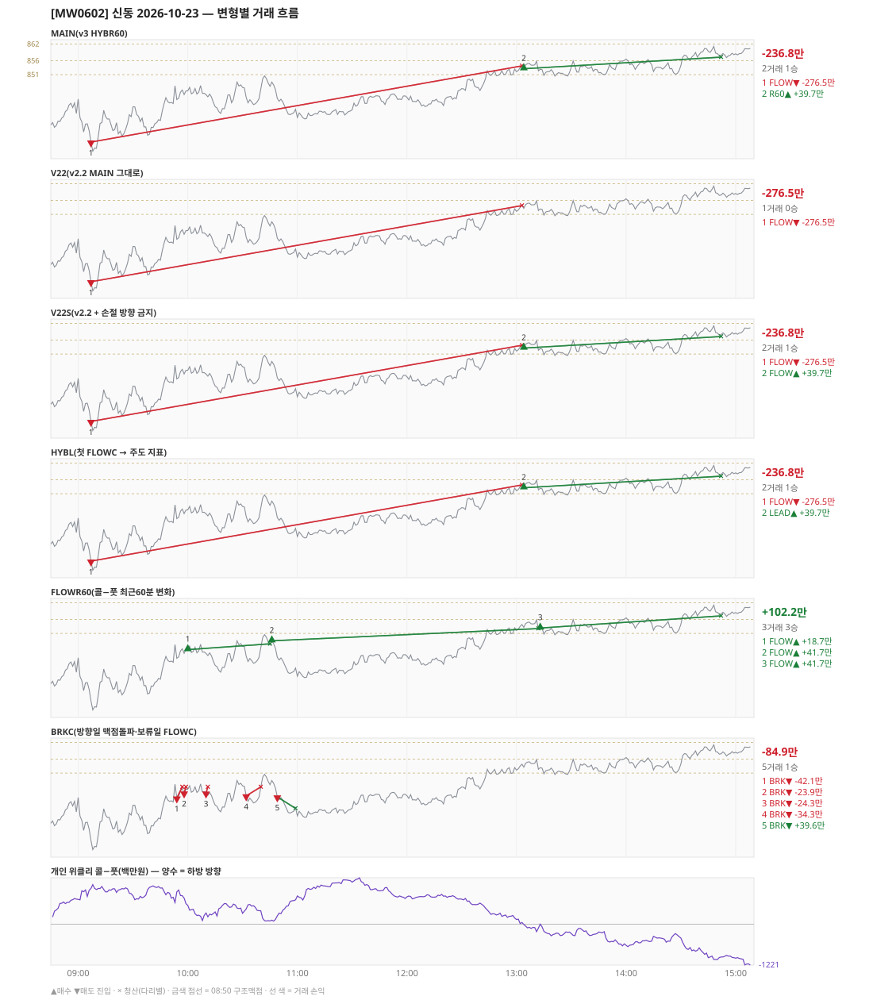

# [MW0602] 신동 일일 리포트 — 2026-10-23

> **MW0602 리포트** · 생성 2026-10-23 15:40 · 규격 `SD-2026-10-19-v3` · 상품 `wk_mon` (최근접 만기 월위클리 (만기 2026-10-26))
> **아래 변형 손익은 엔진 재생(가상)이다** — 장후 최종 흐름으로 하루를 다시 돌린 값. 미니선물 2계약 · CYBOS 요율 · 1틱 슬리피지 기준. **실제 체결 손익은 §2-1 실거래 대사.**

## 0. 한눈에

| 시장 | R1 장전 | R2 개장확정(V1) | R1 적중(09:00→15:05) |
|---|---|---|---|
| 842.22 → 860.38 (+18.16) · 고 861.30 · 저 823.00 · 폭 38.3pt | 콜−풋 +750 → **하방** | CONFIRMED 09:02 | ❌ 불적중 |

| 변형 | 거래 | 승 | 규칙별 | **순손익** | 최악 거래 | MAIN 대비 | 기록 |
|---|---|---|---|---|---|---|---|
| MAIN(v3 HYBR60) | 2 | 1 | FLOW -276.5만 · R60 +39.7만 | **-236.8만** | -276.5만 | — | 재생(장중 기록) |
| V22(v2.2 MAIN 그대로) | 1 | 0 | FLOW -276.5만 | **-276.5만** | -276.5만 | -39.7만 | 재생(장중 기록) |
| V22S(v2.2 + 손절 방향 금지) | 2 | 1 | FLOW -236.8만 | **-236.8만** | -276.5만 | +0.0만 | 재생(장중 기록) |
| HYBL(첫 FLOWC → 주도 지표) | 2 | 1 | FLOW -276.5만 · LEAD +39.7만 | **-236.8만** | -276.5만 | +0.0만 | 재생(장중 기록) |
| FLOWR60(콜−풋 최근60분 변화) | 3 | 3 | FLOW +102.2만 | **+102.2만** | +18.7만 | +339.0만 | 재생(장중 기록) |
| BRKC(방향일 맥점돌파·보류일 FLOWC) | 5 | 1 | BRK -84.9만 | **-84.9만** | -42.1만 | +151.9만 | 재생(장중 기록) |

**실거래(실제 체결)** — 2포지션 -368.7만 · 브로커 net -368.7만 · 재생 MAIN 과 차 -131.8만 → §2-1

**오늘의 한 줄** — MAIN -236.8만(2거래 1승), 최선은 FLOWR60(콜−풋 최근60분 변화) +102.2만(MAIN 대비 +339.0만).

## 1. 차트

## 2. 거래 흐름 — MAIN

| # | 규칙 | 방향 | 진입 | 맥점 | 손절 | 1차 · 최종 | 청산(다리별) | MFE | 손익 | 누적 |
|---|---|---|---|---|---|---|---|---|---|---|
| 1 | FLOW | 매도 | 09:07 826.70 (탐지 09:08) | - | 854.15 | 814.70 · 814.70 | 손절 13:03 854.15 · 손절 13:03 854.15 | 3.7 | **-276.5만** | -276.5만 |
| 2 | R60 | 매수 | 13:04 853.12 (탐지 13:05) | - | 825.67 | 865.12 · 865.12 | 트레일 14:52 857.30 · 트레일 14:52 857.30 | 8.2 | **+39.7만** | -236.8만 |

## 2-1. 실거래 대사 — 실제 체결 vs 재생 MAIN

| # | 구분 | 신호 | 실거래 | 재생 MAIN | 비고 |
|---|---|---|---|---|---|
| 1 | 일치 | `FLOW\|09:07\|-1` | 09:08 매도 3계약 @825.99 · -425.2만 | 09:07 매도 @826.70 · -276.5만 | 차 -148.6만 |
| 2 | 일치 | `R60\|13:04\|+1` | 13:05 매수 3계약 @853.37 · +56.5만 | 13:04 매수 @853.12 · +39.7만 | 차 +16.8만 |

| 구분 | 건 | 실거래 | 재생 MAIN |
|---|---|---|---|
| 일치 | 2 | -368.7만 | -236.8만 |
| **합** | | **-368.7만** | **-236.8만** |

- 브로커 실측 net(계좌 전체, `daily_broker_pnl` · -): **-368.7만** · 신동 실거래 합과 차 -81
- 재생은 장후 최종 흐름으로 다시 돌린 값이라, 장중에 나왔다가 정정으로 사라진 신호(철회)는 빠지고 보유 중·늦음으로 못 친 신호는 들어간다. **실거래 손익은 이 절의 「실거래」 열이다.**

## 3. 섀도 흐름 — 변형별 거래(v1 계열은 V1 과 무엇이 달랐나)

### V22(v2.2 MAIN 그대로) — -276.5만 (MAIN 대비 -39.7만)

- 별개 규칙(family) — MAIN·V1 과 거래 단위 대조는 하지 않는다. 손익·최악·거래 수로만 비교

| # | 규칙 | 방향 | 진입 | 맥점 | 손절 | 1차 · 최종 | 청산(다리별) | MFE | 손익 | 누적 |
|---|---|---|---|---|---|---|---|---|---|---|
| 1 | FLOW | 매도 | 09:07 826.70 (탐지 09:08) | - | 854.15 | 814.70 · 814.70 | 손절 13:03 854.15 · 손절 13:03 854.15 | 3.7 | **-276.5만** | -276.5만 |

### V22S(v2.2 + 손절 방향 금지) — -236.8만 (MAIN 대비 +0.0만)

- 별개 규칙(family) — MAIN·V1 과 거래 단위 대조는 하지 않는다. 손익·최악·거래 수로만 비교

| # | 규칙 | 방향 | 진입 | 맥점 | 손절 | 1차 · 최종 | 청산(다리별) | MFE | 손익 | 누적 |
|---|---|---|---|---|---|---|---|---|---|---|
| 1 | FLOW | 매도 | 09:07 826.70 (탐지 09:08) | - | 854.15 | 814.70 · 814.70 | 손절 13:03 854.15 · 손절 13:03 854.15 | 3.7 | **-276.5만** | -276.5만 |
| 2 | FLOW | 매수 | 13:04 853.12 (탐지 13:05) | - | 825.67 | 865.12 · 865.12 | 트레일 14:52 857.30 · 트레일 14:52 857.30 | 8.2 | **+39.7만** | -236.8만 |

### HYBL(첫 FLOWC → 주도 지표) — -236.8만 (MAIN 대비 +0.0만)

- 별개 규칙(family) — MAIN·V1 과 거래 단위 대조는 하지 않는다. 손익·최악·거래 수로만 비교

| # | 규칙 | 방향 | 진입 | 맥점 | 손절 | 1차 · 최종 | 청산(다리별) | MFE | 손익 | 누적 |
|---|---|---|---|---|---|---|---|---|---|---|
| 1 | FLOW | 매도 | 09:07 826.70 (탐지 09:08) | - | 854.15 | 814.70 · 814.70 | 손절 13:03 854.15 · 손절 13:03 854.15 | 3.7 | **-276.5만** | -276.5만 |
| 2 | LEAD | 매수 | 13:04 853.12 (탐지 13:05) | - | 825.67 | 865.12 · 865.12 | 트레일 14:52 857.30 · 트레일 14:52 857.30 | 8.2 | **+39.7만** | -236.8만 |

### FLOWR60(콜−풋 최근60분 변화) — +102.2만 (MAIN 대비 +339.0만)

- 별개 규칙(family) — MAIN·V1 과 거래 단위 대조는 하지 않는다. 손익·최악·거래 수로만 비교

| # | 규칙 | 방향 | 진입 | 맥점 | 손절 | 1차 · 최종 | 청산(다리별) | MFE | 손익 | 누적 |
|---|---|---|---|---|---|---|---|---|---|---|
| 1 | FLOW | 매수 | 10:00 845.16 (탐지 10:01) | - | 817.71 | 857.16 · 857.16 | 트레일 10:45 847.24 · 트레일 10:45 847.24 | 6.1 | **+18.7만** | +18.7만 |
| 2 | FLOW | 매수 | 10:46 848.34 (탐지 10:47) | - | 820.89 | 860.34 · 860.34 | 트레일 13:12 852.72 · 트레일 13:12 852.72 | 8.4 | **+41.7만** | +60.5만 |
| 3 | FLOW | 매수 | 13:13 852.92 (탐지 13:14) | - | 825.47 | 864.92 · 864.92 | 트레일 14:52 857.30 · 트레일 14:52 857.30 | 8.4 | **+41.7만** | +102.2만 |

### BRKC(방향일 맥점돌파·보류일 FLOWC) — -84.9만 (MAIN 대비 +151.9만)

- 별개 규칙(family) — MAIN·V1 과 거래 단위 대조는 하지 않는다. 손익·최악·거래 수로만 비교

| # | 규칙 | 방향 | 진입 | 맥점 | 손절 | 1차 · 최종 | 청산(다리별) | MFE | 손익 | 누적 |
|---|---|---|---|---|---|---|---|---|---|---|
| 1 | BRK | 매도 | 09:54 842.00 (탐지 09:55) | 844.0 | 846.00 | 834.00 · 834.00 | 손절 09:57 846.00 · 손절 09:57 846.00 | 1.3 | **-42.1만** | -42.1만 |
| 2 | BRK | 매도 | 09:58 843.82 (탐지 09:59) | 844.0 | 846.00 | 835.82 · 835.82 | 손절 09:59 846.00 · 손절 09:59 846.00 | 0.3 | **-23.9만** | -65.9만 |
| 3 | BRK | 매도 | 10:10 843.78 (탐지 10:11) | 844.0 | 846.00 | 835.78 · 835.78 | 손절 10:11 846.00 · 손절 10:11 846.00 | 1.0 | **-24.3만** | -90.2만 |
| 4 | BRK | 매도 | 10:32 842.78 (탐지 10:33) | 844.0 | 846.00 | 834.78 · 834.78 | 손절 10:40 846.00 · 손절 10:40 846.00 | 3.6 | **-34.3만** | -124.4만 |
| 5 | BRK | 매도 | 10:49 842.42 (탐지 10:50) | 844.0 | 846.00 | 834.42 · 834.42 | 트레일 10:59 838.26 · 트레일 10:59 838.26 | 7.2 | **+39.6만** | -84.9만 |

## 4. 누적 채점 (라이브 기록 · 판정 창)

| 변형 | 채점 시작 | 거래일 | 거래 | 승률 | 순손익 | 최악일 | R3 (건 · 승률 · 순) | 판정 |
|---|---|---|---|---|---|---|---|---|
| MAIN(v3 HYBR60) | 2026-10-19 | 5 | 14 | 86% | **+515.7만** | -236.8만 | 0 · - · +0.0만 | v3 vs V22 되돌림 판정 5/20일 |
| V22(v2.2 MAIN 그대로) | 2026-10-19 | 5 | 9 | 78% | **+177.8만** | -276.5만 | 0 · - · +0.0만 | 되돌림 기준 5/20일 |
| V22S(v2.2 + 손절 방향 금지) | 2026-10-19 | 5 | 10 | 80% | **+217.5만** | -236.8만 | 0 · - · +0.0만 | MAIN 비교 5/20일 |
| HYBL(첫 FLOWC → 주도 지표) | 2026-10-19 | 5 | 14 | 86% | **+515.7만** | -236.8만 | 0 · - · +0.0만 | MAIN 비교 5/20일 |
| FLOWR60(콜−풋 최근60분 변화) | 2026-10-19 | 5 | 14 | 86% | **+630.7만** | -1.1만 | 0 · - · +0.0만 | MAIN 비교 5/20일 |
| BRKC(방향일 맥점돌파·보류일 FLOWC) | 2026-10-19 | 5 | 25 | 28% | **-115.9만** | -90.1만 | 0 · - · +0.0만 | MAIN 비교 5/20일 |
| **실집행(실제 체결 · 참고)** | 2026-10-19 | 5 | 14 | 86% | **+175.2만** | -368.7만 | - | 판정 기준 아님 |

> 판정 전 집계다 — 인용·규격 변경 근거로 쓰지 말 것. 되돌림: V22 가 MAIN 보다 순손익·최악일 **둘 다** 나으면 v2.2 복귀. 섀도: MAIN 대비 순손익 우위 **그리고** 최악일 개선 → 채택 후보(자동 승격 없음).
> 「실집행」 = `trades.db` 신동 체결(포지션 단위, 거래일 = 체결이 있던 날). 재생에서 철회됐지만 실제로 친 거래가 **들어가고**, 보유 중·늦음·기각으로 못 친 재생 거래는 **빠진다**. 사전등록 판정은 위 재생 행으로만 한다.

## 5. 러너 섀도 — 미륵이 × 신동 (CREON 요율)

- 오늘 기록 없음 — 미륵이 시스템 진입이 없었거나 장후 기록 전이다

## 6. 개선 방향 (자동 관찰 — 판정 아님)

- **진입 품질** — MAIN 손실 1건 중 1건은 유리한 쪽으로 4pt 도 못 갔다(MFE 3.7). 청산을 바꿔서는 못 막는 손실이다 → 진입 조건(문턱 K·R1 방향) 쪽 관찰 대상.
- **탐지 지연** — 재생 진입 2건, 규칙가 대비 실현가능가 차 +0(음수 = 늦게 알아채 손해).
- **오늘 최선은 FLOWR60(콜−풋 최근60분 변화)** (+102.2만, MAIN 대비 +339.0만). 하루 결과다 — 판정은 사전등록 창(20거래일)으로만.
- **되돌림 대조** — V22(v2.2 MAIN 그대로) -276.5만 vs MAIN -236.8만 (차 +39.7만). 되돌림 판정은 20거래일 누적으로만.
- ⚠ 규격 변경은 사전등록 §6(새 버전 · 재채점)으로만. 이 절은 관찰이다.

---
재생성: `python scripts/shindong_daily_report.py 2026-10-23`
