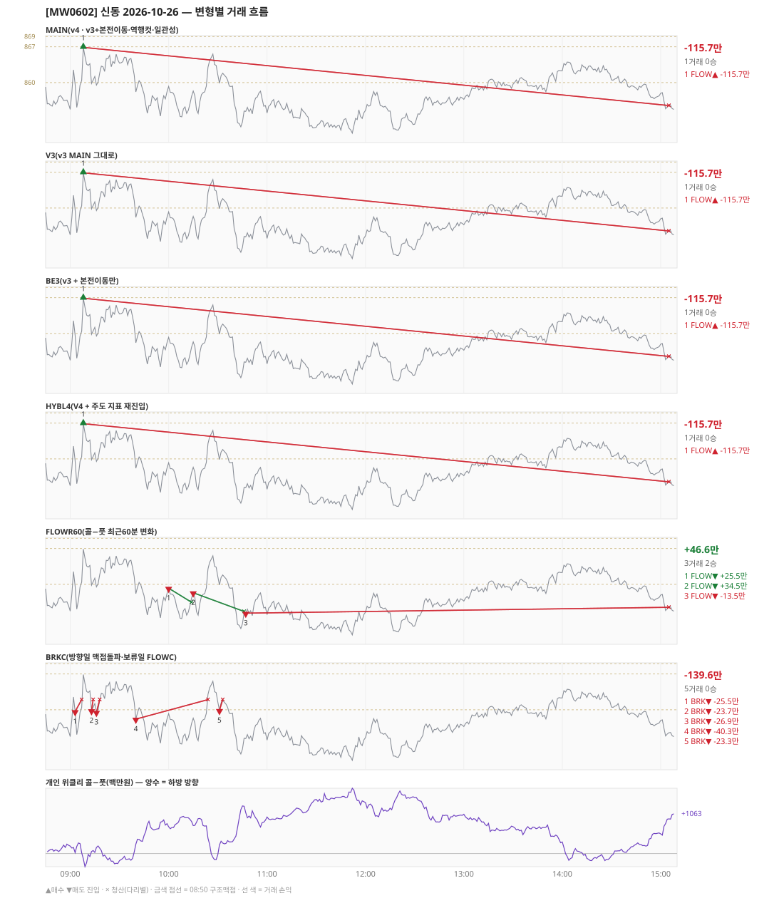

# [MW0602] 신동 일일 리포트 — 2026-10-26

> **MW0602 리포트** · 생성 2026-10-26 15:40 · 규격 `SD-2026-10-26-v4` · 상품 `wk_mon` (최근접 만기 월위클리 (만기 2026-10-26))
> **아래 변형 손익은 엔진 재생(가상)이다** — 장후 최종 흐름으로 하루를 다시 돌린 값. 미니선물 2계약 · CYBOS 요율 · 1틱 슬리피지 기준. **실제 체결 손익은 §2-1 실거래 대사.**

## 0. 한눈에

| 시장 | R1 장전 | R2 개장확정(V1) | R1 적중(09:00→15:05) |
|---|---|---|---|
| 854.78 → 855.52 (+0.74) · 고 868.06 · 저 849.42 · 폭 18.6pt | 콜−풋 +222 → **하방** | NONE | ❌ 불적중 |

| 변형 | 거래 | 승 | 규칙별 | **순손익** | 최악 거래 | MAIN 대비 | 기록 |
|---|---|---|---|---|---|---|---|
| MAIN(v4 · v3+본전이동·역행컷·일관성) | 1 | 0 | FLOW -115.7만 | **-115.7만** | -115.7만 | — | 재생(장중 기록) |
| V3(v3 MAIN 그대로) | 1 | 0 | FLOW -115.7만 | **-115.7만** | -115.7만 | +0.0만 | 재생(장중 기록) |
| BE3(v3 + 본전이동만) | 1 | 0 | FLOW -115.7만 | **-115.7만** | -115.7만 | +0.0만 | 재생(장중 기록) |
| HYBL4(V4 + 주도 지표 재진입) | 1 | 0 | FLOW -115.7만 | **-115.7만** | -115.7만 | +0.0만 | 재생(장중 기록) |
| FLOWR60(콜−풋 최근60분 변화) | 3 | 2 | FLOW +46.6만 | **+46.6만** | -13.5만 | +162.2만 | 재생(장중 기록) |
| BRKC(방향일 맥점돌파·보류일 FLOWC) | 5 | 0 | BRK -139.6만 | **-139.6만** | -40.3만 | -24.0만 | 재생(장중 기록) |

**실거래(실제 체결)** — 1포지션 -61.1만 · 브로커 net -61.1만 · 재생 MAIN 과 차 +54.6만 → §2-1

**오늘의 한 줄** — MAIN -115.7만(1거래 0승), 최선은 FLOWR60(콜−풋 최근60분 변화) +46.6만(MAIN 대비 +162.2만).

## 1. 차트

## 2. 거래 흐름 — MAIN

| # | 규칙 | 방향 | 진입 | 맥점 | 손절 | 1차 · 최종 | 청산(다리별) | MFE | 손익 | 누적 |
|---|---|---|---|---|---|---|---|---|---|---|
| 1 | FLOW | 매수 | 09:08 866.88 (탐지 09:09) | - | 839.33 | 878.88 · 878.88 | 시간 15:05 855.52 · 시간 15:05 855.52 | 0.9 | **-115.7만** | -115.7만 |

## 2-1. 실거래 대사 — 실제 체결 vs 재생 MAIN

| # | 구분 | 신호 | 실거래 | 재생 MAIN | 비고 |
|---|---|---|---|---|---|
| 1 | 일치 | `FLOW\|09:08\|+1` | 09:09 매수 1계약 @867.52 · -61.1만 | 09:08 매수 @866.88 · -115.7만 | 차 +54.6만 |

| 구분 | 건 | 실거래 | 재생 MAIN |
|---|---|---|---|
| 일치 | 1 | -61.1만 | -115.7만 |
| **합** | | **-61.1만** | **-115.7만** |

- 브로커 실측 net(계좌 전체, `daily_broker_pnl` · -): **-61.1만** · 신동 실거래 합과 차 +12
- [v4] 본전청산 실측 슬립: 오늘 본전청산 일치 거래 없음
- 재생은 장후 최종 흐름으로 다시 돌린 값이라, 장중에 나왔다가 정정으로 사라진 신호(철회)는 빠지고 보유 중·늦음으로 못 친 신호는 들어간다. **실거래 손익은 이 절의 「실거래」 열이다.**

## 3. 섀도 흐름 — 변형별 거래(v1 계열은 V1 과 무엇이 달랐나)

### V3(v3 MAIN 그대로) — -115.7만 (MAIN 대비 +0.0만)

- 별개 규칙(family) — MAIN·V1 과 거래 단위 대조는 하지 않는다. 손익·최악·거래 수로만 비교

| # | 규칙 | 방향 | 진입 | 맥점 | 손절 | 1차 · 최종 | 청산(다리별) | MFE | 손익 | 누적 |
|---|---|---|---|---|---|---|---|---|---|---|
| 1 | FLOW | 매수 | 09:08 866.88 (탐지 09:09) | - | 839.33 | 878.88 · 878.88 | 시간 15:05 855.52 · 시간 15:05 855.52 | 0.9 | **-115.7만** | -115.7만 |

### BE3(v3 + 본전이동만) — -115.7만 (MAIN 대비 +0.0만)

- 별개 규칙(family) — MAIN·V1 과 거래 단위 대조는 하지 않는다. 손익·최악·거래 수로만 비교

| # | 규칙 | 방향 | 진입 | 맥점 | 손절 | 1차 · 최종 | 청산(다리별) | MFE | 손익 | 누적 |
|---|---|---|---|---|---|---|---|---|---|---|
| 1 | FLOW | 매수 | 09:08 866.88 (탐지 09:09) | - | 839.33 | 878.88 · 878.88 | 시간 15:05 855.52 · 시간 15:05 855.52 | 0.9 | **-115.7만** | -115.7만 |

### HYBL4(V4 + 주도 지표 재진입) — -115.7만 (MAIN 대비 +0.0만)

- 별개 규칙(family) — MAIN·V1 과 거래 단위 대조는 하지 않는다. 손익·최악·거래 수로만 비교

| # | 규칙 | 방향 | 진입 | 맥점 | 손절 | 1차 · 최종 | 청산(다리별) | MFE | 손익 | 누적 |
|---|---|---|---|---|---|---|---|---|---|---|
| 1 | FLOW | 매수 | 09:08 866.88 (탐지 09:09) | - | 839.33 | 878.88 · 878.88 | 시간 15:05 855.52 · 시간 15:05 855.52 | 0.9 | **-115.7만** | -115.7만 |

### FLOWR60(콜−풋 최근60분 변화) — +46.6만 (MAIN 대비 +162.2만)

- 별개 규칙(family) — MAIN·V1 과 거래 단위 대조는 하지 않는다. 손익·최악·거래 수로만 비교

| # | 규칙 | 방향 | 진입 | 맥점 | 손절 | 1차 · 최종 | 청산(다리별) | MFE | 손익 | 누적 |
|---|---|---|---|---|---|---|---|---|---|---|
| 1 | FLOW | 매도 | 10:00 859.26 (탐지 10:01) | - | 886.81 | 847.26 · 847.26 | 트레일 10:14 856.50 · 트레일 10:14 856.50 | 6.8 | **+25.5만** | +25.5만 |
| 2 | FLOW | 매도 | 10:15 858.36 (탐지 10:16) | - | 885.91 | 846.36 · 846.36 | 트레일 10:46 854.70 · 트레일 10:46 854.70 | 7.7 | **+34.5만** | +60.0만 |
| 3 | FLOW | 매도 | 10:47 854.38 (탐지 10:48) | - | 881.93 | 842.38 · 842.38 | 시간 15:05 855.52 · 시간 15:05 855.52 | 5.0 | **-13.5만** | +46.6만 |

### BRKC(방향일 맥점돌파·보류일 FLOWC) — -139.6만 (MAIN 대비 -24.0만)

- 별개 규칙(family) — MAIN·V1 과 거래 단위 대조는 하지 않는다. 손익·최악·거래 수로만 비교

| # | 규칙 | 방향 | 진입 | 맥점 | 손절 | 1차 · 최종 | 청산(다리별) | MFE | 손익 | 누적 |
|---|---|---|---|---|---|---|---|---|---|---|
| 1 | BRK | 매도 | 09:03 859.66 (탐지 09:04) | 860.0 | 862.00 | 851.66 · 851.66 | 손절 09:07 862.00 · 손절 09:07 862.00 | 4.7 | **-25.5만** | -25.5만 |
| 2 | BRK | 매도 | 09:13 859.84 (탐지 09:14) | 860.0 | 862.00 | 851.84 · 851.84 | 손절 09:14 862.00 · 손절 09:14 862.00 | 0.1 | **-23.7만** | -49.2만 |
| 3 | BRK | 매도 | 09:16 859.52 (탐지 09:17) | 860.0 | 862.00 | 851.52 · 851.52 | 손절 09:18 862.00 · 손절 09:18 862.00 | 0.7 | **-26.9만** | -76.1만 |
| 4 | BRK | 매도 | 09:40 858.18 (탐지 09:41) | 860.0 | 862.00 | 850.18 · 850.18 | 손절 10:24 862.00 · 손절 10:24 862.00 | 5.7 | **-40.3만** | -116.4만 |
| 5 | BRK | 매도 | 10:31 859.88 (탐지 10:32) | 860.0 | 862.00 | 851.88 · 851.88 | 손절 10:33 862.00 · 손절 10:33 862.00 | 0.0 | **-23.3만** | -139.6만 |

## 4. 누적 채점 (라이브 기록 · 판정 창)

| 변형 | 채점 시작 | 거래일 | 거래 | 승률 | 순손익 | 최악일 | R3 (건 · 승률 · 순) | 판정 |
|---|---|---|---|---|---|---|---|---|
| MAIN(v4 · v3+본전이동·역행컷·일관성) | 2026-10-26 | 1 | 1 | 0% | **-115.7만** | -115.7만 | 0 · - · +0.0만 | v4 vs V3 되돌림 판정 1/20일 |
| V3(v3 MAIN 그대로) | 2026-10-26 | 1 | 1 | 0% | **-115.7만** | -115.7만 | 0 · - · +0.0만 | 되돌림 기준 1/20일 |
| BE3(v3 + 본전이동만) | 2026-10-26 | 1 | 1 | 0% | **-115.7만** | -115.7만 | 0 · - · +0.0만 | MAIN 비교 1/20일 |
| HYBL4(V4 + 주도 지표 재진입) | 2026-10-26 | 1 | 1 | 0% | **-115.7만** | -115.7만 | 0 · - · +0.0만 | MAIN 비교 1/20일 |
| FLOWR60(콜−풋 최근60분 변화) | 2026-10-26 | 1 | 3 | 67% | **+46.6만** | +46.6만 | 0 · - · +0.0만 | MAIN 비교 1/20일 |
| BRKC(방향일 맥점돌파·보류일 FLOWC) | 2026-10-26 | 1 | 5 | 0% | **-139.6만** | -139.6만 | 0 · - · +0.0만 | MAIN 비교 1/20일 |
| **실집행(실제 체결 · 참고)** | 2026-10-26 | 1 | 1 | 0% | **-61.1만** | -61.1만 | - | 판정 기준 아님 |

> 판정 전 집계다 — 인용·규격 변경 근거로 쓰지 말 것. 되돌림: V3 가 MAIN 보다 순손익·최악일 **둘 다** 나으면 v3 복귀. 섀도: MAIN 대비 순손익 우위 **그리고** 최악일 개선 → 채택 후보(자동 승격 없음).
> 「실집행」 = `trades.db` 신동 체결(포지션 단위, 거래일 = 체결이 있던 날). 재생에서 철회됐지만 실제로 친 거래가 **들어가고**, 보유 중·늦음·기각으로 못 친 재생 거래는 **빠진다**. 사전등록 판정은 위 재생 행으로만 한다.

## 5. 러너 섀도 — 미륵이 × 신동 (CREON 요율)

- 오늘 기록 없음 — 미륵이 시스템 진입이 없었거나 장후 기록 전이다

## 6. 개선 방향 (자동 관찰 — 판정 아님)

- **진입 품질** — MAIN 손실 1건 중 1건은 유리한 쪽으로 4pt 도 못 갔다(MFE 0.9). 청산을 바꿔서는 못 막는 손실이다 → 진입 조건(문턱 K·R1 방향) 쪽 관찰 대상.
- **탐지 지연** — 재생 진입 1건, 규칙가 대비 실현가능가 차 +0(음수 = 늦게 알아채 손해).
- **오늘 최선은 FLOWR60(콜−풋 최근60분 변화)** (+46.6만, MAIN 대비 +162.2만). 하루 결과다 — 판정은 사전등록 창(20거래일)으로만.
- **되돌림 대조** — V3(v3 MAIN 그대로) -115.7만 vs MAIN -115.7만 (차 +0.0만). 되돌림 판정은 20거래일 누적으로만.
- ⚠ 규격 변경은 사전등록 §6(새 버전 · 재채점)으로만. 이 절은 관찰이다.

---
재생성: `python scripts/shindong_daily_report.py 2026-10-26`
