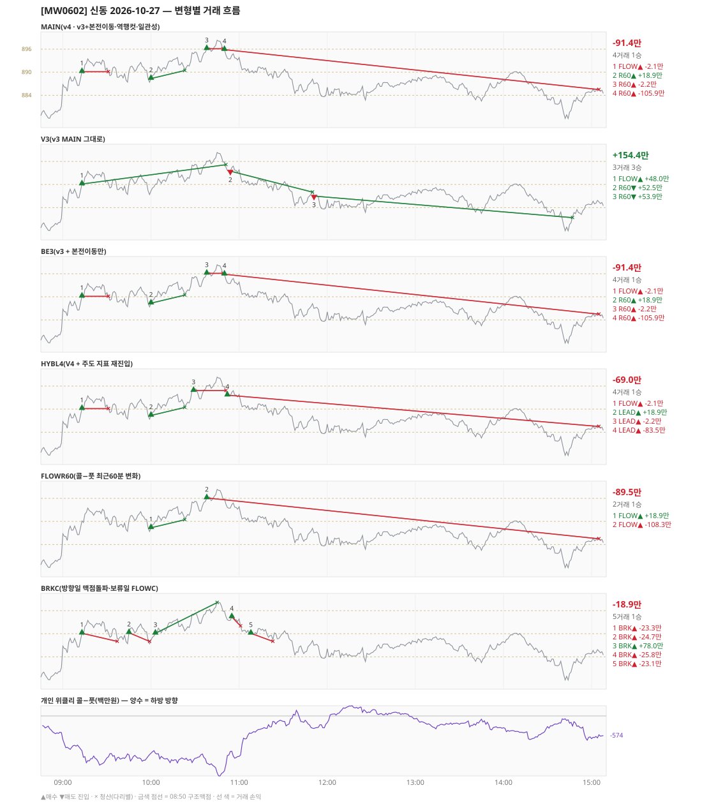

# [MW0602] 신동 일일 리포트 — 2026-10-27

> **MW0602 리포트** · 생성 2026-10-27 15:40 · 규격 `SD-2026-10-26-v4` · 상품 `wk_thu` (최근접 만기 목위클리 (만기 2026-10-29))
> **아래 변형 손익은 엔진 재생(가상)이다** — 장후 최종 흐름으로 하루를 다시 돌린 값. 미니선물 2계약 · CYBOS 요율 · 1틱 슬리피지 기준. **실제 체결 손익은 §2-1 실거래 대사.**

## 0. 한눈에

| 시장 | R1 장전 | R2 개장확정(V1) | R1 적중(09:00→15:05) |
|---|---|---|---|
| 886.78 → 885.48 (-1.30) · 고 899.14 · 저 877.38 · 폭 21.8pt | 콜−풋 -487 → **상방** | CONFIRMED 09:01 | ❌ 불적중 |

| 변형 | 거래 | 승 | 규칙별 | **순손익** | 최악 거래 | MAIN 대비 | 기록 |
|---|---|---|---|---|---|---|---|
| MAIN(v4 · v3+본전이동·역행컷·일관성) | 4 | 1 | FLOW -2.1만 · R60 -89.3만 | **-91.4만** | -105.9만 | — | 재생(장중 기록) |
| V3(v3 MAIN 그대로) | 3 | 3 | FLOW +48.0만 · R60 +106.3만 | **+154.4만** | +48.0만 | +245.8만 | 재생(장중 기록) |
| BE3(v3 + 본전이동만) | 4 | 1 | FLOW -2.1만 · R60 -89.3만 | **-91.4만** | -105.9만 | +0.0만 | 재생(장중 기록) |
| HYBL4(V4 + 주도 지표 재진입) | 4 | 1 | FLOW -2.1만 · LEAD -66.8만 | **-69.0만** | -83.5만 | +22.4만 | 재생(장중 기록) |
| FLOWR60(콜−풋 최근60분 변화) | 2 | 1 | FLOW -89.5만 | **-89.5만** | -108.3만 | +1.9만 | 재생(장중 기록) |
| BRKC(방향일 맥점돌파·보류일 FLOWC) | 5 | 1 | BRK -18.9만 | **-18.9만** | -25.8만 | +72.5만 | 재생(장중 기록) |

**실거래(실제 체결)** — 4포지션 -46.7만 · 브로커 net -46.7만 · 재생 MAIN 과 차 +44.7만 → §2-1

**오늘의 한 줄** — MAIN -91.4만(4거래 1승), 최선은 V3(v3 MAIN 그대로) +154.4만(MAIN 대비 +245.8만).

## 1. 차트

## 2. 거래 흐름 — MAIN

| # | 규칙 | 방향 | 진입 | 맥점 | 손절 | 1차 · 최종 | 청산(다리별) | MFE | 손익 | 누적 |
|---|---|---|---|---|---|---|---|---|---|---|
| 1 | FLOW | 매수 | 09:13 890.12 (탐지 09:14) | - | 862.43 | 902.12 · 902.12 | 본전 09:31 890.12 · 본전 09:31 890.12 | 4.2 | **-2.1만** | -2.1만 |
| 2 | R60 | 매수 | 10:00 888.34 (탐지 10:01) | - | 860.65 | 900.34 · 900.34 | 트레일 10:23 890.44 · 트레일 10:23 890.44 | 6.1 | **+18.9만** | +16.7만 |
| 3 | R60 | 매수 | 10:38 896.10 (탐지 10:39) | - | 868.41 | 908.10 · 908.10 | 본전 10:49 896.10 · 본전 10:49 896.10 | 3.0 | **-2.2만** | +14.6만 |
| 4 | R60 | 매수 | 10:50 895.86 (탐지 10:51) | - | 868.17 | 907.86 · 907.86 | 시간 15:05 885.48 · 시간 15:05 885.48 | -0.1 | **-105.9만** | -91.4만 |

## 2-1. 실거래 대사 — 실제 체결 vs 재생 MAIN

| # | 구분 | 신호 | 실거래 | 재생 MAIN | 비고 |
|---|---|---|---|---|---|
| 1 | 일치 | `FLOW\|09:13\|+1` | 09:14 매수 1계약 @889.42 · +3.7만 | 09:13 매수 @890.12 · -2.1만 | 차 +5.9만 |
| 2 | 일치 | `R60\|10:00\|+1` | 10:01 매수 1계약 @888.84 · +7.8만 | 10:00 매수 @888.34 · +18.9만 | 차 -11.0만 |
| 3 | 일치 | `R60\|10:38\|+1` | 10:39 매수 1계약 @895.96 · +0.2만 | 10:38 매수 @896.10 · -2.2만 | 차 +2.4만 |
| 4 | 일치 | `R60\|10:50\|+1` | 10:51 매수 1계약 @894.90 · -58.5만 | 10:50 매수 @895.86 · -105.9만 | 차 +47.5만 |

| 구분 | 건 | 실거래 | 재생 MAIN |
|---|---|---|---|
| 일치 | 4 | -46.7만 | -91.4만 |
| **합** | | **-46.7만** | **-91.4만** |

- 브로커 실측 net(계좌 전체, `daily_broker_pnl` · -): **-46.7만** · 신동 실거래 합과 차 +10
- [v4] 본전청산 실측 슬립(일치 2건, + = 불리): 평균 -0.01pt · 최악 +0.06pt — 되돌림 검토선 평균 0.8pt(누적 20건 이상, `scripts/shindong_v4_be_slip.py`)
- 재생은 장후 최종 흐름으로 다시 돌린 값이라, 장중에 나왔다가 정정으로 사라진 신호(철회)는 빠지고 보유 중·늦음으로 못 친 신호는 들어간다. **실거래 손익은 이 절의 「실거래」 열이다.**

## 3. 섀도 흐름 — 변형별 거래(v1 계열은 V1 과 무엇이 달랐나)

### V3(v3 MAIN 그대로) — +154.4만 (MAIN 대비 +245.8만)

- 별개 규칙(family) — MAIN·V1 과 거래 단위 대조는 하지 않는다. 손익·최악·거래 수로만 비교

| # | 규칙 | 방향 | 진입 | 맥점 | 손절 | 1차 · 최종 | 청산(다리별) | MFE | 손익 | 누적 |
|---|---|---|---|---|---|---|---|---|---|---|
| 1 | FLOW | 매수 | 09:13 890.12 (탐지 09:14) | - | 862.43 | 902.12 · 902.12 | 트레일 10:51 895.14 · 트레일 10:51 895.14 | 9.0 | **+48.0만** | +48.0만 |
| 2 | R60 | 매도 | 10:54 893.48 (탐지 10:55) | - | 921.17 | 881.48 · 881.48 | 트레일 11:50 888.02 · 트레일 11:50 888.02 | 9.5 | **+52.5만** | +100.5만 |
| 3 | R60 | 매도 | 11:51 886.98 (탐지 11:52) | - | 914.67 | 874.98 · 874.98 | 트레일 14:47 881.38 · 트레일 14:47 881.38 | 9.6 | **+53.9만** | +154.4만 |

### BE3(v3 + 본전이동만) — -91.4만 (MAIN 대비 +0.0만)

- 별개 규칙(family) — MAIN·V1 과 거래 단위 대조는 하지 않는다. 손익·최악·거래 수로만 비교

| # | 규칙 | 방향 | 진입 | 맥점 | 손절 | 1차 · 최종 | 청산(다리별) | MFE | 손익 | 누적 |
|---|---|---|---|---|---|---|---|---|---|---|
| 1 | FLOW | 매수 | 09:13 890.12 (탐지 09:14) | - | 862.43 | 902.12 · 902.12 | 본전 09:31 890.12 · 본전 09:31 890.12 | 4.2 | **-2.1만** | -2.1만 |
| 2 | R60 | 매수 | 10:00 888.34 (탐지 10:01) | - | 860.65 | 900.34 · 900.34 | 트레일 10:23 890.44 · 트레일 10:23 890.44 | 6.1 | **+18.9만** | +16.7만 |
| 3 | R60 | 매수 | 10:38 896.10 (탐지 10:39) | - | 868.41 | 908.10 · 908.10 | 본전 10:49 896.10 · 본전 10:49 896.10 | 3.0 | **-2.2만** | +14.6만 |
| 4 | R60 | 매수 | 10:50 895.86 (탐지 10:51) | - | 868.17 | 907.86 · 907.86 | 시간 15:05 885.48 · 시간 15:05 885.48 | -0.1 | **-105.9만** | -91.4만 |

### HYBL4(V4 + 주도 지표 재진입) — -69.0만 (MAIN 대비 +22.4만)

- 별개 규칙(family) — MAIN·V1 과 거래 단위 대조는 하지 않는다. 손익·최악·거래 수로만 비교

| # | 규칙 | 방향 | 진입 | 맥점 | 손절 | 1차 · 최종 | 청산(다리별) | MFE | 손익 | 누적 |
|---|---|---|---|---|---|---|---|---|---|---|
| 1 | FLOW | 매수 | 09:13 890.12 (탐지 09:14) | - | 862.43 | 902.12 · 902.12 | 본전 09:31 890.12 · 본전 09:31 890.12 | 4.2 | **-2.1만** | -2.1만 |
| 2 | LEAD | 매수 | 10:00 888.34 (탐지 10:01) | - | 860.65 | 900.34 · 900.34 | 트레일 10:23 890.44 · 트레일 10:23 890.44 | 6.1 | **+18.9만** | +16.7만 |
| 3 | LEAD | 매수 | 10:29 894.82 (탐지 10:30) | - | 867.13 | 906.82 · 906.82 | 본전 10:51 894.82 · 본전 10:51 894.82 | 4.3 | **-2.2만** | +14.6만 |
| 4 | LEAD | 매수 | 10:52 893.62 (탐지 10:53) | - | 865.93 | 905.62 · 905.62 | 시간 15:05 885.48 · 시간 15:05 885.48 | 1.6 | **-83.5만** | -69.0만 |

### FLOWR60(콜−풋 최근60분 변화) — -89.5만 (MAIN 대비 +1.9만)

- 별개 규칙(family) — MAIN·V1 과 거래 단위 대조는 하지 않는다. 손익·최악·거래 수로만 비교

| # | 규칙 | 방향 | 진입 | 맥점 | 손절 | 1차 · 최종 | 청산(다리별) | MFE | 손익 | 누적 |
|---|---|---|---|---|---|---|---|---|---|---|
| 1 | FLOW | 매수 | 10:00 888.34 (탐지 10:01) | - | 860.65 | 900.34 · 900.34 | 트레일 10:23 890.44 · 트레일 10:23 890.44 | 6.1 | **+18.9만** | +18.9만 |
| 2 | FLOW | 매수 | 10:38 896.10 (탐지 10:39) | - | 868.41 | 908.10 · 908.10 | 시간 15:05 885.48 · 시간 15:05 885.48 | 3.0 | **-108.3만** | -89.5만 |

### BRKC(방향일 맥점돌파·보류일 FLOWC) — -18.9만 (MAIN 대비 +72.5만)

- 별개 규칙(family) — MAIN·V1 과 거래 단위 대조는 하지 않는다. 손익·최악·거래 수로만 비교

| # | 규칙 | 방향 | 진입 | 맥점 | 손절 | 1차 · 최종 | 청산(다리별) | MFE | 손익 | 누적 |
|---|---|---|---|---|---|---|---|---|---|---|
| 1 | BRK | 매수 | 09:13 890.12 (탐지 09:14) | 890.0 | 888.00 | 898.12 · 898.12 | 손절 09:37 888.00 · 손절 09:37 888.00 | 4.2 | **-23.3만** | -23.3만 |
| 2 | BRK | 매수 | 09:45 890.26 (탐지 09:46) | 890.0 | 888.00 | 898.26 · 898.26 | 손절 09:59 888.00 · 손절 09:59 888.00 | 2.7 | **-24.7만** | -48.1만 |
| 3 | BRK | 매수 | 10:03 890.10 (탐지 10:04) | 890.0 | 888.00 | 898.10 · 898.10 | 1차 10:45 898.10 · 최종 10:45 898.10 | 8.5 | **+78.0만** | +30.0만 |
| 4 | BRK | 매수 | 10:55 894.36 (탐지 10:56) | 894.0 | 892.00 | 902.36 · 902.36 | 손절 11:01 892.00 · 손절 11:01 892.00 | 0.8 | **-25.8만** | +4.2만 |
| 5 | BRK | 매수 | 11:08 890.10 (탐지 11:09) | 890.0 | 888.00 | 898.10 · 898.10 | 손절 11:23 888.00 · 손절 11:23 888.00 | 2.1 | **-23.1만** | -18.9만 |

## 4. 누적 채점 (라이브 기록 · 판정 창)

| 변형 | 채점 시작 | 거래일 | 거래 | 승률 | 순손익 | 최악일 | R3 (건 · 승률 · 순) | 판정 |
|---|---|---|---|---|---|---|---|---|
| MAIN(v4 · v3+본전이동·역행컷·일관성) | 2026-10-26 | 2 | 5 | 20% | **-207.1만** | -115.7만 | 0 · - · +0.0만 | v4 vs V3 되돌림 판정 2/20일 |
| V3(v3 MAIN 그대로) | 2026-10-26 | 2 | 4 | 75% | **+38.7만** | -115.7만 | 0 · - · +0.0만 | 되돌림 기준 2/20일 |
| BE3(v3 + 본전이동만) | 2026-10-26 | 2 | 5 | 20% | **-207.1만** | -115.7만 | 0 · - · +0.0만 | MAIN 비교 2/20일 |
| HYBL4(V4 + 주도 지표 재진입) | 2026-10-26 | 2 | 5 | 20% | **-184.7만** | -115.7만 | 0 · - · +0.0만 | MAIN 비교 2/20일 |
| FLOWR60(콜−풋 최근60분 변화) | 2026-10-26 | 2 | 5 | 60% | **-42.9만** | -89.5만 | 0 · - · +0.0만 | MAIN 비교 2/20일 |
| BRKC(방향일 맥점돌파·보류일 FLOWC) | 2026-10-26 | 2 | 10 | 10% | **-158.6만** | -139.6만 | 0 · - · +0.0만 | MAIN 비교 2/20일 |
| **실집행(실제 체결 · 참고)** | 2026-10-26 | 2 | 5 | 60% | **-107.7만** | -61.1만 | - | 판정 기준 아님 |

> 판정 전 집계다 — 인용·규격 변경 근거로 쓰지 말 것. 되돌림: V3 가 MAIN 보다 순손익·최악일 **둘 다** 나으면 v3 복귀. 섀도: MAIN 대비 순손익 우위 **그리고** 최악일 개선 → 채택 후보(자동 승격 없음).
> 「실집행」 = `trades.db` 신동 체결(포지션 단위, 거래일 = 체결이 있던 날). 재생에서 철회됐지만 실제로 친 거래가 **들어가고**, 보유 중·늦음·기각으로 못 친 재생 거래는 **빠진다**. 사전등록 판정은 위 재생 행으로만 한다.

## 5. 러너 섀도 — 미륵이 × 신동 (CREON 요율)

- 오늘 기록 없음 — 미륵이 시스템 진입이 없었거나 장후 기록 전이다

## 6. 개선 방향 (자동 관찰 — 판정 아님)

- **진입 품질** — MAIN 손실 3건 중 2건은 유리한 쪽으로 4pt 도 못 갔다(MFE 3.0, -0.1). 청산을 바꿔서는 못 막는 손실이다 → 진입 조건(문턱 K·R1 방향) 쪽 관찰 대상.
- **청산** — MAIN 손실 1건은 4pt 이상 유리하게 갔다가 손절됐다(MFE 4.2) → 트레일 발동·거리 쪽 관찰 대상.
- **탐지 지연** — 재생 진입 4건, 규칙가 대비 실현가능가 차 +0(음수 = 늦게 알아채 손해).
- **오늘 최선은 V3(v3 MAIN 그대로)** (+154.4만, MAIN 대비 +245.8만). 하루 결과다 — 판정은 사전등록 창(20거래일)으로만.
- **되돌림 대조** — V3(v3 MAIN 그대로) +154.4만 vs MAIN -91.4만 (차 -245.8만). 되돌림 판정은 20거래일 누적으로만.
- ⚠ 규격 변경은 사전등록 §6(새 버전 · 재채점)으로만. 이 절은 관찰이다.

---
재생성: `python scripts/shindong_daily_report.py 2026-10-27`
