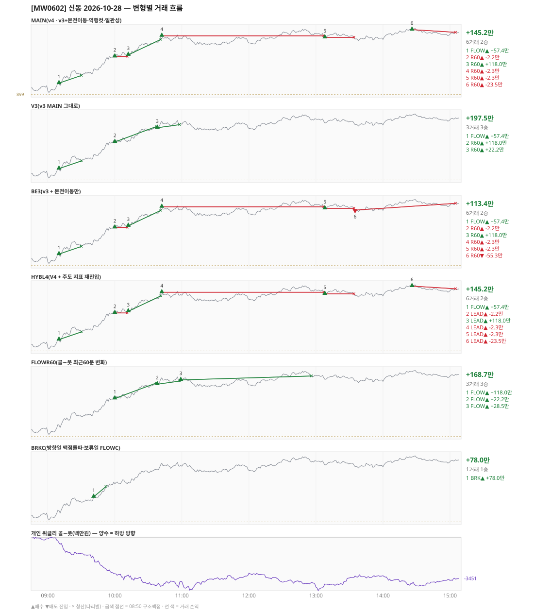

# [MW0602] 신동 일일 리포트 — 2026-10-28

> **MW0602 리포트** · 생성 2026-10-28 15:40 · 규격 `SD-2026-10-26-v4` · 상품 `wk_thu` (최근접 만기 목위클리 (만기 2026-10-29))
> **아래 변형 손익은 엔진 재생(가상)이다** — 장후 최종 흐름으로 하루를 다시 돌린 값. 미니선물 2계약 · CYBOS 요율 · 1틱 슬리피지 기준. **실제 체결 손익은 §2-1 실거래 대사.**

## 0. 한눈에

| 시장 | R1 장전 | R2 개장확정(V1) | R1 적중(09:00→15:05) |
|---|---|---|---|
| 901.70 → 947.50 (+45.80) · 고 950.74 · 저 899.94 · 폭 50.8pt | 콜−풋 -135 → **상방** | NONE | ✅ 적중 |

| 변형 | 거래 | 승 | 규칙별 | **순손익** | 최악 거래 | MAIN 대비 | 기록 |
|---|---|---|---|---|---|---|---|
| MAIN(v4 · v3+본전이동·역행컷·일관성) | 6 | 2 | FLOW +57.4만 · R60 +87.8만 | **+145.2만** | -23.5만 | — | 재생(장중 기록) |
| V3(v3 MAIN 그대로) | 3 | 3 | FLOW +57.4만 · R60 +140.1만 | **+197.5만** | +22.2만 | +52.3만 | 재생(장중 기록) |
| BE3(v3 + 본전이동만) | 6 | 2 | FLOW +57.4만 · R60 +56.0만 | **+113.4만** | -55.3만 | -31.8만 | 재생(장중 기록) |
| HYBL4(V4 + 주도 지표 재진입) | 6 | 2 | FLOW +57.4만 · LEAD +87.8만 | **+145.2만** | -23.5만 | +0.0만 | 재생(장중 기록) |
| FLOWR60(콜−풋 최근60분 변화) | 3 | 3 | FLOW +168.7만 | **+168.7만** | +22.2만 | +23.5만 | 재생(장중 기록) |
| BRKC(방향일 맥점돌파·보류일 FLOWC) | 1 | 1 | BRK +78.0만 | **+78.0만** | +78.0만 | -67.2만 | 재생(장중 기록) |

**실거래(실제 체결)** — 6포지션 +85.8만 · 브로커 net +85.8만 · 재생 MAIN 과 차 -59.4만 → §2-1

**오늘의 한 줄** — MAIN +145.2만(6거래 2승), 최선은 V3(v3 MAIN 그대로) +197.5만(MAIN 대비 +52.3만).

## 1. 차트

## 2. 거래 흐름 — MAIN

| # | 규칙 | 방향 | 진입 | 맥점 | 손절 | 1차 · 최종 | 청산(다리별) | MFE | 손익 | 누적 |
|---|---|---|---|---|---|---|---|---|---|---|
| 1 | FLOW | 매수 | 09:10 907.84 (탐지 09:11) | - | 879.57 | 919.84 · 919.84 | 트레일 09:30 913.80 · 트레일 09:30 913.80 | 10.0 | **+57.4만** | +57.4만 |
| 2 | R60 | 매수 | 10:00 928.64 (탐지 10:01) | - | 900.37 | 940.64 · 940.64 | 본전 10:11 928.64 · 본전 10:11 928.64 | 3.9 | **-2.2만** | +55.2만 |
| 3 | R60 | 매수 | 10:12 929.92 (탐지 10:13) | - | 901.65 | 941.92 · 941.92 | 1차 10:41 941.92 · 최종 10:41 941.92 | 13.9 | **+118.0만** | +173.2만 |
| 4 | R60 | 매수 | 10:42 944.80 (탐지 10:43) | - | 916.53 | 956.80 · 956.80 | 본전 13:07 944.80 · 본전 13:07 944.80 | 5.4 | **-2.3만** | +170.9만 |
| 5 | R60 | 매수 | 13:08 943.56 (탐지 13:09) | - | 915.29 | 955.56 · 955.56 | 본전 13:34 943.56 · 본전 13:34 943.56 | 4.0 | **-2.3만** | +168.6만 |
| 6 | R60 | 매수 | 14:26 949.62 (탐지 14:27) | - | 921.35 | 961.62 · 961.62 | 시간 15:05 947.50 · 시간 15:05 947.50 | 1.1 | **-23.5만** | +145.2만 |

## 2-1. 실거래 대사 — 실제 체결 vs 재생 MAIN

| # | 구분 | 신호 | 실거래 | 재생 MAIN | 비고 |
|---|---|---|---|---|---|
| 1 | 일치 | `FLOW\|09:10\|+1` | 09:11 매수 1계약 @908.22 · +28.1만 | 09:10 매수 @907.84 · +57.4만 | 차 -29.3만 |
| 2 | 일치 | `R60\|10:00\|+1` | 10:01 매수 1계약 @929.18 · +4.9만 | 10:00 매수 @928.64 · -2.2만 | 차 +7.1만 |
| 3 | 일치 | `R60\|10:12\|+1` | 10:13 매수 1계약 @929.86 · +59.8만 | 10:12 매수 @929.92 · +118.0만 | 차 -58.1만 |
| 4 | 일치 | `R60\|10:42\|+1` | 10:43 매수 1계약 @944.34 · +2.2만 | 10:42 매수 @944.80 · -2.3만 | 차 +4.5만 |
| 5 | 일치 | `R60\|13:08\|+1` | 13:09 매수 1계약 @943.70 · -0.9만 | 13:08 매수 @943.56 · -2.3만 | 차 +1.4만 |
| 6 | 일치 | `R60\|14:26\|+1` | 14:27 매수 1계약 @949.46 · -8.4만 | 14:26 매수 @949.62 · -23.5만 | 차 +15.1만 |

| 구분 | 건 | 실거래 | 재생 MAIN |
|---|---|---|---|
| 일치 | 6 | +85.8만 | +145.2만 |
| **합** | | **+85.8만** | **+145.2만** |

- 브로커 실측 net(계좌 전체, `daily_broker_pnl` · -): **+85.8만** · 신동 실거래 합과 차 -16
- [v4] 본전청산 실측 슬립(일치 3건, + = 불리): 평균 -0.53pt · 최악 +0.00pt — 되돌림 검토선 평균 0.8pt(누적 20건 이상, `scripts/shindong_v4_be_slip.py`)
- 재생은 장후 최종 흐름으로 다시 돌린 값이라, 장중에 나왔다가 정정으로 사라진 신호(철회)는 빠지고 보유 중·늦음으로 못 친 신호는 들어간다. **실거래 손익은 이 절의 「실거래」 열이다.**

## 3. 섀도 흐름 — 변형별 거래(v1 계열은 V1 과 무엇이 달랐나)

### V3(v3 MAIN 그대로) — +197.5만 (MAIN 대비 +52.3만)

- 별개 규칙(family) — MAIN·V1 과 거래 단위 대조는 하지 않는다. 손익·최악·거래 수로만 비교

| # | 규칙 | 방향 | 진입 | 맥점 | 손절 | 1차 · 최종 | 청산(다리별) | MFE | 손익 | 누적 |
|---|---|---|---|---|---|---|---|---|---|---|
| 1 | FLOW | 매수 | 09:10 907.84 (탐지 09:11) | - | 879.57 | 919.84 · 919.84 | 트레일 09:30 913.80 · 트레일 09:30 913.80 | 10.0 | **+57.4만** | +57.4만 |
| 2 | R60 | 매수 | 10:00 928.64 (탐지 10:01) | - | 900.37 | 940.64 · 940.64 | 1차 10:37 940.64 · 최종 10:37 940.64 | 12.0 | **+118.0만** | +175.4만 |
| 3 | R60 | 매수 | 10:38 939.74 (탐지 10:39) | - | 911.47 | 951.74 · 951.74 | 트레일 10:58 942.18 · 트레일 10:58 942.18 | 6.4 | **+22.2만** | +197.5만 |

### BE3(v3 + 본전이동만) — +113.4만 (MAIN 대비 -31.8만)

- 별개 규칙(family) — MAIN·V1 과 거래 단위 대조는 하지 않는다. 손익·최악·거래 수로만 비교

| # | 규칙 | 방향 | 진입 | 맥점 | 손절 | 1차 · 최종 | 청산(다리별) | MFE | 손익 | 누적 |
|---|---|---|---|---|---|---|---|---|---|---|
| 1 | FLOW | 매수 | 09:10 907.84 (탐지 09:11) | - | 879.57 | 919.84 · 919.84 | 트레일 09:30 913.80 · 트레일 09:30 913.80 | 10.0 | **+57.4만** | +57.4만 |
| 2 | R60 | 매수 | 10:00 928.64 (탐지 10:01) | - | 900.37 | 940.64 · 940.64 | 본전 10:11 928.64 · 본전 10:11 928.64 | 3.9 | **-2.2만** | +55.2만 |
| 3 | R60 | 매수 | 10:12 929.92 (탐지 10:13) | - | 901.65 | 941.92 · 941.92 | 1차 10:41 941.92 · 최종 10:41 941.92 | 13.9 | **+118.0만** | +173.2만 |
| 4 | R60 | 매수 | 10:42 944.80 (탐지 10:43) | - | 916.53 | 956.80 · 956.80 | 본전 13:07 944.80 · 본전 13:07 944.80 | 5.4 | **-2.3만** | +170.9만 |
| 5 | R60 | 매수 | 13:08 943.56 (탐지 13:09) | - | 915.29 | 955.56 · 955.56 | 본전 13:34 943.56 · 본전 13:34 943.56 | 4.0 | **-2.3만** | +168.6만 |
| 6 | R60 | 매도 | 13:35 942.20 (탐지 13:36) | - | 970.47 | 930.20 · 930.20 | 시간 15:05 947.50 · 시간 15:05 947.50 | 1.6 | **-55.3만** | +113.4만 |

### HYBL4(V4 + 주도 지표 재진입) — +145.2만 (MAIN 대비 +0.0만)

- 별개 규칙(family) — MAIN·V1 과 거래 단위 대조는 하지 않는다. 손익·최악·거래 수로만 비교

| # | 규칙 | 방향 | 진입 | 맥점 | 손절 | 1차 · 최종 | 청산(다리별) | MFE | 손익 | 누적 |
|---|---|---|---|---|---|---|---|---|---|---|
| 1 | FLOW | 매수 | 09:10 907.84 (탐지 09:11) | - | 879.57 | 919.84 · 919.84 | 트레일 09:30 913.80 · 트레일 09:30 913.80 | 10.0 | **+57.4만** | +57.4만 |
| 2 | LEAD | 매수 | 10:00 928.64 (탐지 10:01) | - | 900.37 | 940.64 · 940.64 | 본전 10:11 928.64 · 본전 10:11 928.64 | 3.9 | **-2.2만** | +55.2만 |
| 3 | LEAD | 매수 | 10:12 929.92 (탐지 10:13) | - | 901.65 | 941.92 · 941.92 | 1차 10:41 941.92 · 최종 10:41 941.92 | 13.9 | **+118.0만** | +173.2만 |
| 4 | LEAD | 매수 | 10:42 944.80 (탐지 10:43) | - | 916.53 | 956.80 · 956.80 | 본전 13:07 944.80 · 본전 13:07 944.80 | 5.4 | **-2.3만** | +170.9만 |
| 5 | LEAD | 매수 | 13:08 943.56 (탐지 13:09) | - | 915.29 | 955.56 · 955.56 | 본전 13:34 943.56 · 본전 13:34 943.56 | 4.0 | **-2.3만** | +168.6만 |
| 6 | LEAD | 매수 | 14:26 949.62 (탐지 14:27) | - | 921.35 | 961.62 · 961.62 | 시간 15:05 947.50 · 시간 15:05 947.50 | 1.1 | **-23.5만** | +145.2만 |

### FLOWR60(콜−풋 최근60분 변화) — +168.7만 (MAIN 대비 +23.5만)

- 별개 규칙(family) — MAIN·V1 과 거래 단위 대조는 하지 않는다. 손익·최악·거래 수로만 비교

| # | 규칙 | 방향 | 진입 | 맥점 | 손절 | 1차 · 최종 | 청산(다리별) | MFE | 손익 | 누적 |
|---|---|---|---|---|---|---|---|---|---|---|
| 1 | FLOW | 매수 | 10:00 928.64 (탐지 10:01) | - | 900.37 | 940.64 · 940.64 | 1차 10:37 940.64 · 최종 10:37 940.64 | 12.0 | **+118.0만** | +118.0만 |
| 2 | FLOW | 매수 | 10:38 939.74 (탐지 10:39) | - | 911.47 | 951.74 · 951.74 | 트레일 10:58 942.18 · 트레일 10:58 942.18 | 6.4 | **+22.2만** | +140.1만 |
| 3 | FLOW | 매수 | 10:59 943.08 (탐지 11:00) | - | 914.81 | 955.08 · 955.08 | 트레일 12:56 946.16 · 트레일 12:56 946.16 | 7.1 | **+28.5만** | +168.7만 |

### BRKC(방향일 맥점돌파·보류일 FLOWC) — +78.0만 (MAIN 대비 -67.2만)

- 별개 규칙(family) — MAIN·V1 과 거래 단위 대조는 하지 않는다. 손익·최악·거래 수로만 비교

| # | 규칙 | 방향 | 진입 | 맥점 | 손절 | 1차 · 최종 | 청산(다리별) | MFE | 손익 | 누적 |
|---|---|---|---|---|---|---|---|---|---|---|
| 1 | BRK | 매수 | 09:41 918.56 (탐지 09:42) | 918.0 | 916.00 | 926.56 · 926.56 | 1차 09:52 926.56 · 최종 09:52 926.56 | 8.1 | **+78.0만** | +78.0만 |

## 4. 누적 채점 (라이브 기록 · 판정 창)

| 변형 | 채점 시작 | 거래일 | 거래 | 승률 | 순손익 | 최악일 | R3 (건 · 승률 · 순) | 판정 |
|---|---|---|---|---|---|---|---|---|
| MAIN(v4 · v3+본전이동·역행컷·일관성) | 2026-10-26 | 3 | 11 | 27% | **-61.9만** | -115.7만 | 0 · - · +0.0만 | v4 vs V3 되돌림 판정 3/20일 |
| V3(v3 MAIN 그대로) | 2026-10-26 | 3 | 7 | 86% | **+236.2만** | -115.7만 | 0 · - · +0.0만 | 되돌림 기준 3/20일 |
| BE3(v3 + 본전이동만) | 2026-10-26 | 3 | 11 | 27% | **-93.7만** | -115.7만 | 0 · - · +0.0만 | MAIN 비교 3/20일 |
| HYBL4(V4 + 주도 지표 재진입) | 2026-10-26 | 3 | 11 | 27% | **-39.5만** | -115.7만 | 0 · - · +0.0만 | MAIN 비교 3/20일 |
| FLOWR60(콜−풋 최근60분 변화) | 2026-10-26 | 3 | 8 | 75% | **+125.7만** | -89.5만 | 0 · - · +0.0만 | MAIN 비교 3/20일 |
| BRKC(방향일 맥점돌파·보류일 FLOWC) | 2026-10-26 | 3 | 11 | 18% | **-80.6만** | -139.6만 | 0 · - · +0.0만 | MAIN 비교 3/20일 |
| **실집행(실제 체결 · 참고)** | 2026-10-26 | 3 | 11 | 64% | **-21.9만** | -61.1만 | - | 판정 기준 아님 |

> 판정 전 집계다 — 인용·규격 변경 근거로 쓰지 말 것. 되돌림: V3 가 MAIN 보다 순손익·최악일 **둘 다** 나으면 v3 복귀. 섀도: MAIN 대비 순손익 우위 **그리고** 최악일 개선 → 채택 후보(자동 승격 없음).
> 「실집행」 = `trades.db` 신동 체결(포지션 단위, 거래일 = 체결이 있던 날). 재생에서 철회됐지만 실제로 친 거래가 **들어가고**, 보유 중·늦음·기각으로 못 친 재생 거래는 **빠진다**. 사전등록 판정은 위 재생 행으로만 한다.

## 5. 러너 섀도 — 미륵이 × 신동 (CREON 요율)

- 오늘 기록 없음 — 미륵이 시스템 진입이 없었거나 장후 기록 전이다

## 6. 개선 방향 (자동 관찰 — 판정 아님)

- **진입 품질** — MAIN 손실 4건 중 2건은 유리한 쪽으로 4pt 도 못 갔다(MFE 3.9, 1.1). 청산을 바꿔서는 못 막는 손실이다 → 진입 조건(문턱 K·R1 방향) 쪽 관찰 대상.
- **청산** — MAIN 손실 2건은 4pt 이상 유리하게 갔다가 손절됐다(MFE 5.4, 4.0) → 트레일 발동·거리 쪽 관찰 대상.
- **탐지 지연** — 재생 진입 6건, 규칙가 대비 실현가능가 차 +0(음수 = 늦게 알아채 손해).
- **오늘 최선은 V3(v3 MAIN 그대로)** (+197.5만, MAIN 대비 +52.3만). 하루 결과다 — 판정은 사전등록 창(20거래일)으로만.
- **되돌림 대조** — V3(v3 MAIN 그대로) +197.5만 vs MAIN +145.2만 (차 -52.3만). 되돌림 판정은 20거래일 누적으로만.
- ⚠ 규격 변경은 사전등록 §6(새 버전 · 재채점)으로만. 이 절은 관찰이다.

---
재생성: `python scripts/shindong_daily_report.py 2026-10-28`
