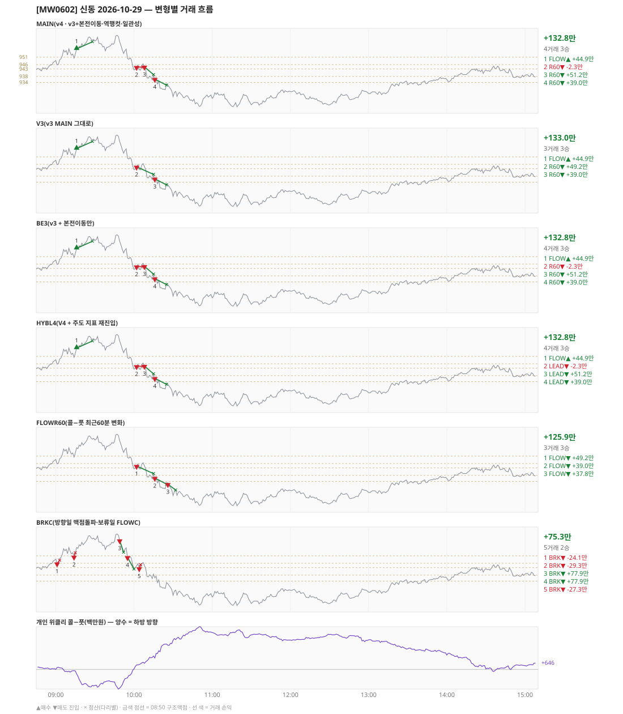

# [MW0602] 신동 일일 리포트 — 2026-10-29

> **MW0602 리포트** · 생성 2026-10-29 15:40 · 규격 `SD-2026-10-26-v4` · 상품 `wk_thu` (최근접 만기 목위클리 (만기 2026-10-29))
> **아래 변형 손익은 엔진 재생(가상)이다** — 장후 최종 흐름으로 하루를 다시 돌린 값. 미니선물 2계약 · CYBOS 요율 · 1틱 슬리피지 기준. **실제 체결 손익은 §2-1 실거래 대사.**

## 0. 한눈에

| 시장 | R1 장전 | R2 개장확정(V1) | R1 적중(09:00→15:05) |
|---|---|---|---|
| 948.74 → 939.96 (-8.78) · 고 967.40 · 저 916.18 · 폭 51.2pt | 콜−풋 +68 → **하방** | CONFIRMED 09:01 | ✅ 적중 |

| 변형 | 거래 | 승 | 규칙별 | **순손익** | 최악 거래 | MAIN 대비 | 기록 |
|---|---|---|---|---|---|---|---|
| MAIN(v4 · v3+본전이동·역행컷·일관성) | 4 | 3 | FLOW +44.9만 · R60 +87.9만 | **+132.8만** | -2.3만 | — | 재생(장중 기록) |
| V3(v3 MAIN 그대로) | 3 | 3 | FLOW +44.9만 · R60 +88.1만 | **+133.0만** | +39.0만 | +0.3만 | 재생(장중 기록) |
| BE3(v3 + 본전이동만) | 4 | 3 | FLOW +44.9만 · R60 +87.9만 | **+132.8만** | -2.3만 | +0.0만 | 재생(장중 기록) |
| HYBL4(V4 + 주도 지표 재진입) | 4 | 3 | FLOW +44.9만 · LEAD +87.9만 | **+132.8만** | -2.3만 | +0.0만 | 재생(장중 기록) |
| FLOWR60(콜−풋 최근60분 변화) | 3 | 3 | FLOW +125.9만 | **+125.9만** | +37.8만 | -6.9만 | 재생(장중 기록) |
| BRKC(방향일 맥점돌파·보류일 FLOWC) | 5 | 2 | BRK +75.3만 | **+75.3만** | -29.3만 | -57.5만 | 재생(장중 기록) |

**실거래(실제 체결)** — 4포지션 +50.3만 · 브로커 net +50.3만 · 재생 MAIN 과 차 -82.5만 → §2-1

**오늘의 한 줄** — MAIN +132.8만(4거래 3승), 최선은 V3(v3 MAIN 그대로) +133.0만(MAIN 대비 +0.3만).

## 1. 차트

## 2. 거래 흐름 — MAIN

| # | 규칙 | 방향 | 진입 | 맥점 | 손절 | 1차 · 최종 | 청산(다리별) | MFE | 손익 | 누적 |
|---|---|---|---|---|---|---|---|---|---|---|
| 1 | FLOW | 매수 | 09:16 956.64 (탐지 09:17) | - | 926.77 | 968.64 · 968.64 | 트레일 09:28 961.36 · 트레일 09:28 961.36 | 8.7 | **+44.9만** | +44.9만 |
| 2 | R60 | 매도 | 10:02 944.32 (탐지 10:03) | - | 974.19 | 932.32 · 932.32 | 본전 10:07 944.32 · 본전 10:07 944.32 | 4.1 | **-2.3만** | +42.7만 |
| 3 | R60 | 매도 | 10:08 944.52 (탐지 10:09) | - | 974.39 | 932.52 · 932.52 | 트레일 10:15 939.18 · 트레일 10:15 939.18 | 9.9 | **+51.2만** | +93.8만 |
| 4 | R60 | 매도 | 10:16 936.20 (탐지 10:17) | - | 966.07 | 924.20 · 924.20 | 트레일 10:25 932.08 · 트레일 10:25 932.08 | 8.1 | **+39.0만** | +132.8만 |

## 2-1. 실거래 대사 — 실제 체결 vs 재생 MAIN

| # | 구분 | 신호 | 실거래 | 재생 MAIN | 비고 |
|---|---|---|---|---|---|
| 1 | 일치 | `FLOW\|09:16\|+1` | 09:17 매수 1계약 @956.16 · +24.3만 | 09:16 매수 @956.64 · +44.9만 | 차 -20.6만 |
| 2 | 일치 | `R60\|10:02\|-1` | 10:03 매도 1계약 @945.44 · -3.7만 | 10:02 매도 @944.32 · -2.3만 | 차 -1.4만 |
| 3 | 일치 | `R60\|10:08\|-1` | 10:09 매도 1계약 @943.32 · +18.7만 | 10:08 매도 @944.52 · +51.2만 | 차 -32.4만 |
| 4 | 일치 | `R60\|10:16\|-1` | 10:17 매도 1계약 @934.48 · +10.9만 | 10:16 매도 @936.20 · +39.0만 | 차 -28.0만 |

| 구분 | 건 | 실거래 | 재생 MAIN |
|---|---|---|---|
| 일치 | 4 | +50.3만 | +132.8만 |
| **합** | | **+50.3만** | **+132.8만** |

- 브로커 실측 net(계좌 전체, `daily_broker_pnl` · -): **+50.3만** · 신동 실거래 합과 차 +1
- [v4] 본전청산 실측 슬립(일치 1건, + = 불리): 평균 +1.82pt · 최악 +1.82pt — 되돌림 검토선 평균 0.8pt(누적 20건 이상, `scripts/shindong_v4_be_slip.py`)
- 재생은 장후 최종 흐름으로 다시 돌린 값이라, 장중에 나왔다가 정정으로 사라진 신호(철회)는 빠지고 보유 중·늦음으로 못 친 신호는 들어간다. **실거래 손익은 이 절의 「실거래」 열이다.**

## 3. 섀도 흐름 — 변형별 거래(v1 계열은 V1 과 무엇이 달랐나)

### V3(v3 MAIN 그대로) — +133.0만 (MAIN 대비 +0.3만)

- 별개 규칙(family) — MAIN·V1 과 거래 단위 대조는 하지 않는다. 손익·최악·거래 수로만 비교

| # | 규칙 | 방향 | 진입 | 맥점 | 손절 | 1차 · 최종 | 청산(다리별) | MFE | 손익 | 누적 |
|---|---|---|---|---|---|---|---|---|---|---|
| 1 | FLOW | 매수 | 09:16 956.64 (탐지 09:17) | - | 926.77 | 968.64 · 968.64 | 트레일 09:28 961.36 · 트레일 09:28 961.36 | 8.7 | **+44.9만** | +44.9만 |
| 2 | R60 | 매도 | 10:02 944.32 (탐지 10:03) | - | 974.19 | 932.32 · 932.32 | 트레일 10:15 939.18 · 트레일 10:15 939.18 | 9.7 | **+49.2만** | +94.1만 |
| 3 | R60 | 매도 | 10:16 936.20 (탐지 10:17) | - | 966.07 | 924.20 · 924.20 | 트레일 10:25 932.08 · 트레일 10:25 932.08 | 8.1 | **+39.0만** | +133.0만 |

### BE3(v3 + 본전이동만) — +132.8만 (MAIN 대비 +0.0만)

- 별개 규칙(family) — MAIN·V1 과 거래 단위 대조는 하지 않는다. 손익·최악·거래 수로만 비교

| # | 규칙 | 방향 | 진입 | 맥점 | 손절 | 1차 · 최종 | 청산(다리별) | MFE | 손익 | 누적 |
|---|---|---|---|---|---|---|---|---|---|---|
| 1 | FLOW | 매수 | 09:16 956.64 (탐지 09:17) | - | 926.77 | 968.64 · 968.64 | 트레일 09:28 961.36 · 트레일 09:28 961.36 | 8.7 | **+44.9만** | +44.9만 |
| 2 | R60 | 매도 | 10:02 944.32 (탐지 10:03) | - | 974.19 | 932.32 · 932.32 | 본전 10:07 944.32 · 본전 10:07 944.32 | 4.1 | **-2.3만** | +42.7만 |
| 3 | R60 | 매도 | 10:08 944.52 (탐지 10:09) | - | 974.39 | 932.52 · 932.52 | 트레일 10:15 939.18 · 트레일 10:15 939.18 | 9.9 | **+51.2만** | +93.8만 |
| 4 | R60 | 매도 | 10:16 936.20 (탐지 10:17) | - | 966.07 | 924.20 · 924.20 | 트레일 10:25 932.08 · 트레일 10:25 932.08 | 8.1 | **+39.0만** | +132.8만 |

### HYBL4(V4 + 주도 지표 재진입) — +132.8만 (MAIN 대비 +0.0만)

- 별개 규칙(family) — MAIN·V1 과 거래 단위 대조는 하지 않는다. 손익·최악·거래 수로만 비교

| # | 규칙 | 방향 | 진입 | 맥점 | 손절 | 1차 · 최종 | 청산(다리별) | MFE | 손익 | 누적 |
|---|---|---|---|---|---|---|---|---|---|---|
| 1 | FLOW | 매수 | 09:16 956.64 (탐지 09:17) | - | 926.77 | 968.64 · 968.64 | 트레일 09:28 961.36 · 트레일 09:28 961.36 | 8.7 | **+44.9만** | +44.9만 |
| 2 | LEAD | 매도 | 10:02 944.32 (탐지 10:03) | - | 974.19 | 932.32 · 932.32 | 본전 10:07 944.32 · 본전 10:07 944.32 | 4.1 | **-2.3만** | +42.7만 |
| 3 | LEAD | 매도 | 10:08 944.52 (탐지 10:09) | - | 974.39 | 932.52 · 932.52 | 트레일 10:15 939.18 · 트레일 10:15 939.18 | 9.9 | **+51.2만** | +93.8만 |
| 4 | LEAD | 매도 | 10:16 936.20 (탐지 10:17) | - | 966.07 | 924.20 · 924.20 | 트레일 10:25 932.08 · 트레일 10:25 932.08 | 8.1 | **+39.0만** | +132.8만 |

### FLOWR60(콜−풋 최근60분 변화) — +125.9만 (MAIN 대비 -6.9만)

- 별개 규칙(family) — MAIN·V1 과 거래 단위 대조는 하지 않는다. 손익·최악·거래 수로만 비교

| # | 규칙 | 방향 | 진입 | 맥점 | 손절 | 1차 · 최종 | 청산(다리별) | MFE | 손익 | 누적 |
|---|---|---|---|---|---|---|---|---|---|---|
| 1 | FLOW | 매도 | 10:02 944.32 (탐지 10:03) | - | 974.19 | 932.32 · 932.32 | 트레일 10:15 939.18 · 트레일 10:15 939.18 | 9.7 | **+49.2만** | +49.2만 |
| 2 | FLOW | 매도 | 10:16 936.20 (탐지 10:17) | - | 966.07 | 924.20 · 924.20 | 트레일 10:25 932.08 · 트레일 10:25 932.08 | 8.1 | **+39.0만** | +88.1만 |
| 3 | FLOW | 매도 | 10:26 932.06 (탐지 10:27) | - | 961.93 | 920.06 · 920.06 | 트레일 10:32 928.06 · 트레일 10:32 928.06 | 8.0 | **+37.8만** | +125.9만 |

### BRKC(방향일 맥점돌파·보류일 FLOWC) — +75.3만 (MAIN 대비 -57.5만)

- 별개 규칙(family) — MAIN·V1 과 거래 단위 대조는 하지 않는다. 손익·최악·거래 수로만 비교

| # | 규칙 | 방향 | 진입 | 맥점 | 손절 | 1차 · 최종 | 청산(다리별) | MFE | 손익 | 누적 |
|---|---|---|---|---|---|---|---|---|---|---|
| 1 | BRK | 매도 | 09:01 945.82 (탐지 09:02) | 946.0 | 948.00 | 937.82 · 937.82 | 손절 09:03 948.00 · 손절 09:03 948.00 | 2.1 | **-24.1만** | -24.1만 |
| 2 | BRK | 매도 | 09:14 950.30 (탐지 09:15) | 951.0 | 953.00 | 942.30 · 942.30 | 손절 09:15 953.00 · 손절 09:15 953.00 | 0.2 | **-29.3만** | -53.3만 |
| 3 | BRK | 매도 | 09:49 961.38 (탐지 09:50) | 965.0 | 967.00 | 953.38 · 953.38 | 1차 09:52 953.38 · 최종 09:52 953.38 | 8.4 | **+77.9만** | +24.6만 |
| 4 | BRK | 매도 | 09:55 950.04 (탐지 09:56) | 951.0 | 953.00 | 942.04 · 942.04 | 1차 10:00 942.04 · 최종 10:00 942.04 | 8.9 | **+77.9만** | +102.5만 |
| 5 | BRK | 매도 | 10:04 942.50 (탐지 10:05) | 943.0 | 945.00 | 934.50 · 934.50 | 손절 10:05 945.00 · 손절 10:05 945.00 | 1.1 | **-27.3만** | +75.3만 |

## 4. 누적 채점 (라이브 기록 · 판정 창)

| 변형 | 채점 시작 | 거래일 | 거래 | 승률 | 순손익 | 최악일 | R3 (건 · 승률 · 순) | 판정 |
|---|---|---|---|---|---|---|---|---|
| MAIN(v4 · v3+본전이동·역행컷·일관성) | 2026-10-26 | 4 | 15 | 40% | **+70.9만** | -115.7만 | 0 · - · +0.0만 | v4 vs V3 되돌림 판정 4/20일 |
| V3(v3 MAIN 그대로) | 2026-10-26 | 4 | 10 | 90% | **+369.2만** | -115.7만 | 0 · - · +0.0만 | 되돌림 기준 4/20일 |
| BE3(v3 + 본전이동만) | 2026-10-26 | 4 | 15 | 40% | **+39.1만** | -115.7만 | 0 · - · +0.0만 | MAIN 비교 4/20일 |
| HYBL4(V4 + 주도 지표 재진입) | 2026-10-26 | 4 | 15 | 40% | **+93.3만** | -115.7만 | 0 · - · +0.0만 | MAIN 비교 4/20일 |
| FLOWR60(콜−풋 최근60분 변화) | 2026-10-26 | 4 | 11 | 82% | **+251.6만** | -89.5만 | 0 · - · +0.0만 | MAIN 비교 4/20일 |
| BRKC(방향일 맥점돌파·보류일 FLOWC) | 2026-10-26 | 4 | 16 | 25% | **-5.3만** | -139.6만 | 0 · - · +0.0만 | MAIN 비교 4/20일 |
| **실집행(실제 체결 · 참고)** | 2026-10-26 | 4 | 15 | 67% | **+28.4만** | -61.1만 | - | 판정 기준 아님 |

> 판정 전 집계다 — 인용·규격 변경 근거로 쓰지 말 것. 되돌림: V3 가 MAIN 보다 순손익·최악일 **둘 다** 나으면 v3 복귀. 섀도: MAIN 대비 순손익 우위 **그리고** 최악일 개선 → 채택 후보(자동 승격 없음).
> 「실집행」 = `trades.db` 신동 체결(포지션 단위, 거래일 = 체결이 있던 날). 재생에서 철회됐지만 실제로 친 거래가 **들어가고**, 보유 중·늦음·기각으로 못 친 재생 거래는 **빠진다**. 사전등록 판정은 위 재생 행으로만 한다.

## 5. 러너 섀도 — 미륵이 × 신동 (CREON 요율)

- 오늘 기록 없음 — 미륵이 시스템 진입이 없었거나 장후 기록 전이다

## 6. 개선 방향 (자동 관찰 — 판정 아님)

- **청산** — MAIN 손실 1건은 4pt 이상 유리하게 갔다가 손절됐다(MFE 4.1) → 트레일 발동·거리 쪽 관찰 대상.
- **탐지 지연** — 재생 진입 4건, 규칙가 대비 실현가능가 차 +0(음수 = 늦게 알아채 손해).
- **오늘 최선은 V3(v3 MAIN 그대로)** (+133.0만, MAIN 대비 +0.3만). 하루 결과다 — 판정은 사전등록 창(20거래일)으로만.
- **되돌림 대조** — V3(v3 MAIN 그대로) +133.0만 vs MAIN +132.8만 (차 -0.3만). 되돌림 판정은 20거래일 누적으로만.
- ⚠ 규격 변경은 사전등록 §6(새 버전 · 재채점)으로만. 이 절은 관찰이다.

---
재생성: `python scripts/shindong_daily_report.py 2026-10-29`
