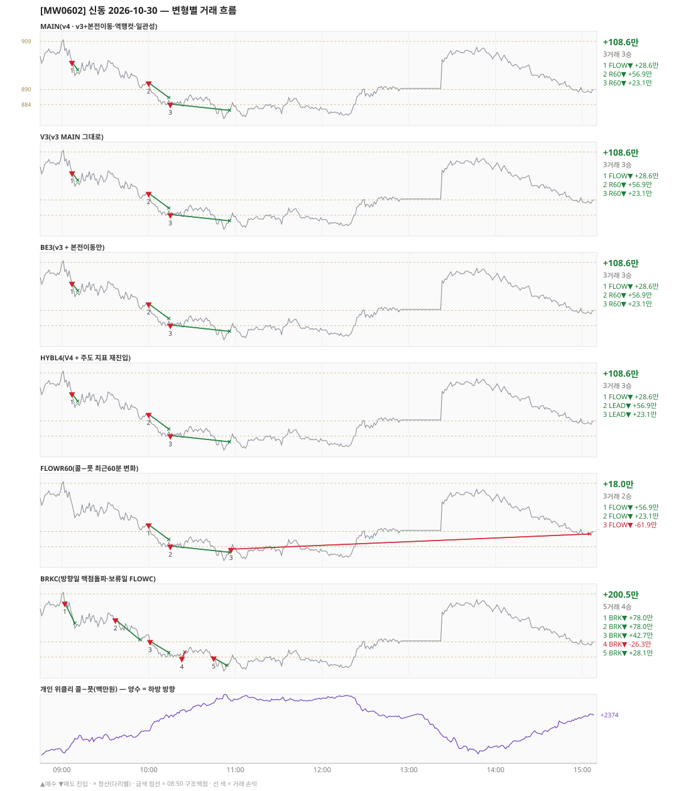

# [MW0602] 신동 일일 리포트 — 2026-10-30

> **MW0602 리포트** · 생성 2026-10-30 15:40 · 규격 `SD-2026-10-26-v4` · 상품 `wk_mon` (최근접 만기 월위클리 (만기 2026-11-02))
> **아래 변형 손익은 엔진 재생(가상)이다** — 장후 최종 흐름으로 하루를 다시 돌린 값. 미니선물 2계약 · CYBOS 요율 · 1틱 슬리피지 기준. **실제 체결 손익은 §2-1 실거래 대사.** 실주문 수량은 X%위험 규칙(ATR14)으로 이보다 적을 수 있다 — 아래 「실거래」 줄이 차이를 수량·체결로 나눈다. 진입가는 **진입봉 종가**(봉 마감 = 다음 분 :00 확정)이고 실주문은 그 뒤 수 초에 시장가로 나간다.

## 0. 한눈에

| 시장 | R1 장전 | R2 개장확정(V1) | R1 적중(09:00→15:05) |
|---|---|---|---|
| 908.82 → 889.00 (-19.82) · 고 910.98 · 저 877.76 · 폭 33.2pt | 콜−풋 +713 → **하방** | CONFIRMED 09:06 | ✅ 적중 |

| 변형 | 거래 | 승 | 규칙별 | **순손익** | 최악 거래 | MAIN 대비 | 기록 |
|---|---|---|---|---|---|---|---|
| MAIN(v4 · v3+본전이동·역행컷·일관성) | 3 | 3 | FLOW +28.6만 · R60 +79.9만 | **+108.6만** | +23.1만 | — | 재생(장중 기록) |
| V3(v3 MAIN 그대로) | 3 | 3 | FLOW +28.6만 · R60 +79.9만 | **+108.6만** | +23.1만 | +0.0만 | 재생(장중 기록) |
| BE3(v3 + 본전이동만) | 3 | 3 | FLOW +28.6만 · R60 +79.9만 | **+108.6만** | +23.1만 | +0.0만 | 재생(장중 기록) |
| HYBL4(V4 + 주도 지표 재진입) | 3 | 3 | FLOW +28.6만 · LEAD +79.9만 | **+108.6만** | +23.1만 | +0.0만 | 재생(장중 기록) |
| FLOWR60(콜−풋 최근60분 변화) | 3 | 2 | FLOW +18.0만 | **+18.0만** | -61.9만 | -90.6만 | 재생(장중 기록) |
| BRKC(방향일 맥점돌파·보류일 FLOWC) | 5 | 4 | BRK +200.5만 | **+200.5만** | -26.3만 | +91.9만 | 재생(장중 기록) |

**실거래(실제 체결)** — 3포지션 +57.5만 (1계약×3 · 재생은 2계약 가정) · 브로커 net +57.5만 · 재생 MAIN 과 차 -51.1만 = 수량 -54.3만 + 체결·비용 +3.2만 → §2-1

**오늘의 한 줄** — 실거래 +57.5만(1계약×3) · 재생 MAIN +108.6만(3거래 3승 · 2계약 가정, 실거래 수량 환산 +54.3만), 최선은 BRKC(방향일 맥점돌파·보류일 FLOWC) +200.5만(MAIN 대비 +91.9만).

## 1. 차트

## 2. 거래 흐름 — MAIN

| # | 규칙 | 방향 | 진입 | 맥점 | 손절 | 1차 · 최종 | 청산(다리별) | MFE | 손익 | 누적 |
|---|---|---|---|---|---|---|---|---|---|---|
| 1 | FLOW | 매도 | 09:07봉 종가 900.84 (확정 09:08) | - | 931.16 | 888.84 · 888.84 | 트레일 09:11 897.76 · 트레일 09:11 897.76 | 7.1 | **+28.6만** | +28.6만 |
| 2 | R60 | 매도 | 10:00봉 종가 892.70 (확정 10:01) | - | 923.02 | 880.70 · 880.70 | 트레일 10:14 886.80 · 트레일 10:14 886.80 | 9.9 | **+56.9만** | +85.5만 |
| 3 | R60 | 매도 | 10:15봉 종가 884.28 (확정 10:16) | - | 914.60 | 872.28 · 872.28 | 트레일 10:56 881.76 · 트레일 10:56 881.76 | 6.5 | **+23.1만** | +108.6만 |

## 2-1. 실거래 대사 — 실제 체결 vs 재생 MAIN

| # | 구분 | 신호 | 실거래 | 재생 MAIN | 비고 |
|---|---|---|---|---|---|
| 1 | 일치 | `FLOW\|09:07\|-1` | 09:08 매도 1계약 @900.88 · +14.6만 | 09:07봉 매도 @900.84 · +28.6만 | 차 -14.0만 (1계약 환산 차 +0.3만) |
| 2 | 일치 | `R60\|10:00\|-1` | 10:01 매도 1계약 @892.80 · +28.8만 | 10:00봉 매도 @892.70 · +56.9만 | 차 -28.0만 (1계약 환산 차 +0.4만) |
| 3 | 일치 | `R60\|10:15\|-1` | 10:16 매도 1계약 @884.52 · +14.0만 | 10:15봉 매도 @884.28 · +23.1만 | 차 -9.0만 (1계약 환산 차 +2.5만) |

| 구분 | 건 | 실거래 | 재생 MAIN |
|---|---|---|---|
| 일치 | 3 | +57.5만 | +108.6만 |
| **합** | | **+57.5만** | **+108.6만** |

- 브로커 실측 net(계좌 전체, `daily_broker_pnl` · -): **+57.5만** · 신동 실거래 합과 차 +12
- [v4] 본전청산 실측 슬립: 오늘 본전청산 일치 거래 없음
  - 누적 판정(R1 정렬 전/후 구간별 · 기준 구간 = 정렬 후): 정렬 후 0건 · 정렬 전(참고) 6건 평균 +0.04pt · 대기 6/20 · 오늘 정렬 후
- 진입 슬립(실거래 − 진입봉 종가, + = 불리): 오늘 3건 평균 -0.13pt · 최악 -0.04pt · 합 -1.9만(실수량) · 누적(2026-10-13~) 42건/14일 평균 -0.096pt · 표준편차 0.95 · t=-0.65
- 청산 슬립(재생 청산가 − 실청산, + = 불리 · 수동 제외): 오늘 3건 평균 +0.09pt · 최악 +0.20pt · 합 +1.4만(실수량) · 손절 청산 갱신창(:00~:01) 안 - / 밖 3건 평균 +0.09 · 그날 갱신 위상 :01 · 누적(2026-10-13~) 40건/14일 평균 +0.058pt · t=+0.55 · 창 안 - / 밖 3건 평균 +0.09
- 재생은 장후 최종 흐름으로 다시 돌린 값이라, 장중에 나왔다가 정정으로 사라진 신호(철회)는 빠지고 보유 중·늦음으로 못 친 신호는 들어간다. **실거래 손익은 이 절의 「실거래」 열이다.**

## 3. 섀도 흐름 — 변형별 거래(v1 계열은 V1 과 무엇이 달랐나)

### V3(v3 MAIN 그대로) — +108.6만 (MAIN 대비 +0.0만)

- 별개 규칙(family) — MAIN·V1 과 거래 단위 대조는 하지 않는다. 손익·최악·거래 수로만 비교

| # | 규칙 | 방향 | 진입 | 맥점 | 손절 | 1차 · 최종 | 청산(다리별) | MFE | 손익 | 누적 |
|---|---|---|---|---|---|---|---|---|---|---|
| 1 | FLOW | 매도 | 09:07봉 종가 900.84 (확정 09:08) | - | 931.16 | 888.84 · 888.84 | 트레일 09:11 897.76 · 트레일 09:11 897.76 | 7.1 | **+28.6만** | +28.6만 |
| 2 | R60 | 매도 | 10:00봉 종가 892.70 (확정 10:01) | - | 923.02 | 880.70 · 880.70 | 트레일 10:14 886.80 · 트레일 10:14 886.80 | 9.9 | **+56.9만** | +85.5만 |
| 3 | R60 | 매도 | 10:15봉 종가 884.28 (확정 10:16) | - | 914.60 | 872.28 · 872.28 | 트레일 10:56 881.76 · 트레일 10:56 881.76 | 6.5 | **+23.1만** | +108.6만 |

### BE3(v3 + 본전이동만) — +108.6만 (MAIN 대비 +0.0만)

- 별개 규칙(family) — MAIN·V1 과 거래 단위 대조는 하지 않는다. 손익·최악·거래 수로만 비교

| # | 규칙 | 방향 | 진입 | 맥점 | 손절 | 1차 · 최종 | 청산(다리별) | MFE | 손익 | 누적 |
|---|---|---|---|---|---|---|---|---|---|---|
| 1 | FLOW | 매도 | 09:07봉 종가 900.84 (확정 09:08) | - | 931.16 | 888.84 · 888.84 | 트레일 09:11 897.76 · 트레일 09:11 897.76 | 7.1 | **+28.6만** | +28.6만 |
| 2 | R60 | 매도 | 10:00봉 종가 892.70 (확정 10:01) | - | 923.02 | 880.70 · 880.70 | 트레일 10:14 886.80 · 트레일 10:14 886.80 | 9.9 | **+56.9만** | +85.5만 |
| 3 | R60 | 매도 | 10:15봉 종가 884.28 (확정 10:16) | - | 914.60 | 872.28 · 872.28 | 트레일 10:56 881.76 · 트레일 10:56 881.76 | 6.5 | **+23.1만** | +108.6만 |

### HYBL4(V4 + 주도 지표 재진입) — +108.6만 (MAIN 대비 +0.0만)

- 별개 규칙(family) — MAIN·V1 과 거래 단위 대조는 하지 않는다. 손익·최악·거래 수로만 비교

| # | 규칙 | 방향 | 진입 | 맥점 | 손절 | 1차 · 최종 | 청산(다리별) | MFE | 손익 | 누적 |
|---|---|---|---|---|---|---|---|---|---|---|
| 1 | FLOW | 매도 | 09:07봉 종가 900.84 (확정 09:08) | - | 931.16 | 888.84 · 888.84 | 트레일 09:11 897.76 · 트레일 09:11 897.76 | 7.1 | **+28.6만** | +28.6만 |
| 2 | LEAD | 매도 | 10:00봉 종가 892.70 (확정 10:01) | - | 923.02 | 880.70 · 880.70 | 트레일 10:14 886.80 · 트레일 10:14 886.80 | 9.9 | **+56.9만** | +85.5만 |
| 3 | LEAD | 매도 | 10:15봉 종가 884.28 (확정 10:16) | - | 914.60 | 872.28 · 872.28 | 트레일 10:56 881.76 · 트레일 10:56 881.76 | 6.5 | **+23.1만** | +108.6만 |

### FLOWR60(콜−풋 최근60분 변화) — +18.0만 (MAIN 대비 -90.6만)

- 별개 규칙(family) — MAIN·V1 과 거래 단위 대조는 하지 않는다. 손익·최악·거래 수로만 비교

| # | 규칙 | 방향 | 진입 | 맥점 | 손절 | 1차 · 최종 | 청산(다리별) | MFE | 손익 | 누적 |
|---|---|---|---|---|---|---|---|---|---|---|
| 1 | FLOW | 매도 | 10:00봉 종가 892.70 (확정 10:01) | - | 923.02 | 880.70 · 880.70 | 트레일 10:14 886.80 · 트레일 10:14 886.80 | 9.9 | **+56.9만** | +56.9만 |
| 2 | FLOW | 매도 | 10:15봉 종가 884.28 (확정 10:16) | - | 914.60 | 872.28 · 872.28 | 트레일 10:56 881.76 · 트레일 10:56 881.76 | 6.5 | **+23.1만** | +79.9만 |
| 3 | FLOW | 매도 | 10:57봉 종가 883.02 (확정 10:58) | - | 913.34 | 871.02 · 871.02 | 시간 15:05 889.00 · 시간 15:05 889.00 | 4.5 | **-61.9만** | +18.0만 |

### BRKC(방향일 맥점돌파·보류일 FLOWC) — +200.5만 (MAIN 대비 +91.9만)

- 별개 규칙(family) — MAIN·V1 과 거래 단위 대조는 하지 않는다. 손익·최악·거래 수로만 비교

| # | 규칙 | 방향 | 진입 | 맥점 | 손절 | 1차 · 최종 | 청산(다리별) | MFE | 손익 | 누적 |
|---|---|---|---|---|---|---|---|---|---|---|
| 1 | BRK | 매도 | 09:02봉 종가 905.40 (확정 09:03) | 909.0 | 911.00 | 897.40 · 897.40 | 1차 09:09 897.40 · 최종 09:09 897.40 | 10.4 | **+78.0만** | +78.0만 |
| 2 | BRK | 매도 | 09:37봉 종가 898.84 (확정 09:38) | 899.0 | 901.00 | 890.84 · 890.84 | 1차 09:54 890.84 · 최종 09:54 890.84 | 8.2 | **+78.0만** | +156.1만 |
| 3 | BRK | 매도 | 10:01봉 종가 890.28 (확정 10:02) | 892.0 | 894.00 | 882.28 · 882.28 | 트레일 10:14 885.80 · 트레일 10:14 885.80 | 7.5 | **+42.7만** | +198.7만 |
| 4 | BRK | 매도 | 10:23봉 종가 883.58 (확정 10:24) | 884.0 | 886.00 | 875.58 · 875.58 | 손절 10:25 886.00 · 손절 10:25 886.00 | 0.6 | **-26.3만** | +172.4만 |
| 5 | BRK | 매도 | 10:45봉 종가 883.78 (확정 10:46) | 884.0 | 886.00 | 875.78 · 875.78 | 트레일 10:54 880.76 · 트레일 10:54 880.76 | 6.0 | **+28.1만** | +200.5만 |

## 4. 누적 채점 (라이브 기록 · 판정 창)

| 변형 | 채점 시작 | 거래일 | 거래 | 승률 | 순손익 | 최악일 | R3 (건 · 승률 · 순) | 판정 |
|---|---|---|---|---|---|---|---|---|
| MAIN(v4 · v3+본전이동·역행컷·일관성) | 2026-10-26 | 5 | 18 | 50% | **+179.4만** | -115.7만 | 0 · - · +0.0만 | v4 vs V3 되돌림 판정 5/20일 |
| V3(v3 MAIN 그대로) | 2026-10-26 | 5 | 13 | 92% | **+477.8만** | -115.7만 | 0 · - · +0.0만 | 되돌림 기준 5/20일 |
| BE3(v3 + 본전이동만) | 2026-10-26 | 5 | 18 | 50% | **+147.7만** | -115.7만 | 0 · - · +0.0만 | MAIN 비교 5/20일 |
| HYBL4(V4 + 주도 지표 재진입) | 2026-10-26 | 5 | 18 | 50% | **+201.8만** | -115.7만 | 0 · - · +0.0만 | MAIN 비교 5/20일 |
| FLOWR60(콜−풋 최근60분 변화) | 2026-10-26 | 5 | 14 | 79% | **+269.6만** | -89.5만 | 0 · - · +0.0만 | MAIN 비교 5/20일 |
| BRKC(방향일 맥점돌파·보류일 FLOWC) | 2026-10-26 | 5 | 21 | 38% | **+195.2만** | -139.6만 | 0 · - · +0.0만 | MAIN 비교 5/20일 |
| **실집행(실제 체결 · 참고)** | 2026-10-26 | 5 | 18 | 72% | **+85.9만** | -61.1만 | - | 판정 기준 아님 |

> 판정 전 집계다 — 인용·규격 변경 근거로 쓰지 말 것. 되돌림: V3 가 MAIN 보다 순손익·최악일 **둘 다** 나으면 v3 복귀. 섀도: MAIN 대비 순손익 우위 **그리고** 최악일 개선 → 채택 후보(자동 승격 없음).
> 「실집행」 = `trades.db` 신동 체결(포지션 단위, 거래일 = 체결이 있던 날). 재생에서 철회됐지만 실제로 친 거래가 **들어가고**, 보유 중·늦음·기각으로 못 친 재생 거래는 **빠진다**. 사전등록 판정은 위 재생 행으로만 한다.

## 5. 러너 섀도 — 미륵이 × 신동 (CREON 요율)

- 오늘 기록 없음 — 미륵이 시스템 진입이 없었거나 장후 기록 전이다

## 6. 개선 방향 (자동 관찰 — 판정 아님)

- **오늘 최선은 BRKC(방향일 맥점돌파·보류일 FLOWC)** (+200.5만, MAIN 대비 +91.9만). 하루 결과다 — 판정은 사전등록 창(20거래일)으로만.
- **되돌림 대조** — V3(v3 MAIN 그대로) +108.6만 vs MAIN +108.6만 (차 +0.0만). 되돌림 판정은 20거래일 누적으로만.
- ⚠ 규격 변경은 사전등록 §6(새 버전 · 재채점)으로만. 이 절은 관찰이다.

---
재생성: `python scripts/shindong_daily_report.py 2026-10-30`
